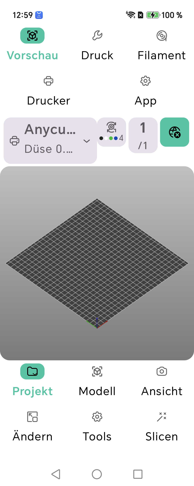

# Farbmalen: GL-Eingabe, Vorschau und Plattenstabilität — 2026-10-27

- Pinselbewegungen werden auf dem UI-Thread zu einem GL-Drain zusammengefasst statt jede Bewegung als native Mesh-Neuberechnung aufzureihen. Ausgelassene Punkte des Pinselpfads werden interpoliert; der letzte Punkt wird vor Stroke-Ende angewendet und die Vorschau abschließend aktualisiert.
- Beim Start des Farbmodus wird die kompakte globale Filament-Schaltfläche bereits während des Renderer-Wechsels ausgeblendet. Damit erscheinen nicht kurzzeitig zwei konkurrierende Filamentanzeigen.
- Android-16-Emulator, `InitialProjectMenuDeviceTest.colorPaintDraftIsVisibleBeforeConfirmAndCancelPreservesModel`: 1/1 bestanden. Der Test flutet die Eingabe mit schnellen Bewegungen, prüft sichtbare Livefarbe vor „Fertig“, genau eine Filamentpalette, gültige Druckplatte und unveränderte Modellzuordnung nach Abbrechen.
- Android-16-Emulator, `InitialProjectMenuDeviceTest.supportSeamAndFuzzyPaintCommitRealCanvasStrokesAndUndoRedo`: 1/1 bestanden. Debug- und Slice-Unit-Variante: `PaintInputCoalescerTest` 2/2 bestanden.
- Xiaomi-Hardwareprüfung bleibt offen; verfügbar war der Android-16-Emulator. Kein echter Druck wurde gestartet.

# Live-Farbmalen: Vorschauleistung und sichtbare Palette — 2026-10-27

- Die Farbmalvorschau baut ihre Filament-Overlays nun in einem nativen Durchlauf. Zuvor wurden die unveränderten Volumen einer mehrteiligen 3MF für jeden Filamentslot erneut deserialisiert; auf langsameren Geräten konnte dies die Live-Aktualisierung verzögern. Die neue Routine erzeugt die GL-Geometrie direkt und hält keine zusätzliche komplette Kopie aller indizierten Overlay-Meshes im Arbeitsspeicher.
- Der gedockte Farbmalbereich wurde von 22 % auf 30 % der verfügbaren Arbeitsfläche (32 % bei Systemschrift ab 130 %) vergrößert. Der vorherige Wert ließ die Slotpalette im scrollbaren Panel unterhalb des sichtbaren Bereichs liegen. Die restlichen Werkzeugoptionen bleiben scrollbar; der Renderer behält mindestens 68 % der Fläche.
- Android-16-Emulator: `TwoColorProjectDeviceTest.livePaintPreviewKeepsImportedColorsAcrossAllPartsOfACombinedObject` 1/1 bestanden. Der Test vergleicht die Live-Geometrie für mehrere Filamentslots mit den gespeicherten 3MF-Volumenfarben und prüft die Vorschau einer neuen Grundfarbe.
- Android-16-Emulator: `InitialProjectMenuDeviceTest.colorPaintDraftIsVisibleBeforeConfirmAndCancelPreservesModel` 1/1 bestanden. Pixelprüfung bestätigt die neue Farbe vor „Fertig“; Abbrechen erhält die ursprüngliche Filamentzuordnung. `supportSeamAndFuzzyPaintCommitRealCanvasStrokesAndUndoRedo` 1/1 bestanden.
- Ein vorhandener Layouttest fand zuerst die außerhalb des sichtbaren Panels liegende Filamentpalette bei 22 %. Nach der Vergrößerung bestand `editPaintActionsOpenTheirGlModesAndBackCancelsWithoutMeshMutation` 1/1; die Druckplatte blieb gültig, jeder Slot hatte genau ein Feld und Back/Abbrechen erhielten das Modell.
- JVM-Suites nach der Änderung: Debug 659/659 und Slice 659/659 bestanden, jeweils 0 Fehler, Errors oder Skips. Vier gezielte Android-Instrumentierungstests bestanden nach der Korrektur.
- Kein APK-Build oder Release in diesem Schritt. Die Xiaomi-Hardwareprüfung bleibt offen; verfügbar war nur der Android-16-Emulator. Kein echter Druck wurde gestartet.

# Mehrfarben-Kopien und Modellbearbeitung — Nachprüfung 2026-10-26

- Der bestehende Bett-füllen-Test färbt jetzt zusätzlich echte Dreiecksflächen eines 3MF-Objekts auf Slot 3. Er prüft die Quellzuordnung, beide erzeugten Kopien, den 3MF-Export/Rundlauf und die tatsächlich ausgegebenen Werkzeuge T0/T1/T2. Android-16-Emulator: 1/1 bestanden.
- Bestehende Rundläufe erneut gezielt geprüft: bemalte Flächen über Multipart-Verbindung → 3MF → Slice 1/1; Boolean-Union 1/1; eigenständiger druckbarer 3D-Text 1/1. Kein tatsächlicher Druckstart.
- M12-Touch-/Raycast-/Workspace-Gerätetest auf Android 16 1/1 bestanden. Der Test erzeugt den Standard-M12-Bolzen, lädt ihn, pickt die Oberfläche präzise und prüft Dialog-Back sowie Auswahlzustand. Die früheren Testfehler kamen vom injizierten rohen `KEYCODE_BACK` in Compose-Dialogfenstern; der App-Back-Dispatcher wird nun direkt geprüft. Die AVD blendete in dieser Konfiguration keine Bildschirmtastatur ein; deren Sichtbarkeit wurde deshalb als nicht verfügbar protokolliert.
- Änderungen dieses Durchgangs betreffen ausschließlich Instrumentierungstests. Es gab keine Änderung am App-Laufzeitcode und keinen neuen APK-Build. Der aktuelle reguläre Release bleibt `v0.8.389`; APK und SHA-256 stehen im folgenden Release-Eintrag. Xiaomi-Hardwareprüfung bleibt offen.

# OrkanSlicer 0.8.389 — transactional bed fill — 2026-10-26

- Production change: extracted fill-bed candidate packing into `FillBedModelOperation`. Every candidate now begins from the original model state; failed or throwing arrangement attempts delete speculative copies and restore original positions. Only the largest accepted placement is committed into the working snapshot. Existing GL-thread arrangement and stale-state guarded commit in `GLView` remain unchanged.
- Code change commit: `84370a23be3b293e4f7f75ea3e6045d59112a241`; release/version commit: `9d992e23b82631cd55d957c6b157d74cdf99324b`. Version 0.8.389 / versionCode 424.
- Android 16 emulator instrumentation: `ModelEditingNativeDeviceTest` 46/46 passed (0 failures/errors/skips; XML timestamp `2026-10-26T15:24:55`). Dedicated `NativeSliceDeviceTest.fillBedCopiesPreserveMaterialThroughThreeMfReloadAndSlice` passed 1/1: three arranged objects kept T1 through 3MF export/reload, then generated extrusion G-code with T1 and without an unexpected T0 tool selection (XML timestamp `2026-10-26T15:09:42`).
- Additional UI-level Android 16 checks: no-fit placement, filament preservation with Undo/Redo, and arrange-failure rollback passed 3/3 (0 failures/errors/skips; XML timestamp `2026-10-26T15:48:09`).
- Post-release multicolor regression: the full `ThreeMfMulticolorDeviceTest` class passed 6/6 (0 failures/errors/skips; XML timestamp `2026-10-26T15:53:40`). Its new fill-bed case selected the middle object from a three-color 3MF, kept untouched objects at slots 1 and 3, assigned both copies to slot 2, reloaded all five objects from 3MF, and verified generated G-code used T0, T1, and T2. Test-only follow-up; runtime APK and v0.8.389 asset are unchanged.
- JVM suites: Debug 658/658 and Slice 658/658 passed, with zero failures/errors/skips. `:app:assembleDebug` succeeded.
- APK: `OrkanSlicer_9d992e23b8.apk`, 239,558,936 bytes; SHA-256 `F92B65A2194138180027CE3A8D7651C79862CB57345E25A414DAB35EDE82AB2D`. Installed and started on the Android 16 emulator; Android reported version 0.8.389/code 424, process remained active, sampled logs had no crash/ANR/OOM/fatal-signal match.
- Regular, non-prerelease GitHub release: https://github.com/Exa201/OrkanSlicer/releases/tag/v0.8.389. Release asset digest matches the local APK. APK is debug-signed; Xiaomi hardware verification remains open. No printer was contacted and no print was started.

# Objektverbindung weist ungültige Transformationen vor der Änderung zurück — 2026-10-26

- Die native Multipart-Verbindung prüft nun Ziel-, Instanz-, Volumen- und zusammengesetzte Welttransformationen auf endliche Werte und Invertierbarkeit, bevor Volumen vorbereitet oder Quellobjekte verändert werden. Damit kann eine beschädigte/importierte Null- oder Nicht-Endlich-Transformation nicht durch die inverse Zielmatrix in verbundene Geometrie übergehen.
- Android 16: Der neue Test bestätigt, dass die öffentliche Skalierung Nullskalierung verwirft und die unveränderten Ziel-/Quellobjekte danach als druckbare Multipart-Geometrie verbinden kann (1/1). In demselben gezielten Lauf bestanden ungültige JNI-Eingaben, Flächenplatzierung mit 3MF-Rundlauf, eigenständiger 3D-Text mit Join/Slicing und Boolean-Union/Slicing (4/4). Zusammen 5 unterschiedliche Gerätetests bestanden; kein echter Druckstart.
- Zusätzliche Join-/Platzierungsregression auf Android 16: Standard-Join mit Filamentzuordnung, gedrehter nichtuniform skalierter Join, ungültige Join-Rollbacks, Einzelobjekt-Flächenplatzierung und Gruppen-Flächenplatzierung bestanden (5/5). `:app:connectedSliceTestAndroidTest` erfolgreich.
- Die isolierte Testkorrektur prüft die Summe beider Volumendreieckzahlen nach dem Join. Die vorherige Testfassung erwartete fälschlich nur die Dreieckzahl eines Einzelobjekts; das war kein Produktionsfehler.
- Kein neuer APK-Build oder Release in diesem Schritt. Die öffentlich verfügbare `v0.8.386` enthält diese nachträgliche Join-Transformationsprüfung noch nicht.

# OrkanSlicer 0.8.386 — native Boolean guards and release — 2026-10-26

- Native code commit: `ad829bde2fef2c557f50ba091331b4c8987e3eb8`; release/version commit: `84c61da29c9c0c2acacad6c4dfd99bb20b5fa7df`. Version 0.8.386 / versionCode 421.
- Native Boolean operations now reject invalid object, instance, volume, and transform state before mesh evaluation. Union, difference, and intersection validate that each result's volume is consistent with the operation before changing the model.
- Android 16 focused instrumentation at the native patch: 5/5 Boolean tests passed, covering multiple cutters, invalid requests without mutation, 3MF reload, placement, and subsequent slicing. A further 0.8.386 run passed `booleanUnionConsumesEverySelectedToolAndSlicesTheCombinedResult` (1/1).
- Full JVM suites at 0.8.386: Debug 658/658 and Slice 658/658 passed; 0 failures, errors, or skips. `:app:assembleDebug` succeeded.
- Changelog device test confirmed the 0.8.386 release text renders, but its final Android-Back dismissal assertion failed in the test harness. Repeated runs showed the test Activity root had no window focus while the Compose `Dialog` owns the focused window (Espresso reported `RootViewWithoutFocusException`). The release note dialog's production behavior was not independently confirmed by this harness; track a focused-window Back test separately.
- APK `OrkanSlicer_84c61da29c.apk`: 239,557,429 bytes; SHA-256 `BC30DD8893FD6C5EA630B45924D470E39BAD9022A654314871480BA40CE39446`. Installed and launched on Android 16 emulator; package reported 0.8.386 / 421. The sampled logcat had no fatal exception, ANR, OOM, or fatal signal.
- Published as regular latest release `v0.8.386`: https://github.com/Exa201/OrkanSlicer/releases/tag/v0.8.386. Tag targets `84c61da29c9c0c2acacad6c4dfd99bb20b5fa7df`; GitHub asset digest matches the local APK. Debug-signed; no production signing key is configured.
- PR #2 remains open. No merge, firmware action, or print start occurred.

# STL-Preflight-Test benötigt kein großes Fixture mehr — 2026-10-24

- Der Grenztest für `StlImportPreflight` legt keine 25-MB-Binär-STL mehr an. Eine pure interne Policy-Prüfung testet 500.000/500.001 Dreiecke und die erwartete deklarierte Binärlänge; zusätzlich prüft eine 6-Dreiecke-Datei den echten Headerlesepfad.
- `StlImportPreflightTest` gezielt bestanden. Vollständige Slice-JVM-Suite **625/625 bestanden**, XML `2026-10-24T06:05:05.760Z`. Im danach folgenden Debug-Kotlin-Task scheiterte der zusammengefasste Gradle-Aufruf wegen fehlendem Speicherplatz beim Auflösen der Plugin-/Classpath-Snapshot-Abhängigkeiten. Deshalb keine aktuelle Debug-Suite-Verifikation und kein APK-Build.

# Adaptive Schichthöhenprofile unterstützen Undo/Redo — 2026-10-24

- Korrektur: Nach erfolgreichem Anwenden oder Löschen des nativen adaptiven Layer-Height-Profils ruft das Panel jetzt den bestehenden BedFragment-Verlaufssnapshot auf. Damit sind beide Operationen rückgängig und wiederherstellbar; Fehlerfälle werden nicht als abgeschlossene Änderung verbucht.
- Honor PTP-N49 / Android 16: `InitialProjectMenuDeviceTest#adaptiveLayerHeightApplyAndClearSupportUndoRedo` 1/1; `GlModePanelsComposeDeviceTest#variableLayerHeightPanelShowsStatusAndReturnsFromMode` 1/1. Zusätzlich Support-/Naht-/Fuzzy-Pinsel 1/1 und Mehrfarben-Pinsel 1/1 bestanden.
- Debug-JVM 625/625 bestanden. Slice-JVM: 625 Tests ausgeführt, 624 bestanden, einer wegen fehlendem Plattenplatz beim Erzeugen des 25-MB-Fixtures in `StlImportPreflightTest` fehlgeschlagen; Laufwerk C: meldete 0 Byte frei. Kein APK-Build, keine 3MF-Rundlauf-/Slice-Prüfung dieser Funktion in diesem Durchgang.

# GL-Paint-Modi: echte Canvas-Bearbeitung — 2026-10-24

- Auf Honor PTP-N49 / Android 16 bestanden `InitialProjectMenuDeviceTest#supportSeamAndFuzzyPaintCommitRealCanvasStrokesAndUndoRedo` (1/1) und `InitialProjectMenuDeviceTest#colorPaintPanelAcceptsRealCanvasTouchAndUndoRestoresFacetAssignments` (1/1).
- Der neue Test führt einen echten GL-Canvas-Pinselstrich für Support-, Naht- und Fuzzy-Malen aus, prüft die Vorschau, verwirft den Pinselstrich mit Android-Back, öffnet das Werkzeug erneut, bestätigt die Änderung und liest danach den jeweiligen nativen Facettenkanal über eine temporäre `PaintSession`. Undo entfernt die Markierung, Redo stellt sie wieder her. Der Farbmaltest bestätigt weiterhin die Farbzuweisung und Undo/Redo.
- `Model.hasPaint()` wird hier nicht als Prüforakel genutzt: Der native Helfer meldet ausschließlich Mehrfarben-Segmentierung, nicht die Support-/Seam-/Fuzzy-Annotationen. Es wurde kein Produktionscode geändert. Vollständige JVM-Suiten und APK-Build wurden in diesem Durchgang nicht ausgeführt.

# STEP/STP-Import auf Release-Stand gebracht — 2026-10-24

- Ursache der weiter gemeldeten Nichtöffnung: GitHub führte `v0.8.366` als neuestes offizielles Release. Die bereits behobene native STEP-Threadstabilisierung aus Commit `88733d62` lag nach dem im Release eingebauten Code-Commit `82540095` und war deshalb noch nicht in der herunterladbaren App enthalten.
- Aktueller Branch-Stand: `.step`, `.stp`, Groß-/Kleinschreibung, Android-Dateiauswahl, externe Dateiübergabe und der Orca-artige Meshingdialog vor dem Laden sind vorhanden. Der Dialog bietet lineare und winklige Abweichung sowie Compound-Aufteilung.
- Verifikation auf Honor PTP-N49 / Android 16 am aktuellen Code `03f4ec34`: nativer STEP/STP-Import 2/2; Projektpicker → geänderte Meshingoptionen → renderbares Modell 1/1; externer `ACTION_VIEW`-Pfad → Optionen vor dem Import → renderbares Modell 1/1. `ModelImportFileNameTest` 4/4 und `StepImportOptionsTest` 3/3 bestanden. Kein Druckstart.
- Vollständige Debug-JVM- und Slice-JVM-Suiten: je 625/625 bestanden, keine Fehler oder Skips. `:app:assembleDebug` erfolgreich.
- Finaler Code-Commit `665551ee323134ff0657d2547e8e47a829ba81fc`; APK `OrkanSlicer_665551ee32.apk`, 239,425,451 Bytes, SHA-256 `08592680C92BA0B89FEBBD23A0BDA2EF033FFCE60038A010C1EA44EE865656B6`.
- APK auf Honor PTP-N49 installiert und gestartet; Android meldet Version 0.8.367 / code 402, MainActivity im Vordergrund. Logcat-Stichprobe ohne Crash, ANR, OOM oder Fatal Signal.
- Regulärer Release: [v0.8.367](https://github.com/Exa201/OrkanSlicer/releases/tag/v0.8.367), APK und SHA-256-Sidecar angehängt. PR #2 Branch auf den Code-Commit aktualisiert; kein Merge.
- Der konkrete Xiaomi-Dateimanager und die Nutzerdatei wurden nicht getestet. Nächster Schritt: OrkanSlicer UI-2.0-Arbeit fortsetzen; bei einem weiter auftretenden Xiaomi-Fehler dessen Dateimanager-Übergabe anhand der neuen Version diagnostizieren.

# OrkanSlicer 0.8.365 — Gruppenplatzierung rollback-sicher gemacht — 2026-10-23

- Product build commit: `795f85ffbffad909233c920fd6af39fe74ce02cf`; enthält die getestete Platzierungstransaktion aus `37a1745c`. Version 0.8.365 / versionCode 400.
- Debug- und Slice-JVM: je 625/625 bestanden, keine Fehler oder übersprungenen Tests. Vier `ModelPlacementTransactionTest`-Fälle verifizieren Commit-Erfolg, negativen Join-Rückgabewert, Exception-Rollback und Rollback bei fehlgeschlagener Bewegung.
- Honor PTP-N49 / Android 16: Gruppen-Flächenplatzierung (nach abschließendem Cleanup-Fix erneut 1/1), Gruppenverbinden, Boolean-Differenz mit Undo/Redo und eigenständiger 3D-Text jeweils erfolgreich geprüft. STEP/STP auf unverändertem Importcode erneut: 8/8 Gerätefälle, dazu STEP-Dateinamen-/Optionen-JVM-Tests 7/7.
- `:app:assembleDebug` erfolgreich. APK `OrkanSlicer_795f85ffbf.apk`, 239,425,221 Byte, SHA-256 `437f01187d9252f31d29d47c0bc113c9e3fad47993b848cfb4e83355f76086d6`. Auf Honor installiert; Paket meldet 0.8.365 / code 400; `MainActivity` war im Vordergrund; Logcat-Stichprobe ohne Crash, ANR, OOM oder Fatal Signal.
- Regulärer GitHub-Release: [v0.8.365](https://github.com/Exa201/OrkanSlicer/releases/tag/v0.8.365), Asset `OrkanSlicer_795f85ffbf.apk` samt SHA256-Sidecar. GitHub meldet denselben APK-SHA-256. **Tag-Hinweis:** `gh release create` legte den fehlenden Tag auf den Repository-Default-Branch und damit auf `e48f93a6c85ba17076cc20bc0e4f6a360708d762` (`master`), obwohl die APK nachweislich aus `795f85ff` gebaut wurde. Die Tag-Referenz wurde nicht gelöscht oder verschoben.
- Branch `codex/rinkhals-safe-start-audit` ist auf `795f85ff`; PR #2 offen. Kein Merge, kein Druckstart.

# GL-thread-sichere Reset- und Paint-Menüaktionen — 2026-10-23

# OrkanSlicer 0.8.359 — 2026-10-23

- Release-Code-Commit: `18df3e8b206b030ea2cbf5643098b25be97080e8`; Version `0.8.359` / code `394`.
- Debug-Unit: 621/621; Slice-Unit: 621/621; Honor PTP-N49 / Android 16: 14 gezielte Modellaktions-/Slicing-Tests bestanden (Z-Position, Objektverbindung, Flächenplatzierung, Boolean-Union/Difference/Intersection, Text, SVG, 3MF-Roundtrip/G-Code). Changelog-Instrumentierung mit neuer Versionsanzeige: 1/1.
- Debug-APK `OrkanSlicer_18df3e8b20.apk`, 239.394.907 Byte, SHA-256 `003557E3F08031909F1A0CE65FEA611C775DDF09734BE9547C5D478A85BD2358`. Auf Honor installiert und gestartet; MainActivity war im Vordergrund. Der geprüfte Logcat-Ausschnitt enthielt keine Crash-, ANR- oder OOM-Treffer.
- Signierung: Debug-Schlüssel, weil im Projekt kein Produktions-Release-Schlüssel konfiguriert ist. Kein Druck wurde gestartet.
- Offizieller GitHub-Release `v0.8.359`: https://github.com/Exa201/OrkanSlicer/releases/tag/v0.8.359. Der Tag zeigt auf den geprüften Code-Commit; APK-Asset und GitHub-Digest stimmen mit dem lokalen Build überein. PR #2 wurde auf den Dokumentations-/Verifikationscommit aktualisiert und bleibt offen.
- Zusätzliche Regression nach der Veröffentlichung: der vollständige `GLView`-Touchtest nutzt nun den erzeugten Standard-M12-Bolzen statt eines kleinen Würfels. Auf Honor wurde Laden, erstes Raycast-Picken, Objektmenü/Long-Press und Abwählen auf dem echten Workspace-Touchpfad mit dem nativen Raycaster 1/1 bestanden. Ein sofortiger Testassert auf den asynchron gelieferten Simplify-Dialog wurde durch begrenztes Warten ersetzt; der Produktdialog blieb unverändert.

- Reset-Drehung und Reset-Skalierung lösen die Objekt-ID jetzt im GL-Queue aus. Stützstruktur-, Naht-, Fuzzy- und Farbmalen lesen Modell, Zielobjekt und Polygonzahl ebenfalls auf GL; bei späterem Modell-/Auswahlwechsel wird kein falsches Objekt gestartet. Explizite Aufrufe mit festem Objektindex bleiben kompatibel.
- Honor PTP-N49 / Android 16: Reset-Drehung inkl. Undo/Redo, Reset-Skalierung inkl. Abbrechen/Bestätigen/Undo/Redo und alle vier Paint-Modi inkl. Back-Abbruch ohne Meshmutation bestanden (3/3). Direkter Paint-Lifecycle/Workspace-Host nach Kompatibilitätsfix zusätzlich 1/1 bestanden.
- Debug-JVM 621/621, Slice-JVM 621/621, Debug-Build erfolgreich. APK `OrkanSlicer_2a401883a4.apk` aus Code-Commit `2a401883`, 239.394.959 Byte, SHA-256 `BE001543D2CBE725C0A851C86CA65137FD5BD14B40895064618E4899B12D0D47`; auf Honor installiert und gestartet. Im erfassten Logcat keine Crash-, ANR- oder OOM-Treffer. Kein Druck gestartet.

# STEP/STP-Öffnung — 2026-10-23

- Ursache des auf einigen Datei-Apps fortbestehenden Fehlers: Der offizielle Release `v0.8.354` stammt von Commit `170ec587` und liegt vor der Korrektur `f3dd9d6a`. Bestimmte Apps senden `ACTION_SEND` und übergeben die Datei-URI ausschließlich über `ClipData`, nicht `EXTRA_STREAM`; der ältere Release extrahierte diese URI deshalb nicht.
- Der aktuelle Branch extrahiert `ClipData` und `EXTRA_STREAM`. Die End-to-End-Geräteregression verwendet jetzt ausdrücklich eine ClipData-only-Übergabe, zeigt den STEP-Meshingdialog vor dem Import, prüft Abbrechen ohne Modelländerung und lädt nach Bestätigung ein renderbares Netz.
- Honor PTP-N49 / Android 16: `StepOpenIntentDeviceTest` 2/2 bestanden; `externalStepDocumentUriShowsMeshingOptionsBeforeLoadingRenderableModel` 1/1 mit `ACTION_VIEW` und ClipData-only `ACTION_SEND` bestanden. Kein Druckstart.
- Debug- und Slice-Unit-Suiten: jeweils 621/621 bestanden, 0 übersprungen/fehlgeschlagen. `:app:assembleDebug` erfolgreich. APK `OrkanSlicer_c028aa77c6.apk`, 239.376.924 Byte, SHA-256 `FBA1F4FF75885B30F59A19EEFFC6FA65D5D740B1233BB4CC0F14B75F4EC226E3`, BuildConfig-Code-Commit `c028aa77c63e090f3fb152f4b7a69cf054e2af3c`.
- Auf Honor PTP-N49 installiert und gestartet; Paket meldet Version 0.8.355 / code 390. STEP/STP-Auflösung durch Android bestätigt. Geprüfter Logcat-Ausschnitt enthält keinen App-Crash, ANR oder OOM.
- Offizieller GitHub-Release `v0.8.355`: https://github.com/Exa201/OrkanSlicer/releases/tag/v0.8.355. PR #2 bleibt offen und zeigt Commit `c028aa77c63e090f3fb152f4b7a69cf054e2af3c`.
- Xiaomi-Dateimanager-Verhalten bleibt auf Xiaomi selbst unbestätigt; der veröffentlichte Release enthält nun den ClipData-Fix. Keine echte Druckaktion.

# STEP/STP-Dateifreigabe — 2026-10-23

- Datei-Apps können neben `ACTION_VIEW` auch `ACTION_SEND`/`ACTION_SEND_MULTIPLE` nutzen. Die Activity registriert und verarbeitet diese Übergaben jetzt einschließlich `EXTRA_STREAM` und `ClipData`; STEP-Dateien öffnen weiterhin zuerst den Meshing-Optionsdialog.
- Honor PTP-N49 / Android 16: `StepOpenIntentDeviceTest` 2/2, STEP-`ACTION_VIEW`/`ACTION_SEND`-Dialog-/Abbruch-/Importablauf 1/1 und nativer `.step`-/`.stp`-Import 1/1 bestanden. Emulator Android 16: `StepOpenIntentDeviceTest` 2/2. Debug-Unit-Suite 617/617, gezielte Slice-JVM-Tests 7/7; Debug-Build erfolgreich. Keine echte Druckaktion ausgeführt.
- Neue Debug-APK wurde erstellt. Kein offizielles Release in diesem Durchgang.

# STEP/STP-Import und Interaktionsstart — 2026-10-22

- Ursache eingegrenzt: STEP/STP-Erkennung, Einstellungsdialog und nativer Import waren bereits vorhanden. Bei direktem Dateistart bzw. frühem Rücklauf des Dateiauswahldialogs konnte der Workspace-Compose-Overlayhost noch nicht bereit sein. Der bisherige Fehlerpfad löschte dann die zwischengespeicherte Datei, statt auf den Host zu warten.
- Behoben: der Import wartet bis zu 10 Sekunden auf den Workspace-Dialoghost. Erst wenn dieser wirklich nicht verfügbar wird, erscheint eine konkrete Meldung. Ein kurzer Fragment-/Overlay-Lifecycle-Rennzustand verwirft die Datei nicht mehr.
- Honor PTP-N49 / Android 16: Regressionstest mit absichtlich verzögert bereitgestelltem Overlayhost bestanden (1/1). Er bestätigt, dass vor der Bestätigung kein Modell geladen wird und danach ein renderbares Dreiecksnetz erscheint. Android-Testquellen kompiliert; gezielter JVM-Test `StepImportOptionsTest` erfolgreich. `git diff --check` erfolgreich.
- Version bleibt 0.8.349 / code 384; dies ist ein noch unveröffentlichter Bugfix-Stand. In diesem Schritt wurde kein Release erstellt.

# Post-release KromaCut fixture and repeated-slot assignment — Honor, 2026-10-22

- The user-provided `kromacut-1792184183294-kromacut-2026-10-16.3mf` was staged only in the isolated `sliceTest` app's external-files directory on Honor PTP-N49 / Android 16 (SHA-256 `9720EB903A6037C10F3179CA8F9557B99147660EB842A6570C6B1AE0FDC3469F`). `KromaCutThreeMfDeviceTest`: 3/3 passed, 0 failures/errors/skips. Coverage includes independent import-choice combinations, own-settings vs embedded settings, palette recoloring and paint followed by real slicing, and the reported T0→white ACE2 / T1→blue ACE4 mapping. The emitted native G-code retained both used tools and the selected white/blue palette; the G-code preview palette matched the native slicer result.
- The two-object Compose assignment test passed 1/1: two separate objects can both select the same white filament slot. The native color-remapping 3MF round-trip + G-code test passed 1/1, verifying remapped material tools after reload.
- `NativeSliceDeviceTest` passed 13/13 on the same device with zero skips/failures/errors. This run exercises multipart joining, precise surface placement through 3MF reload and slicing, native Boolean union/difference/intersection, standalone printable text, and the material/G-code regressions. `git diff --check` passed; no production code changed after the release.
- The fixture was removed from the test package external-files directory after the run. The source attachment was not altered or added to Git. No real MMU query or printer connection occurred; tests used a synthetic MMU snapshot and never started a print. No production source changed after v0.8.349.

# OrkanSlicer 0.8.349 official release — 2026-10-22

- App code/release commit: `7a3ab0f0b9faf04abe5fc876e26f3535c5a002d6` (`Add precise surface placement for selected model groups`). Version 0.8.349 / versionCode 384.
- Debug APK: `OrkanSlicer_7a3ab0f0b9.apk`, 239,314,887 bytes, SHA-256 `E1A28196EB759D27085CFCD78C0CC4BAF01526EF99A394EC041DA5A22D010CB4`. APK digest and asset size match GitHub.
- Verification from the release source: `:app:testDebugUnitTest` 610/610 and `:app:testSliceTestUnitTest` 610/610; zero failures/errors/skips. Full Honor PTP-N49 / Android 16 instrumentation: 301 tests, 298 passed, 3 KromaCut/private-fixture tests skipped, 0 failures/errors. The changelog-device test passed 1/1 after the version bump.
- Installed and launched the exact APK on Honor PTP-N49 / Android 16; package reports versionCode 384 / versionName 0.8.349. Sampled startup Logcat had no fatal exception, ANR, fatal signal, or OOM match. Xiaomi-specific verification remains unavailable.
- Published as the regular (not prerelease) GitHub release `v0.8.349`: https://github.com/Exa201/OrkanSlicer/releases/tag/v0.8.349. Tag was verified to point to the release code commit above; APK asset digest is `sha256:e1a28196eb759d27085cfcd78c0cc4baf01526ef99a394ec041da5a22d010cb4`.
- PR #2 remains open and reports `CLEAN` / mergeable at the code commit. No merge, firmware action, or print start occurred. APK is debug-signed because no production signing key is configured.
- This release includes STEP/STP import with configurable tessellation and precise picked-surface placement. Model editing device evidence in the full run covers object joining, surface placement + cancel + undo/redo, printable text, Boolean operations, 3MF round-trip and slicing/G-code material slots. Private KromaCut fixtures were not part of this environment's full suite.

# Official release candidate 0.8.347 — 2026-10-22

- App version: 0.8.347, versionCode 382. APK: `OrkanSlicer_a653d8ab57.apk`, built from app commit `a653d8ab576a5252c4889bd96b30908ef5ce334d`; 239,286,524 bytes; SHA-256 `D31F47C348936F3E98813CBB28EF54DB257E087802CB219D0236E9970F0BD121`.
- ARM64 native Release library build succeeded. Debug JVM suite: 605/605; Slice JVM suite: 605/605; both had zero failures, errors, or skips.
- Honor PTP-N49 / Android 16 full instrumentation: 294 tests, 290 passed, 3 private-fixture cases skipped, 1 failed because the already packaged test app still contained the previous 0.8.346 changelog asset. Updated `update.json`, then reran `ChangeLogComposeDeviceTest`: 1/1 passed. Source-color remapping, 3MF reload, G-code slot selection, Compose mapping dialog, and Z ruler / Undo / Redo checks passed in focused Honor instrumentation. The user-provided KromaCut fixture was used only temporarily and is not in GitHub.
- Installed the final APK on Honor; package reported versionCode 382 / versionName 0.8.347, `MainActivity` resumed, and the recent logcat window contained no fatal exception, ANR, fatal signal, or OOM.
- App code commit: `787862bb114a350df819d4d6ec354df87641e275`. Release-note and verification commit: `a653d8ab576a5252c4889bd96b30908ef5ce334d`. No production signing keystore is configured; this APK is debug-signed. Xiaomi is unavailable for direct verification.
- Published as the regular (not prerelease) GitHub release `v0.8.347`: https://github.com/Exa201/OrkanSlicer/releases/tag/v0.8.347. GitHub reports asset `OrkanSlicer_a653d8ab57.apk`, size 239,286,524 bytes, digest `sha256:d31f47c348936f3e98813cbb28ef54db257e087802cb219d0236e9970f0bd121`; release tag targets app commit `a653d8ab576a5252c4889bd96b30908ef5ce334d`.
- Post-release Honor regression: `NativeSliceDeviceTest` passed 13/13 (0 skipped/failures/errors), including multipart composition, surface placement and slicing, printable 3D text, Boolean union/difference/intersection with 3MF reload and G-code, imported-color remapping, and tool selection. No app source changed after release; this only adds verification evidence.

# Xiaomi menu-drag test APK — 2026-10-21

- `:app:assembleDebug --no-daemon` succeeded for version 0.8.341 / versionCode 376 from code commit `3b435c61ee085aad04df21d70455848e3c270f39`.
- APK: `OrkanSlicer_3b435c61ee.apk`, 239,165,472 bytes, SHA-256 `DDA8775F8C608A63AC30B1BB41588C8FB3F6BE34C8D1B5BDBE2355DD22844C5D`. The GitHub asset reports the same size and SHA-256.
- Published as a GitHub Debug prerelease for Xiaomi testing: https://github.com/Exa201/OrkanSlicer/releases/tag/v0.8.341. This build contains direct long-press drag reordering for bottom workspace menus; the customization button remains for hide/show/reset.
- No unit or instrumentation tests were run for this build, and no Xiaomi installation/device result is available yet. The earlier production Kotlin compile passed before the version metadata bump; `assembleDebug` compiled the current production sources. No merge or printer operation occurred.
- PR #2 remains open and GitHub reports it mergeable; branch head at upload is `3b435c61ee085aad04df21d70455848e3c270f39`.

# Automatic workspace sizing and text zoom — 2026-10-21

- Workspace layout remains based on Android window dimensions in dp and the adaptive Compose policies; app text zoom no longer drives workspace geometry breakpoints. Android system accessibility font scale remains an input to responsive accommodations. The manual 3D render-scale setting was removed; old `render_scale` overrides are cleared and GL rendering uses `DevicePerformancePolicy`.
- App settings now provides a 90–150% accessible slider with live sample preview, Standard reset, Apply, Cancel and Android Back. No setting is persisted until Apply.
- Honor PTP-N49 / Android 16: `SettingsMenuActionDeviceTest` 8/8 passed; it checks preview, persistence only on Apply, reset/cancel/Back, live text scaling and invariant GL viewport bounds. `SettingsAccessibilityDeviceTest` 1/1 passed for simulated 320/360/400 dp and 640×320 dp, portrait/landscape, and 100/130/150% system font scale. Emulator is offline; these simulated configurations are not physical resizing or physical TalkBack traversal.
- Debug and Slice JVM suites each passed 588/588 with 0 failures/errors/skips. `:app:assembleDebug` succeeded for 0.8.338 / code 373. Code commit `79862bc7d835f69bc813b8c8fbbd0c68065fb65b`; debug APK `OrkanSlicer_79862bc7d8.apk`, 239,148,108 bytes, SHA-256 `7969467783344B03DA2BBBED711C55C25AF88CF15C2B07FA40A958A4924DE9CE`.
- Installed and launched on Honor PTP-N49 / Android 16. Package reports 0.8.338 / code 373; sampled 1,200 Logcat lines had no fatal exception, package ANR, OOM or fatal-signal match. No live printer or print action. Xiaomi-specific rendering and manual TalkBack remain open.
- Pushed implementation and verification commits to `codex/rinkhals-safe-start-audit`; PR #2 is open at head `73e1d3f74ca59c7409673b098c2050280dabc1a4`, merge state CLEAN.

# Static migration guard + dead-route cleanup — 2026-10-21

- `scripts/check_kotlin_ui_migration.py`: passed after updating stale contracts to current Compose dialog/workspace hosts and required GL/WebView interop. It checks 381 production Kotlin and 135 Kotlin unit-test source files.
- Removed `ConverterMenu.kt` after verifying no production entry point referenced it; active KromaCut/Maker path remains. No runtime feature or version change, and no APK build was needed.
- Fresh `:app:testDebugUnitTest` and `:app:testSliceTestUnitTest`: 588/588 each, no failures/errors/skips. Focused Honor `MakerGeneratorWorkspaceDeviceTest` after the deletion: 11 finished, 0 skipped/failed. Not a new full instrumentation run.
- Honor `WorkspaceNavigationDeviceTest`: 1/1 passed on PTP-N49 / Android 16, including KromaCut workspace route and GL restoration checks; emulator remained offline.
- Added actual Settings → Maker → KromaCut route coverage; the full Honor `SettingsMenuActionDeviceTest` class passed 8/8, then the strengthened KromaCut/renderer-retention test passed standalone 1/1. No printer was contacted.
- App runtime is unchanged at 0.8.337 / versionCode 372. Phase 5 action-by-action menu reconciliation and Phase 6 manual TalkBack remain open.

---

# JVM regression closure for current UI 2.0 audit — 2026-10-21

- `:app:testDebugUnitTest`: 588/588 passed; `:app:testSliceTestUnitTest`: 588/588 passed; no failures, skips, or errors.
- Honor PTP-N49 restored to 1280x2800 px / 560 dpi / system font 1.0. Sampled 10,000 log lines with no FATAL EXCEPTION, ANR, OOM, or fatal signal. Emulator offline.
- Runtime code remains `c94a6ca5aac79e83257ffc16f7c019b6eb911a6a`; this checkpoint changes documentation only. Full UI 2.0 action reconciliation and manual TalkBack remain open.
# Filament and slicing action follow-up — Honor (2026-10-21)

- `FilamentPaletteComposeDeviceTest` 20/20, `MmuFilamentSyncDeviceTest` 15/15, `SlicePrintPreparationComposeDeviceTest` 5/5, and `SliceResultWorkspaceDeviceTest` 2/2 passed on Honor PTP-N49 / Android 16 against unchanged runtime code `c94a6ca5aac79e83257ffc16f7c019b6eb911a6a`.
- MMU synchronization used test doubles; no real printer was contacted. No physical print was initiated. Phase 5 exhaustive visible-action reconciliation and Phase 6 manual TalkBack remain open.
# Global dialogs, generators and calibration — Honor (2026-10-21)

- Passed on Honor PTP-N49 / Android 16 against unchanged runtime code: `PrintConfigToolsDialogsDeviceTest` 3/3, `MakerGeneratorWorkspaceDeviceTest` 11/11, `CalibrationWorkspaceDeviceTest` 2/2, `SettingsChoiceDialogDeviceTest` 6/6, `ProfileOptionHelpDialogDeviceTest` 1/1. No live printer operation or print start occurred.
- Covered tests found no regressions. This does not close the exhaustive action inventory (Phase 5) or manual TalkBack (Phase 6).
# Honor workspace action sweep — 2026-10-21

- `InitialProjectMenuDeviceTest`: 42/42 passed on Honor PTP-N49 / Android 16. This covers actual project/file, model, view/camera, edit/tool, and slicing interactions. No print start was performed.
- Results apply to runtime code `c94a6ca5aac79e83257ffc16f7c019b6eb911a6a`; current branch head contains documentation-only commits thereafter. Phase 5's full visible-action inventory remains open; Phase 6 manual TalkBack remains unavailable.

# Stable workspace geometry for app text zoom — Honor PTP-N49 (2026-10-21)

- A strengthened device assertion exposed that the profile header and the active temporary 3MF banner changed height when the app text slider was applied. Their variable wrapping moved the build-plate viewport. The profile header now reserves space for the maximum app zoom based on system accessibility scale; the active 3MF banner uses the same reservation rule and scrolls internally if its text needs more room.
- `SettingsMenuActionDeviceTest#textScaleSelectionUpdatesTheLiveSettingsLayoutAndCanBeRestored`: passed 1/1 on Honor PTP-N49 / Android 16, with an active synthetic 3MF banner. It checks the visible renderer bounds before/after Apply and after Android Back, along with Apply/Cancel/Reset and live text growth.
- `TemporaryProjectSettingsBarLayoutDeviceTest`: passed 1/1 on Honor across 45 combinations (320/360/400 dp portrait and 640×320 / 800×400 dp landscape; system scales 100/130/150%; app zoom 90/100/150%). `SettingsAccessibilityDeviceTest`: 1/1 passed for its 12 synthetic configurations. These are Compose configuration tests, not physical screen resizing or manual TalkBack traversal.
- `:app:testDebugUnitTest`: 590/590; `:app:testSliceTestUnitTest`: 590/590; 0 failures/errors/skips. `:app:assembleDebug`: successful.
- Runtime commit `eca4f3c8daefdc3d359dad58f1784c53a6bfe178`, version 0.8.338 / code 373. APK `OrkanSlicer_eca4f3c8da.apk`, 239,148,111 bytes, SHA-256 `45D9F6AD3AABD78B01D95CEE57DC0F01E338B7A9820FA3C5804EF8D869087B69`. Installed/launched on Honor; 1,200 sampled log lines contained no fatal exception, package ANR, OOM, or fatal-signal match. Emulator remains offline.
- This is a focused verification, not a new full Honor instrumentation-suite run. Xiaomi-specific rendering and manual TalkBack traversal remain open.
# UI 2.0 global profile action follow-up — 2026-10-21

- Additional current-code Honor instrumentation passed: `PrintProfileDropdownIntegrationDeviceTest` 18/18, `ProfileNumericOptionDeviceTest` 3/3, `ProfileSettingsImeDeviceTest` 12/12, `PrinterWebWorkspacePanelDeviceTest` 3/3. Combined with the prior focused responsive/settings set (10 cases), 46 targeted cases passed across both checkpoints; these are a subset of the full 237-case suite and must not be added to that suite count.
- Tests ran against runtime HEAD `c94a6ca5aac79e83257ffc16f7c019b6eb911a6a` (documentation commits only since). No live printer sync, firmware operation, or print start occurred. Full menu action audit and physical TalkBack remain open.
# UI 2.0 phase 5/6 Honor checkpoint — 2026-10-21

- Code under test: `c94a6ca5aac79e83257ffc16f7c019b6eb911a6a`; no application source changed during this checkpoint.
- Full Honor Slice instrumentation: 237 JUnit cases, 234 passed, 3 skipped, 0 failures/errors. The skipped cases require private multicolor KromaCut fixtures; emulator was offline.
- Focused responsive/accessibility device tests on Honor PTP-N49 / Android 16: `SettingsAccessibilityDeviceTest` 1/1, `ProfileFilterAccessibilityDeviceTest` 1/1, `ProfileEnumOptionAccessibilityDeviceTest` 1/1, `SettingsMenuActionDeviceTest` 7/7. The settings accessibility test covers synthetic Compose configurations at 320/360/400 dp, landscape 640x320 dp, and 100/130/150% text. Prior real-Honor checks covered 320 dp / 150%, 400 dp / 130%, and 800x366 dp landscape / 130% for specified workspace actions.
- Physical TalkBack was not tested: Android reported no enabled accessibility service. These test results do not imply full manual TalkBack acceptance. Honor was left at its original 1280x2800 px / 560 dpi / 100% text configuration.
- Phase 5 action audit and Phase 6 accessibility acceptance remain in progress; no APK/release was generated because this checkpoint changed documentation only.
# OrkanSlicer 0.8.337 — KromaCut save permission recovery (2026-10-21)

- Runtime commit: `adf62115` (`Recover KromaCut saves from revoked folder access`); branch `codex/rinkhals-safe-start-audit`; PR #2.
- The app clears a saved Android Storage Access Framework folder when its persisted provider grant is revoked and falls back to Android's normal Save As picker. A selected converter folder is persisted only if the result includes write access.
- Debug unit tests: 588/588 passed. Slice unit tests: 588/588 passed. Two new permission-policy tests cover write-grant validation and nested `SecurityException` recognition. `:app:assembleDebug` succeeded.
- Debug APK: `OrkanSlicer_adf62115df.apk`, 239,127,028 bytes, SHA-256 `E4BC4A10D82EDD489C56A48D5E3FCB1E7CAF8664F105F4BB24A1479D4AC35EB9`.
- Published as regular release: https://github.com/Exa201/OrkanSlicer/releases/tag/v0.8.337. GitHub asset SHA-256 matches the local APK. PR #2 remains open and CLEAN; verification is recorded in https://github.com/Exa201/OrkanSlicer/pull/2#issuecomment-6312784974.
- Installed and launched on Honor PTP-N49 / Android 16; fresh Logcat smoke sample had no FATAL EXCEPTION, ANR, OutOfMemoryError, or fatal signal. End-to-end KromaCut file generation plus SAF save was not exercised on-device, and the Xiaomi report remains unverified because that device is unavailable. No print or printer sync was initiated.

# Release v0.8.323 — filament palette and multicolor verification (2026-10-19)

- Runtime commit: `6ceb8a977e8c` (`6ceb8a977e8c...`); branch `codex/rinkhals-safe-start-audit`; PR #2 remains open.
- Debug APK: `OrkanSlicer_6ceb8a977e.apk` (157,252,339 bytes), SHA-256 `A0AF18D0D4422685CB33A99FC0D660BD4DF8A34EEF01DC052EDCFFA9FD74A9E3`.
- Published prerelease: https://github.com/Exa201/OrkanSlicer/releases/tag/v0.8.323. GitHub asset API digest and size match local file; prerelease is marked as Debug, not production.
- App version 0.8.323 / code 358 built, installed, and launched on Honor PTP-N49 (Android 16), package `com.codemastercody3d.orcaslicermobile`. Visual screenshot confirmed Sync in the Filaments sheet and four fully readable physical ACE gates in one row. Startup log sample: no FATAL EXCEPTION, ANR, OutOfMemoryError, or fatal signal.
- Debug unit suite 561/561 and Slice unit suite 561/561, no failures/errors/skips. Full Honor instrumentation report: 226 JUnit cases, 5 fixture-dependent skips, 0 failures/errors (221 passed). Focused Honor: supplied KromaCut two-color fixture 2/2, filament palette 19/19, MMU sync 15/15, two-color project 3/3. These focused counts may overlap the full run.
- KromaCut checks exercised import option combinations, palette recoloring/painting, uniform object reassignment clearing imported per-part paint, actual native slicing, emitted filament colors/tool selection, layer data, and complete generated G-code. This does not certify physical printing or external G-code compatibility.
- Three private three-color fixtures are still unavailable and their corresponding full-suite cases were skipped. Physical printer synchronization was not triggered during this verification; sync UI behavior was tested with instrumented/fake callback tests. Manual TalkBack remains unverified.
- Feature changes: palette edits persist only with Save; Cancel discards; added slots require Save; palette saves clear stale assigned-slot preview on GL thread and request a render; printer sync moved into workspace Filaments; ACE/MMU gates render in rows of four; removed the duplicate Sync action from Print menu.
# Responsive workspace panel check — Honor PTP-N49 (2026-10-19)

- Extended `WorkspaceModePanelHostDeviceTest` with a Compose matrix for portrait 320/360/400 dp configuration values at font scales 100%, 130%, and 150%. For all nine combinations, the panel remains visible and the final panel action is reachable by scrolling. Exact fixed-size portrait and landscape bounds remain covered by separate tests.
- Focused Honor class passed 4/4, 0 skips/failures/errors. This is a synthetic Compose layout/configuration test on the physical Honor, not a claim that the device was physically resized to each width. Existing landscape panel sizing and physical landscape visual checks remain separate.
- This is a test-only follow-up; the v0.8.322 runtime APK/release remains unchanged. Manual TalkBack traversal remains open because no enabled TalkBack service was available during prior device checks.

# Release v0.8.322 — GL-thread canvas tap safety (2026-10-19)

- Post-publication complete `:app:connectedSliceTestAndroidTest` on Honor PTP-N49 / Android 16 passed: 221 JUnit cases, 216 passed, 5 skipped, 0 failures/errors (XML `2026-10-19T17:06:06Z`). The 5 fixture-dependent skips were two KromaCut cases and three private multicolor-project cases; the emulator was offline. The focused 38-case workspace class had already passed without skips.
- Published GitHub Debug prerelease: https://github.com/Exa201/OrkanSlicer/releases/tag/v0.8.322. Asset `OrkanSlicer_cd4f054fe1.apk`, 157,251,362 bytes, SHA-256 `224C4243CB42A4EB0C5008BCC04A3AC46A322EB1AE29624C50100069AFBAB0FA`; GitHub asset API reports the same digest. Tag targets runtime commit `cd4f054fe10ec01e9b4613b499e885a94fe95f89`; version 0.8.322 / code 357.
- `:app:assembleDebug` succeeded. APK installed and launched on Honor PTP-N49 / Android 16, package `com.codemastercody3d.orcaslicermobile`; `dumpsys package` confirmed version 0.8.322 / code 357. The fresh 5,000-line startup log sample contained no FATAL EXCEPTION, ANR, OOM, or fatal-signal matches. Emulator remains offline.
- PR #2 is open, head `cd4f054fe10ec01e9b4613b499e885a94fe95f89`, merge state `CLEAN` at verification time. No merge or print action.
- Canvas tap callbacks now snapshot scaled coordinates and dispatch `GLRenderer.onClick()` through `GLSurfaceView.queueEvent`, keeping tap-driven renderer/native model access on the GL thread.
- Added Honor `InitialProjectMenuDeviceTest#cutConnectorTapCreatesDiscardablePreviewWithoutMutatingModel`: a real canvas tap stages one connector preview, Android Back discards it, and the native model remains one object.
- Focused test passed 1/1; complete `InitialProjectMenuDeviceTest` passed 38/38 on Honor PTP-N49 / Android 16, 0 skipped/failures/errors. Offline emulator skipped.
- `:app:testDebugUnitTest` 562/562 and `:app:testSliceTestUnitTest` 562/562 passed, no skips/failures/errors. One first invocation failed only because `ANDROID_HOME` was unset; rerun with the configured SDK path passed.
- Version 0.8.322 / code 357 is being built for Debug prerelease publication. Installation, startup/logcat, APK hash and GitHub asset verification are pending; update this record after the build and upload.
- Phase 4 remains complete. Phase 5 full action audit and Phase 6 manual TalkBack/full responsive acceptance remain open. Multi-plate persistence remains a separate open feature.

# Release v0.8.321 — Cut-tool GL thread and cancellation safety (2026-10-19)

- Published Debug prerelease: https://github.com/Exa201/OrkanSlicer/releases/tag/v0.8.321. Asset `OrkanSlicer_74b17ebcbd.apk`, 157,251,514 bytes, SHA-256 `3FECB623D3E34B2AA2C1499702C2EF8F120D2EDE7348A8BA9628B92315F1EB24`; GitHub reports the matching digest. Tag targets code commit `74b17ebcbd50ecca73d68639ada6210848b43704`; app version 0.8.321 / code 356.
- `:app:testDebugUnitTest`: 562/562; `:app:testSliceTestUnitTest`: 562/562; no skips, failures, or errors. Honor PTP-N49 / Android 16 `InitialProjectMenuDeviceTest`: 37/37, 0 skipped/failures/errors (XML `2026-10-19T16:19:51Z`). This includes the cut-panel cancel test and a real Apply cut producing two native model objects.
- Debug APK build succeeded. Installed and launched package `com.codemastercody3d.orcaslicermobile` on Honor; version 0.8.321 / code 356. The sampled post-start logcat had no FATAL EXCEPTION, ANR, OOM, or fatal-signal matches. Emulator remains offline.
- Cut-tool UI now reads selected model/bounds and runs renderer/native operations on GL; connector placements are staged as previews until Apply, and Back discards pending preview changes without clearing saved connectors. Phase 5 full menu audit and Phase 6 full responsive/manual TalkBack acceptance remain open; multi-plate persistence remains a separate feature.

# Full Honor regression after profile-test synchronization — 2026-10-19

- `:app:connectedSliceTestAndroidTest`: JUnit XML at `2026-10-19T14:32:56` reports 217 cases, 212 passed, 5 skipped, 0 failures/errors on Honor PTP-N49 / Android 16. The 5 skips are two KromaCut cases and three private multicolor fixtures; the provided KromaCut project was separately tested and sliced 2/2 earlier today.
- `SettingsMenuActionDeviceTest`: 7/7 passed; `PrintProfileDropdownIntegrationDeviceTest`: 18/18 passed after its profile-button layout wait was added. Emulator `emulator-5554` remains offline.
- This complete regression verifies the current test sources and the already-published v0.8.318 runtime. No new runtime APK was built by the test synchronization change.

## Physical 360 dp / 150% workspace check — Honor PTP-N49 (2026-10-19)

- Confirmed foreground package `com.codemastercody3d.orcaslicermobile`, version 0.8.318. Temporary device window size `1260×2800 px` at `560 dpi` (360 dp wide), Android system font scale `1.5`, portrait.
- Project menu showed readable `Modell laden` / `3MF sichern` labels (save correctly disabled with no model). All six workspace destinations were present in the hierarchy in two rows; each navigation item occupied 420×261 px (120×74.6 dp), above the 48 dp target.
- Edit and Tools menus used the two-row horizontal action grid. The visible `Weitere Werkzeuge` control advanced the grid; repeated use reached the final Edit action `Messen`. Tools profile-export moved from a clipped edge item to a fully readable tile after one scroll-hint action. The work surface remained visible.
- Screenshots and UI hierarchy dumps are retained under ignored `build/reports/ui2-manual-audit/2026-10-19/`. Restored device to physical `1280×2800`, `560 dpi`, font scale `1.0`, with OrkanSlicer foreground. This was a focused portrait check; it is not manual TalkBack verification or full accessibility acceptance.

# Profile and app-settings menu audit — Honor PTP-N49 (2026-10-19)

- `SettingsMenuActionDeviceTest`: 7/7 passed on Honor PTP-N49 / Android 16; verifies actual theme, render-scale, text-scale, accent-color, About, add-printer navigation, and reset-cancel actions.
- `PrintProfileDropdownIntegrationDeviceTest`: first class run reported one transient visibility failure immediately after navigating to the printer profile screen. The test was synchronized to wait for the Compose profile button to be displayed. The complete class then passed 18/18 with 0 skips/failures; the isolated back-dismissal test also passed.
- No runtime source or release APK changed. This resolves a test synchronization flake; it does not establish that every global menu action is audited. The connected run skips the offline emulator.

# Native GL paint hit coordinates — release v0.8.318 (2026-10-19)

- Published Debug prerelease: https://github.com/Exa201/OrkanSlicer/releases/tag/v0.8.318. APK `OrkanSlicer_e0bdaf8f90.apk`, 157,235,095 bytes, SHA-256 `0BC1D536CAE3F055A6934572C30C484E95A93781B731597D77E96A93D4AEFA58`; package `com.codemastercody3d.orcaslicermobile`, version 0.8.318 / code 353. The APK was built from runtime commit `e0bdaf8f909e3863579c8d5b1bec3f495191e815`.
- `:app:testDebugUnitTest` and `:app:testSliceTestUnitTest`: 562/562 each, successful.
- Focused `InitialProjectMenuDeviceTest`: 35/35 passed on Honor PTP-N49 / Android 16. This includes a real injected canvas brush stroke, visible facet preview before commit, commit, Undo, Redo, paint cancellation, and staged base-filament assignment.
- Full Honor `:app:connectedSliceTestAndroidTest`: 217 JUnit cases, 212 passed, 5 private/user-fixture cases skipped, 0 failures/errors. The two KromaCut cases were then run separately with the supplied colored 3MF and passed 2/2; `providedProjectSlicesWithOwnSettingsAndUniformObjectReassignment` performed actual native slicing. Input fixture SHA-256 `9720EB903A6037C10F3179CA8F9557B99147660EB842A6570C6B1AE0FDC3469F`.
- `:app:assembleDebug` succeeded. APK installed and launched on Honor; `MainActivity` was top-resumed for the OrkanSlicer package. Cleared post-launch Logcat had no FATAL EXCEPTION, ANR, OOM, or fatal-signal matches. The emulator remains offline.
- Phase 4 is complete. Phase 5's complete action-by-action menu audit remains active; Phase 6 still lacks manual TalkBack traversal and some physical display configurations. This is a Debug prerelease, not a production release.

# Global Maker navigation and complete Honor regression — 2026-10-19

## GitHub prerelease — v0.8.317 (2026-10-19)

- Published prerelease: https://github.com/Exa201/OrkanSlicer/releases/tag/v0.8.317.
- Uploaded Debug APK: `OrkanSlicer_2ec3501a31.apk`, 157,233,995 bytes; SHA-256 `7A6A2F12E40E850415EF7D28A614AF1D336FCF6C355BFFFDA307A3BF77C49260` (matches the GitHub asset digest).
- The APK contains runtime code from commit `2ec3501`; tag `v0.8.317` points at branch commit `202230a`, which adds only tests/documentation beyond that runtime commit. This is a Debug prerelease and not an official production release.

## Accessibility instrumentation follow-up — complete current test suite (2026-10-19)

- `AdaptiveWorkspaceNavigationDeviceTest`: 3/3 passed on Honor PTP-N49 / Android 16. The six destinations meet the 48 dp height assertion at standard and 150% font scale; rail scroll reaches and selects the last destination with selected-state semantics.
- `SettingsAccessibilityDeviceTest`: 1/1 passed. `ProfileFilterAccessibilityDeviceTest` and `ProfileEnumOptionAccessibilityDeviceTest`: 2/2 passed. These validate Compose semantics, touch bounds and reachable choices; they do not substitute for manual TalkBack speech/focus traversal.
- Full `:app:testDebugUnitTest`: 562/562 passed. Full `:app:testSliceTestUnitTest`: 562/562 passed.
- Full `:app:connectedSliceTestAndroidTest`: 216 JUnit cases, 211 passed, 5 skipped, 0 failures/errors; XML timestamp `2026-10-19T12:55:04`. The two KromaCut cases need the external user-provided fixture, and three multicolor cases need private fixtures. Emulator is offline.
- Device accessibility services were checked without changing device settings: TalkBack was disabled (`accessibility_enabled=0`), so manual screen-reader traversal was not performed. This change is test/docs only; production APK/version remain 0.8.317 / code 352.

## Navigation accessibility bounds — Honor (2026-10-19)

- Extended `AdaptiveWorkspaceNavigationDeviceTest` with minimum 48 dp destination bounds under standard and 150% font scaling, selected/not-selected semantics, and activation of the final rail destination after scrolling.
- Focused Honor instrumentation: 3 tests, 3 passed, 0 skipped/failures/errors; JUnit XML timestamp `2026-10-19T12:46:51`. This is automated Compose semantics/bounds coverage, not a manual TalkBack traversal.
- Test/docs only; production source, version 0.8.317, and APK are unchanged.

## Final verification — 0.8.317 rail hint fix, commit `2ec3501` (2026-10-19)

- Full Honor `:app:connectedSliceTestAndroidTest`: 216 XML cases, 211 passed, 5 skipped, 0 failures/errors; XML `2026-10-19T12:39:15`. Two KromaCut cases and three private multicolor cases skipped because their separate fixture files were absent. Emulator offline.
- `:app:testDebugUnitTest` 562/562 and `:app:testSliceTestUnitTest` 562/562; 0 skipped/failures/errors. `:app:assembleDebug` succeeded.
- Installed and launched production application package `com.codemastercody3d.orcaslicermobile` on Honor PTP-N49 / Android 16. Package metadata verified as version 0.8.317 / code 352. Physical landscape check used 2800×1280 px at 560 dpi (800×366 dp), system font 1.3. After scrolling, `Slicen` and `App` became reachable; tapping `Slicen` showed Schnell slicen / Smart-Experte / Manuell slicen. The hints occupy reserved rail space and do not cover the visible destination icons. Returned workspace to Projekt and restored 1280×2800 px, 560 dpi, font 1.0.
- Recent 1,200-line logcat tail contained no `FATAL EXCEPTION`, `ANR in`, or `OutOfMemoryError` matches.
- APK: `app/build/outputs/apk/debug/OrkanSlicer_2ec3501a31.apk`, 157,233,995 bytes, SHA-256 `7A6A2F12E40E850415EF7D28A614AF1D336FCF6C355BFFFDA307A3BF77C49260`. Debug APK only; no GitHub Release published.

## Version 0.8.317 short landscape rail scroll hints — 2026-10-19

- Added localized and accessible edge hints for overflowing vertical workspace/global navigation rails; the hint direction follows the current scroll position.
- `AdaptiveWorkspaceNavigationDeviceTest`: 3/3 passed on Honor PTP-N49 / Android 16 at XML timestamp `2026-10-19T12:08:28`. Includes a Compose 100×180 dp rail at 130% text scale; after scrolling, the last workspace destination is visible and the upper-scroll hint is exposed.
- `SmartSliceDialogsDeviceTest`: 5/5 passed on Honor PTP-N49 / Android 16 at `2026-10-19T12:04:55`.
- App version metadata: 0.8.317 / code 352; `CHANGELOG.md` and localized in-app notes updated. Full unit suites and versioned Debug APK build are still running at the time of this entry.

## Physical 400 dp / 130% visual check — Honor PTP-N49 (2026-10-19)

- Confirmed the foreground package by ADB/UIAutomator as `com.codemastercody3d.orcaslicermobile` before capturing: these are OrkanSlicer screens, not SliceBeam. Captured workspace, App settings, and Maker at a temporary 1400×2800 px window with 560 dpi (400 dp wide) and system font scale 1.3. Images are retained under the ignored `build/reports/ui2-manual-audit/2026-10-19/` directory, not in the release or source tree.
- Visually confirmed five global destinations and all six workspace destinations are visible; the two-row workspace destinations remain accessible. Printer summary is compact/ellipsized. Settings/Maker headings wrap and their content is vertically scrollable. No setting/profile data was changed. This is not a complete interactive menu audit or manual TalkBack check.
- Restored and verified the physical display (1280×2800 px, 560 dpi), font scale 1.0, and OrkanSlicer workspace. No production source or test source changed and no APK was rebuilt for this visual audit.
- Additional physical landscape check at 2800×1280 px / 560 dpi (800×366 dp), font scale 1.3: vertical swipes expose the bottom workspace destinations (`Tools`, `Slicen`) and global `App` destination. Tapped the scrolled `Tools` destination and confirmed its actual `Kalibrieren`, `Import`, and `Export` actions appeared. Destinations are reachable by scrolling but do not all fit simultaneously at this short height. Device settings were restored to physical portrait and font scale 1.0. This is a focused route/layout check, not complete action or TalkBack acceptance.
- Targeted `:app:connectedSliceTestAndroidTest` for `SmartSliceDialogsDeviceTest` passed on Honor PTP-N49 / Android 16: 5 tests, 5 passed, 0 skipped/failures/errors; XML `2026-10-19T12:04:55`. Covered input validation, valid analyze callback, Cancel/Back, progress cancellation, and result dismissal without applying settings or slicing. This is not a full model Smart Slice execution.

- Extended the `MobileNavigationDeviceTest` flow through the real App settings → Maker → Maker Back route; verifies the settings screen is restored and global Android Back returns to the last primary destination. Focused Honor test passed 1/1.
- Full `:app:connectedSliceTestAndroidTest` after that change: 215 JUnit cases, 210 passed, 5 skipped, 0 failures/errors; XML timestamp `2026-10-19T11:56:08`. The two KromaCut and three private multicolor tests skipped because their fixture files were unavailable; Honor PTP-N49 / Android 16, emulator offline.
- Suite includes the printer web route and WebView lifecycle tests plus the profile-filter synchronization fix. These are instrumentation/test-documentation changes only; production code and APK unchanged.

# Honor printer-web panel lifecycle and full regression — 2026-10-19

- `PrinterWebWorkspaceRouteDeviceTest`: 2/2 passed on Honor PTP-N49 / Android 16. It checks the missing-host dialog's Cancel/Back/setup route and the configured workspace WebView against a temporary loopback HTTP server; Android Back destroys and detaches the WebView. No printer or external network endpoint was contacted, and no print was started.
- The first complete suite run found one timing race in `ProfileSettingsImeDeviceTest`: the test clicked after finding a semantics node but before it was displayed. Updated the test to wait for visible semantics. The focused IME class passed 12/12.
- Final `:app:connectedSliceTestAndroidTest`: 215 JUnit cases, 210 passed, 5 skipped, 0 failures/errors; XML timestamp `2026-10-19T11:47:58`. Two KromaCut tests and three private multicolor tests skipped because their fixtures were unavailable. Honor PTP-N49 / Android 16; emulator offline.
- Changes are instrumentation-test and documentation only. Production runtime/APK unchanged; no production APK was rebuilt.

# Printer web setup route — Honor, 2026-10-19

- Added `PrinterWebWorkspaceRouteDeviceTest` for the actual workspace printer-web button with the selected test printer's `print_host` empty. The test verifies the Compose setup dialog, Cancel and Android Back dismissal without leaving the workspace, and the confirm action navigating to `PrinterConfigFragment`.
- Focused run: 1/1 passed on Honor PTP-N49 / Android 16. Complete `:app:connectedSliceTestAndroidTest`: JUnit XML timestamp `2026-10-19T11:32:22`, 214 cases, 209 passed, 5 skipped, 0 failures/errors. Two KromaCut cases and three private multicolor fixture cases were skipped because their fixtures were not available for this run. The emulator was offline.
- No printer/network action or print start occurred. This changed instrumentation and verification documentation only; the production app and APK are unchanged, so no production APK was rebuilt.

## Kalibrierungs-Ergebnisaktion und Generatorrouten — Honor, 2026-10-19

- `CalibrationWorkspaceDeviceTest`: 2/2 auf Honor PTP-N49 / Android 16 bestanden. Alle sechs unterstützten Preset-Formulare werden geöffnet und ohne Modelländerung abgebrochen. Der Ergebnis-Roundtrip erreicht den Dialog über den sichtbaren Workspace-Menüweg „Werkzeuge → Kalibrierung“; ungültiger PA-Wert `999` wird angezeigt zurückgewiesen und erzeugt keinen Draft. Gültiger PA-Messwert wird im Filamententwurf einschließlich `enable_pressure_advance=1`, VFA-Messwert im Druckprofilentwurf abgelegt. Beide gespeicherten Profilobjekte bleiben unverändert; vorher vorhandene Draft-Werte werden nach dem Test restauriert.
- `MakerGeneratorWorkspaceDeviceTest`: 11/11 auf demselben Honor bestanden; Generator-Formulare, Abbruch/Zurück und Converter-Dialoge durchlaufen. Keine externe Generierung gestartet.
- `SettingsMenuActionDeviceTest`: 7/7 auf Honor bestanden. Tatsächliche App-Einstellungen für Theme, Rendermaßstab, Textgröße, Akzentfarbe, Info-/Druckereinrichtung und Reset-Absicherung geprüft; Werte wurden wiederhergestellt, Reset wurde nicht bestätigt.
- `:app:testDebugUnitTest` und `:app:testSliceTestUnitTest`: je 562/562 bestanden, null Fehler/Errors/Skips. `:app:assembleDebug` erfolgreich; Paket `com.codemastercody3d.orcaslicermobile`, Version 0.8.316 / Code 351. APK `OrkanSlicer_e727a51755.apk`, 157,232,872 Bytes, SHA-256 `196B69F816960B6F71B31722CA721946954254C6B4CCC1570429970B2A7F2630`, gebaut aus `e727a517559e4f49eca6be7e01dc16ab3e063181`. APK wurde auf Honor installiert und `MainActivity` gestartet; 4.000 zuletzt gespeicherte Logcat-Einträge enthielten keinen FATAL EXCEPTION-, ANR-, OOM- oder Fatal-signal-Treffer.
- Runtime-Ergänzung ist ausschließlich ein Compose-Testtag am Kalibrierungsmesswertfeld; keine fachliche Produktionslogik wurde geändert. Der APK-Build wurde nach dem Code-Commit ausgeführt.
- Die Kalibrierungs- und Generatorrouten sind damit gezielt geprüft, aber Phase 5 ist nicht vollständig abgeschlossen: weitere Hauptmenü- und globale Untermenüaktionen bleiben offen. Phase 6 bleibt teilweise offen (manuelle TalkBack-Traversierung und vollständige physische Displaymatrix).

## Workspace-Aktionsregression — Honor, 2026-10-19

- `CalibrationWorkspaceDeviceTest` (2), `SettingsMenuActionDeviceTest` (7) und `PrintProfileDropdownIntegrationDeviceTest` (18) liefen kombiniert mit 27/27 bestanden, 0 Fehler/Errors/Skips. JUnit-Zeitstempel `2026-10-19T08:16:43Z`.
- Danach `InitialProjectMenuDeviceTest`: 30/30 bestanden, 0 Fehler/Errors/Skips auf Honor PTP-N49 / Android 16. JUnit-Zeitstempel `2026-10-19T08:19:22Z`. Deckt unter anderem reale Projekt-/Modellaktionen, Exportwarnung und Abbruch, Profilimport/-export, Kamera-Presets und Projektion, Undo/Redo-Transformationen, Modellmalen/-zuweisung und Slicing-Ergebnisaktionen ab.
- `emulator-5554` war bei beiden Läufen offline und wurde übersprungen. Nur Android-Instrumentierungstest und Verifikationsdokumentation geändert; Produktcode und bereits gebaute APK bleiben unverändert.
- Phase 5 ist weiterhin nicht vollständig abgenommen; diese Klassenläufe stellen Regressionsevidenz für ihre Fälle dar, keine vollständige manuelle Prüfung jedes globalen Menüpunkts. Phase 6 TalkBack-Handprüfung und vollständige physische Displaymatrix bleiben offen.

## Projektübergreifende Profileinstellungen und Accessibility — Honor, 2026-10-19

- `TemporaryProjectSettingsDeviceTest`, `SettingsAccessibilityDeviceTest`, `SettingsChoiceDialogDeviceTest`, `ProfileOptionHelpDialogDeviceTest`, `ProfileNumericOptionDeviceTest`, `ProfileFilterAccessibilityDeviceTest`, `ProfileEnumOptionAccessibilityDeviceTest`, `WorkspaceProfileStatusDeviceTest` und `WorkspaceNavigationDeviceTest`: 18/18 auf Honor PTP-N49 / Android 16 bestanden, 0 Fehler/Errors/Skips. Emulator offline.
- Die isolierte 3MF-Projekteinstellungstestklasse sliced ein synthetisches Mehrfilament-Modell tatsächlich mit Orca/Slic3r-Engine und prüft G-Code-Werte für Temperatur/Pressure Advance sowie Projekt-vs.-Drucker-Felder; Testdaten und Profildatei werden in der SliceTest-Sandbox verwaltet. Die UI-Tests decken Wahl-/Numerikdialoge, Cancel/Back, Favoriten/Filter, Profilhilfe, Statusbeschriftung und Workspace-Navigation ab.
- Keine Produktcodeänderung; dies ist ein gezielter Android-Instrumentierungslauf. Manuelle TalkBack-Bedienung ist damit nicht nachgewiesen.

## Vollständige Honor-Instrumentierungsregression — 2026-10-19

- `:app:connectedSliceTestAndroidTest`: JUnit XML `app/build/outputs/androidTest-results/connected/sliceTest/TEST-PTP-N49 - 16-_app-.xml`, Zeitstempel `2026-10-19T08:28:07Z`: 208 Fälle, 203 bestanden, 5 übersprungen, 0 Fehler/Errors. Die fünf Skips sind zwei projektbezogene KromaCut-Tests und drei private Mehrfarben-Fixtures, die in der lokalen Testumgebung fehlen. `emulator-5554` offline; Honor PTP-N49 / Android 16 führte die verfügbaren Tests aus.
- Der Lauf erfolgte nach den gezielten Projekt-/Menü-, Profil-, Kalibrierungs- und Accessibility-Klassen. Die Teständerung betrifft ausschließlich Instrumentierung; der zuletzt gebaute Produktcode/APK bleibt unverändert und gehört zu `e727a51`.
- Phase 5 ist weiterhin offen, weil nicht alle tatsächlichen Menüaktionen gegen eine vollständige Handler-Matrix funktional abgenommen sind. Phase 6 bleibt teilweise offen: TalkBack manuell nicht geprüft, nicht alle Display-/Schriftkonfigurationen physisch verfügbar.

## Slicing-Vorbereitung und Quick/Smart Slice — Honor, 2026-10-19

- `SlicePrintPreparationComposeDeviceTest`, `QuickSliceDialogDeviceTest` und `SmartSliceDialogsDeviceTest`: 12/12 bestanden, 0 Fehler/Errors/Skips auf Honor PTP-N49 / Android 16. Das prüft Formularvalidierung, Abbruch, vorbereitete Druck-/Upload-Routen und die Callback-Auswahl ohne echten Druckerzugriff bzw. Druckstart.
- Die Slicing-Menütests `InitialProjectMenuDeviceTest` und die synthetischen `TemporaryProjectSettingsDeviceTest`-Slices bleiben zusätzliche, getrennte Nachweise. Externe Drucker-/Upload-Aktionen wurden nicht gegen einen realen Drucker ausgeführt.

## Nutzer-KromaCut-3MF: Importwahl, Umfärben, Paint und Slicing — Honor, 2026-10-19

- Die bereitgestellte Datei `kromacut-1792184183294-kromacut-2026-10-16.3mf` (SHA-256 `9720EB903A6037C10F3179CA8F9557B99147660EB842A6570C6B1AE0FDC3469F`) wurde unverändert als `kromacut-user-sample.3mf` in die isolierte SliceTest-App-Sandbox kopiert. Danach `KromaCutThreeMfDeviceTest`: 2/2 bestanden, 0 Fehler/Errors/Skips auf Honor PTP-N49 / Android 16; XML `2026-10-19T08:33:54Z`. Die temporäre Testkopie wurde nachher entfernt; Original blieb unverändert.
- Importwahltest prüfte alle acht Kombinationen der drei unabhängigen Importoptionen Druckprofil/Filamentprofil/Druckerprofil. Der echte native Slice-Test prüfte Projektwerte aus, nur Druck-, nur Filamentwerte und beide, unveränderte eigene Druckwerte, geänderte Palette, Paint-Änderung und einheitliche Objektzuweisung; G-Code-Werkzeuge/Palette/Layers sowie unveränderte gespeicherte Profile wurden geprüft.
- Damit wurden die zuvor im Volltest wegen fehlender Fixture übersprungenen zwei KromaCut-Fälle für diese konkrete Nutzerdatei nachgeholt. Die drei separaten privaten 3-Farben-Fixtures sind weiterhin nicht verfügbar. Keine Druckerkommunikation und kein Druckstart.

## Unit-Test-Regression nach Aktionsabnahme — 2026-10-19

- `:app:testDebugUnitTest`: 562/562 bestanden, 0 Fehler/Errors/Skips.
- `:app:testSliceTestUnitTest`: 562/562 bestanden, 0 Fehler/Errors/Skips.
- Produktquellen sind gegenüber APK-Commit `e727a51` unverändert (`git diff e727a51 -- app/src/main` leer); der bereits dokumentierte Debug-APK-Hash bleibt für diese Runtime maßgeblich. In diesem Schritt wurde kein neuer APK-Build erstellt.

## Reale Workspace-Menünavigation auf Honor — 2026-10-19

- Auf Honor PTP-N49 / Android 16 wurden OrkanSlicers sechs Workspace-Ziele nacheinander tatsächlich geöffnet und ihre sichtbaren Compose-Aktionen aus dem Android-Layoutbaum gelesen. Die Aktion „Modell laden“ öffnete den System-Dateiauswahldialog; Android-Zurück führte ohne Dateiauswahl/importierte Datei zurück zum Workspace.
- Die globale Druckerroute und die Profilgruppe „Allgemein“ wurden geöffnet. Es wurde nichts gespeichert/zurückgesetzt, kein Web-/Netzwerkaufruf ausgelöst und kein Druck gestartet. Dies ist ein Navigationstest, kein vollständiger Test aller in den Menüs angezeigten Aktionen.
- Die App war über das Paket `com.codemastercody3d.orcaslicermobile` verifiziert. SliceBeam wurde nicht verwendet.

## Honor-Komplettlauf mit Nutzer-3MF und stabilisiertem IME-Test — 2026-10-19

- `:app:connectedSliceTestAndroidTest` auf Honor PTP-N49 / Android 16: 207 Tests, 204 bestanden, 3 wegen nicht verfügbarer separater privater Mehrfarben-Fixtures übersprungen, 0 Fehler/Errors; XML `2026-10-19T05:36:04` UTC. Emulator offline.
- Die Nutzer-KromaCut-Datei wurde vor dem Volltest nur in die SliceTest-App-Sandbox kopiert. Beide `KromaCutThreeMfDeviceTest`-Fälle liefen im Gesamtlauf; danach wurde die temporäre Kopie entfernt. Die drei Skip-Fälle gehören zu anderen privaten Fixtures.
- Der unmittelbar vorherige Komplettlauf hatte einen Reihenfolgefehler im IME-Profiltest gezeigt: Ziel-Fragment vorhanden, Compose-Semantics-Knoten noch nicht wieder angehängt. `ProfileSettingsImeDeviceTest` wartet jetzt auf den Suchknopf; gezielter Lauf 1/1 und anschließender Komplettlauf 204/204 ausführbare Fälle bestanden.
- Änderungen betreffen Instrumentierungstest und Verifikationsdokumentation, nicht Produktionscode. Daher wurde keine neue APK erstellt; der zuletzt gebaute/auf Honor gestartete Produktcode bleibt Commit `49412024b37c32135210aab1f2d999262ff03aa1`.
- Phase 5 Menü-Aktionsaudit und Phase 6 manuelle TalkBack-/vollständige physische Displayabnahme bleiben offen.

## Landscape-Workspace-Crash behoben — 2026-10-19

- Produktionsfehler auf dem physischen Honor PTP-N49 / Android 16 reproduziert: Rücknavigation von globalen App-Einstellungen zum Compose-Workspace im Querformat löste `IllegalStateException: Horizontally scrollable component was measured with an infinity maximum width constraints` aus.
- Fix in `WorkspaceShell`: horizontal scrollender Header-Aktionsbereich erhält einen gewichteten, endlichen Breiten-Slot in der Header-Row. GLView/Renderer bleiben erhalten.
- Gezielter `MainActivityRotationDeviceTest`: 1/1 bestanden. Produktions-Debug-APK mit dem Fix installiert; Settings → Vorschau im Querformat praktisch ausgeführt und visuell geprüft, Druckplatte/GLView sichtbar, Portrait-Rückkehr geprüft.
- `:app:testDebugUnitTest` 561/561 und `:app:testSliceTestUnitTest` 561/561 bestanden. Vollständige Honor-Instrumentierung: 206 Fälle, 201 bestanden, 5 private KromaCut-/Mehrfarben-Fixtures übersprungen, 0 Fehler/Errors. Offline-Emulator übersprungen.
- Profil-Dropdown-Klasse 17/17 und Profil-/IME-Klasse 12/12 nach gezielten Test-Isolationskorrekturen bestanden. Keine neuen Produktionsprobleme dabei festgestellt.
- APK-Build, Hash und finaler Code-Commit werden nach dem Commit der Änderungen ergänzt. Kein Release erstellt; Phase 5 und die vollständige Phase-6-Accessibility-Abnahme sind noch offen.

## Honor-Regression und physische 150-%-Schriftprüfung — 2026-10-19

- Vollständige `:app:connectedSliceTestAndroidTest` auf Honor PTP-N49 / Android 16 abgeschlossen: JUnit XML `app/build/outputs/androidTest-results/connected/sliceTest/TEST-PTP-N49 - 16-_app-.xml`, 206 Tests, 201 bestanden, 5 private Mehrfarben-/KromaCut-Fixtures übersprungen, 0 Fehler/Errors. Der Emulator war offline.
- Direkte visuelle Prüfung der verifizierten OrkanSlicer-App (`com.codemastercody3d.orcaslicermobile`) auf dem physischen Display 1280×2800 px / 560 dpi (ca. 366 dp). Bei Systemschrift 150 % wandert die globale Navigation in zwei Reihen; App-Einstellungen bleiben erreichbar. Eine geöffnete UI-Einstellungsgruppe scrollt vertikal, sodass der zunächst unterhalb des Viewports liegende Auflösungseintrag erreichbar wird. Font-Scale wurde auf 1,0 zurückgesetzt; physische Displaywerte blieben unverändert.
- TalkBack ist installiert, war jedoch nicht aktiv. Der zeitweise ADB-Aktivierungsversuch band keinen Dienst; die Secure-Settings wurden zurückgestellt. Keine manuelle TalkBack-Prüfung beansprucht.
- Nachlauf: OrkanSlicer-`MainActivity` top-resumed und letzte 5.000 Logcat-Zeilen ohne Crash-/ANR-/OOM-/Fatal-Signal-Marker. Der erste Gradle-Start ohne SDK-Pfad brach vor Testausführung ab; Wiederholung mit temporärem `ANDROID_HOME` war erfolgreich.
- Nur Verifikationsdokumentation geändert; keine Runtimeänderung, kein neuer APK-Build und kein Release. Vollständiges Menü-Audit und restliche native responsive/TalkBack-Abnahme bleiben offen.

## Debug-Prerelease 0.8.316 — 2026-10-19

- Fixes the stale in-app release-note version discovered by the complete Honor run: all three `update.json` translations now identify 0.8.316. `ChangeLogComposeDeviceTest` passed 1/1 after the fix.
- Debug JVM tests 561/561 and Slice JVM tests 561/561 passed. Full Honor instrumentation: 199 test cases, 194 passed, 5 private fixture tests skipped, 0 failures/errors; XML timestamp `2026-10-19T02:14:48` UTC. The emulator remained offline.
- Debug APK: `OrkanSlicer_80dffb0383.apk`, 157,232,887 bytes; SHA-256 `1FEDDA3E88A3246CFAA850F2DFAEBDF155A7EF34B42240666FF05C9E79E2BA41`; code commit `80dffb0383` (full commit is in Git history). Installed and launched on Honor PTP-N49 / Android 16, package `com.codemastercody3d.orcaslicermobile`, version 0.8.316 / code 351. MainActivity resumed; checked logcat contained no crash, ANR, OOM, or fatal-signal markers.
- Phase 5 menu audit and manual TalkBack traversal remain open. Release status is tracked separately below.

## Workspace-Navigation, Kalibrierung und Profilaktionen — Honor, 2026-10-19

- `SliceResultWorkspaceDeviceTest`, `CalibrationWorkspaceDeviceTest` und `WorkspaceNavigationDeviceTest`: 4/4 bestanden auf Honor PTP-N49 / Android 16, 0 Fehler/Skips; XML `2026-10-19T01:46:25` UTC. Slicing-Ergebnis-/Layer-Workspaces, Back/Schließen, Upload-Fortschrittsdialog, Kalibrierungsaktionen und Projekt↔Modell-Menüwechsel abgedeckt. Kein Druckstart.
- `PrintProfileDropdownIntegrationDeviceTest`: 17/17 bestanden auf Honor PTP-N49 / Android 16, 0 Fehler/Skips; XML `2026-10-19T01:47:48` UTC. Druckerhost-Typ wird als Profilwert ohne Druckerkontakt geändert; weitere Fälle decken kompatible Profilwahl, Profil-Drafts, Apply/Cancel/Back, maskierten API-Key, Prime Tower, Flush Volumes, Druckbettoberfläche und synthetisches Klonen/Löschen ab.
- Emulator `emulator-5554` war offline. Kein Produktionscode geändert; kein neuer APK-Build. `git diff --check` erfolgreich.

## Slicing-Menü-Aktionsvertrag auf Honor — 2026-10-19

- `SlicePrintPreparationComposeDeviceTest`: 4/4 bestanden auf Honor PTP-N49 / Android 16; XML `2026-10-18T22:27:48` UTC. Die zusätzliche Aktionstestabdeckung prüft die Produktions-Compose-Aktionsdefinitionen für Upload/Druck mit OctoPrint, Moonraker und Klipper. Die Handler wurden ausschließlich an einen injizierten In-Memory-Callback gerichtet; unbekannter Host und leerer Host erzeugen keine Druckeraktionen. Keine Netzwerkkommunikation, kein Upload, kein echter Druckstart. Fixturewerte werden restauriert.
- Kein Runtime-Code geändert. Der Emulator blieb offline. Die volle Android-Instrumentierungssuite wurde für diesen Test-only Nachweis nicht erneut ausgeführt; zuletzt dokumentierter kompletter Lauf ist weiter unten separat datiert.
- `git diff --check` erfolgreich.

## Debug-Prerelease 0.8.315 — 2026-10-19

- Code `350`, source commit `8abb48a3ce47c59e2bd48056e8899039df0a3012`; `:app:assembleDebug` succeeded. APK `OrkanSlicer_8abb48a3ce.apk`, 157,232,984 bytes, SHA-256 `778AE75EB8EB9A1EF82F6A9011F07EFC5F4D8B213B2D767E2B7D239D914D939B`.
- Debug JVM tests 561/561 and Slice JVM tests 561/561 passed, 0 failures/errors/skips. Honor full instrumentation: 198 total, 193 passed, 5 private fixture tests skipped, 0 failures/errors. `InitialProjectMenuDeviceTest` accounts for 23/23 passing cases.
- Installed on Honor PTP-N49 / Android 16, package `com.codemastercody3d.orcaslicermobile`; app version/code `0.8.315`/350; MainActivity resumed. Inspected logcat tail had no crash, ANR, OOM, or fatal-signal markers. Emulator remained offline.
- Published as debug prerelease: [OrkanSlicer 0.8.315](https://github.com/Exa201/OrkanSlicer/releases/tag/v0.8.315). Verification snapshot only; no production runtime behavior changed. Full Phase 5 audit and manual TalkBack traversal remain open.

## Workspace-Menüaktionen — Honor, 2026-10-18

- Latest full `:app:connectedSliceTestAndroidTest` on Honor PTP-N49 / Android 16: 198 tests, 193 passed, 5 skipped, 0 failures/errors; XML timestamp `2026-10-18T22:06:22` UTC. It includes all 23 cases from the current `InitialProjectMenuDeviceTest`. Skips are private KromaCut/multicolor fixture cases; emulator `emulator-5554` remained offline.
- `InitialProjectMenuDeviceTest`: 23/23 passed, 0 skips/failures. Actual Compose Model actions verify duplicate count and Select All against native renderer state; Delete All and Delete Selected use disposable models and prove Cancel/Android Back preserve them while confirmation clears the native renderer. The G-code result export test slices the test cube, verifies `ACTION_CREATE_DOCUMENT` (`application/x-gcode`, native filename), confirms picker cancellation writes no file, then invokes the real result callback and byte-compares exported bytes with generated G-code. No upload or print start.
- Accessibility instrumentation on Honor: `SettingsAccessibilityDeviceTest` 1/1 and `ProfileFilterAccessibilityDeviceTest` 1/1 passed. Coverage includes simulated 320/360/400-dp portrait and 640×320-dp landscape at 100/130/150% font scale for settings semantics/touch targets, plus the filter at simulated 320 dp/150%. Current physical Honor settings read 1280×2800 px, 560 dpi (~366 dp width), font scale 1.0; no physical reconfiguration was performed in this run. TalkBack service was not enabled/registered (`enabled_accessibility_services=null`), so manual traversal remains unverified.
- Latest full `:app:connectedSliceTestAndroidTest` on Honor PTP-N49 / Android 16: aggregate `196` tests, `191` passed, `5` skipped, `0` failures/errors; JUnit timestamp `2026-10-18T21:38:59` UTC. Skips are private KromaCut/multicolor fixture cases; emulator `emulator-5554` remained offline. This full run predates the latest focused project menu additions and is not being attributed to those additions.
- Latest focused project menu run: `InitialProjectMenuDeviceTest` 20/20 passed on Honor PTP-N49 / Android 16, 0 failures/errors/skips; XML timestamp `2026-10-18T21:29:23` UTC. In addition to the single-file picker intent, actual `ACTION_OPEN_DOCUMENT` result callbacks import one STL and two `ClipData` STL selections into the native workspace; the multi-file path imports sequentially and removes both temporary cache files. The same suite covers active-plate 3MF warning cancel/confirm, correct target filename, and picker cancellation without changing plate state.
- JVM regression suites on the current test-only change: `:app:testDebugUnitTest` 561/561 and `:app:testSliceTestUnitTest` 561/561 passed, each 0 failures/errors/skips. XML reports were generated at `2026-10-18T21:21Z`.
- `ProfileSettingsImeDeviceTest`: 12/12 passed on Honor PTP-N49 / Android 16, 0 failures/errors/skips; JUnit XML timestamp `2026-10-18T20:47:10` UTC.
- The new integration case passes a synthetic INI through the application's actual profile-import parser and Compose selection flow. Deselecting the imported profile leaves in-memory config untouched; confirming the selected profile writes the value both to the active config and the serialized config file. Cleanup restores the original config files and removes the synthetic profile.
- `InitialProjectMenuDeviceTest`: 18/18 passed on Honor PTP-N49 / Android 16, 0 failures/errors/skips; JUnit XML timestamp `2026-10-18T21:12:58` UTC. Cases verify model import builds a multi-select `ACTION_OPEN_DOCUMENT` request, profile import builds its `OPENABLE` request with MIME filtering, profile export traverses three Compose selection pages and writes the selected print/filament/printer profiles to a parsed INI, and single-plate 3MF export yields geometry that reloads with the native model loader while picker cancellation writes no file. The multi-plate warning test now verifies warning cancellation launches no picker, confirmation requests `ACTION_CREATE_DOCUMENT` for the active plate filename, and cancellation at the document picker leaves the two-plate workspace unchanged. These tests do not assert complete project metadata or multi-plate persistence. Temporary FileProvider output, model and config files, and launcher/profile-selection state are restored.
- Emulator offline. Version bump `0.8.315` / code `350` is a verification-only debug prerelease; no production runtime behavior changes are included. The full Phase 5 action audit and manual TalkBack verification remain open.

## Nachlauf v0.8.313 — Honor Vollsuite und physische Responsive-Prüfung (2026-10-18)

- Honor PTP-N49 / Android 16: `:app:connectedSliceTestAndroidTest` — 188 Tests, 0 Fehler/Errors, 5 private KromaCut-/Mehrfarben-Fixtures übersprungen (183 ausgeführt und bestanden). Enthalten sind die zentralen Workspace-Menüaktionen, Modelltransformationen, Slicing, Druckprofile, Filament-/Plattenlisten und Compose-Accessibility-Semantik.
- Physisch visuell geprüft: 320 dp/150 %, 360 dp/130 %, 360 dp/150 %, ca. 400 dp/130 %, 400 dp/150 %, native ca. 366 dp/100 % sowie Landscape ca. 800 dp Breite/100 %. Alle sechs Hauptziele und die Druckplatte waren im Workspace erreichbar. Systemwerte danach restauriert.
- TalkBack-Traversierung bleibt offen: Zwar installiert, aber vom automatisierten Geräteschalter nicht als aktiver Service registriert. Keine manuelle TalkBack-Bedienung als bestanden gewertet. Emulator offline.
- Keine Produktionscodeänderung nach dem veröffentlichten APK; Version `0.8.313` / Code `348` bleibt aktueller Debug-Prerelease. Release-Asset: https://github.com/Exa201/OrkanSlicer/releases/download/v0.8.313/OrkanSlicer_0.8.313_Debug.apk

## v0.8.313 Release-Kandidat — Drucker-API-Schlüssel (2026-10-18)

- Produktfix: `printhost_apikey` ist laut nativem Orca-Schema nur als String deklariert. Die gemeinsame Compose-Profileditor-Anbindung behandelt den Schlüssel jetzt in beiden Renderpfaden als sensibel: maskierte Vorschau, Passwortfeld und explizite Anzeigen/Verbergen-Schaltfläche.
- `PrintProfileDropdownIntegrationDeviceTest`: final 17/17 auf Honor PTP-N49 / Android 16, 0 Fehler/Errors/Skips; XML `2026-10-18T19:44:39` UTC. Der Test nutzt ein synthetisches Testprofil und bestätigt maskierte Anzeige, Reveal/Hide, Cancel ohne Draftänderung und Apply ausschließlich in den ungespeicherten Draft. Testwerte werden wiederhergestellt, keine Netzwerkverbindung/kein Druck.
- JVM: `:app:testDebugUnitTest` 559/559 und `:app:testSliceTestUnitTest` 559/559 bestanden. Emulator offline.
- Version `0.8.313`, `versionCode 348`. Debug-Build für Code-Commit `4dfc9c640697e0bdcfe895d4bf58d7b71ec90c5e` erfolgreich; APK `OrkanSlicer_4dfc9c6406.apk` (157,232,822 Bytes), SHA-256 `44B57226142B82546E922B9405E1DB7EA8631D4BF0517AB94DE11177C4C1CF44`. Auf Honor installiert und gestartet; Android bestätigt Version 0.8.313. Physische Layoutchecks bei 320 dp/150 % sowie ca. 400 dp/130 % bestanden; Gerät danach auf 1280×2800, 560 dpi, Schriftfaktor 1.0 zurückgesetzt. Keine Crash-/ANR-/OOM-Zeile im abgefragten Logcat-Ausschnitt. Als Debug-Prerelease veröffentlicht: https://github.com/Exa201/OrkanSlicer/releases/tag/v0.8.313. UI 2.0 und Menüaudit bleiben offen.
- Der erste APK-Screenshot zeigte noch den alten Hinweis 0.8.312. Ursache war `app/src/main/assets/update.json`; alle drei Sprachvarianten wurden auf 0.8.313 aktualisiert. Das korrigierte Asset ist im erfolgreichen zweiten Build enthalten und passt zum Changelog.

## Printer transport selection and safe-route regressions — Honor, 2026-10-18

- `PrintProfileDropdownIntegrationDeviceTest`: 16/16 passed on Honor PTP-N49 / Android 16, 0 skipped/failures; JUnit XML timestamp `2026-10-18T19:00:51` UTC. The new UI case selects Moonraker/OctoPrint in the printer profile, confirms the profile draft changes before Save and the selected transport is persisted only after the confirmed Save. Cleanup restores the isolated fixture; no connection was attempted.
- Additional Honor runs: `PrinterWebWorkspacePanelDeviceTest` 3/3, `SettingsMenuActionDeviceTest` 7/7, `MmuFilamentSyncDeviceTest` 15/15, `SlicePrintPreparationComposeDeviceTest` 3/3, `CloudManageDialogComposeDeviceTest` 1/1, `SetupCloudProfileDeviceTest` 1/1; each had zero skips/failures. These validate targeted actions and Back behavior, not a complete menu audit.
- Debug and Slice JVM filters for printer upload/Moonraker safety each passed 12/12 (origin policy, upload URL and reservation, Moonraker response and print-start confirmation parsing). No real printer connection, upload, or print start was performed.
- Honor snapshot after the runs: 1280×2800 px, 560 dpi (about 366 dp width at 3.5 px/dp), system font scale 1.0, production app resumed. Portrait screenshot shows all six bottom workspace destinations and the plate occupying the viewport. A real landscape screenshot (2800×1280 px, about 800×366 dp) shows side navigation and global destinations around the central plate; rotation/font settings were restored after capture. Emulator offline. This does not complete native smaller-display or manual TalkBack acceptance.
- Test-only changes; no production runtime or APK change. The v0.8.312 debug prerelease remains the latest release while Phase 5 menu audit and Phase 6 accessibility/display work remain open.

## Druckerprofil-Host-Editor und sichere Routenregression — Honor, 2026-10-18

- `PrintProfileDropdownIntegrationDeviceTest`: 15/15 passed on Honor PTP-N49 / Android 16, 0 skipped/failures. The new `print_host` profile UI test verifies that Cancel and Android Back discard the text edit, Apply stages it only in the profile draft, and the confirmed profile Save persists the reserved `http://profile-edit.invalid:7125` value only to the isolated test fixture; cleanup restores the original host. No connection was made to this reserved host.
- The first class run had one pre-existing printer clone/delete selector ambiguity because the profile title appeared on two semantics nodes. The selector was constrained to the Button role; the rerun passed 15/15.
- `MmuFilamentSyncDeviceTest`: 15/15 passed; `SlicePrintPreparationComposeDeviceTest`: 3/3; `CloudManageDialogComposeDeviceTest`: 1/1; `SetupCloudProfileDeviceTest`: 1/1. All filtered Honor runs had zero skips/failures. No print was started and no real printer was contacted.
- Device snapshot after testing: 1280×2800 physical pixels, 560 dpi (about 366 dp width at 3.5 px/dp), system font scale 1.0; production OrkanSlicer package was top-resumed. The offline emulator was skipped. This is not a full display-size/font-scale matrix and no manual TalkBack traversal was performed.
- Test-only changes; production runtime and APK unchanged. The latest release remains debug prerelease v0.8.312; Phase 5's full menu action audit and Phase 6's remaining accessibility/display acceptance are still open.

## Drucker-Dashboard-Handoff und Profilmenü-Regression (2026-10-18, 18:47 Ortszeit)

- `PrintProfileDropdownIntegrationDeviceTest`: vollständige Regression 14/14 auf Honor PTP-N49 / Android 16 bestanden, 0 Fehler/Errors/Skips; XML-Zeitstempel `2026-10-18T18:47:22`.
- Der neue UI-Fall konfiguriert nur in der isolierten SliceTest-App `printer.invalid:7125`, aktiviert den Drucker-Dashboard-Button und bestätigt, dass die App an den externen Browser übergibt. `ActivityTaskManager` protokollierte `http://printer.invalid/`; anschließend kehrte der Test per Android-Zurück zur OrkanSlicer-MainActivity zurück und stellte die Konfiguration wieder her. Es wurde kein Drucker verbunden und kein Druck gestartet.
- Der Android-`ActivityMonitor` greift bei diesem direkten `Context.startActivity(ACTION_VIEW)` nicht als Interceptor. Daher prüft der Gerätefall den tatsächlichen Fokuswechsel; die genaue Port-Entfernung ist durch den separat getesteten `PrinterWebOriginPolicy`-Resolver abgedeckt.
- Frische Logcat-Stichprobe ohne Crash-/ANR-/OOM-/Fatalmarker. Kein Produktivcode oder APK geändert; v0.8.312 bleibt letzter Debug-Release.

## Flush-Volume-Aktion aus dem Druckprofil (2026-10-18, 18:43 Ortszeit)

- `PrintProfileDropdownIntegrationDeviceTest`: vollständige Regression 13/13 auf Honor PTP-N49 / Android 16 bestanden, 0 Fehler/Errors/Skips; XML-Zeitstempel `2026-10-18T18:43:06`.
- Der ergänzte reale Menütest öffnet „Flush volumes“ im Druckprofil, übernimmt eine Matrixänderung ausschließlich in den Profilentwurf, öffnet das Werkzeug erneut und verwirft eine zweite Änderung mit Cancel. Der gespeicherte Prozessdatensatz bleibt vor dem separaten Profil-Speichern unverändert.
- Für den Sollwert wird der im Profil-Editor wirksame Orca-Schema-Standard verwendet, wenn im Profil selbst keine Matrix gespeichert ist. Emulator offline; kein Produktionscode und kein APK-Build in diesem Schritt.

## Prime-Tower-Aktion aus dem Druckprofil (2026-10-18, 18:39 Ortszeit)

- `PrintProfileDropdownIntegrationDeviceTest`: vollständige Regression 12/12 auf Honor PTP-N49 / Android 16 bestanden, 0 Fehler/Errors/Skips; XML-Zeitstempel `2026-10-18T18:39:12`.
- Der neue Gerätefall öffnet den Prime-Tower-Dialog direkt aus dem Druckprofilmenü, übernimmt neue X/Y-Koordinaten in den Profilentwurf und prüft, dass gespeicherte Werte unverändert bleiben. Beim erneuten Öffnen verwirft Cancel die neue Eingabe und erhält den zuvor bestätigten Entwurf. Die Testbereinigung stellt isolierte Auswahl-/Profilzustände wieder her.
- Testkompilierung meldete zunächst verkettete Compose-Testaktionen, deren erste Funktion `Unit` liefert; der Testcode wurde korrigiert. Kein Produktfehler. Keine Laufzeitcodeänderung, kein APK-Build. Emulator offline.

## Profil-Dropdown-Integration auf Honor (2026-10-18, 18:35 Ortszeit)

- `PrintProfileDropdownIntegrationDeviceTest`: vollständiger Lauf 11/11 bestanden auf Honor PTP-N49 / Android 16, 0 Fehler/Errors/Skips. JUnit-XML-Zeitstempel `2026-10-18T18:35:06`; Gradle-Task `:app:connectedSliceTestAndroidTest` mit Klassenfilter.
- Neu abgedeckt: Filament- und Prozessprofile über das reale Dropdown klonen und löschen. Die Assertions prüfen vollständige Profilwertkopie, aktive Profiländerung, Fallback auf ein verbleibendes Profil und Filament-Slotzuordnung. Die bestehende Klasse prüft zusätzlich Druckerprofil-Klon/Löschen, Auswahl, Speichern, Entwurf sowie Cancel/Back.
- Ein erster Filament-Delete-Test erwartete fälschlich einen leeren Palette-Slot. Das Gerät zeigte den beabsichtigten Wechsel auf das verbleibende aktive Profil; die Testassertion wurde entsprechend korrigiert. Ein erster Prozessprofil-Test verwendete vor dem Fragmentwechsel den globalen statt den tatsächlich ausgewählten druckerspezifischen Namen; der Test nutzt jetzt den echten aktiven Menüeintrag.
- Keine Produktivcodeänderung; kein Debug-APK-Build. Der Release v0.8.312 bleibt der letzte APK-Nachweis. Emulator offline, Honor-Test erfolgreich.

## Nach v0.8.311 — zusätzliche Profil- und Generatorprüfungen (2026-10-18)

- Nach Veröffentlichung des Debug-Snapshots bestanden auf Honor PTP-N49 `PrintProfileDropdownIntegrationDeviceTest` 6/6, `MakerGeneratorWorkspaceDeviceTest` 11/11, `MakerComposeDeviceTest` 2/2 und `ProfileNumericOptionDeviceTest` 3/3. Geprüft wurden printer-scoped Profil-/Drucker-/Filamentauswahl, Profilentwurf und Reset-Abbruch, Generator-/Konverteraktionen und Form-Abbruch, zugängliche Aktionen sowie numerische Profilwert-Eingabe mit Apply, Cancel, Android Back und Bereichsvalidierung.
- Der neue numerische Profiltest wurde nach Behebung von Testcode-Kompilierproblemen erfolgreich 3/3 ausgeführt; das war kein Fehler des App-Laufzeitcodes. Insgesamt liefen in dieser Folge nach dem vorherigen 28-Testpaket weitere 49 fokussierte Gerätetests erfolgreich: Profil-Integration 6, Maker/Generator 13, numerischer Editor 3, GL/Paint 7, Printer-Web/Status 4, Hauptmenü 14 und KromaCut-3MF 2. Zusammen sind 77 erfolgreiche ausgewählte Ausführungen über 17 Klassen dokumentiert; kein deduplizierter Vollsuite-Zähler.
- Der Android-Runtime-Code blieb unverändert; der veröffentlichte Debug-Prerelease v0.8.311 bleibt auf Code-Commit `30c92d355d7a771eaf021dd878744ebca043fdc0`. Diese nachfolgenden Ergänzungen sind Test-/Statusänderungen.
- Noch offen sind das vollständige Aktionsaudit der sechs Hauptmenüs sowie Phase-6-Prüfungen mit physischer Auflösungs-/Ausrichtungsmatrix und manueller TalkBack-Traversierung.
- `GlModePanelsComposeDeviceTest` + `PaintModeComposeDeviceTest` auf Honor 7/7; `PrinterWebWorkspacePanelDeviceTest` + `WorkspaceProfileStatusDeviceTest` 4/4; `InitialProjectMenuDeviceTest` 14/14. Geprüft wurden Panel-/Paint-Abbruch und -Aktionen, Druckerpanel-Aktionen/Statusdarstellung sowie aktuelle Projekt-/Modell-/Ansicht-/Edit-/lokale Slice-Interaktionen.
- KromaCut-Fixture: manuell nur in `/sdcard/Android/data/com.codemastercody3d.orcaslicermobile.slicetest/files/kromacut-user-sample.3mf` gepusht; `KromaCutThreeMfDeviceTest` via AndroidJUnitRunner 2/2 (103,886 ms). Acht Importwahlkombinationen und native lokale Slice-Szenarien bestanden. Die Testdatei wurde danach entfernt; Produktionsapp erneut gestartet und frische Logcat-Probe ohne Crash-/ANR-/OOM-/Fatalmarker.
- Letzter AndroidTest-Quellcode ist Commit `ba6ca276212bf91ec7a82d88aa03edc51ed7322b`; kein Runtime-Code nach Erstellung des v0.8.311 APK geändert.

## 0.8.311 — Honor-Funktionsabnahme und Debug-Prüfsnapshot (2026-10-18)

- Auf Honor PTP-N49 / Android 16 liefen 28 gezielte Instrumentierungstests über sieben Klassen erfolgreich: `PrintConfigToolsDialogsDeviceTest` 3/3, `CalibrationWorkspaceDeviceTest` 1/1, `ProfileOptionHelpDialogDeviceTest` 1/1, `CalibrationActionRowAccessibilityDeviceTest` 1/1, `GeneratedOutputDialogDeviceTest` 4/4, `FilamentPaletteComposeDeviceTest` 15/15 und `TemporaryProjectSettingsDeviceTest` 3/3. Kein Skip/Fehler in diesen gefilterten Läufen. Geprüft wurden Profil-Flush-Dialog Validierung/Dezimalwert/Abbruch/Übernahme, Kalibrierungsnavigation samt Barrierefreiheitsbeschreibung, getrennte erzeugte Modell-/Pair-/Raster-Aktionen, lange Filament- und Plattenlisten mit Auswahl/Scrollen, sowie temporäre 3MF-Projektwerte, Preset-Isolation und lokales G-Code-Slicing mit den gewählten Filamenten.
- Das Slicing wurde lokal ausgeführt; kein Drucker-Upload und kein Druckstart. Temporäre Projekt-/Profilzustände sind testisoliert. Diese Läufe bilden keine vollständige Abnahme aller Workspace-Menüs.
- Danach `:app:testDebugUnitTest` und `:app:testSliceTestUnitTest`: je 559 Tests, 0 Fehler, 0 Errors, 0 Skips. Emulator `emulator-5554` war offline und wurde übersprungen.
- Nach den Instrumentierungsläufen war `com.codemastercody3d.orcaslicermobile/ru.ytkab0bp.slicebeam.MainActivity` auf dem Honor top-resumed. Frische Logcat-Stichprobe von 5.000 Zeilen ohne `FATAL EXCEPTION`, ANR- oder OOM-Marker.
- Version 0.8.311 / code 346 ist ein transparenter Debug-Prüfsnapshot und enthält in diesem Schritt keine Laufzeitfunktionsänderung; Build-, Installations-, Start-, Hash- und Release-Nachweise folgen direkt darunter.
- Phase 5 bleibt offen: nicht jede Aktion der sechs Hauptmenüs und globalen Drucker-/Profilrouten wurde ausgeführt. Phase 6 bleibt offen: kein manuelles TalkBack und keine native physische Displaygrößen-/Ausrichtungsmatrix in diesem Schritt.
- Abschlussnachweis: Debug-APK `OrkanSlicer_30c92d355d.apk` (157,232,950 Byte), SHA-256 `6CAB2746D94A18F35B0E3646E6153A1555FF83986AA051FE25D962CAE554C6C2`; Manifest-Version 0.8.311 / Code 346. APK wurde aus Code-Commit `30c92d355d7a771eaf021dd878744ebca043fdc0` gebaut, auf Honor installiert und gestartet. GitHub Debug-Prerelease: [v0.8.311](https://github.com/Exa201/OrkanSlicer/releases/tag/v0.8.311), Assetzustand `uploaded`, 157,232,950 Byte, SHA-256 bestätigt durch GitHub als `sha256:6cab2746d94a18f35b0e3646e6153a1555ff83986aa051fe25d962cae554c6c2`.

## 0.8.308 — Transformationshistorie und natives Rotation-Reset (2026-10-18)

- Honor-Prüfungen mit einem temporären STL-Würfel deckten zwei fehlende Undo-Snapshots auf: bestätigte Positionen und Rotationen änderten das native Modell, riefen danach aber `BedFragment.updateModel()` nicht auf. Beide Commits erfassen jetzt das Ergebnis nach der GL-Operation auf dem Main-Thread.
- „Rotation zurücksetzen“ setzte zuvor nur die GL-Vorschau zurück und ließ die Rotation des nativen Modells bestehen. Eine gezielte JNI-/Model-Funktion setzt die Rotation aller Objektvolumen auf null, erhält ihre Skalierungen und Offsets, stellt das Objekt auf das Druckbett und speichert den Schritt undo-fähig. Edit-Menü und Modellkontextmenü verwenden denselben Pfad.
- Honor PTP-N49 / Android 16: `InitialProjectMenuDeviceTest` 9/9 bestanden; danach der um unbestätigte Rotation plus Back-Abbruch erweiterte Rotationstest 1/1 bestanden. Geprüft: Position 12,5 setzen, native Position prüfen, Undo/Redo; Rotation 90° erst nach Apply übernehmen, Preview mit Back abbrechen ohne native Mutation, bestätigte Rotation mit Undo/Redo, natives Reset Rotation aus dem Edit-Menü samt Callback/Status und Undo/Redo. Die GL-Thread-Abfragen lesen echte native Werte.
- Zusätzliche Honor-Abnahme (Testcode-Commit `681f12b5d0e7f533f1fdeed17d91238016fc3f14`, ohne Produktcodeänderung): komplette `InitialProjectMenuDeviceTest` 11/11; nach Ergänzung der Split-Prüfung Cut-/Variable-Layer-/Split-Ablauf gezielt 1/1; Simplify-Abbruch, bestätigte native Vereinfachung und Mesh-Undo/Redo 1/1. Adaptive Navigation 2/2, Filamentpalette 15/15, Workspace-Navigation/Werkzeug-Lifecycle 1/1. Cut wurde nur geöffnet und abgebrochen; keine produktive Geometrie oder Datei verändert.
- Weitere Honor-Compose-Komponententests: Quick-Slice-Eingabevalidierung/Abbruch/Back 3/3; Einstellungswahl, Reset-Bestätigung, Fehler- und Scroll-Dialoge 6/6. Das sind Tests der Dialogkomponenten, keine vollständige End-to-End-Ausführung aller globalen Einstellungsrouten.
- Weitere aktuelle Honor-Läufe: `ProfileSettingsImeDeviceTest` 11/11 (Profilfilter-UI mit IME, Dialog-Back und Importauswahl), `SliceLayerPartControlsDeviceTest` 1/1 (Bereich/Blockgröße/Alle Layer) sowie `NativeSliceDeviceTest` 3/3. Native Slicing-Fixtures erzeugten lokal G-Code; geprüft wurden Box-Slicing, Bridge-Rollen samt Druck-/Filamentoptionen und G-Code-Temperatur für die ausgewählte strukturierte PEI-Oberfläche. Cache-STL/G-Code/-Config wurden entfernt; kein Druckstart oder Upload.
- 3MF-/Filament-Prioritätsläufe: `ThreeMfImportChoiceDialogDeviceTest` 3/3 einschließlich aller 8 Kombinationen der Auswahlwerte „Dateidrucker“, Druckeinstellungen und Filamenteinstellungen; Standardzustand war jeweils abgewählt und Ergebnis entsprach exakt der Auswahl. `TwoColorProjectDeviceTest` 3/3: explizite Objekt-Filamentwahl ersetzt importierte Teilmaterialien, bemalte Filamentzuweisungen überstehen 3MF-Export/Import, Projektwerte werden temporär gelesen ohne das aktive Profil zu überschreiben. `InitialProjectMenuDeviceTest` prüfte zusätzlich die sichtbare Objektzuweisung; `MainActivityTouchDeviceTest` 1/1.
- Die neue exhaustive Importauswahl-Geräteprüfung liegt im Test-only-Commit `f4b20fdbe3eb19af6ae301a58c051b5eb84760d6`; die oben genannte Debug-APK wurde aus dem unveränderten Produktcode-Commit `b65895454b873b591a3bc1e03cab88a41cfeff5c` gebaut.
- Die genannten Geräteläufe fanden auf Honor PTP-N49 / Android 16 statt; `emulator-5554` blieb offline. Die Filamentlayout-Testmatrix simuliert die vorgesehenen dp-/Schriftstufen; physische Geräte unterschiedlicher Breite sowie manuelle TalkBack-Traversierung sind damit nicht abgenommen.
- Vollständige Debug-JVM-Suite 558/558 und Slice-JVM-Suite 558/558, jeweils 0 Fehler/Errors/Skips. Der Emulator blieb offline.
- Die vollständige UI-Aktionsabnahme bleibt offen: Phase 5 aktiv. Noch zu prüfen sind weitere Edit-/Werkzeugaktionen, Slice-/Dateiaktionen sowie globale Profileinstellungen; Responsive-/Accessibility-Abnahme bleibt teilweise offen. Keine Druckstarts oder Firmwareänderungen.
- Debug-Build des Code-Commits `b65895454b873b591a3bc1e03cab88a41cfeff5c` erfolgreich (`:app:assembleDebug`). APK: `app/build/outputs/apk/debug/OrkanSlicer_b65895454b.apk`, 157.233.085 Byte, SHA-256 `30A5AA0186DB33683CECB10AFC36990F7543FBEC5E9F42F0002CA1CAC3ACB250`.
- Fortgesetzte gezielte Honor-Aktionsprüfungen auf PTP-N49 / Android 16 (emulator-5554 offline): `SliceResultWorkspaceDeviceTest` 2/2, `SlicePrintPreparationComposeDeviceTest` 3/3, `TemporaryProjectSettingsDeviceTest` 3/3, `SettingsAccessibilityDeviceTest` 1/1, `PrintConfigToolsDialogsDeviceTest` 3/3, vollständiger `InitialProjectMenuDeviceTest` 11/11, `SettingsChoiceDialogDeviceTest` 6/6 und `ProfileOptionHelpDialogDeviceTest` 1/1. Summe dieser Läufe: 30/30, keine Skips oder Fehler. Der Slice-Vorbereitungs-Test nutzte ausschließlich injizierte Testcallbacks; kein Upload/Druckstart. Temporäre Profileinstellungen wurden bis zur lokalen G-Code-Erzeugung geprüft, ohne das gespeicherte aktive Profil zu überschreiben.
- Die responsive Settings-Prüfung modellierte in Compose 320/360/400/640 dp, Hoch-/Querformat und 100/130/150 % Schrift auf dem Honor. Das ersetzt weder mehrere physische Displaygrößen noch manuelle TalkBack-Prüfung; diese bleiben offen.
- Weitere Honor-Läufe: `ProfileSettingsImeDeviceTest` 11/11 (Profilimport-Konflikte, 3MF-Overrides und Editor-Abbruch), `PrinterWebWorkspacePanelDeviceTest` 3/3 (View-Lifecycle und Fehleraktionen), `ProfileExportSelectionDialogDeviceTest` 2/2 (scrollbare Kategorieauswahl und Abbruch) sowie `WorkspaceProfileStatusDeviceTest` 1/1 (langer Druckername im schmalen Layout). Zusammen mit den oben aufgeführten Prüfungen ergeben sich 47 gezielte erfolgreiche Testausführungen in diesem Durchgang; das ist keine vollständige Abnahme jeder Hauptmenüaktion.
- Danach vollständige Honor-Instrumentierung auf dem aktuellen Branch: XML-Report `TEST-PTP-N49 - 16-_app-.xml` meldet 157 eindeutige Fälle, 152 bestanden, 5 übersprungen (fehlende private KromaCut-/Mehrfarben-Fixtures), 0 Fehler/Errors, 222,231 s. Gradle zeigte 162 Ausführungen einschließlich Retry-/Reporting-Wiederholungen. Emulator offline. OrkanSlicer-Paket war nach Ende top-resumed; frische Logcat-Stichprobe (4.000 Zeilen) ohne Crash/ANR/OOM/Fatal-Signal-Treffer.
- Das bereitgestellte KromaCut-3MF wurde danach vorübergehend ausschließlich in den isolierten SliceTest-External-Files-Ordner kopiert. `KromaCutThreeMfDeviceTest`: 2/2 bestanden, 0 Skips/Fehler, XML 120,722 s. Geprüft: acht unabhängige Dateidrucker-/Druck-/Filamenteinstellungs-Kombinationen sowie native lokale Slices und 3MF-/Farb-/Objektzuweisungen. Die externe Testkopie wurde durch den Testlauf/Gradle entfernt; die Workspace-Quelldatei blieb unangetastet. Kein Upload oder Druckstart. Die drei getrennten privaten Mehrfarben-Fixturefälle bleiben nicht ausführbar.
- Auf Honor PTP-N49 installiert und gestartet. Verifiziertes Paket: `com.codemastercody3d.orcaslicermobile`; `MainActivity` war top-resumed. Frische Prüfung relevanter Logcat-Marker lieferte keine `FATAL EXCEPTION`, ANR-, OOM- oder Fatal-Signal-Treffer. Der Emulator blieb offline.
- Der Code-Commit wurde auf den bestehenden Branch gepusht. PR #2 ist offen; GitHub meldet `mergeable=MERGEABLE`, `mergeStateStatus=CLEAN`. Dies ist keine Merge- oder Release-Freigabe.

## 0.8.307 — Undo-Historie nach Import und Skalierungsaktion (2026-10-18)

- Gefundener Defekt: Beim Workspace-Start wurde eine Historie für das leere Modell angelegt. Ein erfolgreicher Modellimport aktualisierte nur Druckplattenvorschauen und nicht den Modell-Snapshot der Undo-Historie. Dadurch konnte ein nachfolgendes Undo ein leeres Modell wiederherstellen. Der Import-Abschluss setzt die History nun auf dem GL-Thread anhand des importierten Modells neu.
- Der bestätigte Compose-Skalierungsdialog veränderte die native Modelltransformation, rief danach aber `BedFragment.updateModel()` nicht auf. Diese Änderung wird jetzt als Undo-Schritt gespeichert. Die Aktion „Skalierung zurücksetzen“ setzt nun die native absolute Skalierung auf 100 % und landet ebenfalls in der Undo-Historie.
- Version 0.8.307/code 342, Honor `InitialProjectMenuDeviceTest` 7/7, Debug-/Slice-JVM 558/558, vollständige Honor-Suite 147 bestanden und 5 private Fixtures übersprungen. APK `OrkanSlicer_3905527669.apk`, SHA-256 `E342F9A30752C5F69B1A904F24AC1B62E68A1A15FC0B1C989C34DF2CD1D85443`; Code-Commit `39055276690b7a9a5cf20d43d485cb3fd33e0b91`.

## 0.8.306 — Kachelgrenzen im zweireihigen Workspace-Menü (2026-10-18)

- Ursache des sichtbaren Randanschnitts: Die Rasterkachelbreite zog die 4-dp-Innenränder und 2-dp-Spaltenabstände nicht ab. `gridTileWidthDp` berechnet nun die verfügbare Rasterbreite mit diesen Abständen; Einzelreihen behalten ihre bisherige Breitenlogik.
- Tests: Debug-JVM 558/558 und Slice-JVM 558/558, jeweils ohne Fehler/Errors/Skips. `BedMenuActionTileWidthPolicyTest` enthält die Raster-Grenzprüfung. Die Honor-Klasse `FilamentPaletteComposeDeviceTest` lief 15/15, 0 Skips/Fehler; der neue bounds-Test prüft sichtbare Actions bei (320, 360, 400) dp und Font-Scales (1.0, 1.3, 1.5).
- Nach dem fokussierten Lauf wurde auch die vollständige aktuelle Honor-Instrumentierung ausgeführt: XML enthält 151 eindeutige Testfälle, 146 bestanden, 5 übersprungen (fehlende private KromaCut-/Mehrfarben-Fixtures), 0 fehlgeschlagen, 0 Errors. Gradle meldete 156 Ausführungen einschließlich Retry-/Reporting-Wiederholungen. Der Emulator blieb offline.
- Physische Kontrolle auf Honor PTP-N49 / Android 16: nach Installation und Start von 0.8.306 wurde das echte Modellmenü visuell geprüft; die drei sichtbaren Rasterspalten sind vollständig innerhalb des Workspace-Menüs. Screenshot: `app/build/reports/ui2-font-scale-20261018/v080306-model-menu.png`. Der separate Import-/Auswahl-/Flachlegen-/Löschablauf mit einem temporären Testwürfel war davor manuell auf derselben OrkanSlicer-App durchgeführt worden; die eigens angelegte STL wurde wieder entfernt. Keine vorhandenen Download-Dateien wurden verändert.
- Debug-Build: `app/build/outputs/apk/debug/OrkanSlicer_fcd2a2437e.apk`, 157.216.243 Byte, SHA-256 `2667F699DBEE2F1DBD0F4EFD2D45845B3945A2E1AA284F7B3A8755FF797B8D03`, Code-Commit `fcd2a2437e5a4ba07f93535b52bed21e9f257fb7`, Version 0.8.306/code 341. APK auf Honor installiert; Paket `com.codemastercody3d.orcaslicermobile`, `MainActivity` top-resumed. Frische Logcat-Stichprobe ohne `FATAL EXCEPTION`, ANR, OOM oder Fatal-Signal-Treffer. Emulator blieb offline.
- Dies ist gezielte Menü-/Rasterverifikation, keine vollständige Abnahme aller Menüs oder aller Modellaktionen. Phase 5 bleibt offen; physische TalkBack-Traversierung und volle responsive Gerätematrix bleiben in Phase 6 offen.

### Ergänzende manuelle Projektdatei-Prüfung — Systempicker-Abbruch (2026-10-18)

- Auf dem Honor PTP-N49 wurde aus OrkanSlicer → Projekt → „Modell laden“ der echte Android-DocumentsUI-Picker geöffnet. `topResumedActivity` bestätigte `com.google.android.documentsui/.picker.PickActivity`.
- Android-Zurück navigierte innerhalb des Pickers aus dem Startordner über die Elternverzeichnisse; beim Verlassen kehrte die App auf die Projektansicht zurück. Der Zustand blieb bei 1 Druckplatte, ohne geladenes Modell. Kein Dokument wurde ausgewählt/importiert. Screenshots: `app/build/reports/ui2-font-scale-20261018/manual-system-picker-open.png` und `manual-project-picker-cancel-result.png`.
- Dies ist ein manueller ADB-Gerätecheck, kein automatisierter Gerätetest. Die Automatisierung wurde wegen Android-16-`UiAutomationService already registered` beim externen Systempicker nicht beibehalten.

## 0.8.305 — Slicing-Layersteuerung und vollständiger Honor-Lauf (2026-10-18)

- `SliceLayerPartControlsDeviceTest` prüft sichtbare Benutzeraktionen auf dem Honor PTP-N49: Teil 2 wählen (Layer 51–100), Blockgröße 25 einstellen (Layer 51–75) und alle Layer 1–120 anzeigen. Der gezielte aktuelle Lauf bestand 1/1.
- Vollständiger Honor-Lauf des aktuellen SliceTest-Standes: 150 eindeutige Fälle, 145 bestanden, 5 wegen nicht verfügbarer privater KromaCut-/Mehrfarben-Fixtures übersprungen, 0 Fehler/Errors. Die zusätzliche Layer-Aktionsprüfung wurde nach einer test-only Änderung separat erneut mit 1/1 bestätigt. Debug- und Slice-JVM-Suites: jeweils 557/557, ohne Fehler/Errors/Skips. `:app:assembleDebug` war erfolgreich.
- Vorhandene Produkt-APK bleibt `app/build/outputs/apk/debug/OrkanSlicer_7b187866dc.apk` (0.8.305/code 340, 157.216.310 Byte, SHA-256 `489E0693A8B7A78C0963752A80CBFA47EBBA1C38C985B5234A4EC705F0DBE216`). Der neue Commit enthält nur den Geräte-Regressionstest und Dokumentation, keine zusätzliche Produktcodeänderung.
- Menüs und globale Untermenüs sind weiterhin nur teilweise funktional abgenommen; diese Einzelergebnisse sind kein Abschluss der UI-2.0-Migration.

## OrkanSlicer 0.8.305 — Kalibrierungsdialog bei großer Schrift (2026-10-18)

- Honor PTP-N49 / Android 16: Bei simulierter 320-dp-Breite und 150 % Systemschrift wurde die Kalibrierungsoberfläche tatsächlich geöffnet. Lange Aktionstitel und Beschreibungen umbrechen vollständig; die Abbrechen-Aktion bleibt erreichbar. Screenshot: `app/build/reports/ui2-font-scale-20261018/calibration-320dp-150pct-v080305.png`. Die Display- und Schrifteinstellungen wurden nach der Prüfung zurückgesetzt. Das ist kein separates physisches 320-dp-Gerät und keine manuelle TalkBack-Traversierung.
- Vollständige aktuelle Tests: Debug-JVM 557/557 und Slice-JVM 557/557 bestanden. Honor-Instrumentierung: 149 Fälle, 144 bestanden, 5 wegen nicht verfügbarer privater Fixtures übersprungen, 0 Fehler/Errors. Der Emulator blieb offline.
- Debug-Build erfolgreich: `app/build/outputs/apk/debug/OrkanSlicer_7b187866dc.apk`, 157.216.310 Byte, SHA-256 `489E0693A8B7A78C0963752A80CBFA47EBBA1C38C985B5234A4EC705F0DBE216`. Installiert und gestartet auf Honor PTP-N49; Paketversion 0.8.305 / Code 340. Der frische Logcat-Ausschnitt enthielt keine Crash-, ANR-, OOM- oder Fatal-Signal-Marker.
- Code-Commit `7b187866dcd6d3db80b7e55e03afa3240343f628`. Die sechs Hauptmenüs und globalen Untermenüs sind weiterhin nicht vollständig funktional abgenommen; UI 2.0 wird nicht als abgeschlossen gewertet.

## OrkanSlicer 0.8.304 — responsive Werkzeugkacheln (2026-10-18)

- Sichtbarer Honor-Befund bei 320 dp / 150 % Systemschrift: Werkzeugaktionen waren zu schmal, und die Beschriftungen „Profile importieren/exportieren“ wurden abgeschnitten. Ab 130 % werden zwei breitere Spalten mit höheren Kacheln verwendet; die Profilaktionen zeigen lokalisierte Kurzlabels, während TalkBack die vollständige Aktion erhält. Profiloptionen werden bei großer Schrift über einen durchsuchbaren Dialog erreichbar.
- Honor-Screenshot `app/build/reports/ui2-font-scale-20261018/tools-320dp-150pct.png` wurde am echten PTP-N49 nach Installation von OrkanSlicer geprüft. Die Tool-Kacheln sind vollständig lesbar; Druckplatte bleibt zentral. `wm size` und Systemschrift wurden danach zurückgesetzt. Das ist eine physische Darstellungssimulation durch temporären Window-Size-Override, kein separates 320-dp-Gerät.
- Debug- und Slice-JVM-Suites: jeweils 557/557 bestanden. Vollständige Honor-Instrumentierung: 148 eindeutige Tests, 143 bestanden, 5 mangels privater 3MF-Mehrfarben-Fixtures übersprungen, 0 fehlgeschlagen/Errors; Emulator `emulator-5554` offline. `FilamentPaletteComposeDeviceTest`: 14/14 bestanden, einschließlich der 320-dp-/150%-Kachel- und großen-Schrift-Profilwahltests. Ein separater vorheriger Voll-Lauf hatte einen einzelnen IME-/Profilfilter-Ausreißer; gezielte Wiederholung und abschließender Voll-Lauf bestanden.
- `:app:assembleDebug` erfolgreich. APK `app/build/outputs/apk/debug/OrkanSlicer_28198535f0.apk`, 157.216.376 Byte, SHA-256 `1BB3E788CE6E58E951FE3EF82CF94447553FF77EA14AFC2008592325EBED09A1`. Code-Commit `28198535f0ec4bb42ce894d8985ff0c07678a768`, Version 0.8.304/code 339. Auf Honor installiert und `MainActivity` gestartet; frischer Logcat ohne Crash/ANR/OOM/Fatal-Signal-Marker.
- Diese Änderung schließt weder die vollständige Sechs-Menü-Aktionsmatrix noch TalkBack oder die gesamte UI-2.0-Migration ab. Vollständige Mehrplatten-Projektspeicherung bleibt separat offen.

## 2026-10-18 — result workspace and temporary-project profile interactions

- Honor PTP-N49 / Android 16, `:app:connectedSliceTestAndroidTest`, class `SliceResultWorkspaceDeviceTest`: 2/2 passed, 0 skipped/failures. Exercised the actual slice-info dialog open/close, layer-range dialog open/Back close, and upload-progress non-dismissible Back behavior. This specifically verifies route lifecycle and safety, not manipulation of an actual sliced layer preview.
- Honor PTP-N49 / Android 16, class `FilamentPaletteComposeDeviceTest`: 12/12 passed after the final test-source update, 0 skipped/failures. This includes `workspaceProfileSheetAppliesOnlyChosenProfileGroupInsideTemporaryProject`: it separately chooses only a print profile and only a filament profile in a temporary project. Each action changes its selected project-local group, preserves the other imported group, and leaves saved profile selection untouched. The test ran in the isolated `.slicetest` package.
- The focused run compiled and installed the instrumented test APK and succeeded in 57 seconds; the emulator was skipped because it was offline. The final app APK `OrkanSlicer_6aedcb02a5.apk` remains the already-built 0.8.303/code 338 artifact; this test-only source change is not inside that APK. Rebuild the debug artifact after subsequent product-code changes.
- Additional Honor UI classes: `ProfileSettingsImeDeviceTest` 11/11; `SettingsAccessibilityDeviceTest` 1/1; `PrinterWebWorkspacePanelDeviceTest` 3/3; `SettingsChoiceDialogDeviceTest` 6/6; and `ProfileOptionHelpDialogDeviceTest` 1/1. Together with `SliceResultWorkspaceDeviceTest` 2/2 and `FilamentPaletteComposeDeviceTest` 12/12, 36 distinct focused test cases passed with no skips/failures. Coverage includes settings selection/confirm/cancel, favorite persistence with restoration, profile search/IME, modeled responsive configurations, printer WebView actions, and slice result route lifecycle. Width/font variants are Compose simulations exercised by the Honor test runner, not distinct physical device modes; TalkBack was not manually traversed.
- `InitialProjectMenuDeviceTest` then passed 6/6 on Honor. This added first-open Project route/action visibility, Tools profile-export/back, renderer-backed camera presets, persisted camera options with restoration, native model duplication, and actual 3MF object filament reassignment checks. It confirms the chosen object's imported material is overridden while the second object's assignment remains intact. Total for the listed focused classes is 42 distinct successful cases, 0 skips/failures; this is still not the exhaustive menu matrix.
- Additional Honor device classes: `SlicePrintPreparationComposeDeviceTest` 3/3 (safe cancel, injected upload-only, distinct ACE upload-vs-confirmed-print callbacks); `QuickSliceDialogDeviceTest` 3/3 (input validation, valid values, cancel/Back); `NativeSliceDeviceTest` 3/3 (local native G-code generation plus bridge/pressure-advance and plate surface temperature checks). The current focused evidence totals 51 passed across the listed classes, 0 skips/failures. These tests performed no network upload and no physical print start.
- Follow-on Honor classes: `CalibrationWorkspaceDeviceTest` 1/1; `SmartSliceDialogsDeviceTest` 5/5; `SliceProgressComposeDeviceTest` 1/1; `ProfileFilterAccessibilityDeviceTest` 1/1. These verify calibration navigation/cancel, smart-slice input validation and cancellation, exactly-once progress completion with Back safety, and accessible profile filters at modeled 320 dp/150%. The focused cases documented in this continuation now total 59 passed, 0 skipped/failures. No separate physical 320-dp device or manual TalkBack traversal was used.

## 0.8.303 — Honor-Fontscale-Korrektur (2026-10-18)

- Der reale Honor-Screenshot des vorherigen 0.8.302-Layouts zeigte bei 150% Systemschrift, dass der feste 48-dp-Plattenzähler `/1` abschnitt. Der Zähler und ausschließlich sein Header-Container dürfen jetzt vertikal auf den Text wachsen; Filament- und Druckeraktionen bleiben auf ihrer normalen 48-dp-Fläche. So wird die Drucker-Webaktion nicht durch unbegrenzte Höhenmessung auf die Bildschirmhöhe gestreckt.
- Neue Geräteregressionen: `FilamentPaletteComposeDeviceTest` 11/11 und `WorkspaceModePanelHostDeviceTest` 3/3, zusammen 14/14 auf Honor PTP-N49 / Android 16. Enthalten sind 150%-Zählerfläche und ein Vergleichs-Headerfeld, das bei 48 dp bleiben muss.
- Debug-JVM 556/556 und Slice-JVM 556/556 bestanden, jeweils 0 Fehler/Errors/Skips. `:app:assembleDebug` erfolgreich. Debug-APK `app/build/outputs/apk/debug/OrkanSlicer_6aedcb02a5.apk`, 157.215.009 Byte, SHA-256 `6A534161C4A1761A605218018A4B4EE42A883CB1F3CDE35A61B846E16AC44B73`. Installiert und gestartet auf Honor; `versionName=0.8.303`, `versionCode=338`; Logcat-Stichprobe ohne Crash/ANR/OOM/fatal-signal. Font scale wurde nach dem physischen 150%-Screenshot auf 100% zurückgestellt.
- Der finale 150%-Screenshot ist unter `app/build/reports/ui2-font-scale-20261018/OrkanSlicer_UI2_0.8.303_Honor_150_20261018.png` abgelegt (Build-Ausgabe, nicht eingecheckt). Er zeigt den vollständigen Plattenzähler und unverändert kompakte Nachbaraktionen.
- Der vollständige Honor-Lauf unmittelbar vor der gezielten Headerkorrektur war 140/143 bestanden, 3 private Mehrfarben-Fixturetests übersprungen, 0 fehlgeschlagen/Errors; die KromaCut-Tests liefen mit der gelieferten Fixture. Nach der finalen Headeränderung wurden die 14 betroffenen Gerätefälle gezielt ausgeführt; ein weiterer vollständiger Instrumentierungslauf auf exakt diesem letzten Code-Commit wurde nicht wiederholt. Phase 5/6 bleiben ansonsten teilweise offen.

## Honor-Vollsuite mit KromaCut-Fixture (2026-10-18)

- Vollständige `:app:connectedSliceTestAndroidTest`-Ausführung auf Honor PTP-N49 / Android 16 am unveränderten App-Code 0.8.302/code 337. Das XML `app/build/outputs/androidTest-results/connected/sliceTest/TEST-PTP-N49 - 16-_app-.xml` enthält 143 Testfälle: 140 bestanden, 3 übersprungen, 0 fehlgeschlagen, 0 Fehler; Laufzeit 303,668 s. Gradle meldete 146 Ausführungen wegen Runner-Retry-/Reporting-Zählung. `emulator-5554` blieb offline.
- Die bereitgestellte KromaCut-Fixture lag nur während dieses Laufs im externen Dateienordner der isolierten `.slicetest`-App. Beide `KromaCutThreeMfDeviceTest`-Fälle liefen und bestanden. Die drei übersprungenen Fälle gehören weiterhin zu `ThreeMfMulticolorDeviceTest` und benötigen andere private Fixtures. Der frühere Timeout `MultiPlateProjectDeviceTest.workspaceLoadsTheSecondPlateWithoutLosingTheFirst` trat in diesem Lauf nicht erneut auf.
- Nach dem Lauf war weiterhin die normale App `com.codemastercody3d.orcaslicermobile` die Vordergrund-App. Die KromaCut-Testkopie war gelöscht. Ein Logcat-Suchlauf über die letzten 8.000 Zeilen fand keine FATAL-EXCEPTION-, ANR-, OOM- oder Fatal-Signal-Zeile.
- Zusammen mit den zusätzlich separat ausgeführten Fokusklassen (18 Workspace-/Slice-/Profiltests und 19 MMU-/ACE-/Profil-/Setup-Dialogtests, jeweils bestanden) sind 37 weitere gezielte Fälle durchlaufen; mit den zwei KromaCut-Fällen also 39 gezielte Testerfolge seit dem vorherigen Status. Diese Läufe überschneiden sich teilweise mit der Vollsuite und werden deshalb nicht zu einer eindeutigen Gesamtzahl addiert. Keine App-Quelldateien wurden geändert; der APK-Code bleibt `510989f5df128dcd7eeadf05dc3a34f669fee805`. Der dokumentierte Debug-Build bleibt `OrkanSlicer_510989f5df.apk`, 157.214.988 Byte, SHA-256 `79A173D041CD4579B47A55D6BF1FA279BFBB05097D48BDDC9BFCC9424B34AB0C`.

## OrkanSlicer UI 2.0 – Projektdatei-Geräteprüfung (2026-10-18)

- Fortsetzung auf unverändertem App-Code: Auf Honor PTP-N49 wurde die Nutzer-Fixture `kromacut-1792184183294-kromacut-2026-10-16.3mf` (2.140.897 Byte) in das isolierte `sliceTest`-App-Verzeichnis kopiert und danach wieder entfernt. `KromaCutThreeMfDeviceTest` lief mit der Fixture: 2/2 bestanden, 0 übersprungen/fehlgeschlagen. `allImportChoiceCombinationsRemainIndependentForTheProvidedProject` prüfte die unabhängigen Druck-, Filament- und Drucker-Importauswahlen. `providedProjectSlicesWithOwnSettingsAndUniformObjectReassignment` erzeugte und prüfte echte G-Code-Ausgaben für Projektwerte, nur Druckwerte, nur Filamentwerte, beide Einstellungsgruppen, geänderte Farbpalette, Paint-Zuweisung und explizite einheitliche Objekt-Neuzuordnung. Geprüft wurden Konfigurationswerte, verwendete/emittierte Tools, positive und konsistente Layerzahlen, vollständiger Config-Block und Build-Kennung; gespeicherte Profile blieben unverändert.
- Zusätzliche fokussierte Honor-Geräteklassen: `WorkspaceToolOverlayDeviceTest` 1/1, `WorkspaceSnackbarDeviceTest` 2/2, `WorkspaceProfileStatusDeviceTest` 1/1, `WorkspaceNavigationDeviceTest` 1/1, `SmartSliceDialogsDeviceTest` 5/5, `QuickSliceDialogDeviceTest` 3/3, `SliceProgressComposeDeviceTest` 1/1, `TwoColorProjectDeviceTest` 3/3 und `ProfileFilterAccessibilityDeviceTest` 1/1. Alle 18 Tests bestanden; diese Liste bezeichnet gezielte Läufe, keinen erneuten Vollsuite-Lauf.
- Nach den Instrumentierungsläufen war `com.codemastercody3d.orcaslicermobile` die aktive Vordergrund-App; die Test-Fixturekopie war aus dem Test-App-Verzeichnis entfernt. Zum Zeitpunkt der zuerst dokumentierten Pickerprüfung lag der damalige Vollsuite-Stand bei 137 bestanden, 5 übersprungen und 1 nicht reproduziertem Plattenwechsel-Timeout. Der neueste Vollsuite-Stand steht im Abschnitt oben: 140 bestanden, 3 übersprungen, 0 Fehler.

- Auf Honor PTP-N49 / Android 16 wurde ausschließlich `com.codemastercody3d.orcaslicermobile` bedient. „Projekt → Modell laden“ öffnete den Android DocumentsUI-Picker. Ein selbst erzeugtes Test-STL (6.884 Byte) wurde aus dem eigens angelegten Testordner importiert; das Modell war anschließend sichtbar und der 3MF-Speicherknopf aktiv.
- „3MF sichern“ öffnete den Android-Speicherdialog. Unter dem eindeutigen Namen `OrkanSlicer_UI2_Audit_20261018.3mf` gespeichert; die Datei wurde auf dem Gerät mit 9.989 Byte erzeugt. Nach dem Pull in den ignorierten Build-Testordner war das ZIP intakt (`ZipFile.testzip() == None`) und enthielt `[Content_Types].xml`, `3D/3dmodel.model`, `Metadata/Slic3r_PE.config` und `Metadata/Slic3r_PE_model.config`.
- Die gespeicherte Datei wurde danach über denselben Dokumentpicker wieder geöffnet. Der 3MF-Auswahldialog erschien; Drucker-/Druck-/Filamentoptionen blieben abgewählt, die Auswahl wurde übernommen und OrkanSlicer kehrte mit sichtbarem Modell zurück. Das ist ein praktischer Ein-Platten-Speichern-/Wiederladen-Check, kein Mehrplatten-Projektroundtrip und keine Kompatibilitätsaussage zu anderen Slicern.
- Picker-Back wurde manuell durch die Systemnavigation geprüft; DocumentsUI navigierte zunächst eine Verzeichnisebene zurück und danach zum Workspace. Ein zusätzlicher UI-Automator-Testversuch war mit dem Android-16-Compose-Instrumentierungsrunner nicht nutzbar: `UiAutomationService ... already registered`; der temporäre Testcode wurde entfernt. Ein Produktfehler wurde dadurch nicht festgestellt.
- Die temporären Eingabe-/Ausgabedateien wurden vom Honor sowie dem lokalen Testordner entfernt. `InitialProjectMenuDeviceTest` wurde anschließend erneut auf Honor ausgeführt: 6/6 bestanden, 0 übersprungen/fehlgeschlagen; XML-Bericht `app/build/outputs/androidTest-results/connected/sliceTest/TEST-PTP-N49 - 16-_app-.xml`.
- Der Dateiauswahl-/Ein-Platten-Export-/Importpfad ist damit manuell praktisch geprüft. Mehrplatten-Export bleibt absichtlich auf die aktive Platte begrenzt und war nicht Teil dieses Tests. Die restliche Menüabnahme, globale Einstellungsuntermenüs und physische TalkBack-Abnahme bleiben offen.
- Weitere fokussierte Honor-Läufe am selben Quellcode bestanden: `SlicePrintPreparationComposeDeviceTest` 3/3, `SliceResultWorkspaceDeviceTest` 2/2, `PrintConfigToolsDialogsDeviceTest` 3/3, `TemporaryProjectSettingsDeviceTest` 3/3 (einschließlich Übergabe der Projektwerte in den nativen Slice), `SettingsAccessibilityDeviceTest` 1/1, `AdaptiveWorkspaceNavigationDeviceTest` 2/2, `FilamentPaletteComposeDeviceTest` 10/10 und `PrinterWebWorkspacePanelDeviceTest` 3/3. Zusammen mit `InitialProjectMenuDeviceTest` ergeben diese fokussierten Läufe 33 Tests, alle bestanden, 0 übersprungen/fehlgeschlagen. Das sind gezielte Klassenläufe; kein neuer vollständiger Gesamtlauf.
- Weitere globale/spezialisierte Workspace-Klassen bestanden: `SettingsChoiceDialogDeviceTest` 6/6, `ProfileSettingsImeDeviceTest` 11/11, `MakerGeneratorWorkspaceDeviceTest` 11/11 und `CalibrationWorkspaceDeviceTest` 1/1. Insgesamt sind damit 68 Tests aus den genannten fokussierten Läufen bestanden, 0 übersprungen/fehlgeschlagen. Hierin sind auch Formularvalidierung, IME/Back, Cancel-vs-Apply, Generator-Workspace-Abbruch und Kalibrierungsaktionen enthalten; sie decken nicht jede globale Untermenüaktion ab.
- Die Accessibility-/Layoutklasse verwendet simulierte Compose-Größen/Font-Scales; dies ist keine physische TalkBack-Prüfung. Das Honor-Display selbst wurde in Portrait mit 1280×2800 px und 560 dpi verwendet (ca. 366 dp logische Breite). Emulator bleibt offline.

## OrkanSlicer UI 2.0 – 0.8.302 Menüaktionsprüfung (2026-10-18)

- Auf dem Honor PTP-N49 wurde die tatsächliche Compose-Duplizieraktion mit einer temporär geladenen STL ausgeführt: Eingabe `2`, Bestätigung, natives Modellobjekt von 1 auf 3. Zusätzlich wurde im echten Model → Objects → Assign-Menüpfad ein zweifarbiges 3MF-Objekt auf T2 umgestellt; das native Ergebnis verwendete ausschließlich Filament 3, das zweite Objekt blieb auf Filament 2. Die Kameramenüklasse klickt alle sieben Presets und prüft Position/Origin am Renderer. `InitialProjectMenuDeviceTest`: 6/6 bestanden, 0 übersprungen/fehlgeschlagen.
- Vollständige Debug- und Slice-JVM-Suites: jeweils 556/556, keine Fehler, Errors oder Skips. `:app:assembleDebug` erfolgreich am Code-Commit `510989f5df128dcd7eeadf05dc3a34f669fee805`. Debug-APK `app/build/outputs/apk/debug/OrkanSlicer_510989f5df.apk`, 157.214.988 Byte, SHA-256 `79A173D041CD4579B47A55D6BF1FA279BFBB05097D48BDDC9BFCC9424B34AB0C`; Package `com.codemastercody3d.orcaslicermobile`, Version 0.8.302/code 337. Installiert und gestartet auf Honor; PID-gefilterte Logcat-Stichprobe ohne Crash/ANR/OOM/fatal-signal. Emulator offline.
- Weitere Honor-Geräteklassen: adaptive Workspace-Navigation 2/2, Einstellungs-Accessibility 1/1, Filamentpalette 10/10, Panel-Bounds 2/2. Diese Suite enthält automatisierte Compose-Konfigurationen für 320/360/400 dp, Hoch-/Querformat und 100/130/150% Font-Scale; physische TalkBack-Traversierung ist nicht erfolgt.
- Der anschließende vollständige Honor-Lauf meldete 143 Testfälle: 137 bestanden, 5 wegen privater KromaCut-/Mehrfarben-Fixtures übersprungen, 1 fehlgeschlagen (Gradle 148 Ausführungen durch Retry-/Reporting). `MultiPlateProjectDeviceTest.workspaceLoadsTheSecondPlateWithoutLosingTheFirst` überschritt im Gesamtlauf den 60-s-Wartezeitraum des zweiten Plattenlade-Callbacks. Der isolierte Wiederholungslauf bestand; die gesamte Klasse bestand anschließend 4/4. Ursache des nur im Gesamtlauf aufgetretenen Timeouts ist nicht ermittelt; der Voll-Lauf ist daher nicht grün und es wird kein sicher bestätigter Produktfehler behauptet.
- Die Aktionsabnahme bleibt teilweise offen. Nicht durch diesen Lauf abgedeckt sind insbesondere Project-Dateiauswahl und 3MF-Einzelplattenexport, weitere einzelne Model-Aktionen, alle Slice-Ergebnisaktionen und sämtliche globalen Drucker-/Einstellungs-Untermenüs. Keine tatsächlichen Druckstarts.

## OrkanSlicer UI 2.0 – 0.8.302 workspace panel sizing (2026-10-18)

- Moved tool panel sizing from Android `FrameLayout` pixel measurements in `BedFragment` and tool routes to a Compose-owned `WorkspacePanelSize` resolved against `WorkspaceModePanelHost` dp constraints. Existing per-tool size behavior is represented explicitly.
- Full `:app:testDebugUnitTest :app:testSliceTestUnitTest`: 556 tests in each suite, 0 failures/errors/skips. Added `WorkspacePanelSizePolicyTest` coverage for fixed, fractional, fill, clamped, and invalid dimensions; `WorkspaceControllerTest` now verifies panel size ownership.
- Honor `WorkspaceModePanelHostDeviceTest` on 0.8.302/code 337: 2/2 passed, 0 skipped/failures (portrait fixed dp and landscape fractional bounds).
- Full `:app:connectedSliceTestAndroidTest` after the BedFragment cleanup: 140 unique tests, 135 passed, 5 skipped, 0 failures/errors; Gradle reported 145 executions including retries/report accounting. The 5 skips are two unavailable private KromaCut fixtures and three unavailable private multicolor fixtures. The emulator remained offline.
- Final code commit `aaf02c7` (`refactor: move workspace tool sizing into Compose`). Debug APK `app/build/outputs/apk/debug/OrkanSlicer_aaf02c7f62.apk`, 157,214,976 bytes; SHA-256 `B56112611F25B189DBEFAFD88DA6E689CA56F54EAEBB7274E854D20FA29C0634`. APK metadata verified: package `com.codemastercody3d.orcaslicermobile`, version 0.8.302/code 337. Installed/launched on Honor PTP-N49 (Android 16); exact package remained alive and a fresh 5,000-line logcat scan had no FATAL, ANR, OOM, or fatal-signal markers. `emulator-5554` remains offline.
- The final-code full Honor suite is 140 unique tests, 135 passed, 5 skipped, 0 failures/errors. The skip set is limited to unavailable private KromaCut and multicolor fixtures. This is not a full menu acceptance: many individual menu actions/global submenus remain unverified.
- Re-run on 2026-10-18 against the same production source: `:app:connectedSliceTestAndroidTest` succeeded on Honor PTP-N49 / Android 16; report has 140 unique tests, 135 passed, 5 skipped, 0 failures/errors (Gradle logged 145 executions with retry/report accounting). `emulator-5554` was skipped as offline. `:app:testDebugUnitTest :app:testSliceTestUnitTest` then succeeded: 556/556 in each suite, 0 failures/errors/skips. No production source changed after APK `OrkanSlicer_aaf02c7f62.apk`; APK remains the verified 0.8.302/code 337 artifact above.
- Phase 4 architecture acceptance is considered complete: Compose owns visible workspace navigation/overlays/tool panels, the `BedFragment.currentMenuSlot` property delegates to the controller, no production `UnfoldMenu` references remain, and `RendererAdapter` hosts the existing GLView. Phase 5 is still incomplete. Existing action coverage is representative, not exhaustive; see `docs/UI2_EXECUTION_STATE.md` for the action definitions and explicitly untested actions.
- Targeted Honor `InitialProjectMenuDeviceTest`: 4/4 passed on 2026-10-18. Includes first Project-route action visibility, Tools profile-export/back, camera projection/control preferences, and the newly added all-seven-camera-preset click test verifying expected renderer poses. A separate full-suite run before that instrumentation-only test addition remains 140 unique tests (135 passed, 5 private-fixture skips, 0 failures/errors); the new preset test was then run in its targeted class. An attempted SAF-launch monitor was inconclusive and is not counted as tested.
- UI 2.0 Phases 4 and 5 remain incomplete; the panel sizing adapter is one structural cleanup only.

## OrkanSlicer UI 2.0 – 0.8.301 verification (2026-10-18)

- Change: centralize transition state in `WorkspaceController`, capture the previous destination before selection, and settle transitions from `WorkspaceShell` even when a programmatic route change occurs with the portrait tool panel collapsed. This prevents both rapid route redirection and a permanently locked navigation guard when no menu host is composed. Version 0.8.301/code 336.
- Debug JVM suite: 555 tests, 0 failures/errors/skips. Slice JVM suite: 555 tests, 0 failures/errors/skips. Honor `WorkspaceNavigationDeviceTest` with rapid-tap and collapsed-panel route checks: 1/1 passed, 0 skipped/failures. Full Honor `:app:connectedSliceTestAndroidTest`: 138 unique tests, 133 passed, 5 skipped, 0 failures/errors; Gradle reported 143 executions from retry/report accounting. Skips are two unavailable KromaCut fixtures and three unavailable private multicolor fixtures. Emulator `emulator-5554` remained offline.
- `:app:assembleDebug` passed from code commit `daadb35588955f8ebbae9142ec5f3ddca7fc7a5c`. Debug APK `app/build/outputs/apk/debug/OrkanSlicer_daadb35588.apk`, 157,215,010 bytes; SHA-256 `B63430E7CE3B092F1F6E62308DB25E91F0CCFAB61BE0AE7797960191DDA8CBEF`. Installed on Honor PTP-N49 (Android 16); exact package metadata `com.codemastercody3d.orcaslicermobile` reports 0.8.301/code 336, `MainActivity` top-resumed. Fresh 5,000-line logcat scan had no FATAL EXCEPTION, ANR, OOM, or fatal-signal matches.
- Phase 4/5 remain incomplete; this increment fixes navigation transition ownership but does not claim full dialog closure or exhaustive menu action acceptance. No merge, release, firmware operation, printer command, or print job.
- Phase 4 and Phase 5 remain incomplete. This fix improves transition-state ownership; it does not claim a complete dialog or menu action audit. No merge, release, firmware operation, printer command or print job.

## OrkanSlicer UI 2.0 – 0.8.299 verification (2026-10-17)

- `WorkspaceController` now owns active Compose tool identity and dismissal; the duplicate BedFragment tool reference was removed. The targeted Honor `WorkspaceNavigationDeviceTest` passed 1/1, and the full connected Honor suite was rerun on this source: XML report 138 unique cases, 133 passed, 5 skipped, 0 failures/errors. Gradle reported 143 executions due to runner retries/reporting. The five skips are unavailable KromaCut and private multicolor fixtures; emulator 5554 remained offline.
- Additional real-model Honor action test: Edit → Move opened the Compose position tool, applied a temporary translation preview, and Android Back cancelled it without changing persisted model X/Y/Z. `MainActivityTouchDeviceTest`: 1/1 passed, 0 skipped/failures.
- Debug and Slice JVM suites each passed 554/554 with 0 failures/errors/skips. `:app:assembleDebug` passed. APK `app/build/outputs/apk/debug/OrkanSlicer_f9dbcbf123.apk`: 157,215,098 bytes, SHA-256 `001E6C2993CA2FC4341E85D2680FCB6342DFBDE3E11E00C61CD8C43D7BA56DA7`.
- Version 0.8.299/code 334; production code commit `f9dbcbf1234ab317c5896c5a68d39952e967048b`. The APK was installed and launched on Honor before the full connected suite. No full global-menu action audit or physical TalkBack traversal is claimed. Phase 4 and Phase 5 remain incomplete; see `docs/UI2_EXECUTION_STATE.md`.

## OrkanSlicer UI 2.0 – 0.8.298 verifications (2026-10-17)

- Production UI change: compacted the six-destination workspace labels for the narrow 320 dp / 150% layout. Debug and Slice unit suites passed 553/553 each. Honor PTP-N49 / Android 16: responsive navigation 2/2; workspace navigation/GL lifecycle 1/1; filament/plate list UI stress 10/10; initial Project/Profile Export/Camera action tests 3/3. Honor screenshots were checked at 320 dp / 150%, 360 dp / 130%, and 400 dp / 150%; the device settings were restored. These screenshots do not verify TalkBack traversal.
- Added the Model menu destructive-action cancellation assertion to `MainActivityTouchDeviceTest`. On Honor, the actual Delete selected handler opened the Compose confirmation; Android Back dismissed it and the loaded model selection and object count remained unchanged. Targeted class: 1/1 passed.
- Full Honor connected instrumentation on current tests: XML report 138 total, 133 passed, 5 skipped, 0 failures/errors. The 5 skips are two unavailable KromaCut fixture cases and three unavailable private multi-color fixture cases. Gradle console reported 143 completions while the generated XML report contains 138 test cases; the report is used for the unique-case totals. `emulator-5554` was offline.
- Production Debug APK: `app/build/outputs/apk/debug/OrkanSlicer_8f328d7ad6.apk` (157,215,063 bytes, SHA-256 `15F04657437EC6A7237783435EBE5814231731423B48CFE97CF2DBAF7D5277FD`), version 0.8.298/code 333, built from production commit `8f328d7ad6c029be3b549a10b7e7718c0a6ad154` and installed/launched on the exact OrkanSlicer package `com.codemastercody3d.orcaslicermobile`. The later Model-menu change is instrumentation-only. Fresh launch logcat contained no crash, ANR, OOM, or fatal-signal markers.
- Test-only commit `23ee419bd219ae534b46404501a017039aef4b86`; PR #2 was updated and remains open/mergeable. Phase 4 and Phase 5 are still incomplete: this verifies representative actions, not every global submenu; TalkBack traversal and complete active-dialog/BedFragment responsibility closure remain open. Multi-plate project persistence remains a separate incomplete feature. No printer was contacted, no print was started, and no firmware was changed.

## UI 2.0 – erster Arbeitsstand (2026-10-16)

Die Arbeitsbereichsnavigation trennt jetzt **Projekt** (Modell importieren, Projekt exportieren)
von **Modell** (Objektliste, Kopien, Druckplattenwechsel, Zentrieren, Plattenfüllung, Anordnen,
Ausrichten und Löschen). Das Modellmenü verwendet wie Bearbeiten ein kompaktes Zwei-Reihen-Raster.
Die unteren Navigationsziele haben kurze sichtbare Beschriftungen und vollständige
Accessibility-Namen. „Kopien erstellen“ beschreibt den Mengen-Dialog; „Alle anordnen“ bezeichnet
die Aktion, die alle Modelle auf der aktuellen Druckplatte verteilt. Der Renderer und die
Slicer-Engine wurden nicht geändert. IDs, Titel und Symbole der Ziele liegen nun im
Navigationspaket (`WorkspaceDestination`), getrennt vom Fragment-Lifecycle.

Die vorhandene Oberfläche erfüllt bereits die drei vorgegebenen Gestaltungsrichtungen: freie,
große Druckplatte mit einklappbarer Werkzeugfläche, kleiner Filament-Farbbutton mit Bottom Sheet
auf dem Smartphone beziehungsweise Seitenpanel ab 600 dp und gemeinsame Compose-/Material-3-
Komponenten. Das Filamentpanel wurde auf dem Honor geöffnet; ACE-Fächer und T0–T3-Zuordnung waren
sichtbar. Diese Änderung ist ein UI-Migrationsschritt und noch nicht die vollständige Ablösung der
imperativen `BedFragment`-Workspace-Hülle. Die weitere Entkopplung von Navigation, Zustand,
Workspace-Layout und Renderer-Adapter ist in `ORKANSLICER_UI_2_ROADMAP.md` festgehalten.

Verifiziert: `:app:testDebugUnitTest` und `:app:testSliceTestUnitTest` je 523/523 bestanden,
`:app:assembleDebug` einschließlich ARM64-CMake erfolgreich; APK
`app/build/outputs/apk/debug/OrkanSlicer_f85550d8fb.apk` (157.129.650 Byte, SHA-256
`2E8553021218AE9AC782B9F8B5BF23CECF9BB9E23C66E38A3D195A5425FDEB03`). Auf dem Honor PTP-N49
installiert und gestartet. Projekt-/Modellnavigation, zweireihiges Modellmenü und Filamentpanel
visuell geprüft; keine Abstürze, ANRs oder OOMs im abgefragten Logcat. Der Android-CLI-
Accessibility-Dump scheiterte an der Instrumentierungsverbindung. Der Emulator-Installationsversuch
endete nach APK-Transfer mit I/O-Timeout; Emulatorprüfung daher nicht bestätigt. Kein Druck gestartet.
Der aktualisierte PR #2 ist offen gegen `master`; aktueller UI-Arbeitsstand `162c070` wurde gepusht.

## Entwicklungsstand 0.8.242 – Temperaturen für die aktive Druckoberfläche

Filamentprofile zeigen jetzt separate Werte für erste und weitere Schichten auf glatter kühler,
Engineering-, Hochtemperatur-, strukturierter PEI-, strukturierter kühler und SuperTack-Platte.
Die Auswahl `curr_bed_type` im Druckerprofil bestimmt die Vorschau im Druckdialog. Fehlende Werte
werden nur aus älteren Profilen ergänzt; bereits gespeicherte Oberflächenwerte bleiben unverändert.

Verifiziert: Profilroutenprüfung 488 Einstellungen (319/100/69), beide Unit-Suiten 520/520,
`:app:assembleDebug` einschließlich ARM64-CMake erfolgreich, nativer Slice-/G-Code-Gerätetest
auf Honor bestanden (Textured PEI: M140 S62; kein S81). Debug-App auf Honor und Emulator
installiert; Honor-Startbildschirm visuell kontrolliert. Die Gradle-Instrumentierung über beide
Geräte lief wegen Emulator-ADB-Timeout nicht durch; der gezielte Test wurde direkt auf dem Honor
ausgeführt. Keine native Abhängigkeit fehlte, kein Druck wurde gestartet.

Alpha 0.8.242: https://github.com/Exa201/OrkanSlicer/releases/tag/v0.8.242. Das APK-Asset `OrkanSlicer_0bde473343.apk` (156.867.235 Byte) hat den bestätigten GitHub-Digest `sha256:4c1a0c27b5f463fe9068d99fa74fff50d532824c9a4cc7c62c1312ca62183cee`, identisch mit der lokalen APK. Zum damaligen Release-Zeitpunkt lag PR #2 bei `0bde473343`; der PR ist weiterhin offen gegen `master`, kein Merge ausgeführt.

# Gebündelter Build- und Prüfablauf

## Entwicklungsstand 0.8.241 – ACE-Slots behalten ihre festen T-Indizes

Die vollständige ACE-Synchronisierung komprimiert belegte Fächer nicht mehr. T0 bleibt ACE 1,
T1 bleibt ACE 2 usw.; ein leeres Fach wird als leerer T-Slot gespeichert, statt spätere
Filamente umzuschreiben. Nicht identische Moonraker-Toolmaps werden beim vollständigen Sync
abgewiesen. Die Filamentpalette erhält leere Slots beim Speichern und zeigt nur belegte
Materialien als verfügbaren Bestand.

Verifiziert: `:app:testDebugUnitTest` und `:app:testSliceTestUnitTest` je 517/517 bestanden;
`:app:assembleDebug` einschließlich ARM64-CMake-Build erfolgreich; Honor PTP-N49: APK
installiert und gestartet, **Sync** zeigte T0→ACE 1, T1→ACE 2, T2→ACE 3, T3→ACE 4. Kein Druck
wurde gestartet. Vorhandene Nutzer mit einer früher komprimierten gespeicherten Palette müssen
einmal **Sync** ausführen. Der Emulator wurde für diese Änderung nicht erneut geprüft.

## Arbeitsstand: Objektliste

`:app:testDebugUnitTest` und `:app:testSliceTestUnitTest` bestanden mit je 516 Tests;
`:app:assembleDebug` war ebenfalls erfolgreich. Die Debug-APK wurde auf dem Honor PTP-N49 installiert und OrkanSlicer startete
bis zur Modellansicht. Der Screenshot bestätigt den App-Start; die neue Objektliste selbst
ließ sich nicht prüfen, weil in der Sitzung kein Modell geladen war. Honor und Emulator waren
per ADB sichtbar. Der ARM64-Nativkern wurde als unverändert/up-to-date übernommen. Kein Druck
wurde gestartet.

## Build 0.8.241 – 3MF-Farbmalerei-Rundlauf repariert

Der Honor-Gerätetest `TwoColorProjectDeviceTest.paintedFilamentAssignmentsSurviveThreeMfExportAndImport` reproduzierte den Verlust gemalter Filamente beim 3MF-Rundlauf. Ursache: Der Orca/Bambu-Importer las nur `paint_color`, obwohl der verwendete Prusa-3MF-Exporter `slic3rpe:mmu_segmentation` schreibt. Beide 3MF-Parserpfade des Orca/Bambu-Importers akzeptieren nun beide Attribute. Zusätzlich baut eine Paint-Session ihren Selektor auf Volume 0 auf, dessen Facettenannotation sie speichert, sodass Dreiecksindizes bei Mehrvolumenobjekten übereinstimmen.

Der gezielte Round-trip-Test und die gesamte `TwoColorProjectDeviceTest`-Klasse (2/2) bestanden auf dem HONOR PTP-N49. `:app:testDebugUnitTest`, `:app:testSliceTestUnitTest` und `:app:assembleDebug` einschließlich ARM64-Nativkern bestanden ebenfalls. Die APK wurde auf dem Honor installiert und gestartet. Einzelnes Undo für Pinselstriche, Zoom beim Malen und komplexe Mehrvolumenmodelle bleiben offen.

Alpha 0.8.241 wurde unter `https://github.com/Exa201/OrkanSlicer/releases/tag/v0.8.241` veröffentlicht. Das APK-Asset `OrkanSlicer_0.8.241_alpha_debug.apk` (156.849.377 Byte) hat den bestätigten GitHub-Digest `sha256:4b04e1a7392c2e2b87c0bd4ec859c4b7f02674204d93b6d2bfeb08cbbdaacc8e`, identisch mit der lokalen APK. PR #2 bleibt offen gegen `master`, Kopfcommit `bf1c3707fb8d181de8861e79ef4b1aa0461d682a`; kein Merge ausgeführt. Die bestehende Raycast-API gibt keine Volume-/Facet-ID zurück. Deshalb ist Malen direkt auf einzelnen Volumes komplexer Orca/Bambu-Baugruppen nicht verifiziert und darf nicht aus dem Round-trip-Test für die einfache Zweiteil-Fixture abgeleitet werden.

Zusatzprüfung der Brückenoptionen: `NativeSliceDeviceTest.bridgeSettingsReachNativeConfigAndGenerateBridgeGcode` bestand auf dem Honor. Er prüft vier Brückeneinstellungen in der generierten Native-Konfiguration, Bridge-Markierung im G-Code sowie den Klipper-Pressure-Advance-Befehl. Eine getrennte äußere/innere Rollenassertion ist aus dem G-Code-Parser hier nicht ableitbar: Orca gibt für beide `BridgeInfill` aus. Der Test startet keinen Druck; physische Qualitätsabnahme bleibt offen.

## Build 0.8.174 – SliceBeam-Menüaufbau auf dem Honor geprüft

Der Vergleich mit SliceBeam 1.1.0 auf dem HONOR PTP-N49 bestätigt die fünf Hauptbereiche oben und die Arbeitsbereichs-Werkzeuge unten. Die aktive Tab-Beschriftung verwendet jetzt die Akzentfarbe. Der deutsche Menüpunkt für Verschieben, Drehen, Skalieren und Schneiden heißt „Objekt“ und passt ohne Kürzung in die Leiste.

Der vollständige Sammellauf bestand 342/342 Android-Unit-Tests, 99/99 Headless-/Geometrietests und 9/9 Android-16-Instrumentierungstests, Release-Lint (0 Fehler/390 Warnungen), Kotlin-/UI-, Profilrouten- (473 Einstellungen/91 deutsche Gruppen), Connector- und 63/63 ARM64-Prebuilt-Audits, Java/Kotlin-Interop, Druck-/Upload-/Filament-/G-Code-/Lithophan-/Fastener-Regressionen sowie APK-Metadaten, ZIP-CRC und `git diff --check`. Die endgültige UI-Fassung wurde danach noch einmal gebaut, getestet, installiert und auf dem Honor visuell geprüft. Kein Drucker wurde angesprochen.

Debug-APK `outputs/OrkanSlicer_0.8.174_debug.apk` (156.170.719 Byte; SHA-256 `675AC5DB7F8AB4F1833A48A8AEAE133DA89D15A07B41D12468E632674690C0FC`); unsignierte Release-APK `outputs/OrkanSlicer_0.8.174_release_unsigned.apk` (146.670.583 Byte; SHA-256 `87B1B6BF546BC24351C154D02EC24357430B692BA7BAC121985DA7377B194D48`). Die Release-APK hat mangels Release-Keystore keine Signatur. Screenshots und Prüfprotokoll: `outputs/OrkanSlicer_0.8.174/` sowie die oben genannten Honor-Bilder.

## Build 0.8.173 – Einstellungsmenüs passen sich dem Honor-Querformat an

Die fünf SliceBeam-Hauptbereiche bleiben sichtbar. Die App-Einstellungen zeigen im Hochformat weiterhin eine gut lesbare Spalte und schalten in kurzen Querformatfenstern auf zwei Spalten um. Alle vier geschlossenen Bereiche, „Maker öffnen“ und „Zurücksetzen“ sind direkt erreichbar. Ein geöffneter Abschnitt blieb beim Wechsel der Ausrichtung erhalten.

Der vollständige Sammellauf bestand 341/341 Android-Unit-Tests, 99/99 Headless-/Geometrietests, 9/9 Android-16-Instrumentierungstests auf dem HONOR PTP-N49, Release-Lint (0 Fehler/390 Warnungen), Kotlin-/UI-, Profilrouten-, Cut-Connector- und 63/63 ARM64-Prebuilt-Audits, Java/Kotlin-Interop, Druck-/Upload-/Filament-/G-Code-/Lithophan-/Fastener-Regressionen, APK-Metadaten, ZIP-CRC und `git diff --check`. Der Quellfingerabdruck des ARM64-Caches wurde bestätigt; er enthält 54 Bibliotheken.

Die Debug-App wurde mit erhaltenen App-Daten auf dem Honor installiert und gestartet. Hoch-/Querformat wurden visuell kontrolliert; der Prozess blieb aktiv, und kein Drucker wurde angesprochen. Die ADB-Drehautomatik wurde wiederhergestellt. Debug-APK `outputs/OrkanSlicer_0.8.173_debug.apk` (154.774.667 Byte; SHA-256 `30A7ED41009117491720B1E55478253BEE8C8EB385712CF761BB09EE24CC7659`). Unsigned Release-APK `outputs/OrkanSlicer_0.8.173_release_unsigned.apk` (146.670.583 Byte; SHA-256 `0A94B5DA8E47A3CAFEBE581236C9C6511D688C5C9DD272497B8CA521E4E944AC`). Screenshots, Prüfprotokoll und Bericht liegen in `outputs/OrkanSlicer_0.8.173/` und `outputs/OrkanSlicer_0.8.173_Buildbericht.md`.

## Build 0.8.171 – Druckmenü an SliceBeam auf dem Honor angepasst

Der direkte Vergleich auf dem HONOR PTP-N49 bestätigt die fünf festen Hauptbereiche und die klare, geschlossene Profilnavigation von SliceBeam 1.1.0. In OrkanSlicer bleiben die Arbeitsbereichs-Menüs Datei, Kamera, Ändern, Optionen und Slicen sichtbar. Auf dem Druckprofil bleibt T0–T3 sichtbar; Turmposition, Spülvolumen und ACE-Synchronisierung sind in „Material und Spülung“ zusammengefasst und beim Öffnen standardmäßig geschlossen. Die deutsche Kurzbeschriftung „Ändern“ passt vollständig in die Telefonleiste.

Der Quellcode-Sammellauf bestand 332/332 Android-Unit-Tests, 99/99 Headless-/Geometrietests und 9/9 Android-16-Instrumentierungstests. Profilrouten (471 Einstellungen/91 deutsche Gruppen), Kotlin-/UI-, Connector- und ARM64-Prebuilt-Audits (63/63), Java/Kotlin-Interop, Druck-/Upload-/Filament-/G-Code-, Lithophan- und Fastener-Regressionen sowie APK-Metadaten, ZIP-CRC und `git diff --check` waren erfolgreich. ARM64 wurde aus Quellcode gebaut; der Cache enthält 54 geprüfte Bibliotheken. Release-Lint: 0 Fehler/386 Warnungen.

Nach der Honor-Sichtprüfung wurden zwei lange Texte gekürzt und Debug/Release mit dem verifizierten Cache neu verpackt. Die endgültige Debug-Version wurde installiert; Vorschau sowie geschlossener und geöffneter Druckwerkzeug-Abschnitt wurden visuell geprüft. Kein Crash/ANR/OOM; kein Drucker wurde angesprochen. Debug `outputs/OrkanSlicer_0.8.171_debug.apk` (156.301.655 Byte, SHA-256 `36BC6B5E46E587A83A320EC1EE81AA03A2319716C7E56BB5250752C25C32E83E`); unsignierte Release `outputs/OrkanSlicer_0.8.171_release_unsigned.apk` (146.670.727 Byte, SHA-256 `8B343FE0A249EE6FA07937994AFB4904B2F16AD2854EEC64AF678976690B915A`). Prüfbilder und vollständiger Bericht liegen in `outputs/OrkanSlicer_0.8.171/` und `outputs/OrkanSlicer_0.8.171_Buildbericht.md`.

## Build 0.8.169 – SliceBeam-Profilmenüs als geschlossene Akkordeons

Die Honor-Referenz SliceBeam 1.1.0 zeigt fünf klare Hauptbereiche. In OrkanSlicer bleiben diese Bereiche erhalten; Druck-, Filament- und Druckerprofile zeigen ihre Kategorien jetzt als große Akkordeon-Karten, die beim Start geschlossen sind. Geöffnete Kategorien und Untergruppen sind pro aktivem Profil getrennt gemerkt. Die Suche erhält passende Elternkategorien und Untergruppen, und Profilfilter, Filamentpalette sowie der feste Speichern-/Zurücksetzen-Bereich bleiben erreichbar.

Auf dem HONOR PTP-N49 wurden die fünf SliceBeam-Bereiche und OrkanSlicers neue Profilansichten verglichen. Im Gerätetest öffneten sich „Qualität“ und die Untergruppe „Schichthöhe“; ein Scrolltest zeigte den zugehörigen Wert. Die installierte App blieb aktiv, ohne Crash/ANR/OOM; ein Drucker wurde nicht angesprochen.

Der vollständige Sammellauf bestand 330/330 Android-Unit-Tests, 99/99 Headless-/Geometrietests, 9/9 Android-16-Instrumentierungstests, Kotlin-/UI-, Connector- und Native-Prebuilt-Audits, Profilrouten (471 Einstellungen/91 deutsche Gruppen), Java/Kotlin-Interop, Druck-/Upload-/Filament-/G-Code-/Lithophan-/Fastener-Regressionen sowie APK-Metadaten, ZIP-CRC und `git diff --check`. Der ARM64-Quellcache enthält 54 Bibliotheken. Release-Lint: 0 Fehler/385 Warnungen.

Debug-APK `outputs/OrkanSlicer_0.8.169_debug.apk` (154.183.196 Byte; SHA-256 `8F9319792060D6DE99972917397699E16DE004F0FFFF63B724709CE3AA20EA39`); unsignierte Release-APK `outputs/OrkanSlicer_0.8.169_release_unsigned.apk` (146.653.391 Byte; SHA-256 `E23BE400FC9300DBDB76A96A31303F6A716E6798196CAFB6316A5F3FA353FBFA`). Screenshots und Prüfprotokoll liegen in `outputs/OrkanSlicer_0.8.169/`.

## Vorheriger Build 0.8.168 – Orca-Einstellung für den Ruck der ersten Schicht

Die native Orca-Option `initial_layer_travel_jerk` ist nun im mobilen Prozessprofil unter „Ruck (XY)“ verfügbar. Sie bleibt an die native Definition und den vorhandenen Profil- und Slicingpfad gebunden.

Der vollständige Sammellauf bestand 328/328 Android-Unit-Tests, 99/99 Headless-/Geometrietests, 9/9 Android-16-Instrumentierungstests, Kotlin-/UI-, Connector- und Native-Prebuilt-Audits, Profilrouten (471 Einstellungen/91 deutsche Gruppen), Java/Kotlin-Interop, Druck-/Upload-/Filament-/G-Code-/Lithophan-/Fastener-Regressionen sowie APK-Metadaten, ZIP-CRC und `git diff --check`. Der aus Quellcode aktualisierte ARM64-Cache enthält 54 Bibliotheken. Release-Lint: 0 Fehler/385 Warnungen.

Die Debug-APK wurde auf dem HONOR PTP-N49 installiert und gestartet. Es wurde kein Drucker angesprochen. Debug-APK `outputs/OrkanSlicer_0.8.168_debug.apk` (154.183.209 Byte; SHA-256 `6BA06F15E822C39508586648FE7D6C6BAF4AE7C9566F869A6B0F0BE2BD170721`); unsignierte Release-APK `outputs/OrkanSlicer_0.8.168_release_unsigned.apk` (146.653.391 Byte; SHA-256 `131F99545450E5C02C4C2446C70696384862EC09516349882704E0E81346C595`). Vollständiger Bericht und Protokoll liegen unter `outputs/OrkanSlicer_0.8.168*`.

## Vorheriger Build 0.8.167 – SliceBeam-Arbeitsbereichsmenü auf dem Honor

Der Arbeitsbereich zeigt jetzt die fünf Ziele Datei, Ansicht, Ändern, Optionen und Slicen. Die bislang hinter „Mehr“ versteckten Dateiaktionen sind direkt im Optionen-Menü zugänglich. Kachelbreiten und kurze deutsche Kamera-/Ansichtsnamen wurden auf dem HONOR PTP-N49 kontrolliert.

Die vollständige Sammelprüfung bestand: 327/327 Android-Unit-Tests, 99/99 Headless-/Geometrietests und 9/9 Android-16-Instrumentierungstests auf dem HONOR PTP-N49. Ebenfalls bestanden: Kotlin-/UI-Migrationsaudit (302 App-Produktionsquellen/86 Kotlin-Unit-Tests), Profilrouten (470 Einstellungen/91 deutsche Gruppen), Connector- und ARM64-Prebuilt-Audits (63/63), Java/Kotlin-Interop, Upload-/Filament-/G-Code-, Lithophan- und Fastener-Regressionen, APK-Metadaten, ZIP-CRC und `git diff --check`. Der ARM64-Quellcache enthält 54 geprüfte Bibliotheken. Release-Lint: 0 Fehler/385 Warnungen.

Die Debug-App wurde auf dem Honor mit App-Daten-Erhalt installiert und gestartet. Der Prozess blieb aktiv; im Startprotokoll gab es keinen Crash, ANR oder OOM. Alle fünf Arbeitsbereichsziele wurden visuell geprüft. Der isolierte Slice-Test verwendet eingebettete Daten; kein Drucker oder Netzwerkdienst wurde angesprochen.

Debug-APK: `outputs/OrkanSlicer_0.8.167_debug.apk` (156.283.415 Byte; SHA-256 `9044938487D65D2077E8E28D38F6CEADD17F2963114CF00376421374649DF465`). Die unsignierte Release-APK ist `outputs/OrkanSlicer_0.8.167_release_unsigned.apk` (146.653.391 Byte; SHA-256 `B2CAC3A5F222CD6AB6B0408BB453CBD378F849A498ABF35EC1CB544121888117`). Bericht und Prüflaufprotokoll liegen unter `outputs/OrkanSlicer_0.8.167*`.

## Build 0.8.166 – SliceBeam-Menüstruktur auf dem Honor

Die Hauptnavigation zeigt jetzt die fünf Bereiche Vorschau, Druck, Filament, Drucker und App ohne zusätzlichen Kopfbereich. Maker ist direkt aus dem App-Bereich erreichbar. Der Gerätetest fand dabei einen Fehler in der Fragmentnavigation: Unteransichten und zurückkehrende Ansichten wurden nicht in den Inhalt eingefügt, und die Zurückanimation lief in die falsche Richtung. Beide Pfade sind korrigiert.

Der Build bestand 327/327 Android-Unit-Tests, 9/9 Android-16-Instrumentierungstests auf dem HONOR PTP-N49, Kotlin-/UI-Migrationsaudit, Connectoraudit, 63/63 ARM64-Prebuilt-Prüfungen, `lintVitalRelease`, APK-Metadaten, ZIP-CRC und `git diff --check`. Der ARM64-Slicer wurde aus Quellcode gebaut und der Cache mit 54 Bibliotheken aktualisiert. Der vollständige informative `lintRelease`-Scan sowie Headless-/Geometriesuite wurden in diesem gezielten UI-Lauf nicht ausgeführt.

Auf dem Honor wurden Vorschau, Druck, Filament, Drucker, App, Maker und die Rückkehr aus Maker in die Einstellungen geprüft. Die installierte App blieb aktiv; im App-Protokoll gab es keinen Crash, ANR oder Out-of-memory-Fehler. Kein Drucker wurde angesprochen.

Debug-APK `outputs/OrkanSlicer_0.8.166_debug.apk` (154.253.427 Byte; SHA-256 `58301E99177EBBC5BC5050CC2A342FC066702F23936EE7F08B529A1D4B5FC910`); unsignierte Release-APK `outputs/OrkanSlicer_0.8.166_release_unsigned.apk` (146.653.015 Byte; SHA-256 `79F6FCDA9DB21136F522BE282E5B7B580B1E38548D5D5A2B2EA792B6BDD8B831`). Prüfbericht und Honor-Aufnahmen liegen unter `outputs/OrkanSlicer_0.8.166*`.

## Build 0.8.165 – Honor-Layout und sofortige Profilaktualisierung

Die Profileinstellungs-Compose-Ansicht wird jetzt nach Druckertyp und Profilnamen neu aufgebaut. So bleiben bei einem Druckerwechsel keine Eingabewerte des vorherigen Profils in der Liste stehen.

Auf dem HONOR PTP-N49 mit Android 16 wurde Qidi Q2 0.6 → „Maschinengrenzen“ → Anycubic Kobra 3 V2 → zurück zu Qidi getestet. Anycubic zeigte 255 × 260 mm und Qidi 270 × 256 mm. Qidi blieb nach Kaltstart ausgewählt; die App startete mit leerer Platte. Kein Drucker wurde angesprochen.

Der ARM64-Slicer wurde aus dem Quellcode gebaut (54 native Bibliotheken). 325/325 Unit-Tests, 99/99 Headless-/Geometrietests und 9/9 Android-Instrumentierungstests bestanden. Profilrouten (470 Einstellungen/91 deutsche Gruppen), Kotlin-/UI-/Connector-/Native-Prebuilt-Audits (63/63 Importe), Java/Kotlin-Interop, Upload-/G-Code-/Filament-/Anycubic-/Lithophan-/Fastener-Regressionen, APK-Metadaten, ZIP-CRC und `git diff --check` bestanden. `lintVitalRelease` erfolgreich; der vollständige informative Lint-Scan wurde für diesen Build nicht ausgeführt, da der Windows-Quelldatei-Scan zuvor hing.

Debug-APK `outputs/OrkanSlicer_0.8.165_debug.apk`; unsignierte Release-APK `outputs/OrkanSlicer_0.8.165_release_unsigned.apk`. Vollständiger Prüfbericht: `outputs/OrkanSlicer_0.8.165_Buildbericht.md`.

## Vorheriger Stand — Build 0.8.160 – Honor-Menüs und Reinigungsturm

Die Menüschrift ist standardmäßig 110%, Hauptmenütexte sind größer und die über der Platte liegende mehrzeilige Profilübersicht ist durch einen kompakten, weiterhin bedienbaren Profilknopf ersetzt. Für den Reinigungsturm bleibt Ziehen auf der Druckplatte möglich; die Smartphone-Touchzone beträgt mindestens 12 mm und ein Tipp öffnet die X-/Y-Eingabe.

Der vollständige ARM64-Quellbuild erneuerte den nativen Cache mit 54 Bibliotheken für `versionCode 195`. 322/322 Android-Unit-Tests, 99/99 Headless-/Geometrietests und 9/9 Android-16-Gerätetests auf dem HONOR PTP-N49 bestanden. Dazu kamen Kotlin-/UI-/Connector-/63/63 Native-Prebuilt-Audits, Profilrouten (470 Einstellungen/91 deutsche Gruppen), Java/Kotlin-Interop, Druck-/Upload-/G-Code-/Filament-/Anycubic-/Lithophan-/Fastener-Regressionen, beide Demo-Builds, Release-Lint (0 Fehler/379 Warnungen), APK-Metadaten, ZIP-CRC und `git diff --check`. Die Debug-App wurde mit App-Daten-Erhalt installiert, geöffnet und visuell auf Profilknopf, Druckeinstellungsseite und X/Y-Dialog geprüft; kein Crash/ANR. Ein Reinigungsturm-Modell und ein Druckerauftrag waren nicht Teil des Gerätetests.

Debug-APK: `outputs/OrkanSlicer_0.8.160_debug.apk` (154.163.002 Byte; SHA-256 `FBDF8D4AF2D5603C7E55C1F3F2FFFB24017D89870A82304647ADEBB9349ABA4D`). Release-APK: `outputs/OrkanSlicer_0.8.160_release_unsigned.apk` (146.649.567 Byte; SHA-256 `DA7905A895DFF09EDB9B0B71D5418E1270A2FA41DC86A46E76AA2479209439C3`); ohne Release-Keystore unsigniert. Bericht: `outputs/OrkanSlicer_0.8.160_Buildbericht.md`.

## Build 0.8.139 – Setup-Pager vollständig in Compose

Der Setup-Assistent verwendet Compose `HorizontalPager` und `rememberPagerState` anstelle von ViewPager2. Die vorhandenen Setup-Seiten behalten Navigation und Gesten; Profilseiten werden weiter dynamisch geladen. Die aktive Seite und die Setup-Begrenzung werden nach Activity-Neuerstellung wiederhergestellt. Vollständiger ARM64-Quellbuild in 29:07 Minuten. 285/285 Unit-Tests, 96/96 Headless-E2E-Tests und 9/9 Android-16-Instrumentierungstests bestanden. Kotlin-/UI-Audit (290 Kotlin-Appquellen), Profilrouten (470 Einstellungen/91 deutsche Gruppen), Java/Kotlin-Interop, Druck-/Upload-/G-Code-/Generator-/Geometrieregressionen, Connector-/63/63 ARM64-Prebuilt-Audits, Release-Lint (0 Fehler/370 Warnungen), APK-Metadaten, ZIP-CRC und `git diff --check` waren erfolgreich. Der Quellbuild aktualisierte den Native-Cache mit 54 ARM64-Bibliotheken. Die Debug-App wurde auf `emulator-5554` installiert und ohne Crash gestartet. ADB erkannte kein physisches Xiaomi; ein Drucker wurde nicht angesprochen.

Debug-APK: `outputs/OrkanSlicer_0.8.139_debug.apk` (154.089.964 Byte; SHA-256 `DD477AC199623FA81559FF99963D66CAD630960FAB3404F5729B9DF1C746290C`). Release-APK: `outputs/OrkanSlicer_0.8.139_release_unsigned.apk` (146.592.911 Byte; SHA-256 `4E48F3AA17484174F49EF975F9C9E861A6CB25122075096C17BE442A877BAF28`); ohne Release-Keystore unsigniert. Bericht und Prüfprotokoll liegen unter `outputs/OrkanSlicer_0.8.139*`.

## Build 0.8.138 – Setup-Seite und Repository-Zeile in Compose

Die Repository-Zeile des Setup-Assistenten verwendet jetzt eine zugängliche Compose-Schalterzeile mit gut lesbarer Beschreibung. Der Seitenhintergrund und die äußere Setup-Ansicht sind ebenfalls Compose; der vorhandene ViewPager2 bleibt als Android-View eingebettet, damit Seitenwechsel, Wischgesten, Insets und Titelanimation weiterlaufen. Der Sammellauf mit geprüftem ARM64-Cache bestand 285/285 Android-Unit-Tests, 96/96 Headless-E2E-Tests und 8/8 Android-16-Instrumentierungstests. Kotlin-/UI-Audit (290 Kotlin-Appquellen), Profilrouten (470 Einstellungen/91 deutsche Gruppen), Java/Kotlin-Interop, Druck-/Upload-/G-Code-/Generator-/Geometrieregressionen, Connector-/63/63 ARM64-Prebuilt-Audits, Release-Lint (0 Fehler/370 Warnungen), APK-Metadaten, ZIP-CRC und `git diff --check` bestanden. Die Debug-App wurde auf dem Android-16-Emulator installiert und gestartet; ADB erkannte kein physisches Xiaomi.

Debug-APK: `outputs/OrkanSlicer_0.8.138_debug.apk` (154.073.475 Byte; SHA-256 `3A8E1C3CD3194B86636E9AE51D804FB74EA35408C7DFF2A7A86471C005F6C81E`). Release-APK: `outputs/OrkanSlicer_0.8.138_release_unsigned.apk` (146.592.803 Byte; SHA-256 `1E29C8032CDEA07CBDA7B6384B2C659151ED5027C2C62045184877B4868F03FC`); ohne Release-Keystore unsigniert. Vollständiger Bericht und Protokoll liegen in `outputs/OrkanSlicer_0.8.138*`.

## Build 0.8.137 – Setup-Startbild und Titel in Compose

Das Hintergrundbild und der animierte Titel des Setup-Assistenten werden jetzt in Compose gezeichnet. Theme-abhängige Darstellung, Seitenübergang, Insets und Titelbewegung bleiben erhalten; der vorhandene ViewPager2-Pager behält seine Gesten und Navigation. Der ARM64-Quellbuild dauerte 27:18 Minuten. 285/285 Unit-Tests, 96/96 Headless-E2E-Tests und 8/8 Android-16-Instrumentierungstests bestanden. Das Release-Lint meldete 0 Fehler und 370 Warnungen. Kotlin-/UI-Audit (288 Kotlin-Appquellen), Profilrouten (470 Einstellungen/91 deutsche Gruppen), Java/Kotlin-Interop, Druck-, Upload-, G-Code-, Generator- und Geometrie-Regressionen, Connector-/63/63 ARM64-Prebuilt-Audits, APK-Metadaten, ZIP-CRC und `git diff --check` waren erfolgreich. Die Debug-App wurde auf dem Emulator installiert und ohne Crash gestartet; ein physisches Xiaomi war nicht in ADB sichtbar.

Debug-APK: `outputs/OrkanSlicer_0.8.137_debug.apk` (154.073.410 Byte; SHA-256 `6208326104CCBE46ECEB7BEEA34867996F9923C749C059FA052ED59F7AFB9325`). Release-APK: `outputs/OrkanSlicer_0.8.137_release_unsigned.apk` (146.592.723 Byte; SHA-256 `D8532E396529D0F40040F981359AB93A1CBB087122EF88B8D87EAE2A49814B54`); ohne Release-Keystore unsigniert. Vollständiger Bericht und Protokoll liegen in `outputs/OrkanSlicer_0.8.137/`.

## Build 0.8.136 – Setup-Unterstützerseite in Compose

Die Unterstützerseite des Einrichtungsassistenten nutzt jetzt Compose. Namen stehen in einer scrollbar begrenzten Liste; geänderte Serverdaten aktualisieren die Ansicht auch auf der separat geöffneten Seite. Die Liste bleibt bei bloßem Wiederanzeigen stabil. Der externe Boosty-Link sowie die Weiter-/Schließen-Aktionen bleiben erhalten. Der ARM64-Quellbuild und erste Sammellauf dauerten 25:33 Minuten; nach der abschließenden Aktualisierung der Serverdatenlogik bestand der endgültige Stand eine 14:27-Minuten-Prüfung mit dem versionstreuen Quellbuild-Native-Cache. 285/285 Unit-Tests, 96/96 Headless-E2E-Tests und 7/7 Android-16-Instrumentierungstests bestanden. Profilrouten, Kotlin-/UI-, Connector- und 63/63 ARM64-Prebuilt-Audits, Java/Kotlin-Interop, Druck-/Upload-/G-Code-/Generator-/Geometrieregressionen, Release-Lint (0 Fehler/370 Warnungen), APK-Metadaten, ZIP-CRC und `git diff --check` waren erfolgreich. Die Debug-App wurde auf dem Emulator installiert und startete ohne Crash; ADB erkannte kein Xiaomi.

Debug-APK: `outputs/OrkanSlicer_0.8.136_debug.apk` (154.568.731 Byte; SHA-256 `C9D5A22218A54D3DF5692F413938261F357BF20C8207B9620F4265F5B93E67AA`). Release-APK: `outputs/OrkanSlicer_0.8.136_release_unsigned.apk` (146.576.351 Byte; SHA-256 `77812404AF5F70FCAA0A7707601597E3242606C7411B5FBA53B4998BCDB0F959`); ohne Release-Keystore unsigniert. Vollständiger Bericht und Protokoll liegen in `outputs/OrkanSlicer_0.8.136/`.

## Build 0.8.135 – Absturzbildschirm in Compose

Der Wiederherstellungsbildschirm verwendet jetzt Compose und `ComponentActivity`, damit ein gespeicherter Fehlerbericht auch im Notfall einen Lifecycle-Owner erhält. Der Bericht ist scrollbar; Teilen und Neustart bleiben erreichbar. Die Darstellung berücksichtigt den System-Farbmodus und umgeht Druckerprofile sowie die normale Theme-Initialisierung. Der ARM64-Kern wurde für 0.8.135 aus dem Quellcode gebaut; die finale Gruppenprüfung dauerte nach Behebung des Lifecycle-Fehlers 14:27 Minuten. 285/285 Unit-Tests, 96/96 Headless-E2E-Tests und 6/6 Android-16-Instrumentierungstests bestanden. Profil-/Kotlin-UI-/Connector-/63/63 Native-Prebuilt-Audits, Java/Kotlin-Interop, Druck-/Upload-/G-Code-/Generator-/Geometrieregressionen, Release-Lint (0 Fehler/370 Warnungen), APK-Metadaten, ZIP-CRC und `git diff --check` waren erfolgreich. Die App wurde auf dem Emulator installiert und startete ohne Crash; ADB erkannte kein Xiaomi.

Debug-APK: `outputs/OrkanSlicer_0.8.135_debug.apk` (154.568.932 Byte; SHA-256 `50ECF6BCCD85AD6527176F0812AEB32C100EA552B03F5D656292AE5EF1079324`). Release-APK: `outputs/OrkanSlicer_0.8.135_release_unsigned.apk` (146.576.443 Byte; SHA-256 `57CC617076FC1EFA3D32FC484CAFA559B1E976E62CAF135469E29D364160998E`); ohne Release-Keystore unsigniert. Emulator-Screenshot und vollständiges Protokoll liegen unter `outputs/OrkanSlicer_0.8.135/`.

## Build 0.8.134 – Changelog und Profilfarben in Compose

Das Änderungsprotokoll und die Unterstützerliste sind auf Compose umgestellt; Profilfarben öffnen dieselbe zentrale Farbauswahl wie Filament-Slots. Der vollständige ARM64-Quellbuild dauerte 26:12 Minuten. Die endgültige APK nach einer deutschen Textkorrektur bestand eine inkrementelle Prüfung in 2:26 Minuten. 285/285 Unit-Tests, 96/96 Headless-E2E-Tests, 5/5 Android-16-Instrumentierungstests, Java/Kotlin-Interop, Kotlin-UI-/Profilrouten-/Connector-/63/63 ARM64-Prebuilt-Audits, Geometrie-/Druck-/Upload-Regressions, Release-Lint (0 Fehler/371 Warnungen), APK-Metadaten, ZIP-CRC und `git diff --check` bestanden. Der Android-16-x86_64-Emulator installierte und startete die Debug-App ohne Absturz. Ein Xiaomi war nicht per ADB sichtbar.

## Build 0.8.132 – Compose-Bilder im Setup

Die Drucker- und Filamentbilder des Setup-Assistenten verwenden keine eingebetteten `ImageView`s mehr. Ein gemeinsamer Glide-Loader liefert Größenlimits, Fallback-Symbole und das Beenden von Bildanfragen beim Verlassen des Composables; der Cloud-Profilavatar nutzt dieselbe Komponente. Der vollständige ARM64-Quellbuild dauerte 25:06 Minuten. 279/279 Unit-Tests, 96/96 Headless-E2E-Tests, 3/3 Android-16-Instrumentierungstests, Java/Kotlin-Interop, Kotlin-UI-/Profilrouten-/Connector-/63/63 ARM64-Prebuilt-Audits, Druck-/Upload-/G-Code-/Geometrie-Regressions, Release-Lint (0 Fehler/374 Warnungen), APK-Metadaten, ZIP-CRC und `git diff --check` bestanden. Der Debug-Build wurde auf dem Android-16-Emulator installiert und startete ohne Crash. Das Xiaomi war nicht per ADB sichtbar.

## Build 0.8.131 – Compose-Profilstatus und Android-16-Rotation

Die Profilstatuskarte zeigt die vollständigen Drucker-, Düsen-, Filament- und Prozessangaben auf bis zu vier Zeilen. Die Leiste mit Druckplatten und Webzugriff wird unter der gemessenen Statuskartenhöhe platziert. Der vollständige ARM64-Quellbuild dauerte 24:22 Minuten. 279/279 Unit-Tests, 96/96 Headless-E2E-Tests, 3/3 Android-16-Instrumentierungstests, Java/Kotlin-Interop, Profilrouten, Kotlin-UI-/Connector-/54/54 ARM64-Prebuilt-Audits, Druck-/Upload-/G-Code-/Geometrie-Regressions, Release-Lint (0 Fehler/372 Warnungen), APK-Metadaten, ZIP-CRC und `git diff --check` bestanden. Die Debug-App wurde auf dem Emulator installiert und gestartet. ADB listete kein Xiaomi.

## Build 0.8.130 – übersichtliches Slice-Menülabel

Das Aktionslabel zum manuellen Slicen wurde gekürzt und im Emulator auf Deutsch und Englisch geprüft. Der ARM64-Quellbuild dauerte 24:41 Minuten. 279/279 Unit-Tests, 96/96 Headless-E2E-Tests, 3/3 Android-16-Instrumentierungstests und der vollständige Druck-/Profil-/G-Code-/Generator-/Paket-Prüflauf bestanden; Release-Lint: 0 Fehler/372 Warnungen. Das Xiaomi wurde von ADB nicht erkannt.

## Build 0.8.128 – Arbeitsmenü-Navigation in Compose

Die vier Kategorien Datei, Bearbeiten, Ansicht und Slicen im Modell-Arbeitsbereich verwenden nun die adaptive Compose-Navigation für Hoch- und Querformat. Die vorhandenen Menüaktionen, die Zurück-Navigation, die Slice-Menü-Aktualisierung und die G-Code-Freigabe bleiben erhalten. Der Kotlin-UI-Audit deckt beide Layoutvarianten und den Compose-Auswahlzustand ab. Der Android-Instrumentierungstest prüft den angehängten Compose-Menübereich nach einer Bildschirmdrehung; er wurde kompiliert, aber wegen der offline gebliebenen Testumgebung nicht ausgeführt.

Build 0.8.128 (`versionCode 163`, `compileSdk 36`, `targetSdk 36`, `minSdk 23`) bestand 279/279 Android-Unit-Tests, 96/96 Headless-E2E-Tests, Java/Kotlin-Interop, Profilrouten (470 Einstellungen/91 deutsche Gruppen), Kotlin-UI- und Connector-Audits, 63/63 ARM64-Prebuilt-Prüfungen, Datei-/Upload-/Filament-/G-Code-/Anycubic-, Lithophan- und Fastener-Regressionen, Release-Lint (0 Fehler/372 Warnungen), APK-Metadaten, ZIP-CRC und `git diff --check`. Die 54 ARM64-Nativbibliotheken wurden im Quellbuild erstellt und der native Cache passend zur Version aktualisiert. Der Sammellauf dauerte 20:16 Minuten. ADB listete weder ein Xiaomi noch einen online verfügbaren Android-16-Emulator; die lokale Slice-/Rotations-Instrumentierung wurde kompiliert, aber nicht ausgeführt.

Debug-APK: `outputs/OrkanSlicer_0.8.128_debug.apk` (154.007.256 Byte; SHA-256 `B4F4613AF557E8EBC91708D1D7FB157D301097C458696108D4AB0D8B2996F7DD`). Release-APK: `outputs/OrkanSlicer_0.8.128_release_unsigned.apk` (146.559.339 Byte; SHA-256 `FC5C32DC4B8CBD64E75D8ED07DA4F25E02EAB45DFB813ABAE1690A2454CE275B`); ohne Release-Keystore unsigniert. Bericht und Protokoll: `outputs/OrkanSlicer_0.8.128_Buildbericht.md` und `outputs/OrkanSlicer_0.8.128/verification-transcript.txt`.

## Build 0.8.127 – Compose-Profilrotation unter Android 16

Beim Wechsel zwischen Hoch- und Querformat wurde die horizontal scrollbare Filamentpalette während der adaptiven Navigation zeitweise mit unendlicher Maximalbreite gemessen. `FilamentPaletteBar` begrenzt ihre Breite jetzt auf 1200 dp, bevor das horizontale Scrollen angewendet wird. Der Android-16-Instrumentierungstest prüft die erhaltene Arbeitsfläche samt Modell, die geöffneten App-Einstellungen und die Maker-, Druck-, Filament- und Druckerbereiche über Orientierungswechsel hinweg. Wiederholte Druckplatten-Tipps bleiben ebenfalls durch den Touch-Coalescing-Test abgedeckt.

Build 0.8.127 (`versionCode 162`, `compileSdk 36`, `targetSdk 36`, `minSdk 23`) bestand den vollständigen ARM64-Quellbuild in 31:51 Minuten, 279/279 Android-Unit-Tests, 96/96 Headless-E2E-Tests und 3/3 Android-16-Instrumentierungstests. Java/Kotlin-Interop, Profilrouten (470 Einstellungen/91 deutsche Gruppen), Kotlin-UI-/Connector-/63/63 ARM64-Prebuilt-Audits, Geometrie-/Druckregressionen, Release-Lint (0 Fehler/372 Warnungen), APK-Metadaten, ZIP-CRC und `git diff --check` bestanden. Der native Cache wurde aus den 54 Quellbibliotheken erneuert. Die Debug-App wurde auf `emulator-5554` installiert und ohne Absturz gestartet; ADB erkannte kein Xiaomi.

Debug-APK: `outputs/OrkanSlicer_0.8.127_debug.apk` (154.007.268 Byte; SHA-256 `5CFEA2BD4E6FE56162ACD3287559DCF8C9DD89E4D15F740E23FAF8CA9925AB63`). Release-APK: `outputs/OrkanSlicer_0.8.127_release_unsigned.apk` (146.559.339 Byte; SHA-256 `43608A40969AC044F9C895223529CC3779F39E82678C4488497213F586B1F992`); ohne Release-Keystore unsigniert. Bericht und Prüfprotokoll liegen unter `outputs/OrkanSlicer_0.8.127*`.

## Build 0.8.126 – Renderer-Viewport und Modellberührung

Der GL-Renderer speichert nun die tatsächliche Breite und Höhe seiner Oberfläche, bevor er die Projektion berechnet. Zuvor blieben die Werte null, sodass die Modell-Trefferprüfung auf dem Android-16-Emulator keinen Treffer lieferte. Der Gerätetest lädt einen echten STL-Würfel, bestätigt Renderer-/Oberflächenmaße, tippt zweimal und hält gedrückt. Auswahl und eingeklappte Aktionsleiste bleiben erhalten, ohne dass ein modaler Dialog erscheint.

Build 0.8.126 (`versionCode 161`, `compileSdk 36`, `targetSdk 36`, `minSdk 23`) bestand den vollständigen ARM64-Quellbuild in 28:33 Minuten, 279/279 Android-Unit-Tests, 96/96 Headless-E2E-Tests, 3/3 Android-16-Instrumentierungstests, Java/Kotlin-Interop, Profilrouten (470 Einstellungen/91 deutsche Gruppen), Kotlin-UI-/Connector-/63/63 ARM64-Prebuilt-Audits, Release-Lint (0 Fehler/372 Warnungen), APK-Metadaten, ZIP-CRC und `git diff --check`. Der native Cache wurde aus den 54 Quellbibliotheken erneuert. Die Debug-App wurde auf `emulator-5554` installiert und ohne Absturz gestartet; ADB sah kein Xiaomi.

Die Folgeprüfung ergänzt einen echten Compose-Rotationsfall für die App-Einstellungen: Der Test öffnet den Einstellungsbereich, klappt „Oberfläche“ auf und prüft, dass dieselbe Ansicht samt geöffnetem Bereich Hochformat → Querformat → Hochformat und den Wechsel zwischen unterer Navigation und Seitenleiste übersteht. Der verifizierte ARM64-Quellcache wurde wiederverwendet. Erneut bestanden 279/279 Unit-Tests, 96/96 Headless-E2E-Tests, 3/3 Android-16-Instrumentierungstests und alle UI-, Profil-, Connector-, G-Code- und APK-Audits; Sammellauf 1:57 Minuten. Die Debug-App wurde aktualisiert auf dem Emulator installiert. ADB listete weiterhin nur den Emulator.

Debug-APK: `outputs/OrkanSlicer_0.8.126_debug.apk` (154.525.830 Byte; SHA-256 `61DC679076057C3264F9B0206C73B198541A9A7AE2A2395A3179D5E141CE0EDB`). Release-APK: `outputs/OrkanSlicer_0.8.126_release_unsigned.apk` (146.559.339 Byte; SHA-256 `8E7B770130B12D5FF303C2F4D4F0C8F9EBA8CB7F96EBB31D9D05B8773DAD409A`); ohne Release-Keystore unsigniert. Bericht und Prüflog liegen unter `outputs/OrkanSlicer_0.8.126*`.

## Build 0.8.112 – Druckplattenberührung abgesichert

Die Berührungsauswertung im 3D-Arbeitsbereich akzeptiert nur noch einen vollständigen Ein-Finger-Tipp. Abgebrochene, gezogene und Mehrfinger-Gesten sowie ein Loslassen ohne vorangegangenes Antippen lösen keine Objektauswahl mehr aus. Beim langen Drücken zum Aufnehmen und Verschieben bleibt die Auswahl erhalten, die Aktionsleiste wird dabei jedoch nicht geöffnet. Die drei neuen Touch-Gate-Tests prüfen Einmaligkeit, Abbruch, Ziehen und Mehrfinger-Eingaben. Die Drucker-/Filamentstatuskarte wurde außerdem nach Compose migriert und zeigt lange Bezeichnungen lesbar gekürzt.

Build 0.8.112 (`versionCode 147`, `compileSdk 36`, `targetSdk 36`, `minSdk 23`) bestand 261/261 Android-Unit-Tests, 95/95 Headless-E2E-Tests, Java/Kotlin-Interop, Upload-/Filament-/G-Code-/Anycubic-, Lithophan- und Fastener-Regressionen, Profilrouten (470 sichtbare Einstellungen/91 deutsche Gruppen), Kotlin-UI-, Connector- und 63/63 ARM64-Prebuilt-Audits, Release-Lint (0 Fehler/383 Warnungen), APK-Metadaten, ZIP-CRC und `git diff --check`. Der ARM64-Cache wurde aus der source-built Debug-APK dieses Stands erneuert und als 54 Bibliotheken geprüft. Das angeschlossene Xiaomi war in ADB nicht sichtbar; Installations- und manueller Touchtest auf dem Gerät bleiben offen. Slice-/Rotations-Instrumentierung wurde kompiliert.

Debug-APK: `outputs/OrkanSlicer_0.8.112_debug.apk` (154.434.776 Byte; SHA-256 `9C8B53B408284153ABAAA294D4B342E6ABDA4D622610EF59E053DFB1ECC852AD`). Release-APK: `outputs/OrkanSlicer_0.8.112_release_unsigned.apk` (146.518.403 Byte; SHA-256 `7F6320CAEB0F4E6536EAE0D4F552A0A38BF8D68998241342F69D50D0BB443992`); ohne Release-Keystore unsigniert. Bericht und Prüfprotokoll: `outputs/OrkanSlicer_0.8.112_Buildbericht.md` und `outputs/OrkanSlicer_0.8.112/verification-transcript.txt`.

## Build 0.8.111 – Druckplattenleiste in Compose

Die Leiste für mehrere Druckplatten verwendet jetzt Compose mit klar getrennten Schaltflächen für Plattenauswahl, Schließen und Hinzufügen. Die aktive Platte wird in der horizontalen Liste sichtbar gehalten; Auswahl und Schließen sind auch für Screenreader getrennt benannt. Schließen der letzten Platte setzt sie weiterhin auf eine neue leere Platte zurück. Sechs neue Policy-Tests prüfen aktives Schließen, Indexverschiebungen und ungültige Indizes.

Build 0.8.111 (`versionCode 146`, `compileSdk 36`, `targetSdk 36`, `minSdk 23`) bestand 258/258 Android-Unit-Tests, 95/95 Headless-E2E-Tests, Java/Kotlin-Interop, Upload-/Filament-/G-Code-/Anycubic-, Lithophan- und Fastener-Regressionen, Profilrouten (470 sichtbare Einstellungen/91 deutsche Gruppen), Kotlin-UI-, Connector- und 63/63 ARM64-Prebuilt-Audits, Release-Lint (0 Fehler/383 Warnungen), APK-Metadaten, ZIP-CRC und `git diff --check`. Die ARM64-Bibliotheken wurden aus den Quellen neu gebaut. ADB zeigte kein angeschlossenes Gerät; daher wurde 0.8.111 nicht auf dem Xiaomi installiert oder interaktiv geprüft. Slice-/Rotations-Instrumentierung wurde kompiliert.

Debug-APK: `outputs/OrkanSlicer_0.8.111_debug.apk` (153.900.658 Byte; SHA-256 `2F4A05060F05C2A64D4FA182348F9CFE98A0785EADEB191CB5C293C2C8958E82`). Release-APK: `outputs/OrkanSlicer_0.8.111_release_unsigned.apk` (146.518.403 Byte; SHA-256 `B5CBB849BD1517AB1CB24F81127000B80C42691825F420A6A29B488DD94B41B7`); ohne Release-Keystore unsigniert. Bericht und Prüfprotokoll: `outputs/OrkanSlicer_0.8.111_Buildbericht.md` und `outputs/OrkanSlicer_0.8.111/verification-transcript.txt`.

## Build 0.8.110 – Modell-Aktionsleiste in Compose

Die Aktionsleiste für ein ausgewähltes Modell verwendet jetzt das gemeinsame Compose-Theme. Modellname und Verschieben, Drehen, Skalieren, Duplizieren und Weitere bleiben erhalten; die Aktionschips sind mindestens 48 dp hoch, barrierefrei als Schaltflächen markiert und bei schmalen Displays horizontal scrollbar. Der lange Modellname kann separat horizontal gelesen werden. Theme-Wechsel werden in der eingebetteten Compose-Ansicht aktualisiert. Zwei neue Unit-Tests sichern Aktionsreihenfolge und Beschriftungen; der Kotlin-UI-Audit prüft Theme, Auswahlzustand und alle Aktionen.

Build 0.8.110 (`versionCode 145`, `compileSdk 36`, `targetSdk 36`, `minSdk 23`) bestand 252/252 Android-Unit-Tests, 95/95 Headless-E2E-Tests, Java/Kotlin-Interop, Upload-/Filament-/G-Code-/Anycubic-, Lithophan- und Fastener-Regressionen, Profilrouten (470 sichtbare Einstellungen/91 deutsche Gruppen), Kotlin-UI-, Connector- und 63/63 ARM64-Prebuilt-Audits, Release-Lint (0 Fehler/383 Warnungen), APK-Metadaten, ZIP-CRC und `git diff --check`. Die ARM64-Bibliotheken wurden erfolgreich aus den Quellen gebaut. Das Xiaomi 13 verschwand vor der Installation aus ADB; Build 0.8.110 wurde daher noch nicht auf dem Gerät geprüft. Instrumentierung für Slicing und Rotation wurde kompiliert.

Debug-APK: `outputs/OrkanSlicer_0.8.110_debug.apk` (153.900.654 Byte; SHA-256 `DC3A21463210110BB1976763EA7B41796D2C685A34E3630620D78AC59764AC48`). Release-APK: `outputs/OrkanSlicer_0.8.110_release_unsigned.apk` (146.502.019 Byte; SHA-256 `306BA734B73B4A801E09C024C3B6A7652BA0D3863B8D68287A3D2AEF44058F38`); ohne Release-Keystore unsigniert. Bericht und Protokoll: `outputs/OrkanSlicer_0.8.110_Buildbericht.md` und `outputs/OrkanSlicer_0.8.110/verification-transcript.txt`.

## Build 0.8.109 – Plattenberührung ohne automatisches Aktionsmenü

Ein langes Berühren der Platte oder eines Modells öffnet kein Aktionsmenü mehr; das Auswählen eines Modells in „Objekte“ löst ebenfalls keine Aktionen automatisch aus. Die Modellaktionen bleiben über „Mehr“ erreichbar. Die Änderung wurde auf dem Xiaomi 13 mit Android 16 manuell geprüft; nach dem Kaltstart blieb die Platte leer und das Kobra-Profil erhalten.

## Build 0.8.108 – Clipper2-Mehrzeilenfüllung

Die bisher fehlende native Mehrzeilenfüllung verwendet jetzt OrcaSlicers Clipper2-Implementierung aus dem festgeschriebenen Orca-Quellstand. Clipper2 1.5.2 ist mit Lizenz- und Herkunftshinweis eingebunden; die Füllpfad-Umrechnung ist im Android-Native-Build enthalten.

Build 0.8.108 (`versionCode 143`, `compileSdk 36`, `targetSdk 36`, `minSdk 23`) bestand 250/250 Android-Unit-Tests, 94/94 Headless-E2E-Tests, Upload-/Filament-/G-Code-/Anycubic-, Lithophan- und Fastener-Regressionen, Profilrouten (470 sichtbare Einstellungen/91 deutsche Gruppen), Kotlin-UI-, Connector- und 63/63 ARM64-Prebuilt-Audits, Release-Lint (0 Fehler/384 Warnungen), APK-Metadaten, ZIP-CRC und `git diff --check`. Die ARM64-Bibliotheken wurden aus den Quellen gebaut. Auf dem Xiaomi 13 mit Android 16 wurde die Debug-App installiert und kalt gestartet. Derselbe 10-mm-Testwürfel wurde mit `fill_multiline=2` und anschließend `fill_multiline=1` tatsächlich gesliced; beide G-Codes enthalten 50 Schichten und 42 Abschnitte mit sparsamer Füllung. Der Wert 2 erzeugte 1.629 Füllbewegungen, der Wert 1 2.058. Beide Durchläufe liefen ohne Absturz. Danach wurden die Testwerte in den gespeicherten Profilen auf 1 zurückgesetzt und kontrolliert; ein Kaltstart zeigte die leere Druckplatte, das gespeicherte Profil `0.20mm High Quality` und einen aktiven App-Prozess.

Debug-APK: `outputs/OrkanSlicer_0.8.108_debug.apk` (153.884.272 Byte; SHA-256 `808563FF814DF2589DD45C20167899B7AB2A2CA49B5F6A7EA324B5D13FB88AE9`). Release-APK: `outputs/OrkanSlicer_0.8.108_release_unsigned.apk` (146.502.019 Byte; SHA-256 `33A0EDDFDFBA0B96495CD965EAA0F225F729D3168F0A5A8A9CD8F1368469FD8C`); ohne Release-Keystore unsigniert. G-Code, Profilrücksetzung, Screenshots und Build-Protokoll liegen in `outputs/OrkanSlicer_0.8.108/`.

## Build 0.8.91 – Filament-Kühlung und Temperaturregelung ergänzt

Sechs Orca-Filamentregler sind in passende mobile Gruppen aufgenommen: Aktivierung der Kammertemperaturregelung, Lüfter für Stützflächen und Bügeln, Überhang-/Brückenlüfter, volle Drehzahl des Zusatzlüfters ab einer wählbaren Schicht sowie „Außenwand nicht verlangsamen“. Die Werte werden als Filamentoptionen klassifiziert und bleiben beim Profilimport und Speichern erhalten. Die zentrale allgemeine Heizbett-Temperatur bleibt bestehen; plattenabhängige Temperaturduplikate und experimentelle Volumenstromoptionen bleiben verborgen.

Build 0.8.91 (`versionCode 126`, `compileSdk 36`, `targetSdk 36`, `minSdk 23`) bestand 191/191 Android-Unit-Tests, 94/94 Headless-E2E-Tests, Java/Kotlin-Interop, Profilrouten (466 sichtbare Einstellungen/91 deutsche Gruppen), Kotlin-UI-, Connector- und 63/63 ARM64-Prebuilt-Audits, Upload-/Filament-/G-Code/Anycubic-, Lithophan- und Fastener-Regressionen, Release-Lint (0 Fehler/379 Warnungen), APK-Metadaten, ZIP-CRC und `git diff --check`. Slice-/Rotations-Instrumentierungstests wurden kompiliert. ADB und Windows-PnP erkannten das als angeschlossen gemeldete Xiaomi nicht; Installation und Starttest waren deshalb nicht möglich. Der Gradle-Sammellauf dauerte 25:55 Minuten.

Debug-APK: `outputs/OrkanSlicer_0.8.91_debug.apk` (153.524.790 Byte; SHA-256 `F084EA59F03264C2A550544A5D56B59486CDD5C30190722CA86612143525FB30`). Release-APK: `outputs/OrkanSlicer_0.8.91_release_unsigned.apk` (146.224.459 Byte; SHA-256 `D3D107094420011B4F214CE14F73D2774E2928E8E1CA5E4E14D672EE8AC98154`); ohne Release-Keystore unsigniert. Bericht und Protokoll: `outputs/OrkanSlicer_0.8.91_Buildbericht.md` und `outputs/OrkanSlicer_0.8.91/verification-transcript.txt`.

## Build 0.8.90 – Support- und Überhangoptionen ergänzt

Fünf zuvor nicht dargestellte Orca-Optionen sind in passenden Prozessgruppen ergänzt: Stützfluss, Stützflächen-Flussfaktor, Überlappung am Schwellwert, Abstand der unteren Stützfläche und Überhangsfluss. Die bestehende native Orca-Metadaten-, Profil- und Speicherroute versorgt die Eingaben.

Build 0.8.90 (`versionCode 125`, `compileSdk 36`, `targetSdk 36`, `minSdk 23`) bestand 188/188 Android-Unit-Tests, 94/94 Headless-E2E-Tests, Java/Kotlin-Interop, Profilrouten (460 sichtbare Einstellungen/91 deutsche Gruppen), Kotlin-UI-, Connector- und 63/63 ARM64-Prebuilt-Audits, Upload-/Filament-/G-Code/Anycubic-, Lithophan- und Fastener-Regressionen, Release-Lint (0 Fehler/379 Warnungen), APK-Metadaten, ZIP-CRC und `git diff --check`. Slice-/Rotations-Instrumentierungstests wurden kompiliert. Das Xiaomi wurde trotz Anschlussmeldung weder von ADB noch von Windows-PnP erkannt; Installation und Starttest waren deshalb nicht möglich. Der Gradle-Sammellauf dauerte 20:24 Minuten.

Debug-APK: `outputs/OrkanSlicer_0.8.90_debug.apk` (153.524.774 Byte; SHA-256 `45A588842B5446886AF11D00CB1DE90FD5F81CFE799132CE6ACF2749B2A26C17`). Release-APK: `outputs/OrkanSlicer_0.8.90_release_unsigned.apk` (146.224.459 Byte; SHA-256 `7CF145F78D12C92929A1A75F0AE2BBBCBF831BB73780076B2B3F9B0BE4C5C7F3`); ohne Release-Keystore unsigniert. Bericht und Protokoll: `outputs/OrkanSlicer_0.8.90_Buildbericht.md` und `outputs/OrkanSlicer_0.8.90/verification-transcript.txt`.

## Build 0.8.89 – Mehrmaterial-Verzahnung in der mobilen Profileinstellung

Die mobile Prozessübersicht stellt nun sechs native Orca-Optionen für Beam-Interlocking in einer deutschen Gruppe bereit. Vorhandene Orca-Definitionen, Profilwerte und Slice-Pfade bleiben die Quelle für Verhalten und Standardwerte.

Build 0.8.89 (`versionCode 124`, `compileSdk 36`, `targetSdk 36`, `minSdk 23`) bestand 187/187 Android-Unit-Tests, 94/94 Headless-E2E-Tests, Java/Kotlin-Interop, Profilrouten (455 sichtbare Einstellungen/90 deutsche Gruppen), Kotlin-UI-, Connector- und 63/63 ARM64-Prebuilt-Audits, Upload-/Filament-/G-Code/Anycubic-, Lithophan- und Fastener-Regressionen, Release-Lint (0 Fehler/379 Warnungen), APK-Metadaten, ZIP-CRC und `git diff --check`. Slice-/Rotations-Instrumentierungstests wurden kompiliert. Das Xiaomi wurde trotz Anschlussmeldung weder von ADB noch von Windows-PnP erkannt; Installation und Starttest waren deshalb nicht möglich. Der Gradle-Sammellauf dauerte 19:58 Minuten.

Debug-APK: `outputs/OrkanSlicer_0.8.89_debug.apk` (153.524.682 Byte; SHA-256 `1970280FF146E2ED58D13F8A183788F718EB679098D1CB0116F247606B712D92`). Release-APK: `outputs/OrkanSlicer_0.8.89_release_unsigned.apk` (146.224.407 Byte; SHA-256 `47047EC0A7B57F29BAAD10A12208B8EBC964BDC673A217AEC32E599DAEB341C9`); ohne Release-Keystore unsigniert. Bericht und Protokoll: `outputs/OrkanSlicer_0.8.89_Buildbericht.md` und `outputs/OrkanSlicer_0.8.89/verification-transcript.txt`.

OrkanSlicer wird in kleinen, zusammengehörigen Änderungspaketen weiterentwickelt. Nach jeder einzelnen Datei startet kein kompletter Android-/ARM64-Build mehr. Stattdessen wird ein Paket fertiggestellt und am gemeinsamen Prüfpunkt mit einem einzigen Gradle-Aufruf, allen Regressionen und bei Bedarf einem Gerätestart geprüft. Gradle-Ausgaben erscheinen dabei fortlaufend im Terminal und werden parallel im Buildprotokoll gespeichert; lange native Schritte bleiben dadurch sichtbar.

Der Arbeitsrhythmus ist paketbasiert: Mehrere Änderungen derselben Oberfläche oder Logikschicht werden gemeinsam fertiggestellt und erst am Paketende gezielt kompiliert. Druckablauf, Dateiimport und App-Lebenszyklus bleiben getrennte Pakete. Die vollständige APK-, Native-, Lint- und Regressionmatrix läuft einmal pro abgeschlossenem Paket. Wird dabei nur ein Prüfskript fehlerhaft, wird die Korrektur gegen dieselben erzeugten Klassen und APKs erneut geprüft (`-SkipGradleBuild`); native Bibliotheken werden nicht unnötig neu kompiliert. Bei Änderungen am App-Code startet der nächste Paketabschluss wieder den normalen Sammellauf.

Für die Kotlin-Migration bedeutet das: mehrere einfache Klassen derselben Schicht werden erst gemeinsam umgestellt und dann zusammen geprüft. Dateien mit unterschiedlicher Laufzeitwirkung oder erhöhtem Risiko (z. B. Druckstart, Netzwerk-Upload, Modellimport oder App-Lebenszyklus) bleiben eigene Änderungspakete. So werden häufige Vollbuilds vermieden, ohne Fehler über mehrere unabhängige Funktionen zu vermischen. Nach einem Paket wird erst bei einem konkreten Fehler gezielt nachgebessert und anschließend derselbe Sammellauf erneut gestartet.

## Ein Sammellauf

Aus dem Projektordner:

```powershell
powershell -ExecutionPolicy Bypass -File scripts\verify-and-package.ps1 -InstallSerial e7dbd22e
```

`-InstallSerial` ist optional. Ohne diese Angabe baut und prüft der Lauf lokal und kompiliert den isolierten nativen Slice-Instrumentierungstest, führt ihn aber nicht aus. Mit Gerätekennung führt der Lauf zuerst den ARM64-Slice-Test im separaten `sliceTest`-Build auf dem ausgewählten Gerät aus. Anschließend installiert er die normale Debug-APK per `adb install -r`, erhält damit vorhandene App-Daten, startet die App und kontrolliert Paketversion sowie laufenden Prozess. Bei Testfehlern oder Absturz-/ANR-/OOM-Meldungen bricht er ab. Der native Test nutzt ein eingebettetes Modell und ruft keinen Drucker oder Netzwerkdienst auf.

Der Sammellauf bündelt:

1. Android-Unit-Tests, Debug-/Release-Paketierung, vollständiges Release-Lint, Ermittlung des Test-Classpaths und Kompilierung des Slice-Instrumentierungstests in einem Gradle-Aufruf. Mit `-InstallSerial` ersetzt der Aufruf die reine Kompilierung durch `connectedSliceTestAndroidTest` und führt den nativen Test auf dem angegebenen Gerät aus.
2. Kotlin-/UI-, Schnittverbinder- und ARM64-Vorprüfungen.
3. Headless-E2E-, Upload-/Filament-/G-Code-, Lithophane- und Fastener-Regressionen.
4. Java/Kotlin-Interoperabilitätsprüfungen für migrierte öffentliche Konstruktoren, Felder und statische Methoden sowie `git diff --check`.
5. Versionierte APKs, Lintausgabe, Buildbericht und vollständiges Konsolenprotokoll unter `outputs/`.

Die Regressionstests verwenden den Classpath, den der Hauptlauf schon beim Gradle-Build ermittelt hat. Die Java-Testharness lädt sowohl Java- als auch Kotlin-Klassen; die Uploadtests starten deshalb keinen zweiten Gradle-Prozess. `scripts/tests/run_e2e_tests.ps1` bleibt separat ausführbar und löst dann bei Bedarf seine eigene Classpath-Ermittlung aus.

`-SkipGradleBuild` ist nur für bereits gebaute Ausgaben gedacht, etwa für Regressionen nach einer reinen Testskriptänderung. Nach Änderungen an App-Quellen ist der Standardlauf ohne diesen Schalter zu verwenden.

## Gebündelte Kotlin-Schritte

Build 0.8.35 migriert fünf Bootstrap-Aufgaben gemeinsam nach Kotlin: `PrefsTask`, `PrintConfigWarmupTask`, `VibrationUtilsTask`, `ClearModelCacheTask` und `CheckUpdateJsonTask`. Der Java-Interop-Test kontrolliert ihre Konstruktoren und Scheduling-Eigenschaften; der statische Kotlin-Audit kontrolliert zusätzlich ihre Java-Aufrufverträge. Die komplette Prüfmatrix lief einmal nach Abschluss des Pakets: 106 Unit-Tests, 94 Headless-E2E-Tests, Upload-/Filament-/G-Code-, Lithophane- und Fastener-Regressions, ARM64-Prebuilt- und UI-Audits, Release-Lint sowie ein Installations-/Starttest auf dem Xiaomi 13. Alles bestanden. Das Paket änderte den Quellbestand von 100/143 auf 95 Java- und 148 Kotlin-Dateien.

Build 0.8.36 migriert fünf Druckvorbereitungs-Helfer gemeinsam: `FilamentTypes`, `FilamentPaletteSyncPolicy`, `GCodeToolMapper`, `GCodeIntegrityValidator` und `PrinterWebOriginPolicy`. Der bestehende Regressionstestläufer verwendet nun ausschließlich die gebauten App-Klassen für diese Helfer und legt Testklassen in einem separaten Verzeichnis ab, damit ältere Java-Kompilate keine migrierten Kotlin-Klassen überdecken. Die einmalige Gesamtprüfung bestand mit 106 Unit-Tests, 94 Headless-E2E-Tests, allen Druckdaten-, Lithophane- und Fastener-Regressions, Release-Lint und statischen Audits. Die Debug-App wurde auf dem Xiaomi 13 gestartet. Der Quellbestand beträgt jetzt 90 Java- und 153 Kotlin-Dateien.

Build 0.8.37 bündelt fünf weitere Helfer aus dem Bild-/Maker- und Geometriebereich: Lithophane-Eingabe und Tonzuordnung, Befestigermaße, CSS-Farbpalette und `Vec3d`. Der Regressionstestläufer schreibt seine Testklassen in einen eigenen, vor dem Lauf geleerten Ordner; Produktionsklassen und Tests können so nicht mehr durch alte `.class`-Dateien verwechselt werden. Die gesamte Prüfung lief nach Fertigstellung des Pakets: 106 Unit-Tests, 94 Headless-E2E-Tests, Java/Kotlin-Interop, Druckdaten-/Upload-, Lithophane- und Befestigergeometrie, Release-Lint, ARM64-Prebuilt- und Kotlin-UI-Audits. Der erste Testlauf fand den veralteten Klassenpfad-Eintrag und wurde nach der Korrektur vollständig wiederholt. Die Debug-App wurde auf dem Xiaomi 13 gestartet. Es sind jetzt 85 Java- und 158 Kotlin-Dateien im App-Modul.

Build 0.8.38 migriert zehn kleine EventBus-Signale gemeinsam nach Kotlin. Öffentliche parameterlose Konstruktoren und Erweiterbarkeit bleiben erhalten; der Java/Kotlin-Interoptest prüft beide Verträge. Die gebündelte Prüfung bestand mit 106 Unit-Tests, 94 Headless-E2E-Tests, Interop-, Upload-/G-Code-, Lithophane- und Fastener-Regressions, Release-Lint sowie den statischen Profil-, Kotlin-UI-, Schnittverbinder- und ARM64-Audits. Die Debug-App wurde auf dem Xiaomi 13 installiert und gestartet. Der Bestand liegt jetzt bei 75 Java- und 168 Kotlin-Dateien.

Build 0.8.39 bündelt sechs Start- und Initialisierungstasks in einer Änderung: `BootTask`, `CloudCachedInitTask`, `CloudInitTask`, `EventBusTask`, `BeamServerDataTask` und `LoadSlic3rConfigTask`. Task-Reihenfolge, Java-Aufrufverträge und Profilinitialisierung werden gemeinsam geprüft. Statt nach jedem Task einen Vollbuild auszuführen, erfolgten ein Kotlin-/Java-Paketcompile als früher Sprachgrenzencheck und danach genau ein vollständiger Sammellauf. Er bestand mit 106 Unit-Tests, 94 Headless-E2E-Tests, Interop-, Druckdaten-/Upload-, Lithophane- und Fastener-Regressionen, ARM64-Prebuilt- und Kotlin-UI-Audits, Profilrouten-Audit und Release-Lint. Die Debug-App wurde auf dem Xiaomi 13 installiert und gestartet. Der Bestand liegt jetzt bei 69 Java- und 174 Kotlin-Dateien.

Build 0.8.40 schließt das Startpaket mit `AppBoot` und `TrueTimeTask` ab. Ein Headless-Interoptest prüft die tatsächliche Worker-zu-Hauptthread-Abhängigkeit des Schedulers. Nach dem gemeinsamen Paketcompile wurde die Prüfsuite ausgeführt; danach folgte genau ein vollständiger ARM64-/Android-Sammelbuild. Alle 106 Unit-Tests, 94 Headless-E2E-Tests, Upload-/Druckdaten-, Lithophane- und Fastener-Regressionen, statischen Audits und Release-Lint bestanden. Die Debug-App wurde auf dem Xiaomi 13 gestartet, bevor das Gerät abgesteckt wurde. Der Bestand liegt jetzt bei 67 Java- und 176 Kotlin-Dateien.

Build 0.8.41 bündelt sechs eng verwandte Java-Datenklassen: vier EventBus-Nutzdaten und beide Smart-Slice-DTOs. Nach dem schnellen Kotlin-/Java-Paketcompile gab es einen vollständigen Gradle-/ARM64-Build. Eine neue Interop-Assertion erwartete zunächst eine gekürzte Dezimalzahl; nach Korrektur auf die tatsächliche Zweistellenformatierung bestanden Java/Kotlin-Interop und alle Regressionen in einem erneuten Prüflauf, der die vorhandenen Builds nutzte. So musste der native Orca-Kern nicht nochmals kompiliert werden. Insgesamt bestanden 106 Unit-Tests, 94 Headless-E2E-Tests, Druckdaten-/Upload-, Lithophane- und Fastener-Regressionen, Profil-/Kotlin-UI-/Schnittverbinder-/ARM64-Audits und Release-Lint. Die Geräteschritte blieben ausgelassen; der Nutzer hatte das Handy abgesteckt und gebeten, ohne Gerät weiterzuarbeiten. Der Bestand beträgt jetzt 61 Java- und 182 Kotlin-Dateien.

Build 0.8.42 migriert drei kleine, eng gekoppelte Helfer: Java-statische Debug-Assertions, Vibrationszugriff und den Fortschrittscallback des nativen Slicers. Ein schneller gemeinsamer Compilecheck und ein Java-Interoptest prüfen die API und die JNI-Methodensignatur, bevor der einzelne vollständige Gradle-/ARM64-Sammellauf beginnt. Danach bestanden 106 Unit-Tests, 94 Headless-E2E-Tests, Interop, Upload-/Filament-/G-Code-, Lithophane- und Fastener-Regressionen, Profil-/Kotlin-UI-/Schnittverbinder-/ARM64-Audits, Release-Lint und Patchprüfung. Das Handy blieb unbenutzt. Das Modul umfasst 58 Java- und 185 Kotlin-Dateien.

Build 0.8.43 migriert `NativeEnumValueSanitizer` und `Slic3rUtils` als zusammengehöriges Profil-/Slicer-Paket. Nach dem schnellen Kotlin-/Java-Interopcheck lief genau ein vollständiger Gradle-/ARM64-Sammellauf. 106 Unit-Tests, 94 Headless-E2E-Tests, Interop, Upload-/Filament-/G-Code-/Anycubic-, Lithophane- und Fastener-Regressionen sowie Kotlin-UI-, Profilrouten-, Schnittverbinder- und ARM64-Audits bestanden. Release-Lint: 0 Fehler, 254 Warnungen; Patchprüfung bestanden. Kein Gerätetest, da das Handy abgesteckt war. Der Bestand beträgt 56 Java- und 187 Kotlin-Dateien. Debug- und unsignierte Release-APK, Bericht und vollständiges Prüfprotokoll liegen unter `outputs/OrkanSlicer_0.8.43*`.

Build 0.8.44 migriert `GCodeProcessorResult` und `PaintSession` als gebündelte native Slicer-Ressourcenwrapper. Ein schneller Kotlin-/Java-Paketcompile wurde durch genau einen vollständigen Gradle-/ARM64-Sammellauf ergänzt. 106 Unit-Tests, 94 Headless-E2E-Tests, Interop mit JNI-Argument- und Freigabekontrollen, Upload-/Filament-/G-Code-/Anycubic-, Lithophane- und Fastener-Regressionen sowie Kotlin-UI-, Profilrouten-, Schnittverbinder- und ARM64-Audits bestanden. Release-Lint: 0 Fehler, 254 Warnungen; Patchprüfung bestanden. Der Sammelrunner zeigt Gradle-Fortschritt jetzt während des Builds an. Das Handy blieb unbenutzt. Der Bestand beträgt 54 Java- und 189 Kotlin-Dateien. Debug-/unsignierte Release-APK, Bericht und Prüfprotokoll liegen unter `outputs/OrkanSlicer_0.8.44*`.

Build 0.8.45 bündelt die Geometrieanalyse und die Smart-Slice-Regeln in `GeometryAnalysis.kt` und `SmartSliceEngine.kt`. Der Java/Kotlin-Interoptest prüft Cache-/Geometrieverträge und die Smart-Slice-Konfiguration. Er fand und verhinderte außerdem einen Vasenmodusfehler, bei dem allgemeine Wandberechnungen die Zahl der oberen Deckschichten wieder überschrieben. Nach dem schnellen Vertragstest lief genau ein vollständiger Android-/ARM64-Sammelbuild. Alle 106 Unit-Tests, 94 Headless-E2E-Tests, Druckdaten-/Upload-, Lithophan- und Befestigerregressionen, statischen Audits, 63 ARM64-Prebuilt-Prüfungen und `git diff --check` bestanden. Release-Lint: 0 Fehler, 254 Warnungen. Das Handy war abgesteckt, daher erfolgte kein Installations- oder Gerätetest. Version 0.8.45 (`versionCode 80`) umfasst 52 Java- und 191 Kotlin-Dateien. Debug- und unsignierte Release-APK sowie vollständiger Bericht liegen unter `outputs/OrkanSlicer_0.8.45*`.

Build 0.8.46 migriert die 3D-Kamerasteuerung `Camera` und den Koordinatenachsen-Renderer `CoordAxes` gemeinsam nach Kotlin. Kamera- und Render-APIs bleiben für Java-Aufrufer erhalten; neue Interoptests decken Gestenzoom, Grenzen, Richtungsvektoren, View-Matrix-Cache, Verschieben und Orbit ab. Nach dem schnellen Paketcompile und der Headless-Regression lief ein vollständiger ARM64-/Android-Sammelbuild. Alle 106 Unit-Tests, 94 Headless-E2E-Tests, Druckdaten-/Upload-, Lithophan- und Befestigerregressionen, statischen Audits, 63 ARM64-Prebuilt-Prüfungen und `git diff --check` bestanden. Release-Lint: 0 Fehler und 254 Warnungen. ADB meldete kein angeschlossenes Gerät, daher ohne Installationstest. Version 0.8.46 (`versionCode 81`) umfasst 50 Java- und 193 Kotlin-Dateien. Die Debug-APK (153.087.519 Bytes, SHA-256 `3478BF147C7BBCE73F72F83DD5EF1703C9A4C1D24A356F5DE6ED99903A522652`) und die unsignierte Release-APK (145.983.827 Bytes, SHA-256 `199FC94CDA2793EC82C0E33F1835CF2552468F0D5BC003C01D03D21AAFC8235D`) sowie Bericht und Prüfprotokoll liegen unter `outputs/OrkanSlicer_0.8.46*`.

Build 0.8.47 migriert `Slic3rLocalization` in Kotlin und prüft den Java-Aufrufvertrag, PO-Einträge, deutsche UTF-8-Texte, Fortsetzungszeilen, Escape-Sequenzen, leere/fallback Übersetzungen und Dateiende ohne Leerzeile. Der schnelle Parse-/Interop- und Regressionstest bestand; anschließend lief genau ein kompletter ARM64-/Android-Sammelbuild. Alle 108 Unit-Tests, 94 Headless-E2E-Tests, Druckdaten-/Upload-/G-Code-, Lithophan- und Befestigerregressionen, statischen Audits, 63 ARM64-Prebuilt-Prüfungen und `git diff --check` bestanden. Release-Lint: 0 Fehler und 254 Warnungen. ADB meldete kein Gerät, daher kein Installationstest. Version 0.8.47 (`versionCode 82`) umfasst 49 Java- und 194 Kotlin-Dateien. Die Debug-APK (153.087.523 Bytes, SHA-256 `DF082906022C5A6ECA420BF328446A6CFF92DE188D10334FE67A8039F03855AA`) und die unsignierte Release-APK (145.983.827 Bytes, SHA-256 `943D58AF23B8B7B7240EEC8C5E27289E7195CF0D6B7BB2AF1EC249C74EC9CAD2`) sowie Bericht und Protokoll liegen unter `outputs/OrkanSlicer_0.8.47*`.

Build 0.8.48 bündelt den Renderblock `GLShaderProgram`, `GLShadersManager`, `GLModel` und `Bed3D` in Kotlin. Shader-IDs bleiben Java-Compile-time-Konstanten; Matrix- und Vektor-Uniform-Überladungen, Thread-lokale Puffer, Cache-/Freigabeablauf und der private, statische `@Keep`-JNI-Einstieg bleiben erhalten. Öffentliche Klassen und überschreibbare Methoden bleiben für Java-Unterklassen offen; Mesh-Raycaster, Trefferwerte, Druckbettgrenzen, Render-Aufrufe und Freigabe werden im Java-Interoptest geprüft. Shader-Asset-Streams werden geschlossen, der renderkritische Shader-Lookup bleibt eine direkte Schleife ohne zusätzliche Iteratoren, und das native Druckbett behält die Eigentümerschaft über seine drei Meshes. Frühe Compile- und Interopchecks fanden Kotlin/Java-Grenzabweichungen, die vor dem Sammellauf behoben wurden.

Alle 108 Unit-Tests, 94 Headless-E2E-Tests, Java/Kotlin-Interop, Upload-/Filament-/G-Code-/Anycubic-, Lithophan- und Fastener-Regressionen, Kotlin-UI-, Profilrouten-, Connector- und ARM64-Prebuilt-Audits (63/63), Release-Lint sowie `git diff --check` bestanden. Release-Lint: 0 Fehler und 254 Warnungen. Das Handy war abgesteckt; es gab keinen Gerätetest. Version 0.8.48 (`versionCode 83`) umfasst 45 Java- und 198 Kotlin-Dateien. Die Änderungen wurden unter derselben laufenden Entwicklungsnummer gebündelt, damit ein reiner Zwischenschritt nicht die große native Slicer-Kompilierung erneut auslöst. Die Debug-APK (153.481.444 Bytes, SHA-256 `94E4886395AD717A129D22195DA2BE37F7499B20FB3226B906635FC886196CED`) und die unsignierte Release-APK (145.983.827 Bytes, SHA-256 `3929D52E1A3D56B1CF09D36B101031214B046FDE787C4C706628BA9D8443CF86`) sowie Bericht und Prüfprotokoll liegen unter `outputs/OrkanSlicer_0.8.48*`.

Build 0.8.58 migriert die App-Einstellungsseite vollständig auf Compose. Eine schnelle Kotlin-Compile-/Unit-Prüfung fing zuerst einen fehlenden Iconverweis ab. Der vollständige Gradle-/ARM64-Lauf baute danach Debug und Release sowie das native Slicer-Instrumentierungspaket; alle 119 Unit-Tests bestanden und Release-Lint meldete 0 Fehler. Der erste nachgelagerte Lauf fand veraltete Tests des alten Settings-Recycler-Hosts. Nach Umstellung der Prüferwartungen auf die Compose-Aktionen liefen 94/94 Headless-E2E-Tests, Interop, Druckdaten- und Generatorregressionen sowie die Profilschema-, UI-, Connector- und ARM64-Audits erfolgreich. Ein fehlerhafter eingebetteter Python-Aufruf zur ZIP-CRC-Prüfung wurde in ein separates, getestetes Skript verschoben; der Abschlusslauf gegen dieselben APKs bestand. Gesamt: 449 native Orca-Einstellungen/89 Gruppenübersetzungen, 63/63 native Prebuilts, Release-Lint 0/312 und korrekte Version-/SDK-Metadaten; kein Gerätetest, da das Handy abgesteckt war. APKs, Prüfsummen, Bericht und Protokoll stehen in `outputs/OrkanSlicer_0.8.58*`.

Build 0.8.59 migriert `slic3r/Model` nach Kotlin und prüft seine Java/JNI-Kompatibilität samt Modellimport, Bounds-Cache, Extruderbedarf, Merge und Freigabe. Der vollständige Android-/ARM64-Sammelbuild dauerte 20:35 Minuten; 119 Unit-Tests, 94/94 Headless-E2E-Tests, Interop, Druckdaten-/Upload-/G-Code-, Lithophane- und Fastener-Regressionen, UI-/Profil-/Connector-Audits, 63/63 ARM64-Prebuilts, Release-Lint und APK-Metadaten/ZIP-CRC bestanden. Zwei statische Prüfer verwiesen noch auf die entfernte `Model.java`; nach Korrektur liefen alle Abschlussprüfungen erfolgreich, ohne den nativen Build zu wiederholen. Release-Lint: 0 Fehler, 312 Warnungen. Das Handy war abgesteckt; die Slice-Instrumentierung wurde lokal kompiliert. Version 0.8.59 (`versionCode 94`) umfasst 12 Java- und 230 Kotlin-Dateien. APKs, Prüfsummen, Bericht und Prüfprotokoll stehen unter `outputs/OrkanSlicer_0.8.59*`.

## Build 0.8.66 – Rotationstest für Android 16

Der Rotationstest für Hauptaktivität, Navigation und aktive View wurde ergänzt und in Android-Test kompiliert. 129 Android-Unit-Tests, 94 Headless-Tests, Upload-/Druckdaten-, Lithophane- und Fastener-Regressionen, Profil-/Kotlin-UI-/Connector-/ARM64-Audits sowie Release-Lint (0 Fehler/363 Warnungen) bestanden. Kein Gerätelauf in diesem Build.

## Build 0.8.67 – zwölf Java-Dateien nach Kotlin migriert

EventBus-API und Runtime, Annotation-Processor, EventBus-/SAPIL-Demos und der native Slice-Gerätetest wurden gebündelt migriert; die beiden Demo-Apps wurden im Gradle-Sammellauf gebaut. 129/129 Unit-Tests, 94/94 Headless-Tests und die statischen, G-Code-, Upload-, Generator-, Profil- und ARM64-Prüfungen bestanden; Release-Lint: 0 Fehler/363 Warnungen. APK-Version 0.8.67 / versionCode 102 bestand Metadaten- und ZIP-CRC-Prüfungen. Android 16 erkannte das Xiaomi 13, verweigerte aber die separate Test-APK mit `INSTALL_FAILED_USER_RESTRICTED`, sodass 0 Instrumentierungstests ausgeführt wurden. Die normale Debug-App ließ sich anschließend installieren und starten; der Prozess blieb aktiv und das Crash-/ANR-Protokoll sauber. Es wurde kein Drucker angesprochen. Die Debug- und unsignierte Release-APK, Prüfsummen und Protokoll liegen unter `outputs/OrkanSlicer_0.8.67*`.

## Build 0.8.68 – Profileinstellungs-Gruppen in Compose

Gruppenüberschriften und erklärende Hinweise in den Druck-, Filament- und Druckerprofilen verwenden jetzt Compose mit dem gemeinsamen Hell-/Dunkelthema. Überschriften zeigen einen gut antippbaren Auf-/Zuklapp-Pfeil; TalkBack erhält Aktion und Zustand. Die Gruppenbezeichnungen reagieren auf den Sprachwechsel und die Aktions-/Statusmeldungen sind auf Deutsch, Englisch und Russisch vorhanden. Filter, Profilentwurf, Gruppenstatus und Speichern laufen über die bisherigen Controller weiter.

Build 0.8.68 (`versionCode 103`, `compileSdk 36`, `targetSdk 36`, `minSdk 23`) bestand den Debug-/Release- und Demo-Build, 129/129 Android-Unit-Tests, 94/94 Headless-E2E-Tests, Java/Kotlin-Interop, Upload-/Filament-/G-Code-/Anycubic-, Lithophane- und Fastener-Regressionen, Profilrouten-/Kotlin-UI-/Connector-Audits, 63/63 ARM64-Prebuilt-Prüfungen, Release-Lint (0 Fehler/365 Warnungen), APK-Metadaten, ZIP-CRC und `git diff --check`. Das Slice-/Rotation-Testpaket kompilierte. Beim Installationsversuch meldete ADB kein angeschlossenes Gerät; daher gab es für 0.8.68 keinen Geräte-Start- oder Rotationstest.

Die Debug-APK (`153.381.107` Bytes; SHA-256 `F360AA553B12FD8F908B86B05F893C4C8DE969425009CE5D5FF7F1588FDFDF55`) und die mangels Release-Keystore unsignierte Release-APK (`146.065.335` Bytes; SHA-256 `475CF64E50AC3BC79B19163AD5C02385AACA5C595E81D877F23668C3C7A016EF`) liegen unter `outputs/OrkanSlicer_0.8.68_*.apk`. Buildbericht und vollständiges Protokoll liegen unter `outputs/OrkanSlicer_0.8.68*`.

## Compose-Migration – Profilkategorie-Zeilen, Build 0.8.69

Die auswählbaren Oberkategorien in den Druck-, Filament- und Druckerprofilen verwenden jetzt Compose. Sichtbarer Titel, Symbolfärbung, Klick zum Wechsel, geöffneter Zustand und Pfeilanzeige entsprechen dem bisherigen Profilverhalten. Theme-Farben, aktive Gerätesprache, Screenreader-Zustand und Aktionsbeschreibung werden berücksichtigt. RecyclerView-, Filter-, Profilentwurf- und Orca-Einstellungslogik bleiben erhalten.

Build 0.8.69 (`versionCode 104`, `compileSdk 36`, `targetSdk 36`, `minSdk 23`) bestand 129/129 Unit-Tests, 94/94 Headless-Tests, Java/Kotlin-Interop, Upload-/Filament-/G-Code-/Anycubic-, Lithophane- und Fastener-Regressionen, 449 Profilrouten/89 deutsche Gruppen, Compose-/Kotlin-UI- und Schnittverbinder-Audits, 63/63 ARM64-Prebuilt-Prüfungen, Release-Lint (0 Fehler/365 Warnungen), APK-Metadaten, ZIP-CRC und `git diff --check`. Der ARM64-/Android-Sammellauf dauerte 20:28 Minuten. Das Xiaomi erschien auch nach Neustart des ADB-Dienstes nicht in `adb devices -l`; darum waren Installation, Start und visuelle Prüfung nicht möglich. Die Slice-/Rotation-Instrumentierung wurde lokal kompiliert, aber nicht auf dem Gerät ausgeführt.

Die Debug-APK (`153.250.951` Bytes; SHA-256 `5509406DFB56DBC4B026D2CD3AAF0DE6319D43BF97236E50CE7DB58BB0DD7542`) und die mangels Release-Keystore unsignierte Release-APK (`146.065.335` Bytes; SHA-256 `65883D8FF6C98A696A401A7A18BA937CC6E455CAA951840EBA5F1BA33B43A4CA`) liegen unter `outputs/OrkanSlicer_0.8.69_*.apk`. Bericht und vollständiges Prüfprotokoll liegen unter `outputs/OrkanSlicer_0.8.69*`.

## Compose-Migration – Cloud-Kopf in Profilen, Build 0.8.70

Der Cloud-Kontokopf in den Drucker-, Druck- und Filamentprofilen ist jetzt eine Compose-Zeile. Anmelde-, Lade- und Abmeldezustände, Name, Untertitel und die bisherige Öffnungsaktion bleiben erhalten. Glide lädt weiterhin Profilbilder; die in Compose eingebettete Android-ImageView wird bei Zeilenfreigabe bereinigt. Ellipsen, Theme-Farben und eine zusammengeführte Screenreader-Beschreibung unterstützen schmale Displays und Bedienungshilfen. Der Profilaudit prüft die Cloud-Zustände, die Avatarfreigabe, Aktionssemantik sowie das Entfernen der alten Profilzeile.

Build 0.8.70 (`versionCode 105`, `compileSdk 36`, `targetSdk 36`, `minSdk 23`) bestand 129/129 Android-Unit-Tests, 94/94 Headless-Tests, Java/Kotlin-Interop, Upload-/Filament-/G-Code-/Anycubic-, Lithophane- und Fastener-Regressionen, 449 Profilrouten/89 deutsche Gruppen, Kotlin-UI-/Profil-/Connector-Audits, 63/63 ARM64-Prebuilt-Prüfungen, Release-Lint (0 Fehler/365 Warnungen), APK-Metadaten, ZIP-CRC und `git diff --check`. Der vollständige Android-/ARM64-Sammellauf dauerte 20:46 Minuten. ADB und die Windows-Gerätesuche fanden kein angeschlossenes Xiaomi; daher wurden Installation, Start und visuelle Prüfung nicht ausgeführt. Das Slice-/Rotation-Instrumentierungspaket kompilierte lokal.

Die Debug-APK (`153.250.960` Bytes; SHA-256 `0B268354FC30C73537FD98BFBD0D1D82A060BC4FCD9993F5CA054DE84FA65D65`) und die mangels Release-Keystore unsignierte Release-APK (`146.081.719` Bytes; SHA-256 `45D0869C211DCD6EE25B44BA393F56859966064B0A6EC511208AF3656A491363`) liegen unter `outputs/OrkanSlicer_0.8.70_*.apk`. Bericht und vollständiges Protokoll liegen unter `outputs/OrkanSlicer_0.8.70*`.

## Build 0.8.71 – Profilaktionen mit Compose

Die Fußleiste im Profilbereich wurde auf Compose umgestellt. Speichern und Zurücksetzen bleiben erhalten; Dialoge zeigen verständliche, lokalisierte Bestätigungen, eine scrollbare Zusammenfassung ausstehender Profiländerungen sowie Eingabeprüfung für Profilnamen. Die vorhandenen Profileinstellungen und Speicherroutinen bleiben über den bisherigen Controller verbunden.

Build 0.8.71 (`versionCode 106`, `compileSdk 36`, `targetSdk 36`, `minSdk 23`) bestand 131/131 Android-Unit-Tests, 94/94 Headless-Tests, Java/Kotlin-Interop, Druckdaten-/Upload-/Filament-/G-Code-/Anycubic-, Lithophane- und Fastener-Regressionen, 449 Profilrouten/89 deutsche Gruppen, Compose-/Kotlin-UI-/Connector-Audits, 63/63 ARM64-Prebuilt-Prüfungen, Release-Lint (0 Fehler/365 Warnungen), APK-Metadaten, ZIP-CRC und `git diff --check`. Die Slice-/Rotation-Instrumentierung kompilierte. Nach ADB-Neustart listete Windows weiterhin kein Android-Gerät; Installation und Gerätestart waren deshalb nicht möglich. Der Gradle-Sammellauf dauerte 20:23 Minuten.

Die Debug-APK (`153.269.044` Bytes; SHA-256 `2EA4176A1DB5205EDF3B75D77CA63AB7B2AEF65296E42310FD20B88F7CEE82B4`) und die mangels Release-Keystore unsignierte Release-APK (`146.083.443` Bytes; SHA-256 `872E69B8113BF7CC1EE2B8B28D20689BB6F1DE3FAE7ED02DDE8D394E707E4E0B`) liegen unter `outputs/OrkanSlicer_0.8.71_*.apk`. Bericht und vollständiges Prüfprotokoll liegen unter `outputs/OrkanSlicer_0.8.71*`.

## Build 0.8.72 – letzter Profiloption-Rückfallpfad in Compose

Der verbliebene klassische Dialog-Editor für Orca-Profilwerte wurde durch einen Compose-Rückfall-Editor ersetzt. Profiloptionen verwenden jetzt durchgängig Compose, einschließlich ungewöhnlicher Enum- und Listeneinträge sowie mehrzeiliger Werte. Wertgrenzen für Zahlen und Vektoren werden vor dem Speichern validiert; Enum-Auswahl, Abbrechen, Bestätigen und Long-Press-Hilfe bleiben erhalten.

Build 0.8.72 (`versionCode 107`, `compileSdk 36`, `targetSdk 36`, `minSdk 23`) bestand 134/134 Android-Unit-Tests, 94/94 Headless-Tests, Java/Kotlin-Interop, Druckdaten-/Upload-/Filament-/G-Code-/Anycubic-, Lithophane- und Fastener-Regressionen, 449 Profilrouten/89 deutsche Gruppen, Compose-/Kotlin-UI-/Connector-Audits, 63/63 ARM64-Prebuilt-Prüfungen, Release-Lint (0 Fehler/365 Warnungen), APK-Metadaten, ZIP-CRC und `git diff --check`. Die Slice-/Rotation-Instrumentierung kompilierte. ADB listete kein angeschlossenes Gerät; Installation und Gerätestart blieben deshalb offen. Der Gradle-Sammellauf dauerte 20:34 Minuten.

Die Debug-APK (`153.285.444` Bytes; SHA-256 `E24C0440A334C0411EA6FA3911A2CD9A281774AD828BA345CE579AF4A761CAD8`) und die mangels Release-Keystore unsignierte Release-APK (`146.099.827` Bytes; SHA-256 `2D6E554517BE7BDC3CCCEE2465D2E055DCBD01A8877E7D849BBDC69A1B91E96C`) liegen unter `outputs/OrkanSlicer_0.8.72_*.apk`. Bericht und vollständiges Prüfprotokoll liegen unter `outputs/OrkanSlicer_0.8.72*`.

## Build 0.8.73 – gemeinsamer Profil-Listenhost in Compose

Die gemeinsame Liste für Drucker-, Druck-, Filament- und App-Einstellungen verwendet jetzt Compose `LazyColumn` statt RecyclerView. Kategorieabschnitte, Farbkarten, Filter-Leerzustände, Cloud-Kopf, Zeilenaktualisierung und Pager-Kantenüberblendung bleiben erhalten. Bestehende Orca-Einstellungszeilen werden innerhalb der Compose-Liste weiterverwendet, damit ihre Editier- und Speicherlogik unangetastet bleibt.

Build 0.8.73 (`versionCode 108`, `compileSdk 36`, `targetSdk 36`, `minSdk 23`) bestand 136/136 Android-Unit-Tests, 94/94 Headless-E2E-Tests, Java/Kotlin-Interop, Upload-/Filament-/G-Code-/Anycubic-, Lithophan- und Fastener-Regressionen, 449 Profilrouten/89 deutsche Gruppen, Kotlin-UI-/Profil-/Connector-Audits, 63/63 ARM64-Prebuilt-Prüfungen, Release-Lint (0 Fehler/363 Warnungen), APK-Metadaten, ZIP-CRC und `git diff --check`. Das Slice-/Rotation-Instrumentierungspaket kompilierte. Obwohl das Xiaomi als angeschlossen gemeldet wurde, listeten ADB und Windows kein Gerät; Installation, Start und visuelle Prüfung waren daher nicht möglich. Der erfolgreiche Gradle-Sammellauf dauerte 2:07 Minuten bei bereits gebauten ARM64-Nativdateien.

Die Debug-APK (`153.376.528` Bytes; SHA-256 `0AEA5F0276CCFDAF5C767316141A9238EE736E939AAC444A3F37F10168ACC766`) und die mangels Release-Keystore unsignierte Release-APK (`146.099.827` Bytes; SHA-256 `8A41ABF58D77B025636E472AFD4F2FADDF2B8F694DF46D0BC8D308846BC088C7`) liegen unter `outputs/OrkanSlicer_0.8.73_*.apk`. Bericht und vollständiges Prüfprotokoll liegen unter `outputs/OrkanSlicer_0.8.73*`.

## Build 0.8.74 – Slicing-Fortschritt in Compose

Der Slicing-Fortschrittsdialog zeigt Status, Prozentwert, Fortschrittsbalken und Schrittprotokoll nun mit Compose. Ein unveränderlicher Zustandsreduzierer begrenzt den Prozentwert, erhält den Status bei leeren Ereignismeldungen, übersetzt und dedupliziert aufeinanderfolgende Schritte und schließt den Dialog ab 100 Prozent. EventBus-Anmeldung, automatische Scrollposition zum neuesten Schritt und das erweiterte Bottom-Sheet-Verhalten bleiben erhalten.

Build 0.8.74 (`versionCode 109`, `compileSdk 36`, `targetSdk 36`, `minSdk 23`) bestand 140/140 Android-Unit-Tests, 94/94 Headless-E2E-Tests, Java/Kotlin-Interop, Upload-/Filament-/G-Code-/Anycubic-, Lithophan- und Fastener-Regressionen, 449 Profilrouten/89 deutsche Gruppen, Kotlin-UI-/Profil-/Connector-Audits, 63/63 ARM64-Prebuilt-Prüfungen, Release-Lint (0 Fehler/365 Warnungen), APK-Metadaten, ZIP-CRC und `git diff --check`. Das Slice-/Rotation-Instrumentierungspaket kompilierte. ADB listete trotz gemeldetem Anschluss kein Gerät; Installation, Start und visuelle Prüfung waren nicht möglich. Der erfolgreiche Android-/ARM64-Sammellauf dauerte 20:44 Minuten.

Die Debug-APK (`153.301.835` Bytes; SHA-256 `84ED83C28A16C0B3D2B0022016F59697E3E4D91D1966AC137BE3D6C5137B8187`) und die mangels Release-Keystore unsignierte Release-APK (`146.099.827` Bytes; SHA-256 `367EE2FFEF24E237E778C24B9EED25D3D2ED7A9255DC226655E9C0F60C1739C4`) liegen unter `outputs/OrkanSlicer_0.8.74_*.apk`. Bericht und vollständiges Prüfprotokoll liegen unter `outputs/OrkanSlicer_0.8.74*`.

## Build 0.8.75 – Cloud-Verwaltung in Compose

Der Cloud-Verwaltungsdialog verwendet jetzt Compose. Er zeigt Lade- und Kontostatus, die höchste gültige Abo-Stufe, den passenden Abo-Verwaltungslink, die nur bei berechtigtem Abo verfügbare Profilsynchronisierung sowie Abmelden. Ungültige oder nicht erreichbare Weblinks werden abgefangen und verständlich gemeldet. Drei Zustands-Unit-Tests decken Abo-Auswahl, Synchronisierungsberechtigung und unvollständige Cloud-Daten ab.

Build 0.8.75 (`versionCode 110`, `compileSdk 36`, `targetSdk 36`, `minSdk 23`) bestand 143/143 Android-Unit-Tests, 94/94 Headless-E2E-Tests, Java/Kotlin-Interop, Upload-/Filament-/G-Code-/Anycubic-, Lithophan- und Fastener-Regressionen, 449 Profilrouten/89 deutsche Gruppen, Kotlin-UI-/Profil-/Connector-Audits, 63/63 ARM64-Prebuilt-Prüfungen, Release-Lint (0 Fehler/366 Warnungen), APK-Metadaten, ZIP-CRC und `git diff --check`. Das Slice-/Rotation-Instrumentierungspaket kompilierte. ADB listete trotz gemeldetem Anschluss kein Gerät; daher waren Installation, Start und visuelle Prüfung nicht möglich. Der vollständige Android-/ARM64-Sammellauf dauerte 22:13 Minuten.

Die Debug-APK (`153.318.849` Bytes; SHA-256 `4C495AAA6E76DEDBAF286CDBD8025C6B0FE1BBEDB7251A74FA39AED59DB93AAF`) und die mangels Release-Keystore unsignierte Release-APK (`146.116.843` Bytes; SHA-256 `96918A7B6D5637E90E59A64842AC772B14BC2F03769F0DEBF85088554C3F8F06`) liegen unter `outputs/OrkanSlicer_0.8.75_*.apk`. Bericht und vollständiges Prüfprotokoll liegen unter `outputs/OrkanSlicer_0.8.75*`.

## Build 0.8.76 – adaptive Farbauswahl und Filament-Slot-Editor

Die CSS- und häufige Farbauswahl verwendet jetzt eine adaptive Compose-Palette mit gut antippbaren, für Screenreader beschrifteten Farben. Der Farbkreis bleibt für freie Farben erhalten. Der Filament-Slot-Editor zeigt in Compose die Farbvorschau, Materialauswahl und optionale Löschaktion. Die Tests prüfen Common-Farben, CSS-Palette, Deckkraft und responsive Spaltenzahl.

Build 0.8.76 (`versionCode 111`, `compileSdk 36`, `targetSdk 36`, `minSdk 23`) bestand 146/146 Android-Unit-Tests, 94/94 Headless-E2E-Tests, Java/Kotlin-Interop, Upload-/Filament-/G-Code-/Anycubic-, Lithophan- und Fastener-Regressionen, 449 Profilrouten/89 deutsche Gruppen, Kotlin-UI-/Profil-/Connector-Audits, 63/63 ARM64-Prebuilt-Prüfungen, Release-Lint (0 Fehler/369 Warnungen), APK-Metadaten, ZIP-CRC und `git diff --check`. Das Slice-/Rotation-Instrumentierungspaket wurde kompiliert. ADB listete kein Gerät; daher konnten Installation und visueller Gerätetest nicht ausgeführt werden. Der vollständige Android-/ARM64-Lauf dauerte 20:59 Minuten.

Die Debug-APK (`153.351.598` Bytes; SHA-256 `18CCFC94CE702913A4A2D69897ADC0353C317731C8EA20496DD7482D971F81A8`) und die mangels Release-Keystore unsignierte Release-APK (`146.116.843` Bytes; SHA-256 `323D275612AA869621B8A859E30448A69C1FC3BDBCFBA8B6B259AB83F5FF06F5`) liegen unter `outputs/OrkanSlicer_0.8.76_*.apk`. Bericht und vollständiges Prüfprotokoll liegen unter `outputs/OrkanSlicer_0.8.76*`.
## Build 0.8.77 – Filament- und ACE-Zuordnung in Compose

Die Zuordnung vor dem Slicen und die ACE-Fachzuordnung verwenden jetzt Compose. Der Ein-Slot-Modus kann alle Objekte gemeinsam zuordnen; die Objekt-Einzelzuordnung bleibt erhalten. Drei neue Unit-Tests sichern T0/Slot 1, Slot-Grenzen und Ein-Slot-Zuweisung.

Build 0.8.77 (`versionCode 112`, `compileSdk 36`, `targetSdk 36`, `minSdk 23`) bestand 149/149 Android-Unit-Tests, 94/94 Headless-E2E-Tests, Java/Kotlin-Interop, Upload-/Filament-/G-Code-/Anycubic-, Lithophan- und Fastener-Regressionen, 449 Profilrouten/89 deutsche Gruppen, Kotlin-UI-/Profil-/Connector-Audits, 63/63 ARM64-Prebuilt-Prüfungen, Release-Lint (0 Fehler/373 Warnungen), APK-Metadaten, ZIP-CRC und `git diff --check`. Die Slice-/Rotation-Instrumentierung kompilierte. ADB listete kein Gerät, daher blieben Installation und Gerätetest offen. Der Android-/ARM64-Sammellauf dauerte 20:08 Minuten.

Die Debug-APK (`153.367.982` Bytes; SHA-256 `6FA97D66183685097906CDD1465023980626A91150FD1BAD40CD34430C6FC423`) und die mangels Release-Keystore unsignierte Release-APK (`146.133.227` Bytes; SHA-256 `80199398C2A8D49ACE4824DBF783F8B7A668C207907B4ABC6AA3DA94C13F92F9`) liegen unter `outputs/OrkanSlicer_0.8.77_*.apk`. Bericht und vollständiges Prüfprotokoll liegen unter `outputs/OrkanSlicer_0.8.77*`.
## Build 0.8.78 – Druckvorbereitungsdialog in Compose

Der Druckvorbereitungsdialog ist auf Compose umgestellt. Drucker-/Druckplatteninfo, automatische Leveling-Erkennung, ACE-Zuordnung, Wechsel des Druckerprofils und erneutes Slicen vor dem Senden bleiben erhalten. Neue Regressionstests prüfen G29, unterstützte Upload-Ziele und den Profilwechsel.

Build 0.8.78 (`versionCode 113`, `compileSdk 36`, `targetSdk 36`, `minSdk 23`) bestand 152/152 Android-Unit-Tests, 94/94 Headless-E2E-Tests, Java/Kotlin-Interop, Upload-/Filament-/G-Code-/Anycubic-, Lithophan- und Fastener-Regressionen, 449 Profilrouten/89 deutsche Gruppen, Kotlin-UI-/Profil-/Connector-Audits, 63/63 ARM64-Prebuilt-Prüfungen, Release-Lint (0 Fehler/375 Warnungen), APK-Metadaten, ZIP-CRC und `git diff --check`. Die Slice-/Rotation-Instrumentierung kompilierte. ADB erkannte weiterhin kein Gerät; ein Xiaomi-Gerätetest ist offen. Der Android-/ARM64-Sammellauf dauerte 21:37 Minuten.

Die Debug-APK (`153.384.368` Bytes; SHA-256 `97B928562429D61A651EC45773C7EBDA99DB66B3EDF31962A613B597029F69D0`) und die mangels Release-Keystore unsignierte Release-APK (`146.149.611` Bytes; SHA-256 `1845F4D170EDC7EC18931C562A056092324E5907E8272B0D64A688A373666B03`) liegen unter `outputs/OrkanSlicer_0.8.78_*.apk`. Bericht und vollständiges Prüfprotokoll liegen unter `outputs/OrkanSlicer_0.8.78*`.
## Build 0.8.79 – Compose-Formulare für Quick Slice und Smart Expert

Build 0.8.79 (`versionCode 114`, `compileSdk 36`, `targetSdk 36`, `minSdk 23`) bestand 161/161 Android-Unit-Tests, 94/94 Headless-E2E-Tests, Java/Kotlin-Interop, Datei-/Upload-/Filament-/G-Code-/Anycubic-, Lithophan- und Fastener-Regressionen, 449 Profilrouten/89 deutsche Gruppen, Kotlin-UI-/Profil-/Connector-Audits, 63/63 ARM64-Prebuilt-Prüfungen, Release-Lint (0 Fehler/375 Warnungen), APK-Metadaten, ZIP-CRC und `git diff --check`. Die Slice-/Rotation-Instrumentierung kompilierte. ADB und die Windows-Geräteerkennung listeten kein angeschlossenes Xiaomi, daher waren Installation, Start und visueller Gerätetest nicht möglich.

Die neuen Compose-Formulare prüfen die Quick-Slice-Schichthöhe und Füllung vor dem Schreiben in das Orca-Druckprofil. Smart Expert behält seine Druckerauswahl, asynchrone Geometrieanalyse, Abbruch-/Modelländerungssicherung und Ergebnisaktionen bei. Beide Formulare nehmen Dezimalkommas an und zeigen ungültige Maße direkt am Eingabefeld.

Debug-APK: `outputs/OrkanSlicer_0.8.79_debug.apk` (155.457.072 Byte; SHA-256 `7A1AD7B180EE2B86579008CEEC256B0E6000BA6C6D31D9E04D6C52164DE07320`). Release-APK: `outputs/OrkanSlicer_0.8.79_release_unsigned.apk` (146.168.783 Byte; SHA-256 `E18E33FD7E6300F534110EDACA8CB3EB756AEA122FDB17A71018215737915833`); ohne Release-Keystore unsigniert. Vollständiger Bericht: `outputs/OrkanSlicer_0.8.79_Buildbericht.md`.

## Build 0.8.80 – Workspace-Profilauswahl in Compose

Die Auswahl von Drucker-, Filament- und Druckprofilen im Arbeitsbereich wurde als Compose-Bottom-Sheet umgesetzt. Auswahlzustand, Kompatibilitätsprüfung, Speichern und Aktualisierung des Profilbildschirms bleiben erhalten. Drei Unit-Tests prüfen Indexauflösung, Profiländerungen und nicht vorhandene Einträge.

Build 0.8.80 (`versionCode 115`, `compileSdk 36`, `targetSdk 36`, `minSdk 23`) bestand 164/164 Android-Unit-Tests, 94/94 Headless-E2E-Tests, Java/Kotlin-Interop, Datei-/Upload-/Filament-/G-Code/Anycubic-, Lithophan- und Fastener-Regressionen, 449 Profilrouten/89 deutsche Gruppen, Kotlin-UI-/Profil-/Connector-Audits, 63/63 ARM64-Prebuilt-Prüfungen, Release-Lint (0 Fehler/376 Warnungen), APK-Metadaten, ZIP-CRC und `git diff --check`. Die Slice-/Rotation-Instrumentierung kompilierte. ADB und Windows listeten kein Gerät; Installation und visuelle Prüfung waren deshalb offen. Der vollständige Sammellauf dauerte 21:41 Minuten.

Debug-APK: `outputs/OrkanSlicer_0.8.80_debug.apk` (153.436.315 Byte; SHA-256 `42BAB8095F2BDBAE6CC80BA1E2110DB8D5AB153E239E11BA3737F398F636AD2D`). Release-APK: `outputs/OrkanSlicer_0.8.80_release_unsigned.apk` (146.168.779 Byte; SHA-256 `23A3BFFC942F7B4B81EAFF5023828387D19D28B61EF987EE5D888B981044A565`); ohne Release-Keystore unsigniert. Vollständiger Bericht: `outputs/OrkanSlicer_0.8.80_Buildbericht.md`.

## Build 0.8.81 – Befestigergenerator in Compose

Schrauben-, Muttern- und Scheibenparameter verwenden nun ein scrollbares Compose-Formular mit metrischer Größenauswahl, Passungsvorgaben, Dezimalkomma-Eingabe und direkter Validierung. Die STL-Erzeugung, Passprobe, Fortschrittsanzeige und der vorhandene Speichern-/Laden-Ablauf bleiben erhalten.

Build 0.8.81 (`versionCode 116`, `compileSdk 36`, `targetSdk 36`, `minSdk 23`) bestand 169/169 Android-Unit-Tests, 94/94 Headless-E2E-Tests, Java/Kotlin-Interop, Datei-/Upload-/Filament-/G-Code/Anycubic-, Lithophan- und Fastener-Regressionen, 449 Profilrouten/89 deutsche Gruppen, Kotlin-UI-/Profil-/Connector-Audits, 63/63 ARM64-Prebuilt-Prüfungen, Release-Lint (0 Fehler/377 Warnungen), APK-Metadaten, ZIP-CRC und `git diff --check`. Die Slice-/Rotation-Instrumentierung kompilierte. ADB und Windows listeten kein Gerät; Installation und visuelle Prüfung waren deshalb offen. Der vollständige Sammellauf dauerte 24:27 Minuten.

Debug-APK: `outputs/OrkanSlicer_0.8.81_debug.apk` (153.437.180 Byte; SHA-256 `BF8773B8AF24DDE5B4C53F6FDF59FB3662306E51D7344DFA4F6742793CC0261A`). Release-APK: `outputs/OrkanSlicer_0.8.81_release_unsigned.apk` (146.186.035 Byte; SHA-256 `4A0833A441C12C03EB0BEB665004A5FAADA68820D39112AF3B1901C0482140F6`); ohne Release-Keystore unsigniert. Vollständiger Bericht: `outputs/OrkanSlicer_0.8.81_Buildbericht.md`.

## Build 0.8.82 – Profilwerkzeuge und Sonderdialoge in Compose

Die Druckprofil-Schnellaktionen sowie die Editoren für Spülmatrix und Reinigungsturmposition verwenden nun Compose. Die Matrix bleibt horizontal und vertikal scrollbar, validiert Dezimalkommas und zeigt Zellwerte verständlich an. Positionen können je Druckplatte bearbeitet werden. Filamentsynchronisierung zeigt ihren Ladezustand; Orca-Profil- und Speicherpfade bleiben erhalten. Fünf neue Unit-Tests prüfen Matrix- und Mehrplattenlogik.

Build 0.8.82 (`versionCode 117`, `compileSdk 36`, `targetSdk 36`, `minSdk 23`) bestand 174/174 Android-Unit-Tests, 94/94 Headless-E2E-Tests, Java/Kotlin-Interop, Upload-/Filament-/G-Code-/Anycubic-, Lithophan- und Fastener-Regressionen, 449 Profilrouten/89 deutsche Gruppen, Kotlin-UI-/Profil-/Connector-Audits, 63/63 ARM64-Prebuilt-Prüfungen, Release-Lint (0 Fehler/379 Warnungen), APK-Metadaten, ZIP-CRC und `git diff --check`. Die Slice-/Rotation-Instrumentierung kompilierte. ADB listete trotz angeschlossen gemeldetem Xiaomi kein Gerät; Installation und Gerätetest waren deshalb nicht möglich. Der Gradle-Sammellauf dauerte 22:37 Minuten.

Debug-APK: `outputs/OrkanSlicer_0.8.82_debug.apk` (153.474.579 Byte; SHA-256 `9112E6241AEC5816776040F34F36B109B24D48F845EBB47DA86125BBCA8BAF48`). Release-APK: `outputs/OrkanSlicer_0.8.82_release_unsigned.apk` (146.190.683 Byte; SHA-256 `0E2547B99470D5F80B6CA7E1CEF55B8ADD7854EDDAD0ABA3DBB00BD1760B01C0`); ohne Release-Keystore unsigniert. Vollständiger Prüfbericht: `outputs/OrkanSlicer_0.8.82_Buildbericht.md`.

## Build 0.8.83 – Profilkopf und Filamentpalette in Compose

Der Profilkopf verwendet ein barrierefreies Compose-Auswahlmenü mit aktueller Markierung sowie den bestehenden Aktionen zum Duplizieren und Löschen. Die Filamentpalette T0–T15 ist horizontal scrollbar und bietet weiterhin Farb-/Materialbearbeitung, Speichern und Mindest-/Maximalgrenzen. Größere Texte, lokalisierte Screenreader-Beschreibungen und Theme-Aktualisierung sind erhalten.

Build 0.8.83 (`versionCode 118`, `compileSdk 36`, `targetSdk 36`, `minSdk 23`) bestand 181/181 Android-Unit-Tests, 94/94 Headless-E2E-Tests, Java/Kotlin-Interop, Upload-/Filament-/G-Code-/Anycubic-, Lithophan- und Fastener-Regressionen, 449 Profilrouten/89 deutsche Gruppen, Kotlin-UI-/Profil-/Connector-Audits, 63/63 ARM64-Prebuilt-Prüfungen, Release-Lint (0 Fehler/379 Warnungen), APK-Metadaten, ZIP-CRC und `git diff --check`. Die Slice-/Rotation-Instrumentierung kompilierte. ADB und Windows listeten trotz angeschlossen gemeldetem Xiaomi kein Gerät; Installation und Starttest waren deshalb nicht möglich. Der Android-/ARM64-Gradle-Lauf dauerte 22:25 Minuten.

Debug-APK: `outputs/OrkanSlicer_0.8.83_debug.apk` (153.508.286 Byte; SHA-256 `110CD76B013C80C2483A293A864E8801B7319A3ABEB1F401A7426908F60517BE`). Release-APK: `outputs/OrkanSlicer_0.8.83_release_unsigned.apk` (146.208.023 Byte; SHA-256 `06CF24E8688F136AE3C79CA6F7BF05238DAF26A57EC72DF3C1305FDA25E6D4A2`); ohne Release-Keystore unsigniert. Vollständiger Prüfbericht: `outputs/OrkanSlicer_0.8.83_Buildbericht.md`.

## Build 0.8.84 – Direkte Compose-Zeilen für Orca-Profile

Boolesche Schalter, skalare Zahlen und einzelne Enum-Auswahlen sowie Gruppenüberschriften und Hinweise werden direkt in der gemeinsamen Compose-Liste gerendert. Damit entfällt für die häufigsten Profileinstellungen die zusätzliche Compose-in-Compose-Ansicht, ohne Orca-Wertquelle, Validierung, Profiländerung oder Hilfeaktionen zu ersetzen. Drei Tests sichern die Renderpolicy. Die vollständige Prüfung bestand mit 184 Unit- und 94 Headless-E2E-Tests, Kotlin-/Profilrouten-/Connector-Audits, Upload-, Druckdaten-, Lithophan-, Fastener- und ARM64-Prüfungen sowie Release-Lint (0 Fehler, 379 Warnungen). Debug- und unsignierte Release-APK wurden auf Metadaten und ZIP-CRC geprüft. Der 22:19-Minuten-Build kompilierte auch Slice-/Rotationsinstrumentierung; ADB listete kein Gerät, deshalb blieb der Xiaomi-Gerätetest offen.

Debug-APK: `outputs/OrkanSlicer_0.8.84_debug.apk` (153.508.288 Byte; SHA-256 `3DD421BD6C3A4417246B09B9E8B12D67590175ABA3B734A2D5E9E6B6695CEDB2`). Release-APK: `outputs/OrkanSlicer_0.8.84_release_unsigned.apk` (146.224.407 Byte; SHA-256 `3F5E525075B6FDEAE46A450BC6FF06DA186DF21C4B99DDFDBBEE29BEB279D964`); ohne Release-Keystore unsigniert. Vollständiger Prüfbericht: `outputs/OrkanSlicer_0.8.84_Buildbericht.md`.

## Build 0.8.85 – Vollständige direkte Compose-Darstellung der Profileinstellungen

Alle unterstützten Profiloptionen besitzen nun typspezifische Compose-Inhalte, darunter Enum-Menüs, Farben, skalare und zusammengesetzte Zahlen, Punkte, Texte und Textlisten. Unbekannte beziehungsweise externe Zeilen behalten einen sicheren Fallback. Orca-Profilquellen, Validierung und Speicheraktionen bleiben erhalten. Drei neue Policy-Tests prüfen die Typabdeckung.

Build 0.8.85 (`versionCode 120`, `compileSdk 36`, `targetSdk 36`, `minSdk 23`) bestand mit 184/184 Android-Unit-Tests, 94/94 Headless-E2E-Tests, Java/Kotlin-Interop, Profilrouten-, Kotlin-UI-, Connector- und 63/63 ARM64-Prebuilt-Audits, Upload-/Filament-/G-Code/Anycubic-, Lithophan- und Fastener-Regressionen, Release-Lint (0 Fehler/379 Warnungen), APK-Metadaten, ZIP-CRC und `git diff --check`. Der Slice-/Rotation-Instrumentierungstest kompilierte. ADB und Windows zeigten trotz angeschlossen gemeldetem Xiaomi kein Gerät, daher gab es keinen Installationstest. Der vollständige Sammellauf dauerte 19:42 Minuten.

Debug-APK: `outputs/OrkanSlicer_0.8.85_debug.apk` (153.524.683 Byte; SHA-256 `13138F566C1E3AAED40FDE205586EAAC72A3AFE81636C0CEEB4A3A2F1188CCFE`). Release-APK: `outputs/OrkanSlicer_0.8.85_release_unsigned.apk` (146.224.407 Byte; SHA-256 `1ABF70681F8AF6CBD91E9C369AD5E067815EB76CD9A7F2857DEE49C29B1014EB`); ohne Release-Keystore unsigniert. Vollständiger Bericht und Protokoll: `outputs/OrkanSlicer_0.8.85_Buildbericht.md` und `outputs/OrkanSlicer_0.8.85/verification-transcript.txt`.

## Build 0.8.88 – Cloud-Profilbild ohne eingebettete Android-View

Das Avatarbild im Cloud-Profilkopf wird jetzt als Compose-`Image` angezeigt. Glide lädt weiterhin das Bild; sein Request wird mit dem Composable-Lebenszyklus gestartet und beim Wechsel der URL oder Verlassen der Ansicht abgebrochen. Der getönte Platzhalter, Kreiszuschnitt und die zugängliche Beschriftung bleiben erhalten. Die UI- und Profilrouten-Audits prüfen, dass dieser Bereich kein `AndroidView`/`ImageView` mehr verwendet.

Build 0.8.88 (`versionCode 123`, `compileSdk 36`, `targetSdk 36`, `minSdk 23`) bestand 186/186 Android-Unit-Tests, 94/94 Headless-E2E-Tests, Java/Kotlin-Interop, Profilrouten-, Kotlin-UI-, Connector- und 63/63 ARM64-Prebuilt-Audits, Upload-/Filament-/G-Code/Anycubic-, Lithophan- und Fastener-Regressionen, Release-Lint (0 Fehler/379 Warnungen), APK-Metadaten, ZIP-CRC und `git diff --check`. Die Slice-/Rotation-Instrumentierungstests wurden kompiliert. Beim anschließenden Geräteschritt war das Xiaomi nicht mehr in ADB oder der Windows-Geräteliste sichtbar; der Installationsversuch endete vor der APK-Übertragung, daher gibt es für 0.8.88 keinen Starttest. Der Android-/ARM64-Gradle-Lauf dauerte 23:04 Minuten.

Debug-APK: `outputs/OrkanSlicer_0.8.88_debug.apk` (153.524.673 Byte; SHA-256 `21364B3B326A20F99389E37585B3D9074FB7B91C139290F93CCC9F28A62AAEEC`). Release-APK: `outputs/OrkanSlicer_0.8.88_release_unsigned.apk` (146.224.407 Byte; SHA-256 `EC8EE9E5B2A369678B7E9A8D9451B9D54AD8D50FC16A53006709D1C8DD9FDF52`); ohne Release-Keystore unsigniert. Bericht und Protokoll: `outputs/OrkanSlicer_0.8.88_Buildbericht.md` und `outputs/OrkanSlicer_0.8.88/verification-transcript.txt`.

## Build 0.8.87 – Profilaktionen und Abstände nativ in Compose

Die integrierten Druckeraktionen „Weboberfläche“ und „Filament synchronisieren“ werden jetzt als barrierefreie Compose-Zeilen dargestellt; Abstandszeilen laufen ebenfalls direkt über Compose. Für unbekannte externe Zeilentypen bleibt der bestehende Kompatibilitätsrenderer erhalten. Render-Policy-Unit-Tests und der Kotlin-UI-Audit decken die direkte Darstellung und den Fallback ab.

Build 0.8.87 (`versionCode 122`, `compileSdk 36`, `targetSdk 36`, `minSdk 23`) bestand 186/186 Android-Unit-Tests, 94/94 Headless-E2E-Tests, Java/Kotlin-Interop, Profilrouten-, Kotlin-UI-, Connector- und 63/63 ARM64-Prebuilt-Audits, Upload-/Filament-/G-Code/Anycubic-, Lithophan- und Fastener-Regressionen, Release-Lint (0 Fehler/379 Warnungen), APK-Metadaten, ZIP-CRC und `git diff --check`. Die Debug-App wurde anschließend auf dem Xiaomi 13 (Android 16) installiert und gestartet; Paketversion 0.8.87, aktiver Prozess und sauberes Crash-/ANR-/OOM-Protokoll wurden bestätigt. Slice-/Rotation-Instrumentierungstests wurden kompiliert, aber nicht auf dem Gerät ausgeführt. Der Android-/ARM64-Gradle-Lauf dauerte 23:17 Minuten.

Debug-APK: `outputs/OrkanSlicer_0.8.87_debug.apk` (153.524.684 Byte; SHA-256 `FDD21754A4489FA0D38DCFEAB2A21A6199240CD9A8A8D74526E1BEF0C8973FF6`). Release-APK: `outputs/OrkanSlicer_0.8.87_release_unsigned.apk` (146.224.407 Byte; SHA-256 `1EAB6A9142D3EEFE37D96C1E04653A28E8686945756D907B24B17D58FA4B1C62`); ohne Release-Keystore unsigniert. Bericht und Protokoll: `outputs/OrkanSlicer_0.8.87_Buildbericht.md` und `outputs/OrkanSlicer_0.8.87/verification-transcript.txt`.

## Build 0.8.86 – Crash-Sicherheit bei frühem Activity-Ende

`MainActivity` verwendete in Lifecycle- und Eventpfaden einen nicht-null Getter als Nullcheck. Wenn Android die Activity vor der Navigationseinrichtung beendete (unter anderem während der Crash-Wiederherstellung), warf der Getter `Navigation is not initialized`. Die betroffenen Aufrufe verwenden nun den nullable Delegate; der Kotlin-UI-Audit prüft diese Lifecycle-Verträge.

Build 0.8.86 (`versionCode 121`, `compileSdk 36`, `targetSdk 36`, `minSdk 23`) bestand mit 184/184 Android-Unit-Tests, 94/94 Headless-E2E-Tests, Java/Kotlin-Interop, Profilrouten-, Kotlin-UI-, Connector- und 63/63 ARM64-Prebuilt-Audits, Upload-/Filament-/G-Code/Anycubic-, Lithophan- und Fastener-Regressionen, Release-Lint (0 Fehler/379 Warnungen), APK-Metadaten, ZIP-CRC und `git diff --check`. Auf dem Xiaomi 13 mit Android 16 wurde die Debug-Version installiert und bis zur Hauptansicht gestartet. Die bestehende Crash-Wiederherstellung wurde genutzt; anschließend blieb `MainActivity` aktiv und das Crash-/ANR-Protokoll leer. Modelle und Profile blieben erhalten. Die separate Installation des Slice-/Rotation-Testpakets wurde durch Android mit `INSTALL_FAILED_USER_RESTRICTED` abgelehnt; der Instrumentierungstest ist kompiliert, aber nicht auf dem Gerät ausgeführt. Der vollständige Sammellauf dauerte 22:30 Minuten.

Debug-APK: `outputs/OrkanSlicer_0.8.86_debug.apk` (153.524.689 Byte; SHA-256 `F4EDE461E6513FBEB1BA3078315AD8055C94FA3744FB1F754A2E93DFE758833F`). Release-APK: `outputs/OrkanSlicer_0.8.86_release_unsigned.apk` (146.224.407 Byte; SHA-256 `66A74795BE88E4B423B14F647914A9893270ED4C9C80E913869F4DBBFAFC0527`); ohne Release-Keystore unsigniert. Bericht und Verifikationsprotokoll: `outputs/OrkanSlicer_0.8.86_Buildbericht.md` und `outputs/OrkanSlicer_0.8.86/verification-transcript.txt`.


## Workspace-UI 2.0 – integrierter Debug-Build (2026-10-16)

Die Compose-basierte `WorkspaceShell` ersetzt den manuellen Aufbau der Haupt-Workspace-Menüs in
`BedFragment`. Der bestehende `GLView` wird über `RendererAdapter` innerhalb seines gemessenen
Viewport weiterverwendet. Das Printer-Web-Fehlerpanel ist Compose/Material 3; WebView und
Fortschrittsanzeige bleiben in ihrem Lifecycle-Host. ACE-Gerätetests wurden auf die fest
positionsgebundene Zuordnung (T0→Slot 1 bis T3→Slot 4, Lücken bleiben erhalten) korrigiert und
prüfen explizit, dass ein abweichendes Tool-Mapping nicht die Slotbefehle umschreibt.

Verifikation des Quellstands vor dem finalen Commit:

- `:app:testDebugUnitTest`: 526 Tests, 0 Fehler.
- `:app:testSliceTestUnitTest`: 526 Tests, 0 Fehler.
- `:app:connectedSliceTestAndroidTest` auf Honor PTP-N49/Android 16: 39 bestanden, 0 Fehler,
  3 übersprungen (private multicolor 3MF-Projekt-Fixture fehlt).
- `:app:assembleDebug`: erfolgreich, ARM64-Nativkern eingeschlossen.
- Debug-APK (`versionName 0.8.242`, `versionCode 277`) wurde auf dem Honor installiert und
  gestartet. Screenshot-Prüfung bestätigt sichtbare globale Navigation, Profil-/Filament-/
  Plattensteuerung, Druckplatte und Workspace-Navigation ohne Überdeckung durch die GL-Oberfläche.
  Logcat-Auszug nach Start enthielt keinen FATAL EXCEPTION-, ANR- oder OOM-Treffer.
- Emulator: Gradle konnte `emulator-5554` nicht abfragen (ddmlib property-fetch timeout); kein
  Emulator-Gerätetest wird als bestanden gewertet.
- Kein Druckstart wurde ausgelöst. Der UI-2.0-Migrationsstand ist noch nicht vollständig:
  Dialoge/Sonderwerkzeuge, zentrale Overlaysteuerung und weitere `BedFragment`-Zuständigkeiten
  verbleiben. Die Roadmap führt diese Punkte weiter.

Der abschließende APK-Pfad und SHA-256 werden nach dem Commit in PR #2 ergänzt. Der Build ist eine
lokale Debug-APK und kein öffentliches Release.

Finaler APK-Artefakt nach Commit `6b9b3c0423b9eb1d075521a2bd97eaeec330e10d`:

- `app/build/outputs/apk/debug/OrkanSlicer_6b9b3c0423.apk`
- 156.885.758 Byte; SHA-256 `E27CBF94377B3D694F4B4D9F8BC7EF8D6EB972DF15878BC9CDAA2F2C73AB6AD6`.
- Diese Debug-APK wurde nach dem Build erneut auf dem Honor installiert und gestartet. Das Paket
  blieb als `MainActivity` aktiv; der geprüfte Logcat-Auszug zeigte keinen FATAL-, ANR- oder
  OOM-Eintrag.

## Build-Verifikation: Workspace Panels und Profilfilter (2026-10-16)

- `:app:testDebugUnitTest`: 531/531 bestanden.
- `:app:testSliceTestUnitTest`: 531/531 bestanden.
- `:app:connectedSliceTestAndroidTest` auf Honor PTP-N49 / Android 16: 39 bestanden, 0 Fehler,
  3 übersprungen (private Mehrfarb-3MF-Fixtures nicht vorhanden).
- `:app:assembleDebug`: erfolgreich, ARM64-Kern eingeschlossen.
- Manuelle Honor-Prüfung: Profilblatt geöffnet, lange Druckprofilliste mit Suchfeld und Tastatur
  geprüft, Suchtext `0.16mm` filterte die Treffer, System-Back schloss die Ebenen nacheinander,
  danach öffnete die Plattenauswahl. Kein Druckstart.
- Beim ersten Öffnen der langen Auswahl trat ein Compose-Intrinsic-Measurement-Absturz auf; die
  Liste wurde aus dem Dropdown in einen begrenzten Dialog verschoben. Der reparierte Stand wurde
  erneut installiert und der lange Suchpfad lief ohne neuen Crash. Der alte Crash-Bericht blieb
  zunächst als SafeStart-Wiederherstellungsseite sichtbar und wurde mit „App neu starten“ beendet.
- Gradle meldete weiterhin einen Property-Fetch-Timeout für `emulator-5554`; der Emulator ist nicht
  als geprüft gewertet.
- Kein CPU-/RAM-Benchmark wurde durchgeführt. Der Lazy-Render-Pfad vermeidet das gleichzeitige
  Komponieren aller Optionen; quantitative Performance-Messungen bleiben offen.

Finaler UI-Panel-Build nach Code-Commit `49cb9fcb30cf5c76f0371ed34420c4708643cd1f`:

- APK: `app/build/outputs/apk/debug/OrkanSlicer_49cb9fcb30.apk`
- 156.903.080 Byte; SHA-256 `17FF2BCBE4EB5236A48CF2E6A37B487CB743750ACDE3B4D98AD819352ACC2ADB`.
- `:app:assembleDebug` nach dem Code-Commit erfolgreich. Die beiden Unit-Suiten mit je 531 Tests und die Honor-Instrumentierung (39 bestanden, 3 Fixture-bedingt übersprungen) waren mit demselben Quellstand bereits erfolgreich.
- Genau diese APK wurde auf dem Honor PTP-N49 installiert und gestartet; `MainActivity` blieb im Vordergrund. Ein frischer Logcat-Ausschnitt hatte keine FATAL EXCEPTION-, ANR-, OOM- oder Intrinsic-Measurement-Fehler. Ein Screenshot zeigt die große Druckplatte und Workspace-Navigation. Das Profilfilter-/Panelverhalten wurde im unmittelbar vorhergehenden Gerätedurchgang mit demselben Quellstand geprüft.
- Ein zusätzlicher Emulator-Installationsversuch hing im ADB-Transfer und wurde abgebrochen; Emulatorprüfung nicht bestanden/nicht bestätigt.
- Diese APK entspricht Code-Commit `49cb9fc`. Spätere reine Dokumentationsänderungen ändern den APK-Inhalt nicht. Debug-Build, kein Release.

## Workspace state and large-text navigation follow-up (2026-10-16)

- `WorkspaceController` now combines the active workspace destination, its expanded menu, selected plate index, active special tool, and the existing exclusive overlay coordinator. `BedFragment` delegates its menu and plate-picker selection state to it. The controller does not duplicate GL-owned model selection, domain/profile state, dialog state, or slicing state; those remain in their existing owners and are part of the remaining migration.
- Added controller tests for navigation/panel ownership, plate state, and special-tool exclusivity. Adaptive navigation tests cover the two-row policy and its height. At large font scales, the main navigation uses two rows (3+2) and workspace navigation uses 3+3, preserving full labels instead of compressing them into one row. Activity font-scale handling updates this UI without intentionally rebuilding the GL renderer.
- Honor PTP-N49 / Android 16 at 130% system text: opened and visually checked the workspace, Druck, Filament, Drucker, and App settings screens. Main navigation remained visible in two rows. The Druck and Filament areas use scrollable content for the larger settings/material lists; printer and app settings showed readable section controls. No print action was invoked. These screenshots do not establish coverage of landscape, the smallest display size, larger accessibility font settings, or every nested menu.
- Full verification on code commit `0e4e7f002cec8393cd5505a2000f0700e9c7853b`: `:app:testDebugUnitTest` 536 tests; `:app:testSliceTestUnitTest` 536 tests; `:app:connectedSliceTestAndroidTest` on Honor, 39 passed and 3 skipped because private multicolor fixtures are absent; `:app:assembleDebug` passed. The fresh Honor logcat scan had no `FATAL EXCEPTION`, `ANR in`, or `OutOfMemoryError` matches. The emulator is offline after its previously observed ADB property/transfer hang; no emulator test is claimed.
- Debug APK for that code commit: `app/build/outputs/apk/debug/OrkanSlicer_0e4e7f002c.apk` (156,904,735 bytes; SHA-256 `508D87138D3BE5B7F252F8E0410C2D8B534BEA9415BB972BAD68116BACF0C13C`). This is a local debug build, not a public release.
- UI 2.0 is not complete. `BedFragment` still owns renderer/lifecycle and domain integration plus some legacy presentation; workspace state does not yet centrally own all requested UI domains. Remaining work includes systematic nested-menu/dialog/special-tool migration and verification, small/landscape and accessibility-size checks, 1–20 plate stress coverage, long filament-list persistence cases, and broader functional coverage. Do not treat this milestone as full UI acceptance.
- The APK corresponds to code commit `0e4e7f0`; this verification entry is a later documentation-only commit.

## Workspace UI follow-up: model actions and adaptive navigation (2026-10-16)

- Migrated the selected-model context menu from the legacy Android item dialog to a scrollable Material 3 Compose dialog. All existing model actions and handlers remain connected; renderer-bound actions still use the existing GL-thread dispatch. The dialog is coordinated as an exclusive workspace overlay, and Back/dismiss clears it safely.
- On narrow phones the global navigation uses compact visible labels while retaining descriptive accessibility labels. At larger text scales the workspace navigation reserves height for both rows; the camera action shortens visually to “Iso” while preserving its semantic label.
- Honor PTP-N49 / Android 16 was checked at 150% font scale. Screenshots show the open camera panel, both workspace navigation rows, and readable “Iso” action; no print was started. App was installed/launched; the inspected logcat had no fatal, ANR, or OOM entries.
- Verification on code commit `5e91004574fe74be9e0c4c24fc4a12123f210bc9`: `:app:testDebugUnitTest` 538/538; `:app:testSliceTestUnitTest` 538/538; Honor `:app:connectedSliceTestAndroidTest` 39 passed, 0 failed, 3 skipped because private multicolor fixtures are unavailable; `:app:assembleDebug` passed. `git diff --check` passed.
- Debug APK: `app/build/outputs/apk/debug/OrkanSlicer_5e91004574.apk` (156,905,221 bytes; SHA-256 `D8264E19D85B88CB0D8FE1E5FEA96F17BA52B6029EC0EAF2B526FB919F6C95DC`). This is a local debug build, not a release.
- This does not complete UI 2.0. The wider migration remains open: legacy `BedFragment` presentation and technical/domain responsibilities, remaining dialogs and specialist routes, full menu-by-menu interaction audit, small/landscape/accessibility coverage, and 1–20 plate / long filament stress tests. Emulator checks remain unconfirmed after the prior ADB transfer hang. No print or release was initiated and PR #2 remains unmerged.

This verification entry is documentation for code commit `5e91004574fe74be9e0c4c24fc4a12123f210bc9`; later documentation changes do not alter the APK.

## Workspace dialog migration sprint (2026-10-16, code `043842e67307da514fadf3560c9a72cf40453401`)

- Added the shared Material 3 `WorkspaceMessageDialog` and registered it as an exclusive overlay in the existing `WorkspaceController` coordinator. Back/dismiss removes the Compose host and leaves the workspace active.
- Migrated 9 legacy dialog call sites in the workspace/model actions: 7 from `BedFragment` (Moonraker sync error, missing-model slice warning, sync-failure confirmation, slice error, large-model simplification consent, printer setup prompt, plate deletion confirmation) and 2 model-menu deletion confirmations. Explicit user confirmation remains required for destructive operations and model simplification.
- Source-count audit: the selected workspace/model files had 12 `BeamAlertDialogBuilder` call sites before this change; 9 were replaced. Three remain in `BedFragment`: the prime-tower position editor and two background-import confirmation dialogs. Native file/system dialogs, GL tool hosts, and unrelated settings/setup dialogs remain outside this migration group.
- Verification: `:app:testDebugUnitTest` 539/539; `:app:testSliceTestUnitTest` 539/539; Honor `:app:connectedSliceTestAndroidTest` 39 passed, 0 failed, 3 skipped because the private multicolor fixtures are unavailable; `:app:assembleDebug` passed. The existing Honor touch test now also opens the shared Compose confirmation and verifies that Back closes it while the Activity remains active.
- The final APK for this code commit was installed/launched on Honor PTP-N49 / Android 16. Workspace screenshot reviewed; no FATAL/ANR/OOM matches in the checked logcat. No print was started.
- APK: `app/build/outputs/apk/debug/OrkanSlicer_043842e673.apk` (156,921,610 bytes; SHA-256 `94AAD0F1EC68A62CC25F4BCFFA0CBF79CC3220069AB056C99C00E581733F57BF`). Local debug build only.
- Audit scope and remaining migration: this sprint functionally checked the model-menu delete confirmations and the shared workspace dialog/back route; it did not complete the full audit of all six workspace destinations and their submenus. The file action rail remains a horizontal lazy list, with the next tile partially visible at the edge as a swipe cue. Remaining work includes the legacy transform/special-tool and import/prime-tower dialog routes, broader global menus, BedFragment's renderer/domain responsibilities, small/landscape/accessibility coverage, and plate/filament stress fixtures. UI 2.0 is not complete. No merge or release.

## Adaptive workspace action menu and synthetic list checks (2026-10-16)

- Source review found that the file/project menu itself has two actions, while the adjacent Options/tools destination can expose four actions, or five when AI generation is available. Its Compose action rail had a two-row renderer available but did not select it, so the trailing tile could be only partially visible without a clear indication of more content.
- The action layout now automatically switches to a two-row horizontal grid when the action count exceeds the responsive column count (four on ordinary phones, three on narrow windows or at large font scale). `BedFragment` reserves the matching expanded panel height for the Tools destination, preserving the touchable area and overlay margin calculation. Actions remain lazy and keep their full TalkBack title.
- Added four test cases: one adaptive menu policy test, two plate-layout stress-policy tests, and one filament-capacity boundary test (suite counts rose from 539 to 543). Plate counts 1/3/6/10/20 exercise the layout policy; large text/narrow width use grid. Filament UI list counts 1/4/8/16 and synthetic overflow 24 confirm the existing 16-slot product cap and do not alter it.
- These are policy-level synthetic tests, not full project save/reload stress runs or a device-driven 24-row UI test. The existing plate chooser uses `LazyVerticalGrid`, keyed items, active-plate initial scroll position, and a bounded 420 dp viewport for larger lists; those behaviors were inspected but were not exercised with real 3MF projects in this run.
- Verification on code commit `2997bc6367f9df611078f457209a9c50fa29a9ae`: `:app:testDebugUnitTest` 543/543; `:app:testSliceTestUnitTest` 543/543; Honor `:app:connectedSliceTestAndroidTest` 39 passed, 0 failed, 3 skipped due to unavailable private multicolor fixtures; `:app:assembleDebug` passed. `git diff --check` passed. SDK XML version and existing Kotlin/annotation-processor warnings were reported; no compilation/test failures remained.
- APK: `app/build/outputs/apk/debug/OrkanSlicer_2997bc6367.apk` (156,921,605 bytes; SHA-256 `FEE9C11CE36816709A2E17670FA29A9A8E73E1B3B5581BAC012193BBDFE1DE1B`). It was installed and launched on Honor PTP-N49 / Android 16; process remained alive and the last 1,600 logcat lines had no `FATAL EXCEPTION`, `ANR in`, or `OutOfMemoryError`. This run confirmed installation/start, not a full visual interaction sweep of every menu. `emulator-5554` remained offline. No print was started.
- UI 2.0 remains incomplete: this sprint changed the Tools action rail and added policy tests; it did not migrate the remaining legacy dialog/tool/global routes or complete small-display, landscape, accessibility, plate project persistence, or long-list device checks. PR #2 remains open and unmerged; no release was created.

## Workspace migration and real plate/filament integration follow-up (2026-10-16)

- Migrated the large-STL continuation and oversized-model simplification consent prompts in `BedFragment` from blocking AppCompat alert dialogs to the existing exclusive Compose workspace message dialog. Cancel, Back, overlay replacement, and the existing two-minute worker timeout all resolve conservatively; simplification remains opt-in. The `BedFragment` prime-tower position editor is still a classic dialog because it contains a validated multi-field Compose editor and has not yet been replaced.
- Extended Honor instrumentation with generated real 3MF packages containing 1, 3, 6, 10, and 20 plate entries. The native model reader loaded every generated plate and checked its object and alternating filament-tool assignment. Added SharedPreferences write/read tests for long material names and 1/4/8/16/24 synthetic entries; the actual stored palette is capped at 16 and preferences are restored after the test. Added a device assertion that Back resolves the shared Compose dialog through its dismissal callback.
- Latest verification for code commit `300cade4442839adcc3378baa1b5abf2c7bf2ee7`: `:app:testDebugUnitTest` 543/543; `:app:testSliceTestUnitTest` 543/543; Honor `:app:connectedSliceTestAndroidTest` 41 tests started, 0 failed, 3 skipped for missing private multicolor fixtures; `:app:assembleDebug` passed. The 20-plate native reader and SharedPreferences stress cases ran on the Honor.
- Debug APK: `app/build/outputs/apk/debug/OrkanSlicer_300cade444.apk` (156,921,608 bytes; SHA-256 `DEAC7785BC3175A10F1C348DBA3D57C71CD37692829916707F4C6F7A8175D091`). Installed and launched on Honor PTP-N49 / Android 16; process alive and last 1,800 logcat lines had no fatal exception, ANR, or OOM. No print was started.
- Scope limitation: these are native per-plate load and palette preference persistence tests, not full workspace UI operations for adding/deleting/duplicating plates, nor save/reload of a complete multi-plate project. Source review shows the current 3MF export handler invokes `export3mf` on only the active renderer model; full multi-plate export/persistence is therefore not claimed. No automated app-level round-trip was added for that unsupported route.
- Legacy status: the targeted `BedFragment` import prompts are migrated, but the prime-tower editor, transform/calibration/profile dialogs, seven `UnfoldMenu` subclass files, and global MainActivity/settings dialogs remain in use. `BedFragment` still owns GL/lifecycle and substantial model/plate integration, along with the legacy FrameLayout overlay host; these are not removed by the Compose shell. Raw `BeamAlertDialogBuilder` counts are not presented as unique route counts because many builder calls are repeated branches of the same flow.
- UI 2.0 remains incomplete. A complete route-by-route interaction audit, small-width/landscape and accessibility-font bounds pass, full workspace state/lifecycle migration, UI-level filament action/profile switching, and whole-project multi-plate save/reload remain open. Emulator remains offline. PR #2 remains open and no release or merge was performed.

Final import-consent device check and Debug APK (2026-10-16):

- The Honor test opens the large-STL and oversized-model consent prompts from waiting import workers, presses Back, and asserts both operations return `false` without explicit consent. Targeted `MainActivityTouchDeviceTest`: 1/1 passed. The preceding full Honor suite on the same production sources passed 41 started, 0 failed, 3 skipped for unavailable private multicolor fixtures; both Unit suites passed 543/543.
- Test-only code commit: `2a289c73a6134223640b702f787ce0e4eb6ba348`. Final Debug APK rebuilt for this commit: `app/build/outputs/apk/debug/OrkanSlicer_2a289c73a6.apk` (156,921,603 bytes; SHA-256 `10341808F7F2C1B1C6E126F44507ED182F69D14E315789EA74334F3CF6144739`). Installed and launched on Honor PTP-N49 / Android 16; process stayed alive and checked logcat had no fatal/ANR/OOM.
- The targeted test run does not replace a fresh full 41-test instrumentation run after the test-only commit. No production Kotlin changed after the full suite; this final added test passed separately.

## Model actions and profile export migration (2026-10-16)

- Migrated the six `FileMenuObjectActions` dialog entry points (copy/move chooser, object list, selected-object actions, object filament assignment, duplicate count, and target plate picker) to Compose Material 3 under the existing exclusive workspace overlay. Native model operations and GL-queue calls are preserved; object-to-tool remains one-based in libSlic3r (`T0`/first UI slot -> extruder 1). The object list is lazy/scrollable, exposes the assigned material and color, and disables slot assignment when no slots exist.
- Replaced the three-step AppCompat profile export chooser with one scrollable Compose wizard, category Back/Next, checkbox selection, and the existing Android document picker at completion. The no-selection error remains a Compose workspace message.
- Removed the associated legacy `AlertDialog`, `LinearLayout`, `TextView`, `ScrollView`, `EditText`, and dialog `FrameLayout` implementation from these two menu routes. Added Honor coverage that opens and dismisses the object-list, duplicate-count, and profile-export dialogs. Back first dismisses the numeric keyboard, then the dialog; the device test verifies both Back steps.
- Verification on code commit `279799a730d6ff6f5bd7245912fca8fd6529e0d5`: Debug unit 543/543; Slice unit 543/543; Honor PTP-N49 Android 16 instrumented suite 41 started, 0 failed, 3 skipped because private multicolor fixtures are unavailable. `:app:assembleDebug` passed. App installed/launched on Honor; captured the workspace screenshot; checked 2,000-line logcat tail had no fatal, ANR, or OOM matches. Emulator `emulator-5554` remains offline.
- Debug APK: `app/build/outputs/apk/debug/OrkanSlicer_279799a730.apk`, 156,954,378 bytes; SHA-256 `E4B19C931E26C5FA3CA06E6841BF103C3661D60D3A15700930C9E617380923B4`.
- Migration remains incomplete. The full menu/submenu audit, remaining calibration/transform/slicing/print and global settings dialogs, most UI responsibilities in `BedFragment`, small/landscape/accessibility coverage, and end-to-end multi-plate save/reload plus UI-level filament/plate mutations remain open. The screenshot still shows the trailing file action partly visible as a horizontal-scroll cue; its full menu behavior was not audited in this run. No printer action, merge, or release was performed.

## Transform and camera dialog migration (2026-10-16)

- Replaced the AppCompat model-simplification preset and custom triangle-count dialogs with Compose Material 3 choice/input dialogs, hosted by the exclusive workspace overlay. Presets and numeric clamping remain; simplification still runs only after tapping Start. The custom editor keeps the valid range 4 to triangle-count minus 1.
- Replaced the camera-control-mode single-choice dialog with the same Compose workspace dialog host. Choosing a row persists the selected mode; Back/cancel leaves the preference unchanged.
- Extended the Honor touch integration test to open and dismiss both routes. It verifies Back leaves the loaded model's triangle count and the camera mode preference unchanged.
- Full verification for code commit `be1a32070d0d55a1da089e7bcac3b2e97846dc43`: Debug unit 543/543; Slice unit 543/543; Honor PTP-N49 Android 16 suite 41 started, 0 failed, 3 skipped (private multicolor fixtures unavailable). Targeted touch test also passed after these changes. `:app:assembleDebug` passed.
- Debug APK: `app/build/outputs/apk/debug/OrkanSlicer_be1a32070d.apk`, 156,954,369 bytes; SHA-256 `BDC633D324D0314843737FD11442366D7C8B5BC991CF38809BEB00B6D44FB02A`. Installed/launched on Honor; app process remained alive, a workspace screenshot was captured/reviewed, and checked logcat contained no fatal/ANR/OOM matches. Emulator remains offline.
- The remaining legacy menus/dialogs, central workspace migration, full route-by-route UI audit, small/landscape/accessibility coverage and end-to-end plate/filament workflows remain open. The screenshot continues to show the rightmost file action partially clipped at the horizontal rail edge; no complete menu audit is claimed. No printer action, merge or release.

## Workspace route transition and native plate export follow-up (2026-10-16)

- Fixed a stale View-backed menu transition in `BedFragment`: route changes now record the previous menu slot before updating `WorkspaceController`, and the outgoing view animation removes the actual previous menu rather than looking up the already-selected destination. `WorkspaceController.navigateToDestination` changes routes atomically, dismisses a transient panel/tool, and rejects invalid route indexes without disturbing the active panel.
- Added two controller unit tests and `WorkspaceNavigationDeviceTest`, which switches File → Model → File on Honor and asserts the selected menu is the sole attached menu view after each transition. This verifies the stale mixed-menu regression observed in the prior workspace screenshot.
- Extended `MultiPlateProjectDeviceTest` with a native export/reload check for each plate in generated projects of 1, 3, 6, 10, and 20 plates. Each plate model is translated, exported through the existing native `Model.export3mf` API, released, reloaded, and checked for object count, assigned filament, and restored position. This is a per-plate single-model roundtrip, not a whole-project multi-plate save/reload test; the app export path still exports the active model only. Single-model export compacts unused tool indexes, so exact multi-tool index preservation is covered separately by the existing two-color project test.
- Verification on code commit `2ec8ba8572...`: Debug unit suite 545/545; Slice unit suite 545/545; Honor PTP-N49 / Android 16 `:app:connectedSliceTestAndroidTest` 43 tests, 0 failures, 3 skipped because the private multicolor fixtures are unavailable. The 20-plate generated native export/reload test and the route transition device test passed. `:app:assembleDebug` passed; `git diff --check` passed.
- Final Debug APK for code commit `2ec8ba8572...`: `app/build/outputs/apk/debug/OrkanSlicer_2ec8ba8572.apk` (156,954,374 bytes; SHA-256 `D6F097A2C10A1B08252B537A76A55793FF3C585314D5D136A3531F8455EFB59A`). Installed and started on Honor PTP-N49 / Android 16. After dismissing the first-run change log, a workspace screenshot showed the plate and main navigation; the app process remained alive, and the checked logcat tail had no fatal exception, ANR, or OOM. `emulator-5554` remains offline.
- This sprint does not finish UI 2.0. The manual View-based workspace/menu hosts, remaining legacy tool/dialog/global routes, complete route-by-route interaction audit, small-width/landscape/accessibility-size checks, full multi-plate project persistence, and UI-level filament-list mutation/profile-switch tests remain open. The file rail still needs full visual/action audit. No printer was contacted, no print was started, and no merge or release was performed.

## Mehrplatten-Export-Schutz (2026-10-16, Code `be7979c`)

- Die native Exportmethode `Model.export3mf` erhält ein einzelnes Modell. `MainActivity` exportiert das aktive Renderer-Modell; der Importer liest dagegen Plattenmetadaten aus `Metadata/model_settings.config` und lädt einzelne Platten lazy. In der vorhandenen API gibt es keinen Serializer, der alle `BedFragment.platesModels`, Projektplatten-IDs und Profilzustände als einen 3MF-Projektcontainer ausgibt. Ein kompatibles Container-Merge wurde deshalb nicht spekulativ implementiert.
- Als unmittelbarer Schutz zeigt „3MF sichern“ bei mehr als einer Platte jetzt einen lokalisierten Compose-Hinweis an: Nur die aktive Platte wird exportiert, der Rest fehlt. Abbrechen/Zurück startet keinen Dateidialog; nach Bestätigung wird ein plattenbezogener Dateiname vorgeschlagen. Einplatten-Exporte bleiben direkt.
- Der Honor-Mehrplattentest lädt ein Zwei-Platten-Projekt, wählt die Exportaktion und prüft Öffnen und Abbrechen des Hinweises. Die native per-Platte Export-/Ladeprüfung für Projektgrößen 1/3/6/10/20 bleibt erhalten.
- Vollverifikation auf Code-Commit `be7979cf64...`: Debug-Unit 545/545; Slice-Unit 545/545; Honor PTP-N49 Android 16 Instrumentierung 43 Tests, 0 Fehler, 3 private Mehrfarben-Fixtures übersprungen; Debug-APK-Build erfolgreich. APK installiert und gestartet; Workspace-Screenshot geprüft, Logcat-Ausschnitt ohne fatal/ANR/OOM.
- APK `app/build/outputs/apk/debug/OrkanSlicer_be7979cf64.apk` (156,972,983 Byte; SHA-256 `D10742C62C6484932BFA848EE705E6DF5C6747E39B8C4A57AA6160BA9AC91540`).
- UI 2.0 und vollständige Mehrplatten-Projektspeicherung bleiben offen. Legacy-Werkzeughosts und weitere Workspace-/Einstellungsrouten bestehen. Der Offline-Emulator verhindert Emulatorprüfung; kleine Displaybreiten, Querformat und Accessibility-Schriftstufen wurden in diesem Durchgang nicht vollständig abgenommen. Es wurde kein Druck gestartet und nichts gemergt oder veröffentlicht.

## Filamentleisten-Virtualisierung und Compose-UI-Test (2026-10-16, Code `b83c9ab0a55b13b52dbf182b56c7a25ceb472d21`)

- Die kompakte Filamentleiste verwendet jetzt `LazyRow` mit stabilen Slot-Schlüsseln statt alle Kacheln gleichzeitig in einer scrollenden `Row` zu komponieren. Damit bleibt der Darstellungspfad für längere Listen virtualisiert; die persistierte Drucker-/ACE-Grenze (T0–T15, 16 Slots) wurde nicht verändert.
- Ergänzt wurde `FilamentPaletteComposeDeviceTest`: Auf dem Honor rendert und bedient der Test die gemeinsame Compose-Kacheloberfläche mit 1, 4, 8, 16 und 24 Einträgen. Für jede Größe scrollt er zum letzten Material und klickt es. Die 24 Einträge sind ausschließlich synthetische UI-Testdaten und werden nicht in Preferences oder Druckerprofile geschrieben.
- Prüfergebnis: Debug-Unit 545/545 bestanden; Slice-Unit 545/545 bestanden; neuer Honor-Compose-Test 1 bestanden; `:app:assembleDebug` erfolgreich. Der Emulator `emulator-5554` blieb offline. Die finale Debug-APK wurde auf Honor PTP-N49 / Android 16 installiert und gestartet; Prozess vorhanden, im geprüften Logcat-Ausschnitt keine FATAL-, ANR- oder OOM-Zeile. Workspace-Screenshot nach Schließen des Änderungsdialogs visuell kontrolliert.
- APK `app/build/outputs/apk/debug/OrkanSlicer_b83c9ab0a5.apk` (156,973,274 Byte; SHA-256 `70F2D6A3099BE27EBF53DC0EB04DCDF4BEF5F24DD6C36A4843480C3E2DD99949`). APK-Code-Commit: `b83c9ab0a55b13b52dbf182b56c7a25ceb472d21`.
- Scope-Grenze: Dieser Durchgang virtualisiert und testet die Filament-Kachelreihe; er migriert nicht die BedFragment-Menühosts oder den `UnfoldMenu`-Overlayhost. Im Quellcode bestehen weiterhin 10 konkrete `UnfoldMenu`-Werkzeugrouten (Position, Rotation, Skalierung, Schneiden, zwei Slice-Details, zwei Kalibrierungsrouten, AI-Generator, Kromacut-Editor) sowie die drei GL-gebundenen View-Modushosts. Die sechs Hauptnavigationseinträge wurden in diesem Durchgang nicht vollständig praktisch auditiert; nur der Workspace-Startbildschirm und die Filamentliste wurden visuell beziehungsweise interaktiv geprüft. Kleine Displaybreiten, Querformat, große Schriftstufen und vollständige TalkBack-Fokusreihenfolge bleiben offen.
- Mehrplattenpersistenz bleibt unverändert unvollständig: `Model.export3mf` exportiert ein einzelnes aktives Modell, während BedFragment Platten und lazy geladene Modelle separat im Speicher hält. Der bestehende Hinweis gegen einen irreführenden Gesamtexport bleibt aktiv. Es wurde kein vollständiger 3MF-Projektroundtrip ergänzt oder behauptet.
- Kein Druckstart, keine Firmwareänderung, kein Merge und kein Release.

## OrkanSlicer 0.8.243 Alpha auf GitHub (2026-10-16)

- Version in `app/build.gradle`: `versionName 0.8.243`, `versionCode 278`. `CHANGELOG.md` enthält die Einträge 0.8.243 und 0.8.242; die Release-Notizen führen bekannte Grenzen, insbesondere den aktiven-Platte-only-3MF-Export, ausdrücklich auf.
- Code-Commit für die APK und den Tag `v0.8.243`: `dce1d88754dda32c480f98671ca52ec3f8c14816`. Der Branch `codex/rinkhals-safe-start-audit` wurde nach GitHub gepusht; PR #2 bleibt offen und ungemergt.
- Verifikation dieses Codes: `:app:testDebugUnitTest` 545 Tests, 0 fehlgeschlagen; `:app:testSliceTestUnitTest` 545 Tests, 0 fehlgeschlagen; `:app:connectedSliceTestAndroidTest` auf Honor PTP-N49 44 Tests, 0 fehlgeschlagen, 3 übersprungen (private Mehrfarben-Fixtures fehlen); `:app:assembleDebug` erfolgreich. Der Emulator `emulator-5554` war offline.
- Debug-APK `app/build/outputs/apk/debug/OrkanSlicer_dce1d88754.apk`, 156,973,276 Byte, SHA-256 `5425BDB3322EB0447660C7485B147BC7A307BBC8D6FCAD271B1F63E9C1589418`. APK-Metadaten wurden geprüft: Version 0.8.243 / Code 278. APK auf Honor installiert und gestartet; App-Prozess lief. Geprüfter Logcat-Ausschnitt enthielt keine FATAL EXCEPTION-, ANR- oder OOM-Meldungen.
- GitHub Alpha-Prerelease: https://github.com/Exa201/OrkanSlicer/releases/tag/v0.8.243. APK ist als `OrkanSlicer_0.8.243_alpha_debug.apk` gelabelt. Dies ist ein Debug-Build, kein produktionssigniertes offizielles Release.
- Weiterhin offen: UI 2.0 ist nicht vollständig migriert; mehrere Legacy-Werkzeughosts bleiben, und der vollständige Mehrplatten-Projektroundtrip wurde nicht umgesetzt. Diese Release-Notiz behauptet keine vollständige UI-Abnahme.

## 2026-10-18 — Weitere fokussierte Workspace- und Paint-Prüfungen

- Honor PTP-N49 / Android 16: PaintModeComposeDeviceTest 2/2 und WorkspaceNavigationDeviceTest 1/1 bestanden. Zusammen mit den zuvor aufgeführten fokussierten Klassen sind damit 62 Einzelfälle dokumentiert, alle bestanden, ohne Skips/Fehler. Es handelt sich um gezielte Klassenläufe, nicht um eine vollständige Abnahme aller Menüaktionen.
- PR #2 ist offen auf Code-Head 8037527bd89f5596e94cdf99c0db79c0616a74c8; die Mergeability wird nach dem Evidence-Dokumentationspush erneut abgefragt.

## 2026-10-18 — Changelog-Korrektur, volle Honor-Suite und Debug-APK

- Fehlerursache aus der vollständigen Honor-Suite: der Changelog-Asset-Text nannte noch 0.8.302, obwohl BuildConfig 0.8.303 ausweist. `update.json` wurde in de/en/ru aktualisiert; `ChangeLogComposeDeviceTest` danach 1/1 bestanden.
- Vollständige Honor-Instrumentierung auf PTP-N49 / Android 16: XML mit 146 Testfällen, 141 bestanden, 5 übersprungen (private KromaCut/Mehrfarben-Fixtures), 0 fehlgeschlagen, 0 Errors. Gradle zeigte 151 Ausführungen durch Runner-Retries; 146 ist die XML-Testfallzahl. Emulator blieb offline.
- Fokussierte weitere Integration: 10/10 in Touch/GL-Panel/Mehrplatten-Klassen plus 19/19 Generator-/3MF-Import-/Profil-/Einstellungsdialoge. Zusammen mit den zuvor dokumentierten 62 fokussierten Passes insgesamt 91 fokussierte Fälle, alle grün. Diese Klassenläufe sind zusätzlich zur Vollsuite aufgeführt und werden nicht zu einem unique Vollsuite-Zähler addiert.
- Debug-Build erfolgreich: `app/build/outputs/apk/debug/OrkanSlicer_8037527bd8.apk`, 157,215,107 Byte, SHA-256 `7FA1A708F44BEB6DC09C98AF6DC5B9D032B7D4819BBC9D3098AAC78A251A98CE`, Code-Commit `8037527bd89f5596e94cdf99c0db79c0616a74c8`, Version 0.8.303/code 338. Auf Honor installiert/gestartet; `MainActivity` top-resumed; frische Logcat-Stichprobe ohne Crash-/ANR-/OOM-/Fatal-Signal-Treffer.
- Debug-/Slice-JVM-Suiten waren zuletzt 556/556 je Suite und wurden nach dieser Asset-only Änderung nicht erneut ausgeführt. Die sechs Workspace-Menüs sind weiterhin nicht vollständig auf jede Aktion abgenommen; physische enge Breiten und manuelle TalkBack bleiben offen.
- Nach der Changelog-Asset-Korrektur erneut auf dem finalen Produkt-/Asset-Stand ausgeführt: `:app:testDebugUnitTest` 556/556 und `:app:testSliceTestUnitTest` 556/556; jeweils 0 Fehler, Errors oder Skips. PR #2 auf `6ed0dac7f9665f6af31504a18dffa199185c1155` ist offen und GitHub meldet `mergeable=true`, `mergeable_state=clean`. Kein Merge und kein Release.
## 2026-10-18 — Manuelle echte STL-Datei-Importprüfung auf Honor

- Auf Honor PTP-N49 / Android 16 wurde vor dem UI-Test das laufende Paket `com.codemastercody3d.orcaslicermobile` als OrkanSlicer bestätigt. Bei kaltem Start expandiert ein erster Tap auf das ausgewählte Projekt-Menü dessen Aktionspanel; „Modell laden“ ist unmittelbar erreichbar. Ein Wechsel in ein anderes Menü ist dafür nicht nötig.
- Android DocumentsUI wurde real geöffnet und eine eigens erzeugte Kopie des Repository-Testmodells `box.stl` (684 Byte) gewählt. Der STL-Würfel erschien auf dem Workspace-Bett; die Objektliste zeigte genau ein Objekt; Modell- und Bearbeiten-Menüs blieben mit geladenem Modell bedienbar. App-Neustart verwarf den ungespeicherten Testzustand.
- Screenshots liegen unter `app/build/reports/ui2-manual-audit/`: `project-first-tap-corrected.png`, `after-import.png`, `model-after-import.png`, `object-list-after-import.png`, `edit-after-import.png`, `restarted-empty.png`.
- Nur die für den Test selbst angelegte `/sdcard/Download/ui2-audit-20261018-box.stl` wurde nach Größenprüfung (684 Byte) entfernt; danach wurde ihre Abwesenheit geprüft. Frische Logcat-Stichprobe ohne FATAL EXCEPTION-, ANR-, OOM- oder Fatal-Signal-Marker.
- Manuelle Prüfung des tatsächlichen Systempicker-/Importpfads; kein automatisierter Test und keine vollständige Datei-/Menüabnahme. Kein Export, kein Netzwerk-Upload, kein Druckstart. Es wurde kein Produktcode oder APK-Inhalt geändert.

## 2026-10-18 — Manuelle globale Profil-/Einstellungsprüfung auf Honor

- Gerät: Honor PTP-N49 / Android 16; 1280×2800 px bei 560 dpi (≈366×800 dp Portrait), Android `font_scale=1.0`; OrkanSlicer-Paket `com.codemastercody3d.orcaslicermobile`. UI unverändert auf 0.8.308.
- App-Einstellungen: Design-Auswahl geöffnet und mit Android-Zurück geschlossen; Scrollposition blieb erhalten. Drucker-Preset-Route öffnete `SetupActivity` und Back kehrte ohne Anlage eines Druckerprofils zurück. Konverter-Speicher zeigte „Documents“. App-Info/Credits waren bei langer Textmenge scrollbar und per Back schließbar.
- Druckerprofil: Dropdown mit aktivem Anycubic und Qidi-Presets sowie Delete-/Duplicate-Menüpunkten angezeigt; keine destruktive Aktion ausgeführt. Filtereingabe „Qidi“ ergab „Keine Einstellungen gefunden“ im aktuellen Einstellungsbereich; weder Speichern noch Profilwerte wurden verändert.
- Filament/Druck: Slot-Info, Materialdaten und Farbwahl geöffnet; Back schloss den Farbwähler und ließ `#F2754E` unverändert. Auf Druckseite waren T0–T3 sowie ACE-Zuordnung T0→ACE 1, T1→ACE 2, T2→ACE 3, T3→ACE 4 sichtbar; Back aus dem T2-Filamentpanel führte ohne Speichern zurück. „Sync“, „Speichern“, tatsächlicher Druckstart und Netzwerkaktionen nicht ausgelöst.
- Die langen Einstellungs- und Filamentbereiche ließen sich vertikal scrollen; fixe Speichern-Aktionen blieben am unteren Rand. Screenshots: `app/build/reports/ui2-manual-audit/`. Manuelle Stichprobe, keine Vollabnahme und kein Test der Wertpersistenz. Keine Crash-/ANR-/OOM-Marker im danach geprüften Logcat-Ausschnitt.

## 2026-10-18 — Druckprofil-Auswahlmarkierung mit Integrationstest abgeglichen

- Die sichtbare leere Markierung gehörte zum generischen „0.16mm High Quality“-Preset. Nach `ensurePrinterScopedProcess()` ist das eigentliche aktive Profil druckerspezifisch benannt. Der generische Listeneintrag ist deshalb nicht der aktuell aktive Datensatz.
- `PrintProfileDropdownIntegrationDeviceTest` auf Honor PTP-N49: 1/1 bestanden. Der Test setzt das gebündelte Anycubic-Prozessprofil, navigiert zum realen PrintConfigFragment und verifiziert im kompatibilitätsgefilterten Dropdown-Snapshot genau einen ausgewählten Eintrag, dessen Titel dem aktiven printer-scoped `presets["print"]` entspricht. Ein erster Assertionsentwurf nutzte den Titel vor der vorgesehenen Profilkopie und schlug deshalb fehl; die nach Fragmentinitialisierung gelesene Auswahl ist nun korrekt verifiziert.
- Keine Profilwerte gespeichert, kein Produktcode oder Debug-APK geändert. Nur gezielte `sliceTest`-Instrumentierung; vollständige Unit-/Honor-Suites wurden dafür nicht wiederholt. Screenshot des zuvor missverständlichen generischen Eintrags: `app/build/reports/ui2-manual-audit/profile-radio-verify.png`.

## Vollständige Honor-Instrumentierung nach Profil-Dropdown-Test (2026-10-18)

- Auf Honor PTP-N49 / Android 16 wurde `:app:connectedSliceTestAndroidTest` vollständig ausgeführt. Eindeutiger XML-Bericht: 158 Tests, 153 bestanden, 5 übersprungen, 0 fehlgeschlagen, 0 Errors. Gradle meldete 163 Ausführungen einschließlich Runner-Wiederholungen; die XML-Fallzahl ist der eindeutige Suite-Stand. `emulator-5554` war offline und wurde übersprungen.
- Die fünf Skip-Fälle sind die zwei KromaCut-Fixturetests und drei privaten Mehrfarben-Fixturetests. Die KromaCut-Fälle wurden zuvor separat mit der bereitgestellten Projektdatei auf Honor 2/2 bestanden; dieser Lauf hatte die Fixture nicht im Test-Assetpfad. Die drei privaten Fixtures stehen weiterhin nicht zur Verfügung.
- Der Lauf enthält `PrintProfileDropdownIntegrationDeviceTest`; es bestätigt damit die neue Auswahlprüfung gemeinsam mit der restlichen SliceTest-Instrumentierung. Keine Instrumentierungsfehler. Nur Test- und Dokumentationsänderungen; Produktcode und bestehende Debug-APK blieben unverändert.
- Der Lauf ist eine Regressionstestbasis, aber keine vollständige Aktion-für-Aktion-Abnahme sämtlicher Menüs. Phase 5 und Phase 6 bleiben offen; insbesondere physische Displaymatrix und manuelle TalkBack-Traversierung fehlen weiterhin.

## Projektmenü: Mehrplatten-3MF-Warnung und Abbruch geprüft (2026-10-18)

- Neuer `InitialProjectMenuDeviceTest.multiPlateProjectExportWarnsAndCancelDoesNotOpenDocumentPicker` auf Honor PTP-N49 / Android 16: 1/1 bestanden. Der Test lädt ein temporäres Testmodell, fügt eine zweite Platte hinzu, wählt die Modellplatte und löst „3MF sichern“ im Projektmenü aus.
- Die Compose-Warnung zeigt sichtbar „Druckplatte 1 von 2“ und erklärt, dass andere Platten nicht enthalten sind. Der Dialog passt vollständig auf den Honor-Bildschirm. Android-Abbrechen schließt den Dialog, öffnet den System-Dateipicker nicht und erhält beide Platten, den aktiven Index sowie das Modell unverändert. Screenshot aus dem laufenden Gerätetest: `app/build/reports/ui2-manual-audit/multi-plate-export-warning-test.png`.
- Gesamte `InitialProjectMenuDeviceTest`-Klasse danach auf Honor: 12/12 bestanden, 0 Skips/Fehler. Die Klasse prüft unter anderem erstes Projektmenü-Öffnen, Profil-Export-Back, Kameraansichten/-einstellungen, Modellduplizierung und Filamentzuweisung, Transformation/Undo/Redo sowie die neue Mehrplattenwarnung.
- Der vollständige SliceTest-Lauf unmittelbar davor hatte 158 eindeutige Testfälle (153 bestanden, 5 fixturebedingt übersprungen, 0 Fehler/Errors); der neue Warnungstest war darin noch nicht enthalten und wurde separat sowie in der 12er-Klasse verifiziert. Kein Produktcode und keine Debug-APK wurden geändert; der Test erzeugt keine gespeicherte 3MF-Datei und startet weder Upload noch Druck.
- Die Projektmenü-Import-/Warnungs-/Abbruchpfade sind jetzt gezielter geprüft. Die komplette Aktion-für-Aktion-Abnahme aller sechs Menüs sowie Drucker-/Profil-Änderung und Phase 6 auf physischen Displaygrößen/TalkBack bleiben offen.

## App settings device interaction follow-up (2026-10-18)

- `SettingsMenuActionDeviceTest` now includes the actual Settings → Printer profiles → Add printer from presets route. On Honor PTP-N49 / Android 16, it verified `SetupActivity` receives `EXTRA_ADD_PRINTER`, the Compose setup host is attached, Android Back returns to retained settings, and the active printer preset remains unchanged. No profile was added.
- The same class opens the app accent-color palette, confirms Android Back cancels without changing the persisted color, then selects an accessible palette swatch and verifies that the chosen opaque color is applied. The test restores the original accent color in `finally` and invalidates the theme.
- Targeted `:app:connectedSliceTestAndroidTest` for `SettingsMenuActionDeviceTest`: 6 unique tests passed, 0 skipped/failures (XML timestamp 2026-10-18 15:20:51). The emulator was offline. An initial test selector matched duplicate accessible black swatches in the common and CSS palettes; selecting the first matching node fixed the test harness issue. No product defect was observed.
- Instrumentation test and verification documentation only; no runtime change, APK build, or JVM suite run in this step. The full menu-action audit and physical responsive/TalkBack checks remain incomplete.
- Follow-up added a real app-settings reset-entry test. Both the Compose Cancel button and Android Back dismiss the reset confirmation while preserving the same in-memory `SliceBeam.CONFIG` and its active printer/process/filament presets; the destructive confirmation was never selected. The targeted class then passed 7/7 on Honor PTP-N49 / Android 16, zero skipped/failures.
- An attempted automated cancel test for the external Android Storage Access Framework folder picker was removed: the ActivityLifecycleMonitor used by the Compose test rule did not observe the system picker as a resumed app activity, so its wait timed out. This is a harness observation limitation; the picker entry has prior manual Honor evidence in this document. No product defect was established, and no storage root was changed.
- Only instrumentation and verification documentation changed in the follow-up; no runtime APK rebuild. The whole-menu action audit and physical responsive/TalkBack checks remain incomplete.

## 0.8.309 — Werkzeugraster-Paging bei großer Schrift (2026-10-18)

- Honor-Prüfung (PTP-N49, Android 16): Bei 320 dp / 150 % Schrift zeigte das zweireihige Bearbeitungsmenü eine teilweise angeschnittene Folgekachel ohne ausreichend klaren Hinweis. Die Kacheln reservieren jetzt den Platz des 48-dp-Paging-Buttons; dieser blättert um die sichtbare Viewportbreite. Compose hält außerdem die Semantik-/Scrollaktion für die letzte Werkzeugkachel verfügbar. Screenshots mit dem aktuellen APK: 320 dp/100 %, 320 dp/150 %, 360 dp/130 %, 400 dp/150 %; die Auflösungen wurden per temporärem `wm size`-Override auf dem Honor simuliert und sind keine nativen Displaymodi.
- Screenshot vom echten OrkanSlicer-Paket `com.codemastercody3d.orcaslicermobile`: `app/build/reports/ui2-manual-audit/phase6/final-edit-320dp-150.png`. Der Pfeil ist sichtbar; die Aktionskacheln der ersten Seite enden vor dem Pfeilbereich. Physisch geprüft wurde nur diese Gerätekonfiguration; die Breiten-/Schriftmatrix (320/360/400 dp, 100/130/150 %) wurde automatisiert im Compose-Gerätetest simuliert.
- Neuer/erweiterter `BedMenuActionTileWidthPolicyTest`-Fall und `twoRowToolMenuVisibleTilesStayInsideResponsiveViewport`: UI bounds, mindestens 48-dp-Touchziele, Pfeil-Interaktion, zusätzliche erreichbare Aktion und Scrollzugriff zur letzten Aktion. Gezielter Honor-Lauf nach dieser Assertion-Erweiterung 1/1 bestanden.
- Vollständige gebündelte Suite auf Honor: Debug-Unit 559/559; Slice-Unit 559/559; Slice-Instrumentierung 159 eindeutige Fälle, 154 bestanden, 5 übersprungen, 0 Fehler/Errors. Fünf Skips entsprechen den nicht verfügbaren KromaCut-/Mehrfarben-Fixtures; Emulator offline. Physische TalkBack-Traversierung bleibt ungeprüft.
- `:app:assembleDebug` nach Code-Commit `351d66fff13e469eff85bf49177a1d00ad06eba9` erfolgreich; APK `OrkanSlicer_351d66fff1.apk`, 157.233.162 Byte, SHA-256 `54B9DD7A36ADD474E221856E71C0743B886A5B82233CA9E7995B3905665E45BF`, Version 0.8.309/code 344. Auf Honor installiert und gestartet; Paket `com.codemastercody3d.orcaslicermobile`, `MainActivity` top-resumed. Geräteanzeige anschließend auf 1280×2800 px / 560 dpi / Font-Scale 1.0 zurückgestellt; Logcat-Stichprobe ohne Crash-/ANR-/OOM-Marker. Dies ist weiterhin ein Debug-Build, kein offizielles Release.
- Der umfassende Menüaktionsaudit von Phase 5 und manuelle Accessibility-/Displaymatrix-Test von Phase 6 sind nicht abgeschlossen. Keine Änderung an Mehrplattenpersistenz, Druckerfirmware oder Druckstartpfaden.

## Slice-Menü: Filamentwahl vor dem Slicing abbrechen (2026-10-18)

- Neuer `InitialProjectMenuDeviceTest.sliceMenuManualActionOpensFilamentAssignmentAndCancelOrBackPreservesModel`: über die Workspace-Navigation „Slicen“ geöffnet, Testmodell geladen, „Manuell slicen“ aktiviert und die echte Pre-Slice-Filamentzuordnung angezeigt.
- Sowohl Compose-Abbrechen als auch Android-Zurück schließen den Dialog; native Modell-Extruderzuweisung bleibt gleich und es entsteht kein Slice-Ergebnis. Es wurde weder gesliced noch gesendet oder gedruckt.
- Gezielter Test 1/1 auf Honor bestanden; vollständige `InitialProjectMenuDeviceTest`-Klasse einschließlich des neuen Falls 13/13 bestanden. Das ist eine Teilprüfung des Slice-Menüs, nicht die Abnahme aller Slice-Ergebnisaktionen.

## Slice-Menü: natives Slicing und Ergebnisaktionen (2026-10-18)

- `InitialProjectMenuDeviceTest.sliceMenuProducesResultAndExposesSafeResultActions` auf Honor PTP-N49 / Android 16: 1/1 bestanden; gezielter Finaltest zweimal erfolgreich. Die Test-STL wird aus `assets/models/xyz_cube.stl` nach `cacheDir` kopiert. Über die echte Compose-Slice-Menüaktion wurde natives Slicing gestartet und die Filamentzuordnung bestätigt. Der Test wartet auf eine nichtleere `BedFragment.tempGCodePath` und das native Ergebnis im GLRenderer.
- Aus dem Slice-Ergebnis-Menü wurden Info geöffnet, eine alternative G-Code-Farbdarstellung gewählt, die Nahtoption umgeschaltet, die Schichtvorschau auf 25 Layer pro Block gesetzt, Android-Zurück verwendet und der Performance-Schalter aus- und wieder eingeschaltet. Verifiziert wurden der native Viewerzustand (Abfrage auf dem GL-Thread), die Preview-Blockgröße, der ursprüngliche Preference-Wert und die Erhaltung desselben G-Code-Ergebnisses. Gate- und Performance-Preferences werden gesichert und wiederhergestellt. Keine Send-/Upload-/Druckaktion.
- Vollständige `InitialProjectMenuDeviceTest`-Klasse danach auf Honor: 14/14 bestanden, 0 Skips/Fehler. `emulator-5554` offline und übersprungen.
- Zwei frühe Instrumentierungsversuche scheiterten durch Test-Synchronisierung (Viewer noch nicht initialisiert beziehungsweise native Nahtoption vom UI-Thread abgefragt). Der Test wartet jetzt auf GL-Initialisierung und liest den nativen Optionswert über `GLView.queueEvent`; der finale gezielte Lauf und der vollständige Klassenlauf bestanden. Kein bestätigter Produktfehler.
- In diesem Schritt änderten sich nur Instrumentierungstestcode und Verifikationsdokumentation; keine Runtime-Datei, kein App-Changelog, kein APK-Build und keine erneute Unit-Suite.

## 2026-10-18 — Release-Notes-Version und vollständiger Honor-Lauf

- Der Honor-Voll-Lauf auf PTP-N49 / Android 16 fand eine veraltete sichtbare Versionszeile: `app/src/main/assets/update.json` zeigte `OrkanSlicer 0.8.308`, obwohl `app/build.gradle` `versionName 0.8.309` setzt. Der Test `ChangeLogComposeDeviceTest` schlug deshalb fehl (161 eindeutige Fälle: 155 bestanden, 5 übersprungen, 1 fehlgeschlagen).
- Korrigiert wurden die Release-Notes in Deutsch, Englisch und Russisch auf Version 0.8.309 und auf die tatsächlich enthaltene adaptive zweireihige Werkzeugmenü-Paginierung samt zugänglicher Scrollaktion und 48-dp-Touchzielen. Der Fehler wurde nicht im Test kaschiert.
- Nach der Änderung bestand `ChangeLogComposeDeviceTest` gezielt 1/1. Die vollständige `:app:connectedSliceTestAndroidTest`-Suite bestand anschließend auf Honor mit 161 eindeutigen Testfällen: 156 bestanden, 5 mangels privater Fixture-Dateien übersprungen, 0 fehlgeschlagen, 0 Errors. Der Gradle-Runner meldete 166 Ausführungen einschließlich Wiederholungen. `emulator-5554` blieb offline.
- Der echte Slice-Menü-Ergebnis-Aktionspfad bestand gezielt erneut 1/1; `InitialProjectMenuDeviceTest` danach 14/14. Verifiziert wurden natives Slice-Ergebnis, Farbschema, Nahtoption, Layer-Vorschau, Android-Zurück und reversibler Performance-Schalter; kein Upload und kein Druckstart.
- `:app:testDebugUnitTest` und `:app:testSliceTestUnitTest`: jeweils 559/559, 0 Fehler/Errors/Skips. `:app:assembleDebug` nach den Commits erfolgreich. APK aus HEAD `613aa7ac9ec503cdaa63f5892bda73b99e512a3d`: `app/build/outputs/apk/debug/OrkanSlicer_613aa7ac9e.apk`, 157.232.937 Byte, SHA-256 `430D14879D0CF9DAEA2FAF86ABBC77FB3CD1109C43B1392C31CC44DC55502C60`. Auf Honor PTP-N49 / Android 16 installiert und gestartet; `MainActivity` top-resumed. Frische 5.000-Zeilen-Logcat-Stichprobe ohne Crash-/ANR-/OOM-/Fatal-Signal-Marker.
- Der Changelog-Fehler ist behoben und der Produkt-Assetstand praktisch installiert/verifiziert. Keine Mehrplatten-Projektpersistenz wurde implementiert; die übrige Menü-Aktionsabnahme bleibt unvollständig.
- `SettingsMenuActionDeviceTest.renderScaleSelectionPersistsAndAndroidBackLeavesItUnchanged` wurde ergänzt und auf Honor PTP-N49 / Android 16 gezielt mit 1/1 bestanden. Der reale App-Einstellungen-Pfad ändert die Auflösungsskalierung, zeigt den gewählten Wert an, lässt ihn bei Android-Zurück unverändert und stellt den ursprünglichen Wert zum Testende wieder her. Das Gradle-SDK wurde für den Prozess über das vorhandene `%LOCALAPPDATA%\Android\Sdk` gefunden; keine lokale Projektkonfiguration geändert. Nur Instrumentierungstest und Verifikationsdokumentation geändert, kein Runtime-Build und keine neue APK.
- Version 0.8.310 / code 345 behebt außerdem, dass der UI-Textgrößen-Picker zwar die Preference speicherte, die Live-Settings-Oberfläche ihre Compose-Dichte aber wegen fehlender Theme-Revision nicht neu aufbaute. Ein Honor-Test maß die Einstellungsüberschrift vor/nach der Auswahl; der erste Lauf reproduzierte unveränderte Bounds 84→84 px. Nach Weitergabe von `themeRevision` bestand die gesamte `SettingsMenuActionDeviceTest`-Klasse 3/3 (Textgröße wächst/verkleinert Live-Compose, Themeauswahl und Zurück, Renderer-Skalierung und Zurück). Release-Notes de/en/ru nennen den Live-Textgrößen-Fix.
- Finaler Build/Testlauf für Code-Commit `f51dc37e2e33e8236f01786e1448217bb60b06ea`: Debug Unit 559/559, Slice Unit 559/559; vollständige Honor Slice-Instrumentierung 166 eindeutige Fälle, 161 bestanden, 5 private Multicolor/KromaCut-Fixtures übersprungen, 0 fehlgeschlagen/Errors (Gradle-Runner 171 Ausführungen einschließlich Wiederholungen); Debug-Build erfolgreich. `emulator-5554` offline.
- APK `OrkanSlicer_f51dc37e2e.apk`: 157,233,087 Byte, SHA-256 `159D3670D91B9DA4DD3A730868C76757FF2EC1A0D176CE820032B8C16A6DAEE5`. Auf Honor PTP-N49 / Android 16 installiert und gestartet; Paket `com.codemastercody3d.orcaslicermobile`, Version 0.8.310/code 345, `MainActivity` top-resumed. Frische 5.000-Zeilen-Logcat-Stichprobe ohne Crash-/ANR-/OOM-/Fatal-Signal-Marker.
- Folgeänderung am 18.10.: `SettingsFragment` ruft nach UI-Textgrößenänderung jetzt die vorhandene globale `ThemesRepo.invalidate(Activity)`-Route auf. Der Honor-Test prüft zusätzlich, dass die zurückgehaltene `BedFragment`-Workspace-Theme-Revision steigt; `SettingsMenuActionDeviceTest` bestand damit 3/3. Debug-Unit 559/559, Slice-Unit 559/559, `ChangeLogComposeDeviceTest` 1/1 und `:app:assembleDebug` bestanden. Der 166-Test-Full-Lauf (161 pass / 5 fixture skips) stammt vom unmittelbar vorausgegangenen Stand; nach dieser kleinen globalen Invalidierung wurden gezielte Geräteklassen statt eines erneuten Full-Runs ausgeführt.
- Finaler commitgebundener Build auf `21227eb8c24c92c313d4fe84bcde714b3377a4ae`: `OrkanSlicer_21227eb8c2.apk`, 157,233,132 Byte, SHA-256 `6E314940AB6DD71C4435E42DD190852CEEC39593BE5CCC3EEFBDACC9B51AE86A`. Honor-Installation und Start erfolgreich, Version 0.8.310/code 345, `MainActivity` top-resumed; frische 5.000-Zeilen-Logcat-Stichprobe ohne Crash-/ANR-/OOM-/Fatal-Signal-Marker.
- Neuer test-only Honor-Fall verifiziert den tatsächlichen Settings → App information → About Übergang: `SetupActivity` erhält `EXTRA_ABOUT`, hängt den About-Compose-Host an und Android-Zurück bringt die bestehende Einstellungsroute zurück. `SettingsMenuActionDeviceTest` 4/4 bestanden. Kein Runtime-Code und keine APK geändert; externe Updateprüfung nicht gestartet.
- Ergänzend wurde `PrintProfileDropdownIntegrationDeviceTest` um die tatsächliche Auswahl eines anderen kompatiblen Prozessprofils erweitert. Auf Honor 2/2 bestanden: die UI-Auswahl aktiviert die erwartete druckerspezifische Profilkopie (`<Profil> · <Drucker>`), erhält das Quellpreset und markiert genau ein Profil als aktiv. Der erste Assertion-Entwurf erwartete den generischen Profilnamen; die Produktlogik hatte korrekt den Scoped-Titel erzeugt. Dies ist ein reiner `androidTest`-Schritt; die oben angegebene Debug-APK/Runtime blieb unverändert.
- Dieselbe Honor-Testklasse wurde zusätzlich um die tatsächliche Auswahl eines anderen Druckerprofils erweitert und bestand danach 3/3. Verifiziert wurden die aktive Druckerauswahl, die druckerspezifische Prozesskopie und eine weiterhin auflösbare aktive Filamentzuordnung. Es wurden keine Druckerkommunikation, Sync-Aktion oder Druck gestartet. Nur Android-Testcode und Verifikationsdokumentation geändert; JVM-Suiten und Runtime-APK blieben unverändert.
- `SettingsMenuActionDeviceTest.renderScaleSelectionPersistsAndAndroidBackLeavesItUnchanged` ergänzt eine echte App-Einstellungsaktion. Honor PTP-N49 / Android 16: gezielte Slice-Instrumentierung 1/1 bestanden. Der Test wählt über Einstellungen → Oberfläche → Auflösungsskalierung einen anderen Wert, prüft die angewandte Preference, öffnet die Wahl erneut, prüft Android-Zurück ohne Wertänderung und stellt den ursprünglichen Wert anschließend wieder her. `emulator-5554` blieb offline. Die erste Gradle-Ausführung brach vor Teststart ab, weil `ANDROID_HOME` nicht gesetzt war; mit dem vorhandenen `%LOCALAPPDATA%\Android\Sdk` lief der Test. Ein erster Assertion-Entwurf wurde angepasst, weil der ausgewählte Prozentwert erwartungsgemäß zugleich in der Zusammenfassung und der Optionsliste sichtbar ist. Kein Runtime-Code geändert; keine neue APK gebaut. Das Ergebnis deckt eine Einstellung ab und ist keine vollständige Abnahme der App-Einstellungen.

## Druckerprofil-Editor und Schrift-Screenshots (2026-10-18)

- `PrintProfileDropdownIntegrationDeviceTest` wurde um `printerBedSurfaceEditIsDraftUntilSavedAndCanBeDiscardedWithBackOrReset` ergänzt. Der Test nutzt das reale Druckerprofil-Compose-Menü auf Honor PTP-N49 / Android 16 und die nativen `curr_bed_type` Enumwerte. Er ändert eine Bettoberfläche, liest den Draft über `ProfileConfigValueController`, vergleicht den unveränderten gespeicherten Druckerpresetwert, verlässt den Editor mit Android-Zurück, verwirft den Draft nicht versehentlich durch Abbruch des Reset-Dialogs und bestätigt schließlich den Draft-Reset. Kein Speichern/Überschreiben eines Profils, keine Druckerkommunikation und kein Druckstart.
- Gezielte Ausführung `:app:connectedSliceTestAndroidTest -Pandroid.testInstrumentationRunnerArguments.class=ru.ytkab0bp.slicebeam.PrintProfileDropdownIntegrationDeviceTest`: Honor 4/4 bestanden, 0 übersprungen/fehlgeschlagen; XML-Zeitstempel 2026-10-18 15:32:28. Der Emulator war offline. Die vorherigen drei Dropdown-/Drucker-Auswahltests liefen gemeinsam erneut mit.
- Visuell geprüfte echte Honor-Screenshots bei 130 % und 150 % Systemschrift: `app/build/reports/ui2-manual-audit/honor-font-130-app-existing.png` und `app/build/reports/ui2-manual-audit/honor-font-150-workspace-settled.png`. Globale fünf Ziele und Workspace-Hauptziele bleiben ohne sichtbare Überlagerungen bedienbar; die Druckplatte bleibt im Workspace sichtbar. Lange Profil-/Druckerbezeichnungen werden teilweise ellipsiert. Gerät: 1280×2800 px / 560 dpi (ca. 366×800 dp); Schrifteinstellung danach auf 1.0 zurückgesetzt und verifiziert. Keine physische Querformat-, TalkBack- oder native 320-dp-Prüfung in diesem Schritt.
- Ausschließlich `androidTest` und Verifikationsdokumentation betroffen; App-Version 0.8.310 / Code 345 blieb unverändert. Keine neue APK oder JVM-Tests in diesem Test-only-Schritt.

## Druckerprofil-Dropdown-Abbruch und 150-%-Ansicht (2026-10-18)

- `PrintProfileDropdownIntegrationDeviceTest.printerProfilePickerBackDismissesWithoutChangingAnyActivePreset` prüft das echte Druckerprofilmenü: eine alternative Druckerkonfiguration wird sichtbar angeboten; Android-Zurück schließt das Dropdown und erhält Drucker-, Druck- und Filamentpreset. Gemeinsam mit vier vorhandenen Profilaktionen bestand die Klasse auf Honor PTP-N49 / Android 16 5/5 (XML-Zeitstempel 15:35:58, 0 Skips/Fehler). `emulator-5554` blieb offline.
- Druckerprofil-Editor auf demselben Honor-Gerät bei 150 % Schrift visuell geprüft; Screenshots: `app/build/reports/ui2-manual-audit/honor-150-printer-profile-open.png`, `honor-150-printer-general-expanded.png`, `honor-150-printer-general-scroll.png`. Kategorien und Optionsliste bleiben scroll- und bedienbar, der Speichern-/Zurücksetzen-Footer bleibt sichtbar. Lange Beschriftungen und Werte umbrechen beziehungsweise zeigen Ellipsen. Font-Scale wurde anschließend auf 1.0 zurückgesetzt und bestätigt; das echte OrkanSlicer-Paket `com.codemastercody3d.orcaslicermobile` war top-resumed.
- Die echte Gerätedisplaybreite blieb bei rund 366 dp (1280×2800 px, 560 dpi); 320 dp, Querformat und TalkBack wurden in dieser manuellen Sichtprüfung nicht geprüft. Keine Profiländerung gespeichert, kein Runtime-Code oder APK verändert.

## Vollständiger Honor-SliceTest-Lauf nach Druckerprofil-Erweiterung (2026-10-18)

- `:app:connectedSliceTestAndroidTest` auf Honor PTP-N49 / Android 16: JUnit-XML `app/build/outputs/androidTest-results/connected/sliceTest/TEST-PTP-N49 - 16-_app-.xml` enthält 172 eindeutige Testfälle, 0 Fehler, 0 Errors, 5 Skips. Gradle meldete 177 Ausführungen inklusive Wiederholungen; für die eindeutige Abnahme gilt der XML-Wert 172.
- 167 Fälle bestanden. Übersprungen wurden exakt `KromaCutThreeMfDeviceTest.providedProjectSlicesWithOwnSettingsAndUniformObjectReassignment`, `KromaCutThreeMfDeviceTest.allImportChoiceCombinationsRemainIndependentForTheProvidedProject` sowie drei Tests in `ThreeMfMulticolorDeviceTest` (`inspectUserProjectAgainstActualNativeSchema`, `realThreeColorProjectKeepsOwnTemperaturesWhenOnlyItsColorsAreImported`, `sliceActualAssemblyUsesAllThreeToolsWithoutChangingSavedProfiles`), da die zugehörigen privaten 3MF-Fixtures nicht bereitgestellt sind. Keine fehlgeschlagenen Fälle. `emulator-5554` blieb offline.
- Die Klasse `PrintProfileDropdownIntegrationDeviceTest` ist im Voll-Lauf mit 5/5 enthalten. Anschließend blieb die echte OrkanSlicer-`MainActivity` des Pakets `com.codemastercody3d.orcaslicermobile` im Vordergrund; 5.000 frische Logcat-Zeilen hatten keine Marker für FATAL EXCEPTION, ANR, OOM oder Fatal signal. System-Font-Scale 1.0 bestätigt.
- Nur Instrumentierungscode und Dokumentation seit dem letzten Runtime-Build geändert; keine neue APK erstellt. Debug-/Slice-JVM-Suiten wurden in diesem reinen Android-Testdurchgang nicht erneut ausgeführt.
## Honor-Dialogprüfung: Druckbetttyp bei großer Schrift (2026-10-18)

- Auf Honor PTP-N49 / Android 16 wurde `ProfileEnumOptionAccessibilityDeviceTest.largeEnumDialogCanScrollToLastChoiceAndStillDismissWithoutApplying` ausgeführt: 1/1 bestanden, 0 übersprungen, 0 fehlgeschlagen. Das Compose-Testfenster verwendet 320 dp × 640 dp und 150 % Schrift; die Liste wird bis zur letzten Bettoberflächenoption gescrollt, „Abbrechen“ bleibt erreichbar, und kein neuer Wert wird übernommen.
- Der reale Honor-Screenshot `app/build/reports/ui2-manual-audit/honor-150-profile-dialog-after-swipe.png` zeigt nach dem Scroll Titel, alle Auswahloptionen und den Abbrechen-Button gleichzeitig. Es wurde kein Fehler reproduziert.
- Danach Systemschrift auf 1.0 zurückgesetzt und verifiziert. Foreground-Paket `com.codemastercody3d.orcaslicermobile`; Emulator offline. Es wurde ausschließlich Android-Testcode ergänzt; Runtime-Code und APK blieben unverändert.
## App-Einstellungsaktionen auf Honor (2026-10-18)

- `:app:connectedSliceTestAndroidTest -Pandroid.testInstrumentationRunnerArguments.class=ru.ytkab0bp.slicebeam.SettingsMenuActionDeviceTest` auf Honor PTP-N49 / Android 16: 7/7 bestanden, keine Skips/Fehler (XML-Zeitstempel 2026-10-18T15:49:59).
- Geprüfte reale Compose-Aktionen: Textskalierung aktualisiert live und lässt sich wiederherstellen; Akzentfarbe anwenden beziehungsweise mit Zurück abbrechen; Themeauswahl und Zurück; Drucker hinzufügen und Zurück ohne Änderung des aktiven Druckers; Reset bestätigen-Dialog abbrechen/mit Zurück schließen ohne Konfigurationsänderung; About öffnen und zur vorherigen Einstellungsroute zurückkehren; Rendererskalierung auswählen und Zurück ohne weitere Änderung.
- Nach dem Lauf System-Font-Scale 1.0 bestätigt. `com.codemastercody3d.orcaslicermobile/ru.ytkab0bp.slicebeam.MainActivity` top-resumed; frische Logcat-Stichprobe (5.000 Zeilen) ohne FATAL EXCEPTION, ANR, OOM oder Fatal signal. `emulator-5554` offline. Kein Runtime-Code/APK geändert.

## Filament- und Druckplatten-Compose-Abnahme auf Honor (2026-10-18)

- `:app:connectedSliceTestAndroidTest -Pandroid.testInstrumentationRunnerArguments.class=ru.ytkab0bp.slicebeam.FilamentPaletteComposeDeviceTest` auf Honor PTP-N49 / Android 16: 15/15 bestanden, 0 Skips/Fehler (XML `TEST-PTP-N49 - 16-_app-.xml`, Zeitstempel 2026-10-18T15:51:48).
- Testfälle decken 1–24 Filamente mit Scrollen bis zum letzten Eintrag, Filamentfarben, Profilwahl/-abbruch, ACE-Gate-Scroll, Druckplattenwahl über Stressprojektgrößen bis zur letzten Platte, Abbruch-Touchziel sowie Responsive-/Large-Text-Werkzeugkacheln ab. Das sind UI-/Compose-Tests, keine Hardwarekapazitäts- oder Mehrplatten-Projektpersistenztests.
- Nachweis nach dem Lauf: System-Font-Scale 1.0, OrkanSlicer-Paket `com.codemastercody3d.orcaslicermobile` / `MainActivity` im Vordergrund, Logcat-Stichprobe ohne Crash-/ANR-/OOM-/Fatal-Marker; Emulator offline. Keine Runtime-Änderung/APK.
## Workspace-, GL-Panel- und Menütests auf Honor (2026-10-18)

- `InitialProjectMenuDeviceTest`: 14/14 bestanden. Geprüft wurden erste Projektmenü-Anzeige, Mehrplattenexportwarnung und Abbruch, native Kamera-/Projektionsaktionen, Edit-Position/Rotation/Skalierung mit Undo/Redo beziehungsweise Cancel, Simplify-Bestätigung, Cut/Variable-Layer-Abbruch, Modellduplikat, Filamentzuweisung, manuelle Slice- und Ergebnisaktionen sowie Profil-Export/Back.
- `WorkspaceNavigationDeviceTest`: 1/1; `PaintModeComposeDeviceTest`: 2/2 für getrennte Commit-/Cancel-Aktionen; `GlModePanelsComposeDeviceTest`: 5/5 für Compose-Workspace-Panel, Backdrop-Dismiss und Variable-Layer-/Emboss-/Measure-Panels; `WorkspaceToolOverlayDeviceTest`: 1/1 für Outside-Tap-Dismiss. Alle Läufe auf Honor PTP-N49 / Android 16, jeweils 0 Skips/Fehler; Emulator offline.
- Zusammen mit den direkt zuvor dokumentierten Settings (7/7), Filament-/Platten-Compose (15/15) und großem Enum-Dialog (1/1) wurden acht gezielte Klassenläufe mit 46 bestandenen Testausführungen durchgeführt. Das ist keine einzigartige Suite-Zahl und keine Vollabnahme aller Menüs.
- Nachweis nach letztem Lauf: Systemschrift 1.0, Paket `com.codemastercody3d.orcaslicermobile` / `MainActivity` top-resumed. Frische 5.000-Zeilen-Logcat-Stichprobe ohne FATAL EXCEPTION, ANR, OOM oder Fatal signal.
## Accessibility-Einstellungssektion auf Honor (2026-10-18)

- `SettingsAccessibilityDeviceTest.interfaceSectionAnnouncesExpansionAndKeepsSettingsActionsReachable`: Honor PTP-N49 / Android 16, 1/1 bestanden, 0 Skips/Fehler (XML-Zeitstempel 2026-10-18T15:57:41). Verifiziert die Compose-Semantik zur Ankündigung der Interface-Sektion und Erreichbarkeit ihrer Einstellungsaktionen. Keine manuelle TalkBack-Traversierung.
- System-Font-Scale 1.0 und OrkanSlicer-`MainActivity` im Vordergrund bestätigt. Frische Logcat-Stichprobe ohne Crash-/ANR-/OOM-/Fatal-Marker; Emulator offline.
## Profil-IME-, Import- und Dialogtests auf Honor (2026-10-18)

- `ProfileSettingsImeDeviceTest` auf Honor PTP-N49 / Android 16: 11/11 bestanden, 0 Skips/Fehler (JUnit-XML-Zeitstempel 2026-10-18T15:59:29).
- Fälle prüfen Profilfilter mit sichtbarer IME, Android-Zurück (IME zuerst ausblenden), Compose-Fehlerdialog, Profilimport und Konfliktabbruch/-überschreiben, selektive 3MF-Einstellungsübernahme beziehungsweise Abbruch, Zustimmung vor Modellvereinfachung sowie Prime-Tower-Draft/Abbruch/Anwenden.
- Nach dem Lauf Font-Scale 1.0 und OrkanSlicer-`MainActivity` im Vordergrund bestätigt; Logcat-Stichprobe ohne Crash-/ANR-/OOM-/Fatal-Marker, Emulator offline.
## Einstellungs-Auswahldialoge auf Honor (2026-10-18)

- `SettingsChoiceDialogDeviceTest` auf Honor PTP-N49 / Android 16: 6/6 bestanden, 0 Skips/Fehler. Getestet wurden lange Choice-Listen mit Auswahl/Abbruch, Reset-Bestätigungsdialoge (Cancel und Android-Zurück ändern keine Daten; Reset nur mit ausdrücklicher Bestätigung) sowie Compose-Fehlerdialoge einschließlich scrollbarer längerer Meldung.
## Slice-/Druckvorbereitungsdialoge auf Honor (2026-10-18)

- Honor PTP-N49 / Android 16: `SlicePrintPreparationComposeDeviceTest` 3/3, `SmartSliceDialogsDeviceTest` 5/5 und `QuickSliceDialogDeviceTest` 3/3 bestanden; keine Skips/Fehler. Die Fälle verifizieren Cancel/Back ohne Dispatch oder Analyse, Validierung ungültiger Werte, Weitergabe eines injizierten Upload-/Analyse-Cancel-Callbacks, getrennte Upload-/explizite Druckoption, Ergebnis schließen ohne Slice-Start sowie Quick-Slice-Abbruch ohne Start.
- Es wurde kein echter Druck gestartet. Emulator offline. Runtime/APK nicht geändert.
## Drucker-Web-Panel und Safe-Start-Recovery auf Honor (2026-10-18)

- `PrinterWebWorkspacePanelDeviceTest`: 3/3 bestanden; Android-View-Lifecycle innerhalb des Compose-Panels, getrennte Retry/Browser/Close-Aktionen und 320/360-dp-Bounds bei 100/130/150 % Compose-Schrift.
- `SafeStartComposeDeviceTest.recoveryScreenRendersAfterStoredCrashWithoutOpeningWorkspace`: 1/1 bestanden; Recovery-Route nach persistiertem Crash öffnet nicht den normalen Workspace. Honor PTP-N49 / Android 16, keine Skips/Fehler. Keine reale Moonraker-Verbindung und kein Druckstart.
## Native Mehrplatten-/3MF-Integration auf Honor (2026-10-18)

- `MultiPlateProjectDeviceTest` auf Honor PTP-N49 / Android 16: 4/4 bestanden, 0 Skips/Fehler (JUnit-XML-Zeitstempel 2026-10-18T16:07:31). Reale native Tests laden alle Platten aus kleinen synthetischen 3MF-Projekten mit 1, 3, 6, 10 und 20 Platten, vergleichen aktive Einzelplattenexport-/Reload-Modelle und Positionen, prüfen unterschiedliche Plattenfarben/Filamentindizes und wechseln im echten Workspace zur zweiten Platte, ohne die erste zu verlieren.
- Tests nutzen temporäre Dateien unter `cacheDir` und restaurieren die getesteten Config-/Preferencewerte. Sie testen keinen vollständigen Export aller Platten in eine gemeinsame Projektdatei; Gesamtprojekt-Roundtrip bleibt offen. Keine Benutzerdateien überschrieben, kein Druckstart, Emulator offline.
## ACE-/Moonraker-Filamentzuordnung auf Honor (2026-10-18)

- `MmuFilamentSyncDeviceTest` auf Honor PTP-N49 / Android 16: 15/15 bestanden, keine Skips/Fehler (JUnit-XML-Zeitstempel 2026-10-18T16:09:47). Die Testantworten laufen über die isolierte HTTP-/JSON-Teststrecke; Preferences werden gespeichert und nach jedem Test wiederhergestellt. Geprüft: Materiallisten 1/4/8/16/24 mit unterstütztem Hardwarelimit 16, fehlerhafte/leere Gates, physische Gate-/Toolzuordnung, Schutz vor Slot- und T-Command-Verschiebung, erneute Uploadprüfung bei nachträglich geänderten Slots, Gate-Löschen/Refresh und Projekt-Auto-Sync-Erhalt eingebetteter Dateifarben gegenüber manueller temporärer Palette.
- Kein echter Drucker/ACE wurde angesprochen, keine Hardwarezuordnung geändert und kein Druck gestartet. Dies ist eine isolierte Integrationsprüfung und kein Hardware-Gerätetest.
## 3MF-Importauswahl und natives Slicing temporärer Projektwerte auf Honor

- `ThreeMfImportChoiceDialogDeviceTest`: 3/3 bestanden; eingebettete Print-/Filamenteinstellungen starten abgewählt, jede Gruppe ist unabhängig auswählbar und alle acht Printer/Print/Filament-Auswahlkombinationen liefern ausschließlich markierte Optionen.
- `TemporaryProjectSettingsDeviceTest`: 3/3 bestanden auf Honor PTP-N49 / Android 16 (XML-Zeitstempel 2026-10-18T16:12:14). Mit synthetischen 3MF-Projektsettings wurde geprüft, dass gespeicherte Profile/Preferences nicht überschrieben werden, temporäre Profilwahl eine Kopie verwendet und die ausgewählten Projektwerte im nativen Slice landen. G-Code enthielt PLA/PETG-Temperaturen und Pressure-Advance-Werte, Tools T0/T1 sowie alle angekündigten Layer.
- Dies ist ein lokaler nativer Slicingtest; kein Druckerupload/-start. Keine private Mehrfarben-Fixture verwendet. Keine Runtime-Änderung/APK.

## Bereitgestellte KromaCut-3MF: Importoptionen und echte native Slices auf Honor (2026-10-18)

- Fixture: kromacut-1792184183294-kromacut-2026-10-16.3mf, 2,140,897 Byte; MD5 CD162A22DBF9F5C23D8A4BB29DEAB106. Honor PTP-N49 / Android 16, KromaCutThreeMfDeviceTest: 2/2 bestanden, 0 Skips/Fehler, XML TEST-PTP-N49 - 16-_app-.xml, Zeitstempel 2026-10-18T16:17:05, Laufzeit 110.769 s.
- Die Importauswahl wurde für sämtliche acht booleschen Kombinationen von Drucker-, Druck- und Filamenteinstellungen geprüft. Die Testassertionen sichern die unabhängige Auswahl, den Erhalt visueller Farben, das Nichtübernehmen abgewählter Profilwerte sowie den Erhalt eigener Materialtemperaturen und gespeicherter Profile.
- Sieben tatsächliche native Slicing-Läufe nutzten die Fixture: eigene Profile, neu eingefärbte Palette, Paint-Materialzuweisung, Druckwerte allein, Filamentwerte allein, beide Gruppen und explizite Objektzuweisung auf Tool 2. Geprüft: Tool-Kommandos entsprechend der Modellzuordnung, vollständiger Konfigurationsblock, nichtleeres G-Code-Ergebnis und konsistente Layerzahl. Das ist kein Geräte-Druck-/Uploadtest.
- Keine Runtime-Datei geändert; kein neuer Debug-Build oder APK. SliceTest-Variante nur für Instrumentierung eingesetzt. Produktionspaket com.codemastercody3d.orcaslicermobile wurde nicht ersetzt. Drei zusätzliche private Mehrfarben-Fixtures bleiben nicht verfügbar.

## Honor-Drucker-, Druck- und Filamentprofilmenüs (2026-10-18)

- PrintProfileDropdownIntegrationDeviceTest, Honor PTP-N49 / Android 16: 6/6 bestanden, 0 Skips/Fehler, XML-Zeitstempel 2026-10-18T16:23:24, Testzeit 22.743 s. Getestet wurden kompatibler Druckprofil-Picker/echte Aktivierung einer printer-scoped Kopie, Druckerwechsel mit Kompatibilitätssynchronisierung, Filamentprofil-Auswahl aus dem App-Menü und Palette-Slotzuordnung, Zurück-Abbruch des Druckerpickers ohne Zustandsänderung sowie ein Druckbettflächen-Draft mit Cancel/Back und bestätigtem Draft-Reset.
- Der neue Filament-Auswahltest stellt SliceTest-Konfiguration, Filament-Slot-Preference, aktiven Slot, per-Drucker Auswahl und Draft wieder her. Er verändert keine produktive OrkanSlicer-App- oder Geräteprofile.
- Gezieltes :app:connectedSliceTestAndroidTest erfolgreich (BUILD SUCCESSFUL; 117 actionable tasks, 8 executed, 109 up-to-date); Testvariante neu kompiliert. Emulator offline. Der separate vorherige Lauf derselben Klasse vor Hinzufügung des Filamentfalls hatte 5/5 bestanden; aktueller maßgeblicher Stand ist 6/6.
- Nur Android-Instrumentierungstest geändert; kein Runtime-Produktcode, keine Debug-APK, keine vollständigen JVM-Unit-Suites. Kein Druckstart oder Druckerzugriff.

## Finaler Honor-Lauf: Drucker-/Druck- und Filamentprofil-Picker (2026-10-18)

- PrintProfileDropdownIntegrationDeviceTest erneut auf PTP-N49 / Android 16: 6 Tests, 0 Fehler/Errors/Skips, XML 2026-10-18T16:23:24, Laufzeit 22.743 s. Der finale Lauf folgt auf zwei vorangegangene erfolgreiche Läufe mit 5/5 und 6/6 nach Integration des Filament-Profilfalls.
- Die neue UI-Aktion wählt ein kompatibles Filamentprofil in FilamentConfigFragment und verifiziert dessen aktive Profil- und Slotzuordnung. Der finally-Block stellt Testprofil, per-Drucker-Auswahl, Slotzuordnung, aktiven Slot und Draft wieder her und persistiert den wiederhergestellten SliceTest-Configstand.
- Die bestehenden 5 Fälle prüften Druckprofil-Picker, printer-scoped Prozesskopie, Druckerwechsel/Kompatibilität, Back ohne aktive Profiländerung und nicht-persistierende Bettoberflächen-Draft-/Cancel-/Reset-Aktionen.
- Gezielter SliceTest-Instrumentierungslauf: BUILD SUCCESSFUL. Emulator offline. Keine Produkt-Runtime-Datei, kein Debug-APK-Build und keine vollständige Unit-Suite in diesem Testschritt.

## Profil-Picker-Retest auf Honor (2026-10-18, 16:34 UTC)

- Nach Entfernen eines nicht belastbar ausführbaren Zusatztests wurde `PrintProfileDropdownIntegrationDeviceTest` erneut auf PTP-N49 / Android 16 ausgeführt: 6/6 bestanden, 0 Fehler/Skips, 22,818 s. JUnit-XML `app/build/outputs/androidTest-results/connected/sliceTest/TEST-PTP-N49 - 16-_app-.xml`, Zeitstempel `2026-10-18T16:34:44`. Der Offline-Emulator wurde übersprungen.
- Ein Zusatztest für Filamenttemperatur bearbeiten/Abbrechen/Speichern fand die erwartete lokalisierte Compose-Optionszeile nicht (`Andere Schichten`); der zugehörige Gerätelauf war 6/7 mit einem Fehler. Kein Produktfehler wurde nachgewiesen. Der unzuverlässige Test wurde entfernt; Filamentwert-Edit/Cancel/Save bleibt ungeprüft.
- Keine Runtime-Dateien geändert; kein Debug-APK-Build und kein vollständiger Unit-Lauf. SliceTest-App isoliert; kein Drucker, Upload oder Druckstart.

## Compose-Accessibility-Regressionen auf Honor (2026-10-18)

- `SettingsAccessibilityDeviceTest`: 1/1 bestanden auf Honor PTP-N49. Die Komponente wurde mit simulierten 320/360/400/640-dp-Konfigurationen, Hoch-/Querformat-Proportionen und Font-Scale 100/130/150 % getestet; geprüft wurden Accordion-StateDescription, 48-dp-Touchziele, Erreichbarkeit der Theme-Aktion und Expand/Collapse. Das ist ein automatisierter Compose-Konfigurationstest auf dem Gerät, keine physische Display-/Schriftänderung.
- `ProfileFilterAccessibilityDeviceTest`: 1/1 bestanden auf Honor PTP-N49; Such-/Filterbereich bei simulierten 320 dp und 150 % Schrift, Favoriten-StateDescription, mindestens 48-dp-Ziele, Levelauswahl und Suchtexteingabe geprüft.
- Beide waren SliceTest-Instrumentierungstests; `emulator-5554` offline. Keine Runtime-Änderung, kein Debug-APK-Build, kein TalkBack-Screenreader-Manuelltest.

## Workspace-Menü-/Aktionsabnahme auf Honor (2026-10-18)

- `InitialProjectMenuDeviceTest`: 14/14 bestanden, 0 Fehler/Skips auf Honor PTP-N49 / Android 16; JUnit XML `2026-10-18T16:40:41`, 51,29 s. Der Offline-Emulator wurde übersprungen.
- Tatsächlich ausgeführt: erste Projektöffnung (Dateiaktionen sichtbar), Slice-Menü einschließlich manueller Filamentzuweisung mit Cancel/Back und lokaler Slice-Ergebnisaktionen, Projekt-Mehrplattenexportwarnung ohne SAF-Pickerstart, Compose-Profil-Export mit Back, Kamera-Projektion/Steuerungsmodus und alle Preset-Posen, Modellduplizierung, Objektmaterialzuweisung sowie Skalierung/Position/Drehung/Schneiden/variable Layer/Vereinfachen einschließlich Bestätigung, Cancel und Undo/Redo.
- Der Slice-Test erzeugte nur lokale G-Code-Ergebnisse und prüfte Renderer-/Vorschaureaktionen; kein Upload und kein tatsächlicher Druckstart. Die Tests benutzen temporäre Modelle im Cache.

## Globale App-Einstellungen auf Honor (2026-10-18)

- `SettingsMenuActionDeviceTest`: 7/7 bestanden, 0 Fehler/Skips auf Honor PTP-N49 / Android 16; JUnit XML `2026-10-18T16:41:47`, 24,458 s. Emulator offline.
- Geprüft: Render-Skalierung übernehmen sowie Back ohne Commit, Theme-Auswahl und Back, live UI-Schrift-Skalierung und Rückstellung, About-Route/Back, Drucker-Preset-Setup/Back ohne Änderung des aktiven Druckers, App-Reset abbrechen/Back ohne Konfigurationsänderung sowie Akzentfarb-Palette abbrechen/Swatch anwenden.
- Nachlaufkontrolle: Systemschrift auf dem Honor 1.0; Produktionspaket `com.codemastercody3d.orcaslicermobile` blieb top-resumed. Frische 5.000-Zeilen-Logcat-Suche ohne FATAL/ANR/OOM/Fatal-signal Marker. Keine Firmwareänderung oder Druckaktion.
## 0.8.312 verification snapshot (2026-10-18)

- Version: `0.8.312` (versionCode `347`); Debug APK only. No runtime feature changes are included in this verification snapshot.
- In-app notes source: `app/src/main/assets/update.json` updated to match manifest version `0.8.312` in German, English, and Russian. A pre-publication device screenshot caught the prior `0.8.311` text; the APK was rebuilt after correcting it.
- Additional Honor PTP-N49 / Android 16 checks: `SetupCloudProfileDeviceTest` 1/1, `CloudManageDialogComposeDeviceTest` 1/1, and `ChangeLogComposeDeviceTest` 1/1 passed, all 0 skips/failures. The last test confirms the matching 0.8.312 in-app notes.
- Earlier same-day checks covered touch navigation, Android Back, workspace rotation, Compose accessibility semantics, simulated 320/360/400 dp layouts, 100/130/150% font scales, and screenshot review. These overrides ran on the Honor, not on separate physical displays. Manual TalkBack traversal remains unperformed.
- Final `:app:assembleDebug`: successful (28 seconds after correcting the notes; the first version-triggered native build took 12m16s). APK `OrkanSlicer_19a2965b66.apk`, 157,233,039 bytes, SHA-256 `47B83326DD7C61C1B9AB133D1D2B76FA32662748D1AC64C31603C9F98EE6BBDC`.
- Installed and launched on Honor PTP-N49, package `com.codemastercody3d.orcaslicermobile`; versionCode 347 / versionName 0.8.312 confirmed. The app was top-resumed; logcat scan showed no crash, ANR, OOM, or fatal-signal markers. Screenshot visually confirmed the 0.8.312 release notes.
- GitHub Debug prerelease: [v0.8.312](https://github.com/Exa201/OrkanSlicer/releases/tag/v0.8.312), asset uploaded, 157,233,039 bytes; GitHub digest `sha256:47b83326dd7c61c1b9ab133d1d2b76fa32662748d1ac64c31603c9f98ee6bbdc`. Source commit `19a2965b66e9a9d1dbc8744bf2ed386593a9f311`.
- Phase 5's full action audit and Phase 6 manual TalkBack traversal remain open. Full multi-plate single-file persistence remains a separate incomplete task.

## Weitere Profilaktionen nach v0.8.312 (2026-10-18)

- Auf Honor PTP-N49 / Android 16 bestanden `PrintConfigToolsDialogsDeviceTest` 3/3, `ProfileOptionHelpDialogDeviceTest` 1/1 und `ProfileExportSelectionDialogDeviceTest` 2/2. Alle gefilterten Läufe: 0 Skips, 0 Fehler. Emulator weiterhin offline.
- Abgenommen: Flush-Volumen ungültig/gültig mit Dezimalkomma, ungültige Eingabe nicht anwenden, Abbruch ohne Änderung, MMU-Sync-Fehlermeldung schließen; Profilhilfe/Favorit hinzufügen und entfernen mit restaurierten Präferenzen; langer Profil-Exportauswahldialog scrollen/Zurück und System-Back ohne Exportabschluss.
- Diese Tests decken konkrete Dialog-/Profilaktionen ab, nicht alle globalen Profileditorwerte oder sämtliche Drucker-/Rinkhals-Menüaktionen. Keine Runtime-Änderung und kein neuer APK-Build nach v0.8.312.


## Honor profile dropdown — 2026-10-18

`PrintProfileDropdownIntegrationDeviceTest` passed 7/7 on Honor PTP-N49 / Android 16 (0 skipped, 0 failed; JUnit XML timestamp 2026-10-18T18:09:03). The added real UI test covers a numeric filament profile draft: Cancel and Android Back discard the dialog edit; Apply stages the value in the draft without mutating the stored preset. The test clears its draft afterward. Test-only change; no runtime change or APK rebuild. Phase 5 action audit and Phase 6 manual TalkBack/display acceptance remain open. The current release remains the v0.8.312 debug verification snapshot.

## Printer profile save flow — Honor, 2026-10-18

The complete `PrintProfileDropdownIntegrationDeviceTest` passed 8/8 on Honor PTP-N49 / Android 16 (0 skipped, 0 failed; XML timestamp `2026-10-18T18:11:54`). The new integration case changed `curr_bed_type`, confirmed the Compose profile-save dialog, verified the persisted test-profile value, and restored the fixture in cleanup. This remains test-only; no runtime change or APK rebuild. Phase 5 global/menu action coverage and Phase 6 manual TalkBack/physical display acceptance remain open.


## Printer profile dropdown clone/delete — Honor, 2026-10-18

`PrintProfileDropdownIntegrationDeviceTest` passed 9/9 on Honor PTP-N49 / Android 16 (0 skipped, 0 failed; XML timestamp `2026-10-18T18:25:36`). The test scrolls to the lower dropdown actions, clones a temporary printer profile, checks copied settings, deletes the clone through the same menu and restores active and per-printer selections. The first exploratory test omitted scrolling and was a test interaction issue; the corrected test and full class passed. Test-only change; no runtime APK rebuild. Full Phase 5 action coverage and Phase 6 manual TalkBack/physical display checks remain open.

## Printer API-key edit lifecycle and full Honor regression — 2026-10-18

- Extended `printerApiKeyEditorMasksRevealsAndKeepsSyntheticEditsInTheDraft` to verify Cancel and Android Back both discard the unconfirmed API-key edit, Apply stages it only in the profile draft, and explicit profile-save confirmation persists it only to the selected printer profile. The fixture restores its original key and active profile in `finally`; no network request is made.
- The full `PrintProfileDropdownIntegrationDeviceTest` passed 17/17 on Honor PTP-N49 / Android 16, 0 skipped/failures (JUnit XML timestamp `2026-10-18T20:07:17`). The dashboard browser test failed once in an earlier class run but passed alone and again in this complete class run, so no reproducible test-order failure remains.
- Full `:app:connectedSliceTestAndroidTest` on Honor: 188 test cases, 183 passed, 5 skipped private multicolor fixtures, 0 failures/errors (JUnit XML timestamp `2026-10-18T20:12:49`; 287.159 s). Emulator remained offline.
- Test-only change; no runtime code, debug APK, or release changed. UI 2.0 Phase 5 action inventory and Phase 6 manual TalkBack traversal remain incomplete.

## Printer secret import boundary and password presentation — 2026-10-18

- Both profile editor render paths now use the same `isPasswordOption` policy. It classifies native password fields and Orca's schema-misclassified `printhost_apikey` as sensitive, without masking the ordinary `print_host` value.
- Added `ThreeMfProjectSettingsReaderTest.projectSettingsNeverImportPrintHostCredentialsOrEndpoints`: synthetic 3MF project settings carrying a printer host, Moonraker type, API key, and Web UI URL retain safe layer settings and printer identity but import none of those connection/secret values.
- The targeted password-policy and 3MF reader tests passed. `:app:testDebugUnitTest` and `:app:testSliceTestUnitTest` each passed 561/561 (0 failures/errors/skips). Honor API-key lifecycle test passed 1/1 after the shared policy change; the full Honor suite on the prior behavior-equivalent build was 188 cases, 183 passed, 5 private-fixture skips, 0 failures.
- Final `:app:assembleDebug` succeeded on code commit `d29131f84861ce356aaa95ad2fdb0794c26311d5`. APK `OrkanSlicer_d29131f848.apk`, 157,232,977 bytes, SHA-256 `ADD122224B6A27C3B80BD2666B176DBB2EADA3D87E7AC6B456771F3F1EBB0B56`; Android package metadata confirms version 0.8.314 / versionCode 349.
- Installed with `adb install -r` on Honor PTP-N49 and launched. `topResumedActivity` is `com.codemastercody3d.orcaslicermobile/ru.ytkab0bp.slicebeam.MainActivity`; the last 3000 logcat lines had no FATAL EXCEPTION, ANR, OOM, or fatal-signal markers. Emulator offline.
- Published as a GitHub debug prerelease: https://github.com/Exa201/OrkanSlicer/releases/tag/v0.8.314. Uploaded asset `OrkanSlicer_d29131f848.apk` is labeled `OrkanSlicer_0.8.314_Debug.apk` (157,232,977 bytes; GitHub digest `sha256:add122224b6a27c3b80bd2666b176dbb2eada3d87e7ac6b456771f3f1ebb0b56`), tagged to the code commit. PR #2 remains open and mergeable; no merge or stable release.

## Unit regression after API-key lifecycle coverage — 2026-10-18

- `:app:testDebugUnitTest :app:testSliceTestUnitTest` succeeded on commit `ec35f2a`: 559 tests in each suite, 0 failures, 0 errors, 0 skipped in both suites. Build completed in 42 seconds using the existing Gradle cache.
- The earlier full Honor instrumentation record remains 188 tests / 183 passed / 5 skipped / 0 failed; no product-runtime change was part of this test extension.

## 3MF printer metadata in temporary project state — Honor, 2026-10-18

- The device fixture now includes an untrusted printer ID, host, Moonraker connection type, API key, and Web UI URL beside valid print/filament settings. The selected physical printer keeps its own connection settings and active preset; imported filament/process values remain available.
- Full TemporaryProjectSettingsDeviceTest passed 3/3 on Honor PTP-N49 / Android 16 (0 skipped/failures; XML timestamp 2026-10-18T20:41:24). This includes a native slice using both imported filament temperatures. Emulator offline.
- Instrumentation-only change; no runtime files or v0.8.314 APK changed. Broader UI 2.0 menu/action audit and manual TalkBack traversal remain open.

# Honor verification — 2026-10-19 (model menu action audit)

## Project-menu profile import, dismissal, and conflict handling — 2026-10-19

- The device test starts from the real Options → Import Profiles action, captures the document picker request, returns a temporary valid `.ini` through `MainActivity`'s result handler, and verifies Back and Cancel discard the selected profile. It then imports a synthetic print profile (`layer_height = 0.17`) and exercises conflicts for an existing `0.16mm Standard` profile: Skip Existing preserves its value; explicit Overwrite applies the imported `0.19` value.
- The test restores the prior config object and persisted config bytes, launcher, and temporary input file in cleanup. Targeted test passed on Honor PTP-N49 / Android 16; the full `InitialProjectMenuDeviceTest` passed 30/30, 0 skips/failures.
- Full `:app:connectedSliceTestAndroidTest` after integration passed 206 cases: 201 passed, 5 skipped because private KromaCut/multicolor fixtures are unavailable, 0 failures/errors; XML timestamp `2026-10-19T03:42:55Z`. The import/cancel/conflict flow passed in that suite. Emulator offline.
- Test-only change; app runtime remains `0.8.316` / versionCode 351. No APK or release rebuilt. Phase 5 menu audit and Phase 6 physical TalkBack/display acceptance remain open.

## Full Honor suite after Fill Bed coverage — 2026-10-19

- `InitialProjectMenuDeviceTest`: 29/29 passed on Honor PTP-N49 / Android 16, 0 skipped/failures. New `modelMenuFillBedCreatesCopiesWithinRendererObjectLimit` invokes the real Compose menu action with a disposable cube and checks native object count increases without exceeding the renderer's 256-object cap. The complete class passed with all model-menu cases.
- Full `:app:connectedSliceTestAndroidTest`: 205 cases, 200 passed, 5 skipped because private KromaCut/multicolor fixtures are unavailable, 0 failures/errors; XML timestamp `2026-10-19T03:05:39` UTC. Emulator offline.
- Instrumentation-only change; runtime remains version `0.8.316` / versionCode 351. No APK was rebuilt because no production source changed. Previously documented APK hash is from its recorded production commit, not this test commit.
- The action audit remains incomplete for other main/global menu entries, and physical TalkBack traversal is still open.

## Extended model-menu action audit — 2026-10-19

- `InitialProjectMenuDeviceTest`: 28/28 passed on Honor PTP-N49 / Android 16. Added functional UI checks for Auto Orient (all objects), Auto Orient Selected, and Arrange for an off-bed disposable model; existing cases in the class also cover Center on Bed, Flatten mode toggle, and moving an object between workspace plates.
- Full `:app:connectedSliceTestAndroidTest`: 204 cases, 199 passed, 5 skipped because private KromaCut/multicolor fixtures are unavailable, 0 failures/errors. XML timestamp `2026-10-19T02:55:41` UTC. Emulator offline.
- Test-only changes after `dbbad28658b80b29eb2d9a20d8723b5b9152cac3`; app runtime is unchanged at `0.8.316` / versionCode 351. Existing APK identity remains the previously recorded build on code commit `60114a150c0a127159e204a2da0574e84c5be3b8`; no fresh APK was built for instrumentation-only additions.
- Full UI action audit and manual TalkBack/display matrix remain open.

- `:app:connectedSliceTestAndroidTest`: 202 cases, 197 passed, 5 skipped due to unavailable private KromaCut/multicolor fixtures, 0 failures/errors. JUnit XML: `app/build/outputs/androidTest-results/connected/sliceTest/TEST-PTP-N49 - 16-_app-.xml`, timestamp `2026-10-19T02:42:07` UTC. Offline emulator skipped.
- `InitialProjectMenuDeviceTest`: 26/26 passed on Honor PTP-N49 / Android 16. Added actual UI/GL behavior checks for Center on Bed, Flatten mode on/off without mesh mutation, and moving an object between two workspace plates.
- `:app:testDebugUnitTest`: 561/561; `:app:testSliceTestUnitTest`: 561/561; no failures, errors, or skips.
- `:app:assembleDebug`: successful. APK `OrkanSlicer_60114a150c.apk`, 157,232,891 bytes, SHA-256 `CE2CB5609E428032EB3C6A774737290AF9AF7CE27D2DF4206B7322FA9C36793B`, app version `0.8.316` / code `351`. Installed with `adb install -r` and launched on Honor; `MainActivity` top-resumed. Last 5,000 logcat lines had no crash, ANR, OOM, or fatal-signal markers.
- Test-only source changes; no production app version/release change. Phase 5 menu action audit and Phase 6 manual TalkBack traversal remain open.

## Debug-Build nach Landscape-Fix — 2026-10-19

- Code-Commit: `9c03ddd6b077c67ca4b1f8fad58f677d4759ca08` (`Fix workspace landscape header constraints`). `:app:assembleDebug` erfolgreich.
- APK: `app/build/outputs/apk/debug/OrkanSlicer_9c03ddd6b0.apk`, 157,232,875 Bytes; SHA-256 `AA11FECEDC95020522A12BCAE8291305386A99F80CF399D00A8AC476CCCD3451`.
- APK mit `adb install -r` auf Honor PTP-N49 installiert und Paket `com.codemastercody3d.orcaslicermobile` gestartet. Letzter Logcat-Ausschnitt zeigte keine FATAL EXCEPTION-, ANR- oder OOM-Marker. Emulator offline.
- Zugrunde liegende Verifikation: Debug- und Slice-Unit-Suites je 561/561; vollständige Honor-Instrumentierung 206 Fälle, 201 bestanden, 5 private Fixtures übersprungen, 0 fehlgeschlagen; gezielter Rotationstest 1/1. Der Release-/UI-2.0-Abschluss ist damit nicht erklärt: Phase 5 Menü-Aktionsaudit und Phase 6 Accessibility/Layoutrest bleiben offen.

## Filamentprofil speichern: Honor-End-to-End — 2026-10-19

- `PrintProfileDropdownIntegrationDeviceTest.savingFilamentNumericDraftPersistsOnlyAfterSaveConfirmation`: bestand auf Honor PTP-N49 / Android 16. Der Test ändert den echten `filament_diameter`-Profilwert im Compose-Editor, prüft vor Bestätigung den unveränderten gespeicherten Presetwert, bestätigt anschließend den Profil-Speicherdialog und prüft erst dann die persistierte Änderung. Cleanup stellt den gebündelten Fixturewert wieder her und speichert die Testkonfiguration zurück.
- Die vollständige Klasse bestand 18/18, 0 übersprungen, 0 Fehler; JUnit XML `2026-10-19T04:45:34`, Fallzeit 43,011 s. `emulator-5554` offline. Die Ausführung verwendete `:app:connectedSliceTestAndroidTest` mit gezieltem Klassenfilter.
- Ausschließlich Instrumentierungstestcode geändert; kein Runtime-Code und kein APK-Neubau. Phase 5 bleibt offen für nicht einzeln abgenommene Workspace-/Drucker-/Rinkhals-Aktionen; Phase 6 bleibt offen für manuelles TalkBack und noch nicht physisch getestete Displaymodi. Mehrplatten-Projektpersistenz ist separat offen.

## Empty plate removal from workspace picker — Honor, 2026-10-19

- Extended `InitialProjectMenuDeviceTest.multiPlateProjectExportWarnsAndCancelDoesNotOpenDocumentPicker`: after creating a second empty plate and exercising the multi-plate export warning/cancel path, the test removes plate 2 through its real accessible close action. It verifies the workspace returns to one active plate and the model on plate 1 remains intact.
- Targeted Honor run passed 1/1 on PTP-N49 / Android 16, 0 skips/failures; JUnit XML `2026-10-19T04:47:18`. Emulator offline. The test uses a temporary STL and an intercepted document picker; it performs no actual export or print.
- Instrumentation-only change, no runtime APK rebuild. This closes UI coverage for empty plate add/select/remove plus active-model preservation in that flow; multi-plate project persistence is still unsupported and its warning remains.
# Honor-Testisolation für Druckerprofile und schmale Schriftlayouts — 2026-10-19

- Auf dem vollständigen Honor-Lauf trat ein Reihenfolgefehler im `PrintProfileDropdownIntegrationDeviceTest` auf: der Test für Druckerprofilwechsel ließ den synthetisch gewählten Anycubic-Drucker als aktives Profil zurück. Der nächste Test erwartete dadurch fälschlich sein eigenes Ausgangsprofil. Der Test restauriert nun auch die vorherige aktive Druckerauswahl und speichert die isolierte Konfiguration.
- Der Dashboard-Gerätetest wartete im Suite-Lauf nicht auf die asynchron recomponierte Compose-Aktion nach Rückkehr in das gecachte Druckerprofil-Fragment. Er wartet jetzt auf den tatsächlichen Accessibility-Knoten vor dem Klick.
- Verifikation auf Honor PTP-N49 / Android 16: `PrintProfileDropdownIntegrationDeviceTest` 18/18 bestanden. Vollständige `:app:connectedSliceTestAndroidTest`: XML `app/build/outputs/androidTest-results/connected/sliceTest/TEST-PTP-N49 - 16-_app-.xml`, 207 Fälle, 202 bestanden, 5 private Fixturetests übersprungen, 0 Fehler/Errors; Zeitstempel `2026-10-19T05:09:37`. Der offline Emulator wurde übersprungen.
- `:app:testDebugUnitTest` 562/562 und `:app:testSliceTestUnitTest` 562/562, jeweils ohne Fehler/Errors/Skips. `git diff --check` erfolgreich.
- Das Laufzeit-APK gehört unverändert zum Produktcode-Commit `1876c42e0e986cf4a236b05779cabdfe51664dfe`: `OrkanSlicer_1876c42e0e.apk`, 157,232,886 Bytes, SHA-256 `5BF336C9810C6C31CC5BF9D2EE0F96AEA437362923C17058FE15E3DCA5D251A2`; auf Honor installiert und gestartet, Paket `com.codemastercody3d.orcaslicermobile`, Version 0.8.316 / Code 351. Frischer Logcat-Ausschnitt: keine Crash-, ANR-, OOM- oder Fatal-Signal-Marker. Änderungen dieses Abschnitts betreffen nur Android-Testcode/Dokumentation.
- Die physische 320-dp/150-%-Schriftprüfung für das Projektmenü auf Commit `1876c42` zeigte nach der adaptiven Einspalten-/Icon-aus-Darstellung vollständige Labels „Modell laden“ und „3MF sichern“; die zugehörige Breiten-Policy-Klasse bestand 9/9. Phase 5 Menü-Aktionsabnahme und manuelle TalkBack-Prüfung bleiben offen; deshalb wurde kein Release erstellt.

## Projektaktionen bei großer Schrift: 400 dp-Fix — 2026-10-19

- Visuelle Vorher/Nachher-Prüfung auf Honor PTP-N49 / Android 16 mit temporärem Window-Size-Override: bei 400 dp/150 % waren „Modell laden“ und „3MF sichern“ zuvor ellipsiert. `BedMenuActionTileWidthPolicy` nutzt bis einschließlich 400 dp jetzt eine breite Spalte. Nach dem Fix zeigt der Screenshot `build/reports/ui2-manual-audit/2026-10-19/400dp-150pct-project-after-fix.png` beide Namen vollständig; die Druckplatte bleibt zentral und alle sechs Workspace-Navigationsziele sind sichtbar. 360 dp/130 % wurde ebenfalls aufgenommen. Diese Konfigurationen sind auf dem Honor simuliert, keine separaten physischen Displaypanels. Systemwerte danach auf 1280×2800 px, 560 dpi, Schriftfaktor 1,0 zurückgesetzt.
- `BedMenuActionTileWidthPolicyTest` 9/9; vollständige Debug-Unit-Suite 562/562 und Slice-Unit-Suite 562/562. `InitialProjectMenuDeviceTest#initialProjectRouteShowsFileActionsOnItsFirstOpen` auf Honor 1/1. Vollständige Honor-Instrumentierung aus demselben Verifikationsfenster: 207 Testfälle, 202 bestanden, 5 private KromaCut-/Mehrfarben-Fixtures übersprungen, 0 Fehler/Errors.
- Commitgebundenes Debug-APK für Code `49412024b37c32135210aab1f2d999262ff03aa1`: `app/build/outputs/apk/debug/OrkanSlicer_49412024b3.apk`, 157,232,876 Byte, SHA-256 `998A74D82A402456B96AEAFB9405F6998B5FDC2E411786D91D281F8D8056CB3F`. Installiert/gestartet auf Honor; `com.codemastercody3d.orcaslicermobile`, Version 0.8.316 / Code 351. Die letzten 5.000 Logcat-Zeilen enthalten keine Crash-/ANR-/OOM-/Fatal-Signal-Marker.
- Phase 5 bleibt für weitere Menüaktionen offen; Phase 6 bleibt für manuelle TalkBack-Traversierung und nicht tatsächlich geprüfte physische Display-/Ausrichtungskonfigurationen offen. Kein Release wurde erstellt.

## Nutzer-3MF: Importoptionen und tatsächlicher Slice auf Honor — 2026-10-19

- `KromaCutThreeMfDeviceTest` wurde mit der Nutzerdatei `kromacut-1792184183294-kromacut-2026-10-16.3mf` auf Honor PTP-N49 / Android 16 ausgeführt: 2/2 bestanden, 0 übersprungen, 0 Fehler. XML-Zeitstempel `2026-10-19T05:20:53` UTC.
- Getestet: alle 8 Importentscheidungen für Druck-/Filament-/Druckerprofile, Farb-/Profilwerterhalt, tatsächlicher nativer Slice mit eigenen und eingebetteten Einstellungen, Varianten mit geänderter Filamentpalette/Zuordnung, erzeugte G-Code-Layer und Filament-/Werkzeugbefehle. Temporäre Testkopie wurde nur in die SliceTest-App-Sandbox gelegt und danach entfernt.
- Dies ist ein echter gerätebasierter Slice-/Importtest der bereitgestellten Fixture; er behauptet keine pauschale Kompatibilität mit allen 3MF-Dateien und keine Mehrplatten-Projektpersistenz. Produktionscode und APK unverändert.
# Full Honor regression with supplied KromaCut fixture — 2026-10-19

- `:app:connectedSliceTestAndroidTest` completed on Honor PTP-N49 / Android 16. JUnit XML `app/build/outputs/androidTest-results/connected/sliceTest/TEST-PTP-N49 - 16-_app-.xml` reports 208 cases, 0 failures, 0 errors, and 3 skipped; therefore 205 passed. The two `KromaCutThreeMfDeviceTest` cases ran with the supplied fixture; the three `ThreeMfMulticolorDeviceTest` cases were skipped because their separate private fixture is unavailable. Gradle reported the emulator offline and skipped it.
- The fixture was copied only to the SliceTest variant's external app files, and the device-side SHA-256 matched the supplied file (`9720EB903A6037C10F3179CA8F9557B99147660EB842A6570C6B1AE0FDC3469F`). The temporary device copy was removed after the run; the original attachment remains unchanged.
- The test APK was built from the current branch's instrumented test sources. Product sources are unchanged from runtime commit `e727a517559e4f49eca6be7e01dc16ab3e063181`, so no new production Debug APK was needed. The previously documented Debug APK hash remains tied to that product-code commit.
- A follow-up added end-to-end coverage for the real Edit → Emboss menu action. `InitialProjectMenuDeviceTest` passed 31/31 on the same Honor (0 skips/failures); the new case confirms Compose panel activation, GL emboss-mode activation, Android Back exit, retained GLView, and unchanged mesh triangle count. Its JUnit XML contains 31 cases and zero failures/errors/skips.
- A second follow-up drives all four Edit-menu paint actions—Support, Seam, Fuzzy, and Color—through the actual workspace handler. It asserts the corresponding native GL paint mode, then cancels with Android Back and confirms no paint override, no triangle-count change, and the same GLView instance. The focused case passed, followed by the complete `InitialProjectMenuDeviceTest` class at 32/32, 0 skipped/failures; XML timestamp `2026-10-19T09:05:26` UTC.
- Physical TalkBack acceptance could not be activated: the Honor Accessibility page reported no selected service, `enabled_accessibility_services` remained `null`, and the ADB setting attempt was not applied. The TalkBack package is installed but no service is bound. Accessibility semantics/instrumentation tests remain valid; manual spoken traversal remains unverified. Font scale stayed 1.0, display size 1280×2800 at density 560, and the device was returned to the OrkanSlicer package.
- Phase 4 remains completed. Phase 5's one-to-one audit of every menu action and Phase 6's manual TalkBack traversal remain incomplete. Existing simulated/physical responsive checks remain documented above; this full instrumentation run does not itself close those manual acceptance items.

## Edit menu Measure action — Honor, 2026-10-19

- Added `editMeasureMenuActionOpensComposeModeAndAndroidBackClosesIt` to `InitialProjectMenuDeviceTest`. It scrolls the actual Compose Edit action grid to Measure, activates the GL measurement flag and Compose panel, then sends Back through `OnBackPressedDispatcher` and verifies the mode closes, Edit remains selected, and the same GLView is retained.
- Targeted Honor run: 1/1 passed. Full `InitialProjectMenuDeviceTest`: 33/33 passed, 0 skipped/failures, JUnit XML timestamp `2026-10-19T09:16:10` UTC. Emulator offline.
- Initial test attempts exposed a test-selector/scroll-range issue, not a product defect; the final test uses the tile's full accessible description and scrolls to the actual final grid item. It dismisses the startup changelog only if displayed.
- Test-only change; no runtime source or Debug APK changed. Phase 5's complete action-by-action audit and Phase 6's manual TalkBack/remaining physical display checks remain open.

## Edit menu Undo/Redo actions — Honor, 2026-10-19

- Updated `editRotationActionIsUndoableAndResetChangesNativeModel` to invoke Undo and Redo from their real Compose Edit-menu tiles after a confirmed native rotation and again after Reset Rotation. The native transform is read back on the GL thread after each action.
- The focused rotation test passed 1/1; the complete `InitialProjectMenuDeviceTest` passed 33/33 on Honor PTP-N49 / Android 16, 0 skipped/failures, XML timestamp `2026-10-19T09:27:22` UTC. Emulator offline.
- Test-only change; production sources and Debug APK unchanged. Phase 5 action inventory and Phase 6 manual accessibility/display acceptance remain open.
# Honor UI verification — 2026-10-19 (latest focused run)

- `SlicePrintPreparationComposeDeviceTest`: 4/4 passed on Honor PTP-N49 / Android 16. Preparation cancel/back and injected printer upload-vs-print callbacks were exercised; no network printer request and no print start occurred.
- Accessibility/layout run: `SettingsAccessibilityDeviceTest` 1/1; `AdaptiveWorkspaceNavigationDeviceTest` 8/8; `ProfileFilterAccessibilityDeviceTest`, `ProfileEnumOptionAccessibilityDeviceTest`, and `WorkspaceProfileStatusDeviceTest` 1/1 each. These run on the Honor host and exercise Compose dimensions 320/360/400 dp portrait and 640×320 dp landscape at font scales 100/130/150%, plus semantics/state and scroll assertions. They are simulated Compose configurations, not separate physical displays.
- Total for these focused classes: 16 passed, 0 skipped, 0 failures/errors (4 slice-preparation + 1 settings-accessibility + 8 adaptive navigation/panel + one each for profile filter, enum choice, and workspace profile status). Instrumentation result XML: `app/build/outputs/androidTest-results/connected/sliceTest/TEST-PTP-N49 - 16-_app-.xml` (the file is overwritten by each Gradle run; the final XML corresponds to `WorkspaceProfileStatusDeviceTest`, 1/1, `2026-10-19T09:52:18`). The preceding class result counts are from successful Gradle connected-test invocations in the same shell loop.
- `emulator-5554` remained offline. No manual TalkBack traversal was performed. Runtime/test sources were unchanged, so no APK was rebuilt; this verifies tests against the existing instrumented build, not a new production APK.

## Successful native mesh split and full Honor regression — 2026-10-19

- Added `InitialProjectMenuDeviceTest.editSplitActionSeparatesDisconnectedMeshComponentsIntoNativeObjects`: creates a disposable valid binary STL by duplicating the bundled cube triangles with a 30 mm X translation, loads it as one compound model, invokes the actual Edit → Split Compose action, and verifies the native model becomes two objects with 136 triangles each. Targeted test 1/1 and full `InitialProjectMenuDeviceTest` 34/34 passed on Honor PTP-N49 / Android 16; XML timestamps `2026-10-19T10:05:00` and `2026-10-19T10:07:10` UTC.
- Full `:app:connectedSliceTestAndroidTest` on code commit `fbd03707a6daca65f481e30ddb0aa20c26c3cb50`: 212 cases, 207 passed, 5 skipped, 0 failures/errors; XML timestamp `2026-10-19T10:13:50` UTC. Two KromaCut tests and three private multicolor fixture tests were skipped because their fixture files were unavailable in this run; emulator offline.
- The first targeted run exposed an incorrect test-only triangle-count expectation (total imported triangles vs per-component triangles); fixed using actual split output and reran successfully. No production sources changed, so no production APK was rebuilt.

### Full-suite rerun on the committed test

- On code commit `fbd03707a6daca65f481e30ddb0aa20c26c3cb50`, `:app:connectedSliceTestAndroidTest` completed on Honor PTP-N49 / Android 16: 212 tests, 207 passed, 5 skipped, 0 failures/errors; XML timestamp `2026-10-19T10:13:50` UTC. The five skips are fixture-dependent: two KromaCut and three private multicolor tests. The offline emulator was skipped.
- This full run includes the positive split test; the focused `InitialProjectMenuDeviceTest` run had already passed 34/34. No application runtime source changed.

## G-code share action and SliceTest FileProvider authority — 2026-10-19

- Extended `sliceMenuProducesResultAndExposesSafeResultActions` to invoke the real Compose Share action after native slicing. An `Instrumentation.ActivityMonitor` blocks the Android chooser, confirming the chooser route without selecting a target or sharing externally; the G-code artifact and active rendered result remain intact.
- Initial targeted run found the SliceTest manifest authority was ordered differently from the app's `BuildConfig.APPLICATION_ID + ".slicermore.files"` lookup. Updated only the `sliceTest` manifest placeholder in `app/build.gradle` to `${defaultConfig.applicationId}.slicetest.slicermore.files`, matching the test variant's application ID and app-code suffix convention. Targeted Honor test passed 1/1 after the fix.
- Full `:app:connectedSliceTestAndroidTest` after the fix: 212 cases, 207 passed, 5 fixture-dependent skips, 0 failures/errors; Honor PTP-N49 / Android 16; XML `2026-10-19T10:24:20` UTC. Emulator offline. No product runtime source was changed, so no Debug APK rebuild was needed.

## Color paint panel base-filament action — Honor (2026-10-19)

- The actual Compose Edit → Color Paint action opens the GL paint panel; selecting its base filament T2 and confirming with Done updates the native model to T2 while preserving triangle topology and not fabricating per-facet paint. Existing Back-cancel coverage for all four paint modes remains in the same test.
- Focused test passed 1/1, then `InitialProjectMenuDeviceTest` passed 34/34 (0 skipped/failures) on Honor PTP-N49 / Android 16; JUnit timestamp `2026-10-19T10:39:33` UTC. Emulator offline.
- An exploratory synthetic GL touch stroke did not create native facet paint and was not counted as a successful test. Native `PaintSession` facet persistence is covered by separate native round-trip tests; manual device brush-stroke acceptance remains open. Instrumentation-test/documentation only; no production APK rebuild.

## Full regression after color-panel test — 2026-10-19

- Commit `a0dadbed9d400df5afd015f486ff41392c2844e2`: `:app:connectedSliceTestAndroidTest` passed on Honor PTP-N49 / Android 16: 212 JUnit cases, 207 passed, 5 fixture skips, 0 failures/errors; XML `2026-10-19T10:47:59` UTC. Two KromaCut cases were skipped because their temporary fixture copy was not present in this run; both had previously passed 2/2 using the supplied user fixture. Three separate private multicolor fixtures remain unavailable. Emulator offline.
- `:app:testDebugUnitTest` 562/562 and `:app:testSliceTestUnitTest` 562/562 passed, with 0 failures/errors/skips.
- PR #2 is open and currently mergeable at head `a0dadbed9d400df5afd015f486ff41392c2844e2`. No production code changed, so no runtime APK rebuild was needed.

## Full Honor suite with supplied KromaCut 3MF — 2026-10-19

- The unchanged supplied file (SHA-256 `9720EB903A6037C10F3179CA8F9557B99147660EB842A6570C6B1AE0FDC3469F`) was copied only to the SliceTest app's external-files sandbox on Honor PTP-N49. Both `KromaCutThreeMfDeviceTest` cases ran in the complete suite.
- `:app:connectedSliceTestAndroidTest`: 212 JUnit cases, 209 passed, 3 skipped for separate unavailable private multicolor fixtures, 0 failures/errors; XML `2026-10-19T10:58:49` UTC. Emulator offline.
- The temporary device copy was removed after the run; the workspace original was untouched. Debug and Slice unit suites remain 562/562 each. No production source changes and no runtime APK rebuild.

## Global navigation and large-text Honor audit — 2026-10-19

- Added `MobileNavigationDeviceTest`, which taps the five accessible global Compose destinations (Preview, Print, Filament, Printer, App), verifies each real fragment route, then invokes Android Back from App and confirms return to the last primary Printer route. It passed 1/1 on Honor PTP-N49 / Android 16; the final full SliceTest run also includes it.
- The first full run exposed a test synchronization race in `printerDashboardButtonOpensExternalBrowserForTheConfiguredProfile`: the semantics node existed before Compose laid it out visibly. The test now waits for `assertIsDisplayed()` before clicking. Its focused Honor rerun passed 1/1; the subsequent full run passed with zero failures. The first draft of the new navigation test also failed because its harness had not initialized `SliceBeam.CONFIG`; the test fixture now initializes and restores configuration/preferences.
- Final `:app:connectedSliceTestAndroidTest`: JUnit XML `app/build/outputs/androidTest-results/connected/sliceTest/TEST-PTP-N49 - 16-_app-.xml`, timestamp `2026-10-19T11:21:52`, 213 cases, 210 passed, 3 skipped, 0 failures/errors. The three skips are private multicolor fixtures. The supplied KromaCut 3MF was present in the SliceTest sandbox, so both related tests ran. `emulator-5554` was offline.
- Physical Honor visual check: temporary window override `1120×2800 px` at 560 dpi (320×800 dp) and system font scale 1.5. Screenshot: [`docs/images/ui2/honor-320dp-150-2026-10-19.png`](images/ui2/honor-320dp-150-2026-10-19.png) (SHA-256 `373EAFADF752C7D44966C8C613B993F2E7E8582BCA1E7E85CEF4ED3F482072C0`). All six workspace destinations were visible. Printer title/nozzle summary is ellipsized in compact chrome but its complete name remains in the button's accessibility description; no action was obscured. This was a visual state check, not a menu-action or TalkBack traversal.


- Device was restored and verified at physical `1280×2800`, density `560 dpi`, font scale `1.0`; foreground is the production OrkanSlicer package `com.codemastercody3d.orcaslicermobile`, version `0.8.316` / code `351`. The temporary 3MF device copy was removed. Only instrumentation-test and documentation sources changed; no production APK rebuild was needed.
- Phase 4 remains complete. Phase 5 remains active because not every global/workspace handler has a closed action-by-action audit. Phase 6 is partial: this physical 320-dp/150% screenshot is verified, but manual TalkBack traversal and other physical size/orientation cases remain open. Next: continue the remaining handler-to-test matrix for global printer/profile and workspace actions, prioritizing real route actions not already covered by focused UI tests.

## Moonraker upload-only end-to-end and null-safe failure callback — 2026-10-19

- `SliceUploadOnlyLoopbackDeviceTest` passed 1/1 on Honor PTP-N49 / Android 16. It loaded and natively sliced the bundled disposable cube STL, validated the generated G-code, exercised `SliceUploadController` against an isolated `127.0.0.1` Moonraker mock, verified exactly one `POST /server/files/upload` with the generated filename, and confirmed no `/printer/print/start` request. A second attempt against the now-closed mock verified a visible upload-failure dialog and a live workspace rather than a process crash. No physical printer or print was involved.
- The first exploratory failure exposed a real Kotlin crash: the HTTP library can call `onFailure` with null `responseHeaders`; callback signatures for OctoPrint, Moonraker, print-start uncertainty, and status-query failure now accept nullable response headers/body/error values. The print-start uncertainty path falls back to the configured request headers and still performs only one status query.
- A test-server fixture initially expired during slicing; its lifetime is now long enough to serve the post-slice request and listen briefly for an unexpected second request. This was a test-harness issue, not an application failure.
- `:app:testDebugUnitTest` and `:app:testSliceTestUnitTest`: 562/562 each, 0 failures/errors/skips. Full Honor `:app:connectedSliceTestAndroidTest`: JUnit XML `2026-10-19T15:04:18` UTC, 218 cases, 213 passed, 5 fixture-dependent skips, 0 failures/errors; two supplied-project KromaCut tests and three unavailable private multicolor fixture tests skipped in this run. The emulator remained offline.
- Version advanced to 0.8.319 / code 354 for a new Debug prerelease. APK build/install/release verification is pending.
- Phase 4 remains complete. Phase 5 remains active; a real upload-only route is now exercised. Phase 6 is partial and TalkBack traversal remains open. Full multi-plate project persistence is a separate open feature.

### Debug prerelease v0.8.319 — build/install/GitHub verification

- Debug APK: `app/build/outputs/apk/debug/OrkanSlicer_bc57087cea.apk` (157,235,079 bytes), SHA-256 `9496395A5B4D07FE332D0B29971F253E1824240F25BA43119B91F0C6C083C3F8`.
- Built from runtime code commit `bc57087cea74a657cc4d93d19306dea3df39d286`; installed on Honor PTP-N49 / Android 16. Package `com.codemastercody3d.orcaslicermobile`, version 0.8.319 / code 354, MainActivity top-resumed. No fatal exception, ANR, or OOM in the cleared startup logcat.
- Published as GitHub Debug prerelease: https://github.com/Exa201/OrkanSlicer/releases/tag/v0.8.319. GitHub reports asset `OrkanSlicer_bc57087cea.apk`, 157,235,079 bytes, SHA-256 matching the local APK.
- PR #2 remains OPEN and CLEAN at runtime commit `bc57087cea74a657cc4d93d19306dea3df39d286`; no merge performed.

## v0.8.319 in-app changelog resource synchronization — 2026-10-19

- The first full-suite run after the v0.8.319 release found one failure: `ChangeLogComposeDeviceTest` still saw the previous release title because the Compose dialog loads localized notes from `app/src/main/assets/update.json`, not `CHANGELOG.md`.
- Updated the German, English, and Russian `update.json` entries to v0.8.319 and the upload-callback fix. Focused `ChangeLogComposeDeviceTest` passed 1/1; the subsequent full Honor suite passed: XML `2026-10-19T15:33:45` UTC, 218 cases, 213 passed, 5 fixture-dependent skips, 0 failures/errors. The 5 skips were two missing KromaCut fixture copies and three private multicolor fixtures. Emulator offline.
- Expanded the loopback upload test to verify: one upload-only request and no start during a quiet observation window; `print=true` produces a second upload followed by exactly one `/printer/print/start` request only to the loopback mock; a subsequent refused connection displays an error instead of crashing. Focused Honor test passed 1/1. No physical printer or print was involved.
- The already-published v0.8.319 asset still contains the pre-fix JSON asset and will be replaced with a rebuilt APK from the upcoming commit; the runtime callback fix is unchanged. No new version number is needed for this asset/docs/test correction.

## Final v0.8.319 asset replacement — 2026-10-19

- Rebuilt Debug APK after fixing the app-consumed `update.json` and expanding the loopback device test. Current release asset is `OrkanSlicer_0.8.319.apk`, 157,235,060 bytes, SHA-256 `475B9C5B9137B7E1786D2D4A3413C27F5C546DAF371357AFD9CE96080959FAB0`.
- Replaced the earlier same-version asset so the release now contains one APK with matching in-app release notes. GitHub verifies the uploaded asset digest. Release URL: https://github.com/Exa201/OrkanSlicer/releases/tag/v0.8.319.
- APK was installed and launched on Honor PTP-N49 / Android 16 as `com.codemastercody3d.orcaslicermobile`, version 0.8.319 / code 354; no fatal, ANR, or OOM in startup logcat. The full suite after resource correction passed 213/218 (5 fixture skips).
- APK build source commit: `4b56f548bb771650655d492c8abc04c3735efb8a`. Release tag remains v0.8.319; PR #2 is still open. This is a Debug prerelease only.
## Debug prerelease v0.8.320 — selected-model GL thread correction (2026-10-19)

- `ModelMenuItems` now queues selected-object auto-orientation and Flatten renderer-resource changes on the GL thread. Auto-orientation refreshes the workspace model on the main thread after the native edit; Flatten UI state still updates immediately while the renderer work is queued.
- Focused `InitialProjectMenuDeviceTest`: 35/35 passed on Honor PTP-N49 / Android 16, including actual selected/all-object orientation, Flatten enter/exit, arrange, and fill-bed operations with temporary STL models. Full `:app:connectedSliceTestAndroidTest`: XML `2026-10-19T18:00:25`, 218 cases, 213 passed, 5 skipped, 0 failures/errors. Skips: two unavailable KromaCut copies and three private multicolor fixtures. Emulator offline.
- Debug and Slice unit tests: 562/562 each, 0 failures/errors/skips. `:app:assembleDebug` succeeded. App installed and launched on Honor as package `com.codemastercody3d.orcaslicermobile`, version 0.8.320 / code 355; no fatal/ANR/OOM marker in the inspected startup logcat.
- Final APK from code commit `b0931f4a2dea3b5094ac63a3dd85d46f2f6d19cc`: `OrkanSlicer_b0931f4a2d.apk`, 157,234,976 bytes, SHA-256 `FD745ABA108DFBDC3617E8797CC6487F486F3651BDE02B9AE52B7F0B56B62BAE`.
- Published as Debug prerelease https://github.com/Exa201/OrkanSlicer/releases/tag/v0.8.320; GitHub asset digest matches. PR #2 remains open. Phase 5 action audit continues; Phase 6 manual TalkBack and broader responsive matrix remain incomplete. No real printer was contacted and no print was started.

## Camera menu GL-thread follow-up — working branch after v0.8.320 (2026-10-19)

- `CameraMenu` no longer mutates the renderer camera or projection matrix on the UI thread. Preset selection snapshots the camera on the GL thread, animates scalar values on main, and queues each pose/projection update back to GL. A generation token drops stale frames when a second preset is selected. Orthographic projection changes are also applied on GL.
- `InitialProjectMenuDeviceTest`: 35/35 passed on Honor PTP-N49 / Android 16. The camera tests now read camera pose and projection matrix through GL-queue barriers and confirm preset destinations and the actual projection matrix change.
- Debug and Slice unit suites: 562/562 each, 0 failures/errors/skips. `:app:assembleDebug` succeeded. This source follow-up is on the branch after v0.8.320; the published v0.8.320 APK does not contain this later camera correction. Bundle this change into the next version/release after the current menu-audit phase.

## Camera preset overlap regression — Honor PTP-N49 (2026-10-19)

- Added `rapidCameraPresetChangesKeepTheLatestSelection`, which immediately switches from Top to Right and asserts on the GL queue that the last selected pose remains active after the animations settle.
- Focused Honor run passed 1/1, 0 skips/failures/errors. Together with the preceding 35/35 `InitialProjectMenuDeviceTest` run against the same camera implementation, all 36 test methods in that class have passed across the two runs.
- Test-only follow-up; no runtime source or APK changed after the v0.8.320 camera-branch fix. The published v0.8.320 asset remains prior to the camera fix; include it with the next versioned bundle.


# Multicolor fixture follow-up after v0.8.323 (2026-10-19)

- Test-only follow-up commit: `8930005aaecc13e2e74578085c22b1b590a792a9` on `codex/rinkhals-safe-start-audit`; runtime source and the published v0.8.323 APK are unchanged.
- Replaced the three `user-multicolor-repro.3mf` external-file assumptions in `ThreeMfMulticolorDeviceTest` with repository-bundled `models/three-color-project.3mf` and cache-local copies. Tests cover imported visual colors while retaining current print temperatures, three native object/tool assignments, and native slicing that emits T0/T1/T2, correct palette, positive matching layer records, and complete G-code without mutating saved test profiles.
- Focused Honor run: 3/3 passed. Full `:app:connectedSliceTestAndroidTest`: 226 cases, 224 passed, 2 skipped, 0 failures/errors (XML timestamp `2026-10-19T19:02:07`). Only the two tests requiring the separately supplied KromaCut 3MF were skipped in the full run; the supplied KromaCut file had separately passed 2/2 focused cases before this test-only follow-up.
- The generated test profile neutralizes a Bambu-specific start-G-code macro from the disposable bundled Anycubic PLA test profile; no production profile or user setting is changed. Emulator remains offline.


# Release candidate verification — 0.8.324 (2026-10-19)

- Published as GitHub Debug prerelease [v0.8.324](https://github.com/Exa201/OrkanSlicer/releases/tag/v0.8.324), asset `OrkanSlicer_6b1fb9e697.apk`; GitHub API confirms SHA-256 `792da73bf274e3a6f6e5f0ec6ba5bbc93199f7bcdd2ff8fd7296efc7a2c97570` and size 157,252,572 bytes. Tag points to code commit `6b1fb9e697fbda2e5de4b37e326ef649eb047fb1`.
- Fixed truncated ACE/MMU tool headings at system font scale >= 130% using a compact `slot · Ttool` label. Standard font retains the explicit ACE label. Hardware slot mapping is unchanged.
- `FilamentPaletteComposeDeviceTest`: 20/20 on Honor PTP-N49 / Android 16, including all four gates in one row at 150% Compose font scale. Full physical screenshot at system 150% confirms labels `1 · T0` through `4 · T3`; palette, all rows, sync action, and Cancel are visible/reachable. Device was restored to font 1.0, 1280×2800 px, 560 dpi.
- Full Debug unit suite 561/561 and Slice unit suite 561/561; zero skipped/failures/errors. Full Honor `:app:connectedSliceTestAndroidTest`: JUnit XML timestamp `2026-10-19T19:30:25`, 227 tests, 225 passed, 2 skipped, 0 failures/errors. Only the two user-provided KromaCut fixture cases were skipped; bundled three-color tests ran. `:app:assembleDebug` succeeded.
- APK installed/launched on exact app package `com.codemastercody3d.orcaslicermobile`, Honor PTP-N49 / Android 16; `dumpsys package` confirms version 0.8.324 / code 359. Startup log sample of 6,000 lines contains no FATAL EXCEPTION, ANR, OutOfMemoryError, or fatal signal.
- APK `app/build/outputs/apk/debug/OrkanSlicer_6b1fb9e697.apk`, 157,252,572 bytes; SHA-256 `792DA73BF274E3A6F6E5F0EC6BA5BBC93199F7BCDD2FF8FD7296EFC7A2C97570`. Screenshots and UIAutomator dump are under `app/build/outputs/apk/debug/` and are not committed.
- No physical printer synchronization or print started. Manual TalkBack traversal remains unverified; emulator remains offline. UI 2.0 remains in progress, with Phase 5 action audit and Phase 6 accessibility acceptance open.


# Debug build and Honor verification — 0.8.330 (2026-10-20)

- Code commit: `6a1748da93991f6747bdacbe35beadf1bb24b28a`; branch `codex/rinkhals-safe-start-audit`; version 0.8.330 / code 365.
- Debug and Slice unit suites each passed 579/579 with 0 failures/errors/skips. Full Honor `:app:connectedSliceTestAndroidTest` JUnit XML timestamp `2026-10-20T05:16:19`: 235 cases, 232 passed, 3 skipped, 0 failures/errors. Those skips occurred because the SliceTest app variant uses a separate external-files directory. The exact supplied KromaCut 3MF (source SHA-256 `9720EB903A6037C10F3179CA8F9557B99147660EB842A6570C6B1AE0FDC3469F`) was staged temporarily to that directory; the three focused `KromaCutThreeMfDeviceTest` cases then passed 3/3, 0 skips/failures, covering all import-choice combinations, independent/uniform object reassignment, actual native slicing, blue/white ACE gate mapping, G-code palette, T0/T1 tools, valid layer records, and equality of `GCodeProcessorResult.previewToolColors` to the palette consumed by native slicing. The test copy was removed and the original attachment was not changed. The suite was rerun after updating the app-consumed `update.json`; the focused release-notes test also passed 1/1.
- `InitialProjectMenuDeviceTest`: 42/42 passed in true landscape at 800×366 dp. It verifies navigation to Slicing, actual slice/G-code result/export flow, and Project → 3MF export becoming enabled after importing a model while the Project menu remains open.
- `:app:assembleDebug` succeeded. APK: `app/build/outputs/apk/debug/OrkanSlicer_6a1748da93.apk`, 157,294,395 bytes; SHA-256 `8775607C2BB385010D48A84975216FEF7243B02AAE9DEF88D432F05E1F3D5443`.
- Installed and launched on Honor PTP-N49 / Android 16; package `com.codemastercody3d.orcaslicermobile`, version 0.8.330 / code 365; `MainActivity` top-resumed. Sampled startup Logcat contained no FATAL EXCEPTION, ANR, OutOfMemoryError, or fatal signal. Emulator `emulator-5554` remained offline.
- A first full-suite attempt exposed stale in-app release notes still labeled 0.8.329 after the version bump. Updated localized `app/src/main/assets/update.json`; focused test and complete rerun passed (with only the three fixture skips). No printer was synchronized and no print was started. UI 2.0 remains incomplete; manual TalkBack review and the broader menu audit remain open.

# Honor printer-profile UI checks — 2026-10-20

- At Honor PTP-N49 / Android 16, window 320 dp × 700 dp, 560 dpi, and 150% system text, the full `PrintProfileDropdownIntegrationDeviceTest` passed 18/18 with 0 skips/failures/errors (JUnit XML `app/build/outputs/androidTest-results/connected/sliceTest/TEST-PTP-N49 - 16-_app-.xml`, timestamp `2026-10-20T18:53:32`). Coverage includes printer host type/address/API key and bed-surface editing with cancel, Android Back, draft isolation, and confirmed save flows.
- The same full class passed 18/18 on Honor at 400 dp × 700 dp / 130% system text and 800 dp × 366 dp landscape / 130%, each with 0 skips/failures/errors. In landscape, the API-key test now dismisses the IME before exercising the reveal/hide control; numeric settings navigate using the tagged virtualized row.
- The initial large-text attempts exposed instrumentation selectors that did not scroll the settings LazyColumn to virtualized rows or scroll string-dialog content to its editor. The controls were present; no production interaction defect was reproduced. Added stable semantics test tags to the profile settings list and option rows, and updated the UI tests to scroll by option key and bring the dialog editor into view.
- `:app:testDebugUnitTest` and `:app:testSliceTestUnitTest`: 582/582 each, 0 failures/errors/skips. No APK was built because there was no user-visible or domain behavior change. Honor restored to physical 1280×2800 px, 560 dpi, font scale 1.0, automatic rotation. Emulator offline.
- PR #2 remains open; no release or merge was made. Phase 5 menu audit and Phase 6 accessibility checks remain incomplete; manual TalkBack and multi-plate persistence remain open.

# Release v0.8.323 — filament palette and multicolor verification (2026-10-19)

# UI 2.0 continuation — 2026-10-20, landscape action reachability and filament assignment

- Current base: `9a161d55a632b4ea5795cffb7c666a8422087bef` on `codex/rinkhals-safe-start-audit`; PR #2 remains open. No release or merge in this continuation.
- Fixed the cut connector tool's landscape interaction: only while connector placement is enabled does its workspace panel allow background canvas touches and move to the left side, leaving the rendered model accessible. The interaction permission is scoped to the active tool and resets on tool replacement, dismissal, or connector-mode exit. This addresses an actual landscape failure where the opaque right-side mode sheet covered the selected model and made placing connectors impossible.
- Added a controller regression for active-tool scoping/reset and test tags for the menu host/action list and model choice list. Updated the landscape UI-test helpers to scroll the navigation/actions into view. Removed a redundant object-list opening sequence from the two-object filament assignment test.
- Honor PTP-N49 / Android 16, landscape 800×366 dp / 130% font: cut connector placement touch + Back cancellation passed 1/1; per-object two-model filament reassignment followed by native slicing/G-code verification passed 1/1; multi-plate export warning/cancel passed 1/1; paint canvas + undo passed 1/1; rotation + reset/undo passed 1/1. The manual slice-menu cancel/Back test and complete slice-result/safe-actions test both have passing JUnit XML (1/1 each); they took unusually long, 159 s and 261 s respectively, so timing remains a performance concern. No crash/ANR was seen in the captured device logs. Emulator `emulator-5554` remains offline.
- Honor portrait, 360×800 dp / 130% font: cut connector placement + Back cancellation passed 1/1. The two-object assignment/G-code test passed 1/1 in both portrait and landscape. The choice-list test tag was corrected from the object-list LazyColumn to the actual slot-choice LazyColumn; this fixes a test selector defect, not product assignment logic.
- Debug unit suite: 583/583; Slice unit suite: 583/583; 0 failures/errors/skips. The complete `InitialProjectMenuDeviceTest` portrait class passed 42/42. In landscape, targeted tests for the items listed above passed; the complete 42-case landscape class was not verified as a whole. No complete `connectedSliceTestAndroidTest` suite was run in this follow-up.
- The current debug APK was built from the uncommitted runtime tree on Honor PTP-N49 / Android 16: `OrkanSlicer_9a161d55a6.apk`, 157,294,385 bytes, SHA-256 `5F97DA8736A0B86557A8A95D7F4139E5F1DC3B7B822D1BDFF13CDABACAA12DEA`. Installation succeeded and `MainActivity` was top-resumed. Startup Logcat sampled after clearing contained no FATAL EXCEPTION, ANR, or OutOfMemoryError. This APK is a local Debug build, not a release asset.
- Honor display restored to 1280×2800 px / 560 dpi, font scale 1.0, auto-rotation enabled. No printer sync, firmware action, or print start occurred.
- Phase 5 menu/action audit and Phase 6 accessibility/display acceptance remain active; manual TalkBack traversal and other untested menu routes remain open. Full multi-plate project serialization remains a separate incomplete feature. Next: investigate the very slow slice-result UI test and continue the remaining menu/accessibility matrix. UI 2.0 is not complete.

## Accessibility and long menu-class follow-up — 2026-10-20

- On Honor PTP-N49 / Android 16, the following connected UI tests completed successfully as separate Gradle invocations: `SettingsAccessibilityDeviceTest` 1/1, `ProfileEnumOptionAccessibilityDeviceTest` 3/3, `ProfileFilterAccessibilityDeviceTest` 1/1, and `CalibrationActionRowAccessibilityDeviceTest` 1/1. These check semantics, state descriptions, scrolling/filter behavior, and action-row touch targets. They do not substitute for physical TalkBack traversal.
- A complete `InitialProjectMenuDeviceTest` invocation under a display override/font scale 1.3 reported 40/42 progress, then was stopped after extended inactivity. Its partial JUnit XML contained 41 completed test cases with 0 failures/errors/skips and one unfinished case. This is not counted as a successful full class/task. The unfinished duplicate-model action then passed when rerun alone at 100% and 130% font scale (JUnit duration 3.89s on the first run; the repeated run also completed successfully). No evidence of a product defect was reproduced in that action.
- The intended override was `2800×1280 px` (800×366 dp at 560 dpi), but Android reported the app configuration as portrait (`w366dp h800dp`, `port`) despite display rotation 90. Therefore this attempt does not qualify as full landscape acceptance. Device settings were reset to physical 1280×2800, 560 dpi, font scale 1.0, auto-rotation enabled; OrkanSlicer was relaunched.
- Manual TalkBack traversal, a verified full landscape menu-class run, other menu actions, and full multi-plate project persistence remain open. No release was created.

## True landscape workspace-menu follow-up — 2026-10-20

- Added an instrumentation argument (`ui2.testOrientation`) to `InitialProjectMenuDeviceTest` so tests can request and verify an actual Activity configuration change; a focused run confirmed `land`/landscape configuration at 800×366 dp on Honor PTP-N49 / Android 16. The test restores the Activity's prior requested orientation after each method.
- In true landscape, separate connected Gradle invocations completed successfully for the cube face tap/drag, camera projection and control-mode action, duplicate-model action, all six camera preset tiles, and rapid camera-preset changes (5/5 focused cases). Earlier focused true-landscape passes for cut connector placement/cancel, per-object filament reassignment with native slice/G-code mapping, multi-plate export warning/cancel, paint touch/undo, and rotation/reset/undo remain valid.
- The landscape `sliceMenuManualActionOpensFilamentAssignmentAndCancelOrBackPreservesModel` invocation did not return a normal instrumentation result. JUnit XML was emitted after roughly 94 seconds with an invalid negative testcase duration; Gradle remained attached. The process was stopped after confirming the test Activity stayed foreground without a sampled crash or ANR. This is recorded as incomplete/hung, not as a pass or an assertion failure. The broader 42-case landscape class also remains incomplete; its prior run stalled after 14/42 progress and was cancelled.
- Honor was restored to physical 1280×2800 px / 560 dpi, font scale 1.0, auto-rotation enabled, and the regular OrkanSlicer app was relaunched. No APK or release was created for this test-harness-only change. Manual TalkBack and complete menu/action acceptance remain open.
- Additional true-landscape focused runs completed successfully on Honor after that entry: model menu selected-vs-whole-plate grouping; center, flatten-mode, auto-orient, arrange, fill-bed, plate-transfer, and duplicate actions; delete-all/delete-selected cancel, Back, and confirmation; move/rotate/scale confirmation and undo/reset; measure and cut/variable-layer cancel; GL-thread cut, mesh split, emboss Back, paint Back/canvas/undo, and simplify confirm/undo/redo; project STL import (single and sequential multi-select), active-model 3MF export; camera actions/cube/presets; and profile import/export/document-picker/Back. Each was a separate connected instrumentation Gradle task and returned `BUILD SUCCESSFUL`.
- The additional test list does not include `sliceMenuManualActionOpensFilamentAssignmentAndCancelOrBackPreservesModel`; that remains the landscape case with abnormal instrumentation completion described above. Existing full portrait class result remains 42/42; no claim is made that the whole landscape class passed.
- After the orientation-harness change and focused device runs, `:app:testDebugUnitTest` and `:app:testSliceTestUnitTest` both passed 583/583 with 0 failures, errors, or skipped tests. The device was verified restored to physical 1280×2800 px / 560 dpi / font scale 1.0, automatic rotation enabled, with the regular OrkanSlicer `MainActivity` top-resumed.
- Additional portrait navigation checks on Honor completed successfully: `MobileNavigationDeviceTest` 1/1, `MainActivityBackDeviceTest` 1/1, and `AdaptiveWorkspaceNavigationDeviceTest` 3/3. The adaptive class verifies destination reachability, scroll hint/last destination, and large-text accessibility labels. No TalkBack spoken traversal was performed.

## Honor regression follow-up — 2026-10-20

- Honor PTP-N49 / Android 16: `PrintConfigToolsDialogsDeviceTest` passed 3/3 again. `GlModePanelsComposeDeviceTest` passed 5/5 after its Emboss test targeted the stable `emboss-done` button tag and scrolled the action into view. The previous selector did not reliably activate the button; this is a test selector correction, with no change to emboss runtime behavior.
- Fresh `:app:testDebugUnitTest` and `:app:testSliceTestUnitTest` passed 583/583 each, 0 failures/errors/skips; `:app:assembleDebug` succeeded. APK from code commit `8743ca046024caaf9b331332565164487dbd7dc9`: `OrkanSlicer_8743ca0460.apk`, 157,294,391 bytes, SHA-256 `208DA7EA4D5E4C9519372EEA4705D63C4DB9DE73CF61E8A7A39D5E08A3FFC579`. Installed and launched on Honor; version 0.8.330 / code 365, `MainActivity` top-resumed. Sampled Logcat had no fatal exception, ANR, OOM, or fatal signal.
- A full `:app:connectedSliceTestAndroidTest` attempt stopped after progress stalled near 47/235. Its partial report contained three failures: a profile-sheet test could not find `0.06mm Standard`; the Emboss selector failure is fixed and its class now passes 5/5; and the image-format test could not find the final target-format option. Focused reruns confirmed the profile-option and image-format cases still need investigation. No full-suite result is claimed.
- Honor was restored to 1280×2800 px / 560 dpi / font scale 1.0 / automatic rotation, with the regular OrkanSlicer `MainActivity` foreground. Emulator remains offline. No printer sync, firmware action, or print start occurred. Phase 5/6, physical TalkBack review, remaining menu/dialog actions, and full multi-plate persistence remain open. UI 2.0 is not complete.
- Follow-up focused multicolor run on Honor passed `ThreeMfMulticolorDeviceTest` 4/4 with 0 skips/failures/errors. It covered three-color native object assignment, color-only 3MF import retaining current temperatures, three-tool native slicing/G-code palette, profile preservation, and per-object selected slots. The exact supplied private KromaCut fixture is a separate class/result and is not included in this 4/4.

## Flush-volume validation visibility fix — 2026-10-20

- A Honor run of `PrintConfigToolsDialogsDeviceTest` first exposed a UI defect: invalid flush-volume feedback was rendered at the bottom of the vertically scrollable matrix, outside the visible dialog content, so the user could press Apply without seeing the reason for rejection. The invalid-input test failed at the assertion that the German error message was displayed. The other two dialog tests passed.
- Moved validation feedback into the fixed AlertDialog title area and exposed it as a polite accessibility live region with a stable `flush-error` test tag. The regression test now scrolls to an invalid cell in a 6×6 matrix before submitting and verifies visible feedback, no applied value, and Cancel without applying. This test passed on Honor at 100% and 150% system font scale.
- `PrintConfigToolsDialogsDeviceTest` then passed 3/3 on Honor PTP-N49 / Android 16. Full Debug and Slice unit suites passed 583/583 each (0 failures/errors/skips). `:app:assembleDebug` succeeded from code commit `3da93082c3870978fe8dd6ad75c4f90fcdd04980`.
- Installed APK: `app/build/outputs/apk/debug/OrkanSlicer_3da93082c3.apk`, 157,294,390 bytes, SHA-256 `E94F5F9E43CC5D8404B7895241D38C78F171E239E80178CD31E6792733D97143`. Honor reports app version 0.8.330 / code 365; `MainActivity` was top-resumed after launch. Cleared startup Logcat sampling showed no FATAL EXCEPTION, ANR, OutOfMemoryError, or fatal signal.
- No actual printer synchronization, firmware action, or print start occurred. This is a local Debug APK, not a release. PR #2 remains the publication target; Phase 5/6 acceptance, manual TalkBack traversal, and the abnormal landscape slice-menu instrumentation completion remain open. Full multi-plate project serialization remains separate and incomplete.

## Honor picker test follow-up — 2026-10-21

- Corrected two instrumentation selectors exposed by focused device runs. The workspace profile sheet test now scrolls the chosen profile field into view, enters a unique search query, and selects the last matching semantics node (the actual menu option, after the search field). The image-format dialog test now scrolls its target-format dropdown into the viewport before opening it. No runtime or domain behavior changed.
- Honor PTP-N49 / Android 16: complete `FilamentPaletteComposeDeviceTest` passed 20/20, including the project-local process/filament group application flow. Complete `ImageFormatPairDialogDeviceTest` passed 2/2. The two focused failing selectors now pass; prior failures were test visibility/selection issues and did not demonstrate a production defect.
- Emulator `emulator-5554` remains offline and was skipped; the tests ran on the connected Honor. No full instrumented suite, unit suites, or APK build was run in this follow-up. Do not infer a full-suite pass from the focused classes.
- Current project status remains Phase 5 menu/action audit and Phase 6 responsive/accessibility acceptance in progress. Full manual TalkBack traversal, remaining menu actions, the anomalous landscape slice-menu test, and full multi-plate project persistence remain open. No printer synchronization, firmware change, print start, APK release, or merge occurred.

## Honor landscape menu-class verification — 2026-10-21

- Corrected the shared test helper to check whether a workspace navigation destination is already visible before requesting `performScrollTo()`. A prior explicit swipe had already revealed the Slice destination in the regular scrolling landscape rail; redundantly asking Compose to bring that visible node into view left the test waiting indefinitely. Runtime app code is unchanged.
- On Honor PTP-N49 / Android 16, `InitialProjectMenuDeviceTest` passed as a complete class in actual Activity landscape: 42/42, 0 failures, 0 errors, 0 skipped. The formerly stalled `sliceMenuManualActionOpensFilamentAssignmentAndCancelOrBackPreservesModel` case is included. It verifies both Cancel and Android Back preserve the model tool assignment and do not start slicing.
- The test teardown returned to regular OrkanSlicer `MainActivity`; Honor remained at auto-rotation enabled and user rotation 0. Sampled Logcat contained no fatal exception, ANR, OOM, or fatal signal. Emulator remains offline and was skipped.
- This is focused landscape UI coverage. No full instrumentation suite, unit suite, APK build, or release was run. Phase 5/6 acceptance and multi-plate project persistence remain open.

## Full Honor instrumentation recovery — 2026-10-21

- After correcting the profile/image picker selectors and the redundant landscape navigation scroll, the complete `:app:connectedSliceTestAndroidTest` task completed successfully on Honor PTP-N49 / Android 16.
- JUnit XML: 235 cases total, 232 passed, 3 skipped, 0 failures, 0 errors. The three skipped cases are the private KromaCut 3MF fixture tests. UTP printed “Finished 238 tests,” but JUnit XML reports the authoritative suite total of 235 including the three skips.
- Included focused classes now pass: `InitialProjectMenuDeviceTest` true landscape 42/42; `FilamentPaletteComposeDeviceTest` 20/20; `ImageFormatPairDialogDeviceTest` 2/2. No focused failure from the earlier scroll/search selectors remains.
- Honor returned to the regular OrkanSlicer app with auto-rotation enabled and user rotation 0. Sampled Logcat had no fatal exception, ANR, OOM, or fatal signal. Emulator was offline and skipped.
- This follow-up changes test harnesses/docs only; no runtime APK was built and no release was created. Debug/Slice unit suites were not rerun in this follow-up. UI 2.0 Phase 5/6 and complete multi-plate project persistence remain open.

## KromaCut download bridge and Android save fallback — 2026-10-21

- On Honor PTP-N49 / Android 16, `MakerGeneratorWorkspaceDeviceTest` passed 16/16. It exercises KromaCut's JavaScript download bridge with a valid binary STL, the shared production validator/output dialog, safe discard, and the no-saved-folder path from `ACTION_OPEN_DOCUMENT_TREE` cancellation to `ACTION_CREATE_DOCUMENT` cancellation/temporary-file cleanup.
- The complete `:app:connectedSliceTestAndroidTest` then passed. JUnit XML `2026-10-21T13:37:44`: 243 cases, 240 passed, 3 skipped, 0 failures/errors. Only the three external/private-fixture KromaCut project slicing cases skipped in this run; they were separately verified 3/3 with the supplied fixture in an earlier Honor run. Emulator offline.
- Honor returned to OrkanSlicer MainActivity; sampled 10,000 Logcat lines had no fatal exception, ANR, OOM, or fatal signal. No external file was written, no live printer contacted, and no print was started. Instrumentation/docs only; app version and APK unchanged. PR #2 is open/unmerged at `595bf65f2ecc3e0b08de419bba5ff358111533ea` with mergeable state clean. UI menu/accessibility audit remains incomplete.

## KromaCut actual 3D WebGL check — 2026-10-21

- Focused Honor `WorkspaceNavigationDeviceTest`: 1/1 passed after entering KromaCut 3D mode. The observed real Three.js call created WebGL2 successfully (`WebKit WebGL`, 1 request, 0 failures; visible 732×576 canvas). An unrelated disposable context is no longer used as the success criterion.
- Runtime working-tree change adds one-shot error reporting for actual WebGL2 context creation failure/context loss. This gives affected devices a useful renderer error instead of a silent black canvas. It is diagnostic/error handling, not proof that the Xiaomi-specific black-rendering report is resolved.
- Xiaomi PTP device was not connected; its WebView/GPU behavior remains unverified. Debug/Slice JVM suites and full connected instrumentation are pending for this current runtime diff. No APK or release has been produced for it.

## KromaCut WebGL verification — final current-tree result (2026-10-21)

- `WorkspaceNavigationDeviceTest` passed 1/1 on Honor PTP-N49 / Android 16 after entering KromaCut 3D mode. Actual WebGL2 diagnostics: one request, one success, no failures, context not lost, renderer `WebKit WebGL`, and a nonzero canvas. The old separate create-and-destroy probe is gone.
- `:app:testDebugUnitTest` and `:app:testSliceTestUnitTest` both passed 588/588 with zero failures/errors/skips on the same working tree. Emulator remains offline.
- The editor now reports a failed actual WebGL2 context creation or context loss once per session, with an actionable message. This is an error-reporting safeguard, not confirmation that Xiaomi's black view is fixed. Xiaomi device validation is still open. No APK/release produced.

## KromaCut renderer failure fallback — 2026-10-21

- `MakerGeneratorWorkspaceDeviceTest` passed 17/17 on Honor PTP-N49 / Android 16. New test drives the real Android bridge callback for WebGL2 context creation failure, verifies the localized error dialog includes failure detail, dismisses it, and confirms the KromaCut route remains active until Back.
- The dedicated actual-3D-renderer test passed 1/1; Debug and Slice JVM suites passed 588/588 each on runtime commit `4246239e`. This verifies the Honor path and the error UI, not Xiaomi rendering recovery. Xiaomi validation is still open. No APK/release.

## KromaCut device/WebView diagnostic details — 2026-10-21

- Renderer errors now include manufacturer/model, Android release/API level, and the current WebView provider package/version so a black-render report contains actionable device data.
- Honor PTP-N49 / Android 16 focused failure-dialog test passed 1/1. It checked the actual bridge error, diagnostic details, dismissal, and KromaCut route state. Xiaomi not available; no direct device reproduction, APK, or release.
- Honor PTP-N49 / Android 16: focused `MakerGeneratorWorkspaceDeviceTest` after adding Utility Box success/discard coverage passed 18/18, 0 skipped/failures/errors. It generated and validated the default utility-box STL in app cache, then discarded only that temporary output. XML timestamp `2026-10-21T14:14:44`; no external save or printer operation. Emulator remains offline.
- Honor PTP-N49 / Android 16: focused `MakerGeneratorWorkspaceDeviceTest` after adding Fastener, Cable Clip, and Utility Box generate/discard coverage passed 20/20, 0 skipped/failures/errors. The STL outputs were produced in app cache, validated by the production output path, then discarded. XML timestamp `2026-10-21T14:30:57`; no external save or printer operation. Emulator remains offline.
- Honor PTP-N49 / Android 16: after restoring the original pinned Plant Tags Generate action and changing the new action test to tap it directly, complete `MakerGeneratorWorkspaceDeviceTest` passed 21/21, 0 skipped/failures/errors. The test generated the default four-label STL, verified the production output flow, and discarded only the cache output. XML timestamp `2026-10-21T14:40:02`. `python scripts/check_kotlin_ui_migration.py` passed (381 production sources, 135 unit-test sources). Emulator offline; no external save or printer operation.
- Honor PTP-N49 / Android 16: complete `MakerGeneratorWorkspaceDeviceTest` passed 22/22, 0 skipped/failures/errors after adding default generate/validate/discard actions for Planter Pot, Power Strip Tray, and Wall Tool Holder. XML timestamp `2026-10-21T14:44:11`. This is test-only coverage: no production code, app version, APK, external save, printer operation, or print start changed. Emulator remains offline; full unit suites and the broader instrumentation suite were not rerun for this test-only change.
- Honor PTP-N49 / Android 16: complete `MakerGeneratorWorkspaceDeviceTest` passed 23/23, 0 skipped/failures/errors. XML timestamp `2026-10-21T14:52:59`. The new SAF round-trip test uses an instrumentation-only ContentProvider that stores in the test APK cache; it drives the app's real save callback, compares saved bytes with the validated STL, verifies the keep-saved action, and cleans up. Planter Pot, Power Strip Tray, and Wall Tool Holder generation checks remain in the full pass. No user file, printer, or print operation was involved. Broader suites and Debug/Slice unit tests were not rerun.
- Honor PTP-N49 / Android 16: `SlicePrintPreparationComposeDeviceTest` passed 6/6, 0 skipped/failures/errors (XML timestamp `2026-10-21T14:59:28`). New action-level case selected the same white filament slot for two distinct 3MF objects through the actual individual-object dialog and verified the callback preserved `[1, 1, 2]` slot indices. `ThreeMfMulticolorDeviceTest` passed 5/5 in the preceding focused run; its new native slice case assigned all three objects to slicer slot 2 and confirmed generated G-code used T1 and did not use T0/T2/T3. These are Honor/device-side controls and native slice tests, with no printer connection or actual print start. JVM suites were not rerun.
- Honor PTP-N49 / Android 16: `WorkspaceMenuCustomizationDeviceTest` passed 2/2, 0 skipped/failures/errors (XML timestamp `2026-10-21T15:02:07`). The new camera-menu test confirms the actual CameraMenuContent exposes the shared customization action and persists a hidden camera action plus reordered action order. No camera callback was invoked or renderer state changed.
- `python scripts/check_kotlin_ui_migration.py` passed after aligning its camera-menu source contract with the shared customizable host (all 381 production sources and 135 app unit-test sources Kotlin; permitted AndroidViews remain GL/WebView integrations).
- Honor PTP-N49 / Android 16: `WorkspaceMenuCustomizationDeviceTest` passed 3/3, 0 skipped/failures/errors (XML timestamp `2026-10-21T15:04:27`). The camera-menu customize button, its accessibility description, and editor open/close were exercised at 320, 360, and 400 dp widths. Font-scale variants, landscape, TalkBack traversal, and other menus were not covered by this focused test.
- After camera-menu customization integration: `:app:testDebugUnitTest` and `:app:testSliceTestUnitTest` each passed 588/588, 0 failures/errors/skips. This does not replace full instrumented coverage of all menu actions.
- Honor PTP-N49 / Android 16: expanded `WorkspaceMenuCustomizationDeviceTest` passed 4/4, 0 skipped/failures/errors (XML timestamp `2026-10-21T15:12:27`). Camera menu customization and orthographic action were exercised at simulated Compose font scales 100%, 130%, and 150% in portrait and landscape at 360 dp. Emulator remains offline. This is test-only; no APK or full JVM suite was rebuilt for this addition.
- Follow-up Honor PTP-N49 / Android 16: the same 4-test class passed 4/4 (XML timestamp `2026-10-21T15:14:53`) after expanding the camera-menu check to 320/360/400 dp host widths × 100/130/150% simulated font scale × portrait/landscape. Customization open/cancel and the orthographic callback were exercised in all 18 combinations. No APK or JVM unit suite was rebuilt for this instrumentation-only update.
- Focused Honor PTP-N49 / Android 16 accessibility runs passed: `ProfileEnumOptionAccessibilityDeviceTest` 1/1, `SettingsAccessibilityDeviceTest` 1/1, and `ProfileFilterAccessibilityDeviceTest` 1/1. The current XML report for the last run (`ProfileFilterAccessibilityDeviceTest`) is timestamped `2026-10-21T15:17:47`; the earlier per-run XML was overwritten by Gradle's connected-test output. These are not a full instrumentation pass. No APK or JVM suites were rebuilt.
# Build and verification update — slice layer panel docking (2026-10-21)

- Code/test commit: `83337820fdbc6efa587ad315b6766b1e23d8e551`.
- Debug build: `:app:assembleDebug` succeeded. APK: `OrkanSlicer_83337820fd.apk`, version 0.8.339 / versionCode 374, 239,148,095 bytes, SHA-256 `79C41412E7BEA523E7E6F6D11609D4730074ED21A13DF6DEFBFB7E54B085AF55`.
- JVM suites on the tested tree: Debug 591/591 and Slice 591/591; zero failures, errors, or skipped tests.
- Honor PTP-N49 / Android 16: `SliceResultWorkspaceDeviceTest` 2/2 and `InitialProjectMenuDeviceTest#sliceMenuProducesResultAndExposesSafeResultActions` 1/1. The tests verify separate renderer/panel bounds, close and Back handling, plus a real native slice followed by selecting a layer block. Full Honor instrumentation was not rerun; emulator remained offline.
- The exact commit-named APK was installed and launched. Android reported `MainActivity` resumed. A sampled 12,000-line startup Logcat had no matches for fatal exception, package ANR, OOM, or fatal signal.
- No printer was contacted and no print was started. PR #2 was open and mergeable before this commit; final pushed-branch/PR state is recorded after publication.

# Build and verification update — slice viewport and 0.8.340 changelog (2026-10-21)

- Slice viewport runtime/test commit: `83337820fdbc6efa587ad315b6766b1e23d8e551`; follow-up version and in-app release-note commit: `f0b3ec9cf7c3a1bd8279947241cf83cb44fe0f74`.
- `:app:assembleDebug` succeeded for 0.8.340 / versionCode 375. APK `OrkanSlicer_f0b3ec9cf7.apk`, 239,148,100 bytes, SHA-256 `45CF5C597E3A2A772FC350CCECA89C08F3817951CDA2179443C9758DB908AB46`.
- Slice panel focused Honor cases passed 2/2; real native slice and layer selection passed 1/1. Debug and Slice JVM suites each passed 591/591, 0 failures/errors/skips. The initial 0.8.339 full Honor run exposed a stale changelog string; after updating German/English/Russian notes, `ChangeLogComposeDeviceTest` passed 1/1. The complete Honor suite was rerun on 0.8.340: 256 cases, 253 passed, 3 unavailable private KromaCut fixtures skipped, 0 failures/errors (XML timestamp `2026-10-21T17:10:49`).
- Exact 0.8.340 APK installed/launched on Honor PTP-N49 / Android 16; Android reports MainActivity resumed. Sampled 12,000 startup log lines had no fatal exception, package ANR, OOM, or fatal-signal matches. Emulator offline. No printer or print action.


## GitHub Release 0.8.346 — 2026-10-22

- Source/code commit: 6718417fd6ef88d23a74a32a9a6e4add87b053cf (branch codex/rinkhals-safe-start-audit).
- Published as a regular, non-prerelease GitHub release: https://github.com/Exa201/OrkanSlicer/releases/tag/v0.8.346.
- APK: OrkanSlicer_6718417fd6.apk, 239,263,616 bytes; SHA-256 71D6BB97ED265E8897DBB1435C67B437C17728449A25BFBAED1D4B08ED03FCFC.
- Version 0.8.346 / versionCode 381. Z-position action and existing X-position regression passed on Honor PTP-N49 / Android 16; production and Slice Android-test Kotlin sources compiled. APK installed and MainActivity resumed on Honor.
- Signing: debug-signed APK; repository has no production release keystore. This is stated on the release page.
- No print started and no firmware action.


## GitHub Release 0.8.348 — 2026-10-22

- Source/code commit: `2754c60dda3a61bdc0279f2fb5d2bd87eb1e5a1c` (branch `codex/rinkhals-safe-start-audit`).
- Published as a regular, non-prerelease GitHub release: https://github.com/Exa201/OrkanSlicer/releases/tag/v0.8.348.
- APK: `OrkanSlicer_2754c60dda.apk`, 239,286,917 bytes; SHA-256 `1302B2BD9CB90D25D3B87D23E58CD161300193D3B36497C4C7B452316E18F78F`. GitHub reports the matching SHA-256 asset digest.
- Version 0.8.348 / versionCode 383. Debug build succeeded. Debug and Slice JVM suites each passed 605/605 with zero failures/errors/skips. On Honor PTP-N49 / Android 16, standalone plate text 1/1, surface-text/back regression 1/1, model editing 19/19, printable text slicing/G-code 1/1, and Z-position regression 1/1 passed.
- APK installed successfully; Android reports version 0.8.348 / code 383 and the app launch succeeded. The sampled fresh startup log had no fatal exception, ANR, OOM, or fatal signal.
- Signing: debug-signed APK; repository has no production release keystore. Xiaomi is not connected, so direct Xiaomi validation remains open. No print was started and no firmware was changed.

## STEP/STP-Dateiimport abgesichert — 2026-10-23

- Code-Commit: `d8b7eea7dea9e573dfd88427d1bff6b142077773` (`Protect STEP source files during import`). Bei lesbaren `file://`-Dokumenten wird zuerst eine app-eigene Cachekopie erstellt. Das STEP-Dialog-Cleanup kann dadurch die ausgewählte Originaldatei beim Abbrechen oder Fehler nicht mehr löschen.
- Honor PTP-N49 / Android 16: fokussierte STEP/STP-Instrumentierung 4/4 bestanden, 0 Fehler, 0 übersprungen. Der neue Test prüft sowohl Abbruch als auch erfolgreichen nativen Import aus einer lesbaren `file://`-Quelle und bestätigt, dass das Original erhalten bleibt. Zusätzlich bestanden: SAF-Fallback, externer VIEW/SEND samt Einstellungsdialog vor dem Laden und nativer STEP/STP-Meshimport.
- Debug-JVM und Slice-JVM jeweils 621/621 bestanden, 0 Fehler/Fehlschläge/Skips. `:app:assembleDebug` erfolgreich.
- APK: `OrkanSlicer_d8b7eea7de.apk`, Version 0.8.358 / versionCode 393, 239.394.949 Byte, SHA-256 `16B082E7432B9CF305BC1BDB804BFEBC6EFD6582B573D7513B436C438E58B626`. APK auf Honor installiert und gestartet; `MainActivity` war resumed. Geprüfter Logcat-Ausschnitt ohne Crash-, ANR-, OOM- oder Fatal-Signal-Treffer.
- Keine Benutzerdatei außerhalb des Tests geändert oder gelöscht. Kein Drucker kontaktiert, kein Druck gestartet, keine Firmwareänderung. Xiaomi-Geräteprüfung bleibt offen.

## GL-sichere Vereinfachen-, Teilen- und Ausrichten-Aktionen — 2026-10-23

- Code-Commit: `e411edb611fbc585e86ae548695915196f5ac38a` (`Bind simplify edits to captured model selection`). Die Vereinfachungsoberfläche liest Dreiecksanzahl auf GL und reicht den Auswahl-Schnappschuss an die native Änderung weiter. Bei geänderter Modellgeometrie oder Objektauswahl wird die verzögerte Vereinfachung abgewiesen.
- Honor PTP-N49 / Android 16: fünf gezielte Tests bestanden, 0 Fehler/Skips: normale Vereinfachung inklusive Abbrechen/Undo/Redo; Auswahlwechsel vor dem Vereinfachen ohne Mutation; Mesh-Teilen inklusive Undo/Redo; Gruppenausrichten inklusive Undo/Redo; natives Slicing des ausgerichteten Modells mit Extrusions-G-Code.
- Debug-JVM und Slice-JVM jeweils 621/621 bestanden, 0 Fehler/Fehlschläge/Skips. `:app:assembleDebug` erfolgreich.
- APK `OrkanSlicer_e411edb611.apk`, Version 0.8.358 / versionCode 393, 239.394.954 Byte, SHA-256 `50851CE1AD8839548A0D0BDB83FA59596166E72F9A07F57B0DA8B041D434AF5B`. Auf Honor installiert und gestartet; `MainActivity` war resumed. Geprüfter Logcat-Ausschnitt ohne Crash-, ANR-, OOM- oder Fatal-Signal-Treffer.
- Keine echten Druckstarts und keine Firmwareänderung. Die nächste Modellaktionsgruppe ist Objektverbindung, Flächenplatzierung und Booleans.
# Verification — OrkanSlicer 0.8.360, 2026-10-23

- Fix: dense-model object picking switches to bounds hits above 20,000 triangles, avoiding synchronous native `create_face_neighbors_index` construction during touch. Precise surface paint/placement still requires a simplified mesh.
- Debug JVM and Slice JVM: 621/621 each, 0 failures/errors/skips. Focused Honor PTP-N49 / Android 16 M12 GLView touch regression: 1/1; targeted `LargeModelPickTest` passed. STEP import/options 7/7 and three model group actions 3/3 had also passed on Honor in this work session.
- `:app:assembleDebug`: successful. APK `OrkanSlicer_517c8ba39e.apk`, 239,394,884 bytes, SHA-256 `E0D5EA71E7220ACA24640AD64BEDC7FB1AA37D97C1E9743727A8C98F3C568DFFF`, built from code commit `517c8ba39e31b92a8c290503089f410acc5dc53b`.
- Installed and launched on Honor PTP-N49 / Android 16; `MainActivity` resumed and the captured Logcat contained no crash, ANR, OOM, or fatal signal. Xiaomi was not connected, so the device-specific reproduction remains pending.
- PR #2 remains open; official release: https://github.com/Exa201/OrkanSlicer/releases/tag/v0.8.360.

# Verification — OrkanSlicer 0.8.361, 2026-10-23

- Full Honor instrumentation on 0.8.360 executed 347 cases: 343 passed, 3 private KromaCut fixture tests skipped, 1 failed. The failure was a stale embedded changelog version (0.8.359 vs app 0.8.360); the fix updates `app/src/main/assets/update.json` and bumps app version to 0.8.361 / code 396.
- On the corrected version, `ChangeLogComposeDeviceTest` 1/1 and generated M12 GLView-touch regression 1/1 passed on Honor PTP-N49 / Android 16. The dense-model bounds-picking change is unchanged. Debug/Slice JVM suites remain 621/621 each from the preceding code commit; only release metadata and changelog assets changed in 0.8.361.
- Full Honor PTP-N49 / Android 16 instrumentation on 0.8.361: 344 tests, 341 passed, 3 skipped for unavailable private KromaCut fixtures, 0 failures/errors. Debug JVM 621/621 and Slice JVM 621/621 were rerun on this version, 0 failures/errors/skips.
- The three KromaCut project-fixture cases skipped in the full run were then executed against the user-provided 3MF (SHA-256 `9720EB903A6037C10F3179CA8F9557B99147660EB842A6570C6B1AE0FDC3469F`), temporarily copied only to the SliceTest app's external-files sandbox: 3/3 passed, 0 skips/failures. Verified independent import-choice combinations, saved-profile isolation, palette recoloring and paint followed by real slicing, T0→white ACE2 / T1→blue ACE4 mapping, both tools in generated G-code, `#FFFFFF;#0047BB` G-code palette, and equality between the native slice and G-code-preview palette. The temporary device copy was removed; the source attachment was unchanged.
- `:app:assembleDebug` succeeded. APK `OrkanSlicer_4c47f8dd4f.apk`, 239,395,012 bytes, SHA-256 `1FD9436CF8554E1CC9E238C3952440F507D84637B0781934C2F40988B144C979`, built from `4c47f8dd4f761ea46a3d512a4eb5446b4b3503b4`.
- Installed and cold-started on Honor; MainActivity resumed and captured Logcat contained no crash, ANR, OOM, or fatal signal. Xiaomi was not connected.
- Official release: https://github.com/Exa201/OrkanSlicer/releases/tag/v0.8.361. PR #2 remains open.


## OrkanSlicer 0.8.362 — 2026-10-23

- Code commit `310c2f0f9674974337509ebd87785ad22d34cc34`; regular non-prerelease GitHub release: https://github.com/Exa201/OrkanSlicer/releases/tag/v0.8.362.
- Debug APK `OrkanSlicer_0.8.362.apk`, 239,425,493 bytes; SHA-256 `BA443B6B23852980E893AFFBD14E9F3CF0F697FFBB6F19ABD17B0CE146CC8C87`. GitHub reports the same digest for the APK asset.
- Change: object-picking raycasts, model access and long-press drag previews now run on the GL queue, not in Android's touch callback. Dense meshes retain bounds-based picking. A stale pending-long-press state is cleared when the GL raycast misses.
- Debug and Slice JVM suites each passed 621/621. Six focused Honor PTP-N49 / Android 16 device checks each passed 1/1: M12 touch/long-press, Boolean difference with Undo/Redo, selected-group surface placement, standalone text mesh creation, standalone text UI placement, and generated text G-code. The final long-press miss-state cleanup was followed by another passing M12 integration run.
- Version 0.8.362 / code 397 installed on Honor and MainActivity resumed. The sampled app log contained no fatal exception or native fatal signal. Xiaomi was unavailable, so its exact device-specific crash remains unverified.
- APK is debug-signed because no production signing keystore is configured. No print was started and no firmware was changed. PR #2 remains open.

## GitHub Release 0.8.387 — 2026-10-26

- Code commit: `72fec6a42e8c674f2b3d1c9eeeb5f565f9b55533` on `codex/rinkhals-safe-start-audit`; regular, non-prerelease GitHub release: https://github.com/Exa201/OrkanSlicer/releases/tag/v0.8.387.
- APK: `OrkanSlicer_0.8.387.apk`, 239,558,933 bytes; SHA-256 `236DB714A05384F6C9F61D26DA6201E475A012DD45910E7881282D7FB28FEF15`. GitHub reports the matching asset digest.
- Version 0.8.387 / versionCode 422. Debug build succeeded. Debug JVM 658/658 and Slice JVM 658/658, with zero failures, errors, or skipped tests.
- Android 16 emulator: all 43 `ModelEditingNativeDeviceTest` cases passed. The focused coverage includes mirrored-object joining, per-part filament assignment, geometry/placement preservation, Boolean operations, standalone text, surface placement, and slicing.
- APK installed successfully; Android reports version 0.8.387 / code 422. The launcher opened `SetupActivity`; sampled Logcat contained no crash, ANR, OOM, or fatal-signal matches. This confirms installation and startup, not completion of onboarding or a full UI tour.
- Debug-signed APK; no production release keystore is configured. Xiaomi device validation remains open. No printer was contacted, no print was started, and no firmware was changed.

## Model editing regression — linked-instance joins (2026-10-26)

- Added `combiningObjectsMaterializesEveryLinkedInstanceAtItsWorldPlacement`: combines two objects that each contain two linked instances and verifies all four printable parts, both filament assignments, positive solid volume, and retained outer world-space bounds.
- Corrected `Model` API documentation: joining and Boolean operations support object instances; the earlier single-instance wording did not match the native implementation.
- Android 16 focused instrumentation: linked-instance join, object-on-object surface placement, standalone 3D text join-and-slice, and multi-tool Boolean union-and-slice passed 4/4, zero skips/failures. The added linked-instance join case also passed 1/1 independently.
- No slicer-native behavior changed in the linked-instance join update; only regression coverage and API documentation changed. These checks are included in the current 0.8.388 release.
- Additional Android 16 join-to-slice round-trip: two objects with two linked instances each were joined, exported to 3MF, reloaded, and sliced. The test passed 1/1, verifying all four part meshes, both filament assignments, retained placement extents, deposited G-code, and tool changes T0/T1. An initial assertion used an incorrect expected outer bound; after deriving the correct bound from the two copied instance offsets, the complete round-trip test passed.

## GitHub Release 0.8.388 — 2026-10-26

- Release commit: `ff00b39f992a85386b47081a2808a6b33c65abdd`; regular, non-prerelease release: https://github.com/Exa201/OrkanSlicer/releases/tag/v0.8.388. The tag points to the release commit, and PR #2 is open with merge state `CLEAN` at publication time.
- APK: `OrkanSlicer_0.8.388.apk`, 239,558,926 bytes; SHA-256 `3D7488F1659E49FE0EB41AE70252578793946DF41630A1A488F0CA13EF4AE7A1`. GitHub's asset digest matches.
- Version `0.8.388` / versionCode `423`; `:app:assembleDebug` succeeded. The APK installed on the available Android 16 emulator, which reported version 0.8.388/code 423 and resumed `SetupActivity`; sampled Logcat had no crash, ANR, OOM, or fatal-signal matches.
- The user-provided `Beste_Oma_Kind_Herz_3D_Druck.svg` and the Android test asset have the same SHA-256 `597E1C260C2B2FC895613F1A660ED7266E67802B8723A52EF51C6AEB33246D47`. On Android 16, native detailed multicolor SVG import, project-menu file-picker import, and external-open workspace import passed 3/3 focused device tests with zero skips/failures.
- The full Debug/Slice JVM suites were not rerun for 0.8.388; their latest recorded results remain 658/658 each on 0.8.387. The new linked-instance 3MF round-trip/slicing regression passed on Android 16 before release, 1/1. APK is debug-signed; Xiaomi validation remains open.
- Additional M12 crash-path verification on the Android 16 emulator after release: the standard M12 lightweight exact-raycast-index test and real GL touch-selection test passed 2/2, zero skips/failures. Device log: 40,128 STL facets; generation 338 ms, import 303 ms, lightweight raycast index 119 ms. The full test case took 15.954 seconds including Android instrumentation overhead. Xiaomi-specific confirmation remains open.
- Post-release model-editing regression against the same 0.8.388 runtime on Android 16: linked-copy join with 3MF/G-code, tilted multi-instance surface placement, standalone raised/engraved text with filament assignments, linked-copy Boolean union, and Boolean difference/intersection after 3MF reload passed 5/5 (JUnit XML `2026-10-26T14:58:50`, 23.271 seconds total; 0 failures/errors/skips). This adds no new product behavior; it confirms the release build across the three priority editing paths.

## Zurückgestellter GitHub-Entwurf 0.8.390 — 2026-10-26

- Code commit: `4785763f941a2524bf14ca564ef4c52b9673a39e` on `codex/rinkhals-safe-start-audit`. Version `0.8.390` / versionCode `425`.
- Change: moved “Separate parts” / “Teile trennen” into the selected-object scope of the Model menu, removing the duplicate File object-actions and Edit menu entries. The model-menu item uses the existing GL-thread selection snapshot and native split flow; plate-wide scope does not expose it.
- Verification: Debug and Slice JVM suites each passed 658/658. Android 16 device checks passed for multipart join → split with material preservation and Undo/Redo (`objectListGroupCanBeCombinedAsPartsFromTheModelMenu`) and for the no-op single connected mesh split plus Cut/variable-layer cancellation (`editCutAndVariableLayerActionsOpenAndCancelWithoutChangingModel`). A separate scope test verified the action in selected-object scope and its absence in all-object scope before the emulator's Android activity service became unresponsive (`DEAD_OBJECT`) during later navigation; that test could not be rerun on this emulator. No application assertion failed in that run.
- Debug APK: `OrkanSlicer_4785763f94.apk`, 239,559,291 bytes; SHA-256 `8D44DB6B2628A259E3870B9DA889A1C7B20ADFF3C71BC9C1E3CBE92FBC071F40`. `:app:assembleDebug` succeeded; APK metadata reports package `com.codemastercody3d.orcaslicermobile`, version 0.8.390 / code 425. APK is debug-signed; no production signing keystore is configured.
- The emulator activity service was unavailable after the scope test, so installation/startup verification of this APK and physical Honor/Xiaomi checks remain open. No printer was contacted and no print was started.
- GitHub initially created tag `v0.8.390` against the repository default branch instead of the development code commit. The release was moved back to draft; its tag/history was left untouched. Use the corrected `v0.8.391` release below.

## GitHub Release 0.8.391 — 2026-10-26

- Code/tag commit: `f5930758e0c692d980a53d090dcf9f4f095a115e` on `codex/rinkhals-safe-start-audit`; annotated tag `v0.8.391` points to this exact commit. Version `0.8.391` / versionCode `426`.
- Change: release version of the Model-menu “Separate parts” action for the selected object, reusing the existing GL-thread selection snapshot and native split flow. The product implementation is in `4785763f941a2524bf14ca564ef4c52b9673a39e`.
- Verification: final `:app:assembleDebug` succeeded after the version bump. Debug and Slice JVM suites passed 658/658 each on product commit `4785763f`. Focused Android 16 checks passed for split/material preservation/Undo/Redo and no-op split/cancellation on that same product commit. Final version-bump APK was rebuilt from `f5930758`; device installation/startup checks were unavailable in this run because the emulator Android service was unresponsive and no physical device was connected. APK is debug-signed; no production signing keystore is configured.
- Debug APK: `OrkanSlicer_f5930758e0.apk`, 239,559,298 bytes; SHA-256 `E2745D70B385FDB311769A8CD51F7739B62E1EC6CA98AD8EC601940C42A71DE5`. Android package metadata reports `com.codemastercody3d.orcaslicermobile`, version 0.8.391 / code 426. GitHub asset digest matches the local SHA-256.
- Release: https://github.com/Exa201/OrkanSlicer/releases/tag/v0.8.391. No printer was contacted and no print was started.

## Model-editing regression on Android 16 — 2026-10-26

- Tested the 0.8.391 code state (`f5930758`, product implementation from `4785763f`) with the SliceTest variant on `small_phone` / Android 16 x86_64.
- `MainActivityTouchDeviceTest`: 3/3 passed, 0 skips/failures/errors (JUnit XML `2026-10-26T17:59:01`). This covers generated M12 GL touch selection, precise M12 surface placement without paint-topology indexing, and the generated-M12/empty-plate touch plus long-press regression.
- Focused native model operations each passed 1/1 in separate Android instrumentation invocations: `combiningObjectsMaterializesEveryLinkedInstanceAtItsWorldPlacement` (join with linked-instance world bounds), `placingOnePrintableObjectOnAnotherAlignsCentersAndTouchesSurface`, `standaloneTextCreatesIndependentPrintableMeshAtPickedSurface`, and `nativeBooleanUnionSupportsThreeSelectedObjectsAndPreservesWorldBounds`. The last test specifically confirms a three-object native union, expected output volume, and retained world bounds.
- Current Debug JVM and Slice JVM suites: 658/658 each, 0 failures/errors/skips.
- A repeated 46-test native model-editing class run did not complete cleanly: the emulator Android system server died during the long batch; Launcher/SystemUI logged `DeadSystemException`, and instrumentation aborted before all cases completed. The affected three-object Boolean union passed independently 1/1, as did the other focused operations above. This batch failure is recorded as an emulator/system stability limit, not as a passing full class run. No physical Honor/Xiaomi device was attached.
- No production source changed during this verification pass; the published 0.8.391 APK and its digest are unchanged.

## Model action navigation regression — Android 16 — 2026-10-26

- Fixed brittle device-test navigation that scrolled to hard-coded menu indices before trying to locate the action. With user-customizable menus and a growing model action list, those indices no longer guaranteed that the lazy tile had been composed. The tests now use the existing `revealMenuAction` helper to page to the actual accessible action.
- Five focused `InitialProjectMenuDeviceTest` cases passed across targeted device invocations on `small_phone` / Android 16: disconnected-mesh split into printable objects; fill bed with copies while retaining filament and undo/redo state; reject an oversized fill-bed operation without changing placement; confirm X movement with undo/redo; and edit Z with cancel, confirmation, ruler movement, undo and redo. The Z test first exposed the remaining stale index, then passed after the same selector correction.
- The initial targeted batch had two selector failures before the underlying operations were reached. No product assertion failed; after correcting the selectors, all five cases above passed. The split/fill/Z batch reported 2/3 before the final Z selector correction; the Z case, X case and oversized rejection case then passed in separate runs.
- `git diff --check` passed. Changes are limited to Android regression-test navigation and this verification note; no production code changed, so release 0.8.391 remains current.

## GitHub Release 0.8.393 — paint preview and workspace visibility — 2026-10-27

- Release commit/tag target: `bfa16e5ea81cb1336a5559128871d1e12cf5c0e5`; branch `codex/rinkhals-safe-start-audit`; regular GitHub release: https://github.com/Exa201/OrkanSlicer/releases/tag/v0.8.393. PR #2 remains open and mergeable.
- Changes since 0.8.392: native draft paint overlays now use the same volume and instance transforms as the rendered mesh; base-color and brush previews are visible before confirmation; the duplicate compact filament palette is hidden while painting; the docked panel reserves at least 150 dp of renderer height on normal-font portrait phones.
- Debug JVM and Slice JVM suites passed 659/659 each, with zero failures, errors, or skipped tests.
- Android 16 focused paint-preview instrumentation passed 1/1: live base-color pixels, brush-color pixels before Done, one visible paint palette, cancellation preserving source color, renderer plate state, and viewport bounds. The frame wait also guards against stale screenshots on slower GPUs.
- `:app:assembleDebug` succeeded after commit `bfa16e5e`. The APK installed and started on `small_phone` / Android 16; package metadata reports version `0.8.393`, code `428`. Sampled Logcat contained no fatal exception, ANR, OOM, or native fatal signal.
- APK: `OrkanSlicer_bfa16e5ea8.apk`, 239,561,713 bytes; SHA-256 `F98E2A6A8041EDD02F9A0CB90EFEC06E503BC70BFCD498482BF2CB7B1B0E7C02`. GitHub reports the same asset digest.
- Xiaomi was not connected during verification. Device-specific Xiaomi appearance therefore remains unverified. APK is debug-signed; no production signing key is configured. No printer was contacted and no print was started.

## GitHub Release 0.8.394 — live paint preview for multicolor assemblies — 2026-10-27

- Product commit: `90fc2f1354b157c30ef5c243c061c6b4e8fddbbf`; version `0.8.394` / versionCode `429`.
- Fixed live color-paint preview for combined/imported 3MF assemblies: the preview now includes material parts from every volume and instance, rather than only the first volume. Base-filament preview now also suppresses stale original base facets, so the selected color appears before confirmation.
- Focused Android 16 emulator checks passed 1/1 each: imported color overlays survive live painting across combined parts; base-filament draft color is visible before confirmation and cancel preserves the model; paint panel has one visible palette and preserves the plate viewport.
- Debug JVM and Slice JVM suites passed 659/659 each, 0 failures/errors/skips. `:app:assembleDebug` succeeded.
- APK `OrkanSlicer_90fc2f1354.apk`, 239,565,104 bytes; SHA-256 `EC884447B1171EE9F6A2622B297A32C6FDF773E8DC9B55C4DC65C6E712219CD4`. Installed and launched on `small_phone` / Android 16; sampled Logcat had no crash, ANR, OOM, or native fatal signal.
- Xiaomi was not connected; the device-specific appearance still needs user confirmation. APK is debug-signed; no production signing key is configured. No printer was contacted and no print was started.

## Model-editing regression on OrkanSlicer 0.8.394 — Android 16 — 2026-10-27

- After the live multicolor paint-preview change, the complete `ModelEditingNativeDeviceTest` class passed on `small_phone` / Android 16: 46 tests, 46 passed, 0 skipped/failures/errors (JUnit XML `2026-10-27T13:42:03`).
- This current-code regression run includes multipart object joining with linked instances, per-part material retention, object-on-object surface placement, independent printable text meshes, and native Boolean union/difference/intersection geometry and rollback cases. No product-specific regression was observed.
- Tested source HEAD: `711e4b4573946617c32310fd4854b5cdfa73220a` (verification-only commit on top of product commit `90fc2f1354b157c30ef5c243c061c6b4e8fddbbf`); app behavior matches the released 0.8.394 product code.

## Model-editing UI workflows on OrkanSlicer 0.8.394 — Android 16 — 2026-10-27

- Four focused `InitialProjectMenuDeviceTest` interactions passed on `small_phone` / Android 16: combine a selected group from the Model menu; create an independent text model directly on the build plate; pick a target face and apply Boolean union; place a selected object on a tapped side surface with Undo/Redo. Result: 4/4, 0 skipped/failures/errors (JUnit XML `2026-10-27T13:45:43`).
- Together with the 46/46 native model-editing class on the same current code, joining, surface placement, standalone text generation, and native Boolean geometry are verified through both model APIs and user-facing interactions. No printer or print workflow was invoked.

## Workspace history and curved text workflow on OrkanSlicer 0.8.394 — Android 16 — 2026-10-27

- `WorkspaceRuntimeCompositionDeviceTest`: 6/6 passed, 0 skipped/failures/errors on `small_phone` / Android 16 (JUnit XML `2026-10-27T13:48:10`). Covered workspace Undo/Redo for object joining, Boolean operations and standalone text; standalone text creation through the Compose workspace; text conforming to curved surfaces; target-object and filament selection; and actual slicing after surface text placement.
- No additional product code was required: current behavior passed on the released 0.8.394 code. The verification-only documentation was added to the existing PR branch.

## Painted multi-color G-code regression on OrkanSlicer 0.8.394 — Android 16 — 2026-10-27

- `TwoColorProjectDeviceTest.paintedFilamentAssignmentsSurviveMultipartJoinThreeMfRoundTripAndSlice` passed 1/1 on `small_phone` / Android 16 (JUnit XML `2026-10-27T13:50:03`). The test paints a bundled two-color 3MF, joins a second part, verifies facet segmentation survives 3MF export/reimport, performs a native slice, and confirms the painted filament emits a `T1` tool change and extrusion G-code.
- This confirms the released preview fix did not regress persisted paint data or sliced tool selection. The Xiaomi itself was not available for the test.

## Paint feedback and viewport adjustment — Android 16 — 2026-10-27

- Reduced the portrait color-paint panel from 30% to 22% of the workspace at normal text scale (28% at larger text scale). The panel remains independently scrollable, reserving more screen area for the live model/build plate.
- `InitialProjectMenuDeviceTest.colorPaintDraftIsVisibleBeforeConfirmAndCancelPreservesModel` passed 1/1 on `small_phone` / Android 16. It checks live base-color and brush-color pixels before Done, exactly one visible swatch per slot, no second header palette, and at least 70% of the tool region retained for the renderer.
- `InitialProjectMenuDeviceTest.colorPaintPanelAcceptsRealCanvasTouchAndUndoRestoresFacetAssignments` passed 1/1. It performs two strokes with different filament slots, verifies both live overlays, undoes/redoes each draft, commits, and verifies model-level Undo/Redo. The test now compares each history state with the captured prior overlay counts; an earlier zero-count expectation was incorrect because untouched base facets are represented in the base-filament overlay.
- `:app:assembleDebug` succeeded after these changes. Physical Xiaomi/Honor devices were not attached, so the device-specific duplicate-row and visibility report still needs confirmation on Xiaomi. The existing 0.8.394 release has not changed in this pass.

## Standalone text Boolean engraving coverage — Android 16 — 2026-10-27

- Added `ModelEditingNativeDeviceTest.standaloneTextCanBeBooleanSubtractedAsAnEngraving`, which creates independent text over a cube, subtracts it as an engraving, and checks retained positive target volume, target material, and original plate-contact/top bounds. The isolated test passed 1/1 on `small_phone` / Android 16.
- The expanded 48-case `ModelEditingNativeDeviceTest` batch did not complete: the Android emulator system server crashed while the existing `nativeBooleanDifferenceSubtractsTheOverlappingHalf` case was running. After a cold emulator restart, that existing case passed independently 1/1. Do not treat the 48-case batch as passed; a clean class run remains outstanding.

## Multi-object and repeated-slot filament assignment — OrkanSlicer 0.8.394 — Android 16 — 2026-10-27

- The real Model-menu assignment flow passed `InitialProjectMenuDeviceTest.modelObjectsMenuAssignmentOverridesImportedThreeMfMaterial` 1/1 on `small_phone` / Android 16. A two-object colored 3MF was assigned independently to T6 and T3 through the object list; assignment replaced imported color overrides, survived 3MF export/reload, and the generated G-code emitted T6 and T3 with the expected palette.
- `SlicePrintPreparationComposeDeviceTest.multipartModelColorsCanBeRemappedIndividuallyToTheSameSlot` passed 1/1: two distinct imported colors could both be assigned to one selected destination filament.
- `NativeSliceDeviceTest.perSourceColorRemappingSurvives3mfReloadAndEmitsMappedTools` passed 1/1: distinct tool mapping and shared-slot mapping both survived 3MF reload and slicing; G-code contained the requested tools and omitted unmapped tools.
- These current-code checks confirm that per-object assignment and multiple source colors sharing one slot are already supported in the tested 0.8.394 flow. Xiaomi hardware remains unverified.

## Standalone text + Boolean workflow regression — OrkanSlicer 0.8.394 code — Android 16 — 2026-10-27

- Added `standaloneTextCanBeBooleanUnionedIntoTargetWithoutLosingItsMaterial` to `ModelEditingNativeDeviceTest`. It creates an independent printable text mesh partially embedded in a cube, unions both through the native Boolean API, then verifies one positive-volume printable result, raised text above the target, preserved plate-contact bounds, and retention of the target filament.
- The new integration case passed independently 1/1. The full native model-editing class then passed 47/47 on `small_phone` / Android 16, with 0 skips/failures/errors (JUnit XML `2026-10-27T14:06:15`).
- This test change only extends Android regression coverage; no product APK rebuild or release was needed. Existing join, surface placement, curved text, Boolean rollback, and model-material cases remained green in the full class.

## Paint palette and plate visibility follow-up — Android 16 — 2026-10-27

- Replaced the paint panel's separate role-selector and filament rows with one horizontally scrolling row containing a single role toggle and the filament swatches. Kept 48 dp swatch touch targets; four synthetic colors are confirmed visible together at the emulator's 360 dp width. The global header filament button remains hidden for the whole paint-tool session.
- Reduced the normal-font portrait paint dock from 30% to 24%. The dock sizing policy now retains at least 60% of available workspace height for the renderer, in addition to the compact panel's smaller requested height. This gives the plate more room while keeping the active palette visible at the top of the dock.
- Verification used the correct app task `:app:connectedSliceTestAndroidTest` (the app configures `sliceTest` as its instrumentation build type): `PaintModeComposeDeviceTest` 3/3, `InitialProjectMenuDeviceTest.colorPaintDraftIsVisibleBeforeConfirmAndCancelPreservesModel` 1/1, `InitialProjectMenuDeviceTest.colorPaintPanelAcceptsRealCanvasTouchAndUndoRestoresFacetAssignments` 1/1, and `TwoColorProjectDeviceTest.livePaintPreviewKeepsImportedColorsAcrossAllPartsOfACombinedObject` 1/1 passed on `small_phone` / Android 16. These cover a visible one-row palette, base-color and actual brush pixels before confirmation, cancel/Undo/Redo, multi-volume 3MF overlays, and retained plate viewport/bounds.
- `WorkspaceShellLayoutPolicyTest` passed 9/9 on the Debug JVM suite. `git diff --check` passed. `:app:assembleDebug` succeeded for commit `340e4b5831c377688d662aef46b0de0425078654`; `OrkanSlicer_340e4b5831.apk` is 239,587,628 bytes with SHA-256 `39CEEBA4DBA974D50D5BBB0D927C7725F84AE3FC60B133F1F0F7731DBEF1D39E`. It installed and launched on the Android 16 emulator (PID 19524); sampled Logcat had no crash, ANR, OOM, or fatal signal. Xiaomi hardware is not attached, so its device-specific report still needs confirmation. No release was created in this change.

## Paint input regression follow-up — OrkanSlicer 268831fd — Android 16 — 2026-10-27

- A repeated live-preview instrumentation run passed 1/1 on `small_phone` / Android 16: `InitialProjectMenuDeviceTest.colorPaintDraftIsVisibleBeforeConfirmAndCancelPreservesModel`. The scenario verifies that paint color is visible before confirmation, the filament controls do not appear twice, paint dock/renderer bounds leave the plate visible, and cancel does not commit the draft.
- Preserved both the first and latest pointer positions when GL-thread paint events are coalesced. This prevents a busy renderer from dropping the beginning of a fast brush gesture; the live preview is now exercised before pressing Done. `PaintInputCoalescerTest` passed 3/3 in Debug and Slice unit test tasks. The multi-volume imported-color regression also passed 1/1 in `TwoColorProjectDeviceTest.livePaintPreviewKeepsImportedColorsAcrossAllPartsOfACombinedObject`.
- Reduced the portrait paint dock allocation to 22% at normal font scale and 25% at font scale >= 1.3, leaving more viewport for the plate while retaining a single palette row.
- `:app:assembleDebug` succeeded. Xiaomi hardware was not attached, so the device-specific rendering/layout remains to be confirmed on the user's Xiaomi. No release was created.
- The resulting Debug APK `app/build/outputs/apk/debug/OrkanSlicer_268831fd9d.apk` installed and launched on the Android 16 emulator. The sampled 2,000-line Logcat window showed no fatal exception, native fatal signal, ANR, or OOM. APK size: 239,587,634 bytes; SHA-256: `8FE42EEDD3871E77FBD60349ED9EEB5286846407CFD1ECA046F3E646A424D97F`.

## Model-editing continuation — OrkanSlicer 268831fd — Android 16 — 2026-10-27

- Four focused `NativeSliceDeviceTest` instrumentation invocations passed independently on `small_phone` / Android 16: `joiningLinkedInstancesSurvivesThreeMfAndSlicesEveryCopyWithItsMaterial`, `placedObjectGroupRemainsPrintableAfterSurfacePlacement`, `standaloneRaisedAndEngravedTextSurviveThreeMfAndSliceWithTheirFilaments`, and `surfacePlacedUnionDifferenceAndIntersectionRemainPrintable` (each 1/1, Gradle task successful).
- These cover four requested model-editing functions through material/placement preservation, 3MF reload where applicable, and actual slicing/printability checks. No real print was started. The final invocation's JUnit XML reports 1 test, 0 failures/errors/skips at `2026-10-27T16:44:48`; the earlier individual Gradle invocations each also exited successfully.

## Model-menu interaction regression — OrkanSlicer 5fd2a0b4 — Android 16 — 2026-10-27

- Four focused user-facing Compose/GL workflows passed individually on `small_phone` / Android 16: `objectListGroupCanBeCombinedAsPartsFromTheModelMenu`, `modelMenuPlacesSelectedGroupOnTappedSurfaceAndPreservesSpacingAndMaterials`, `modelMenuCanCreateStandaloneTextDirectlyOnTheBuildPlate`, and `modelMenuBooleanUnionRunsForAllThreeSelectedObjects` (each connected test invocation successful, 1/1).
- Combined with the four native export/reload/slice checks above, this confirms the model menu can join a selected group, place a group on a picked surface, create standalone printable text, and apply a Boolean union; separate native checks also verified difference and intersection.
- The final UI-test XML reports 1 test, 0 failures/errors/skips at `2026-10-27T16:50:26`. No production code change was needed because all selected actions completed as expected. No print was started.
